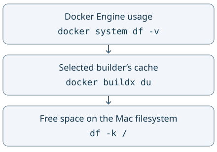

Docker measures reclaimable space inside its virtual machine, where it stores images and caches. macOS measures free space on the host filesystem, which includes the blocks allocated to the VM’s disk image, `Docker.raw`. A layer shared with an image can stay on disk after its build cache entry is removed. [Docker Desktop FAQ](https://docs.docker.com/desktop/troubleshoot-and-support/faqs/macfaqs/) · [Buildx du](https://docs.docker.com/reference/cli/docker/buildx/du/)

## Where is each number measured?

With Docker Desktop running on the Mac, check the local context and builder. An asterisk marks the selected builder in the list.

```sh
docker context show
docker buildx ls
docker system df -v
docker buildx du
df -k /
```



The first usage report covers images, containers, volumes and build cache. In the second, `Reclaimable` refers to the selected builder’s cache. In the last command, `Available` is the free space on the Mac’s root filesystem in KiB. [Docker system df](https://docs.docker.com/reference/cli/docker/system/df/)

## How much space does Docker.raw occupy?

Find the disk image location under Settings → Resources → Advanced in Docker Desktop and adjust the example path to point to the file. In `ls -klsh`, the first column shows allocated space in KiB and the size column shows logical size. The last command checks the filesystem containing the image, even if it is on another volume.

```sh
image="$HOME/Library/Containers/com.docker.docker/Data/vms/0/data/Docker.raw"
ls -klsh "$image"
stat -f 'bytes=%z blocks=%b' "$image"
df -k "$image"
```

In a read-only check on a local Mac, `desktop-linux` reported 61.76 MB of reclaimable build cache. The disk image had a logical size of 63,999,836,160 bytes and occupied 12,272,488 blocks of 512 bytes each, about 6.28 GB.

To clear only build cache, check the selected builder first. Compare the same readings just before cleanup and a few minutes later. This check did not delete cache or measure how much space the Mac recovered. [Buildx prune](https://docs.docker.com/reference/cli/docker/buildx/prune/)

[Related article · Measuring a Mac disk cleanup with du and df](../2026-11-27-mac-disk-cleanup-du-df/)
