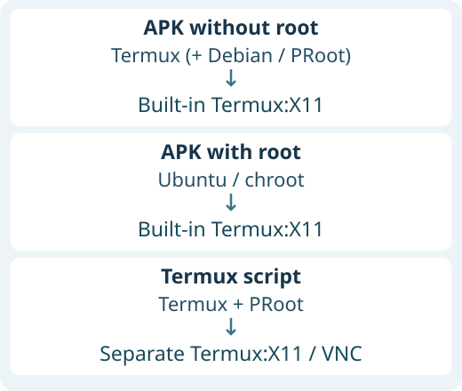

---
{
  "kind": "post",
  "publishedAt": "2026-11-27T06:08:31Z",
  "language": "en",
  "translationKey": "2026-11-27-droiddesk-android-linux-desktop",
  "routeSlug": "2026-11-27-droiddesk-android-linux-desktop",
  "title": "Inside DroidDesk · How does a Linux desktop run on an Android phone?",
  "description": "Compare the runtimes and displays used by the standalone APK and the Termux script, then pick a first test for your phone.",
  "categories": [
    "tips"
  ],
  "tags": [
    "android",
    "linux",
    "termux"
  ],
  "reviewScope": "This article draws on the release notes and source code for orailnoor/DroidDesk v1.3.1, reviewed on November 27, 2026. I did not install the APK on a physical device or measure individual apps’ performance.",
  "reviewSources": [
    "https://github.com/orailnoor/DroidDesk/releases/tag/v1.3.1",
    "https://github.com/orailnoor/DroidDesk/blob/v1.3.1/README.md",
    "https://github.com/orailnoor/DroidDesk/blob/v1.3.1/app/android/app/src/main/kotlin/com/orailnoor/droiddesk/runtime/LinuxRuntime.kt",
    "https://github.com/orailnoor/DroidDesk/blob/v1.3.1/app/android/app/src/main/kotlin/com/orailnoor/droiddesk/runtime/ChrootRuntime.kt",
    "https://github.com/orailnoor/DroidDesk/blob/v1.3.1/app/android/app/build.gradle.kts",
    "https://github.com/orailnoor/DroidDesk/blob/v1.3.1/README.md#for-monitor-output--optional-",
    "https://github.com/termux/proot-distro#limitations"
  ]
}
---

Could you plug a keyboard into a spare Android phone and get to work with a Linux editor and browser? DroidDesk is an open-source project that runs a Linux desktop on Android. Before you choose an installation method, it helps to know that the standalone APK and the Termux installation script take different paths.

This article draws on the release notes and source code for orailnoor/DroidDesk v1.3.1, reviewed on November 27, 2026. I did not install the APK on a physical device or measure individual apps’ performance. [Release notes](https://github.com/orailnoor/DroidDesk/releases/tag/v1.3.1)

## How do the APK and the Termux script differ?

| Installation | Runtime | Display |
| --- | --- | --- |
| Standalone APK without root | Default desktop in the app’s Termux environment, with optional Debian via PRoot | Built-in Termux:X11 |
| Standalone APK with root | ARM64 Ubuntu filesystem running in a chroot | Built-in Termux:X11 |
| Termux installation script | Separate Termux installation, with PRoot for distribution packages | Separate Termux:X11 app or optional VNC |

The README says the APK runs without PRoot on an unrooted phone. That describes the default desktop, which runs directly in Termux. LinuxRuntime in v1.3.1 also includes an optional Debian installation and a PRoot launcher. Even within the same app, a program’s environment can depend on whether you start it from the default desktop or inside Debian. [README](https://github.com/orailnoor/DroidDesk/blob/v1.3.1/README.md) · [LinuxRuntime](https://github.com/orailnoor/DroidDesk/blob/v1.3.1/app/android/app/src/main/kotlin/com/orailnoor/droiddesk/runtime/LinuxRuntime.kt) · [ChrootRuntime](https://github.com/orailnoor/DroidDesk/blob/v1.3.1/app/android/app/src/main/kotlin/com/orailnoor/droiddesk/runtime/ChrootRuntime.kt)

## What can you use on your phone?

Start with one program you need. The project lists Firefox, LibreOffice and VS Code among its examples. The v1.3.1 release notes also describe fixes for installation and launch failures affecting software such as a package Firefox needs and VS Code. Once the editor icon appears, check the extensions, input method and file paths you use every day. [Release notes](https://github.com/orailnoor/DroidDesk/releases/tag/v1.3.1)

Graphics can vary by device. The source includes a path that uses Turnip for Adreno with Zink, and a software rendering path that uses llvmpipe. For a demanding app such as Blender, check whether acceleration works on your phone and whether your actual project runs smoothly. If you plan to build software under PRoot, workloads that access files frequently can incur overhead. [PRoot limitations](https://github.com/termux/proot-distro#limitations)

For an external monitor, first check whether your phone supports video output over USB-C. In the project’s Raspberry Pi setup, the Pi receives the VNC session provided by the Termux script and displays it on the monitor. The standalone APK uses its own built-in X11 display. [Monitor setup](https://github.com/orailnoor/DroidDesk/blob/v1.3.1/README.md#for-monitor-output--optional-)

## What makes a good first test?

On an ARM64 Android device, look for the APK on the project’s official release page and try your first task on the phone screen. For example, write some Korean text in the editor, save the file, reopen the session and load the same file. If that works, try continuing your usual work with a keyboard and mouse or an external monitor. The appeal of DroidDesk is finding out which Linux tools you can use on a phone you already own. For documents, start with typing and saving. For development, check your packages and extensions. For graphics, try acceleration and see how the screen responds. [Android build configuration](https://github.com/orailnoor/DroidDesk/blob/v1.3.1/app/android/app/build.gradle.kts)

[Check Docker Desktop disk usage on a Mac](../2026-11-27-docker-desktop-mac-disk-space/)
