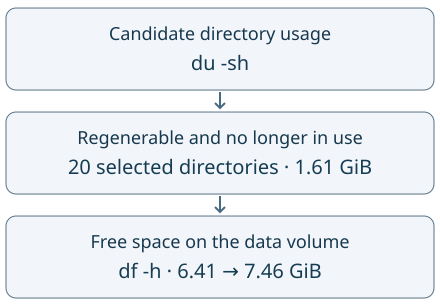

The full local build of the PostgreSQL job queue article stopped when the Mac ran out of disk space. The remote checks passed and the GitHub Pages deployment succeeded. Whether an earlier worker’s `hostFault` was part of the same incident remains unknown. [Publication PR #202](https://github.com/youdozi/youdozi.github.io/pull/202)

## Which directories were safe to remove?

During a separate manual cleanup, I selected 20 directories from completed jobs. These included regenerable `dist` and `.astro` output, plus dependency and build directories from one-off checks. I excluded paths still in use.

These read-only examples assume a Git repository on macOS with both build directories at its root. From that root, `du` reports usage for each named path. `git ls-files` lists tracked files under those paths, and `git check-ignore` shows which paths match an ignore rule.

```sh
du -sh ./dist ./.astro
git ls-files -- dist .astro
git check-ignore -- dist .astro
```

An ignored directory can still contain work in progress. For each candidate, I checked that I could recreate it and that no running job was using it before selecting it for removal.

## How much space became available?



The selected directories totaled 1.61 GiB. Free space on the same data volume went from 6.41 GiB before cleanup to 7.46 GiB afterward, a gain of about 1.05 GiB.

Compare the `Avail` column before and after cleanup using the command below. `df` reports free space on the filesystem containing the given path. APFS volumes in a single container can share its free space. I did not establish why the directory total differed from the observed gain in this case. [Apple’s guide to APFS space sharing](https://support.apple.com/ko-kr/guide/security/seca6147599e/web)

```sh
df -h /System/Volumes/Data
```
