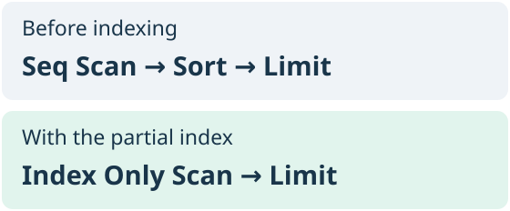

Of 300,000 jobs, 297,000 were complete and only 3,000 were pending. To find the oldest 20 pending jobs, PostgreSQL could skip the sort once a partial index held just those pending rows in creation-time and ID order.

## Run the same query twice

Run the SQL below in order in an empty database. `ANALYZE` refreshes the table statistics. The index added between the two queries includes only rows matching `status = 'pending'`. [Partial indexes](https://www.postgresql.org/docs/19/indexes-partial.html)

```sql
CREATE TABLE jobs (id bigserial PRIMARY KEY, status text NOT NULL, created_at timestamptz NOT NULL);
INSERT INTO jobs (status, created_at)
SELECT CASE WHEN n % 100 = 0 THEN 'pending' ELSE 'done' END,
       timestamptz '2026-01-01 00:00:00+00' + n * interval '1 second'
FROM generate_series(1, 300000) AS g(n);
ANALYZE jobs;

EXPLAIN (ANALYZE, BUFFERS) SELECT id FROM jobs WHERE status = 'pending' ORDER BY created_at, id LIMIT 20;

CREATE INDEX jobs_pending_created_idx ON jobs (created_at, id) WHERE status = 'pending';

EXPLAIN (ANALYZE, BUFFERS) SELECT id FROM jobs WHERE status = 'pending' ORDER BY created_at, id LIMIT 20;
```

## What changed in the plan?



The first plan scans the table, discards completed jobs and sorts the remaining candidates. The index supplies pending jobs in `(created_at, id)` order, so the second plan can stop as soon as it satisfies `LIMIT 20`.

| Execution plan | Before indexing | With the partial index |
| --- | --- | --- |
| Shared buffers at the top node | `shared hit=1911` | `shared hit=1 read=2` |
| Scan node detail | `Rows Removed by Filter=297000` | `Heap Fetches=0` |
| Rows returned | 20 | 20 |

Each query ran once in an isolated, in-memory PGlite instance using `@electric-sql/pglite 0.6.0`. `SHOW server_version` returned `19.0`. Here `read` counts blocks read into PostgreSQL’s shared buffers. This in-memory measurement does not establish physical disk I/O. [EXPLAIN](https://www.postgresql.org/docs/19/sql-explain.html) · [PGlite](https://pglite.dev/docs/about)

The experiment measured a read query. Claiming jobs with `FOR UPDATE SKIP LOCKED`, updating their status and running workers concurrently need separate measurements. [Claim jobs with SKIP LOCKED in two sessions](/en/posts/2026-11-26-postgres-skip-locked-queue/)
