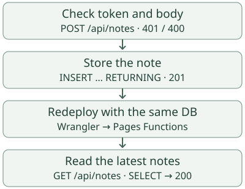

---
{
  "kind": "post",
  "publishedAt": "2026-11-28T14:00:00Z",
  "routeSlug": "2026-11-28-cloudflare-workers-neon-notes",
  "reviewedAt": "2026-11-28",
  "reviewStatus": "source-audited",
  "reviewSources": [
    "https://developers.cloudflare.com/pages/functions/get-started/",
    "https://developers.cloudflare.com/pages/functions/routing/",
    "https://neon.com/docs/serverless/serverless-driver",
    "https://developers.cloudflare.com/pages/get-started/direct-upload/",
    "https://developers.cloudflare.com/pages/functions/bindings/#secrets"
  ],
  "reviewScope": "Checked routing, deployment environments and parameter binding against provider documentation. Expected hosted responses are unmeasured.",
  "language": "en",
  "translationKey": "2026-11-28-cloudflare-workers-neon-notes",
  "title": "Deploying a notes app with Cloudflare Workers and Neon",
  "description": "Serve a page and its API from the same Cloudflare Pages origin, then check that the redeployed API can read a note from Neon.",
  "categories": [
    "tips"
  ],
  "tags": [
    "cloudflare",
    "neon",
    "postgresql"
  ]
}
---

Cloudflare Pages serves the static interface. A Pages Function running on Workers handles `/api/notes`. Because the page and API share an origin, the browser can read the list without extra CORS configuration. Neon PostgreSQL stores the notes. [Pages Functions](https://developers.cloudflare.com/pages/functions/get-started/)

Anyone can read the list. Writing requires a token, so use this example only for practice notes. The responses below are what to expect after deployment.

## Create the notes table and API

In the SQL Editor for a practice Neon database, create the notes table.

```sql
CREATE TABLE notes (
  id integer GENERATED ALWAYS AS IDENTITY PRIMARY KEY,
  body text NOT NULL CHECK (char_length(body) BETWEEN 1 AND 200)
);
```

With Node.js and npm installed, run these commands from the project root.

```bash
npm init -y
npm install @neondatabase/serverless
npm install --save-dev wrangler
mkdir -p functions/api public
```

Save the handler in `functions/api/notes.js` at the project root. The Neon driver's tagged template passes the note body as a SQL parameter. [Pages Functions](https://developers.cloudflare.com/pages/functions/routing/) · [Neon](https://neon.com/docs/serverless/serverless-driver)

```js
import { neon } from "@neondatabase/serverless";

export async function onRequest({ request, env }) {
  const reply = (data, status = 200) =>
    Response.json(data, {
      status,
      headers: { "Cache-Control": "no-store" },
    });

  if (request.method === "POST") {
    if (
      !env.DEMO_WRITE_TOKEN ||
      request.headers.get("Authorization") !== `Bearer ${env.DEMO_WRITE_TOKEN}`
    ) {
      return reply({ error: "Unauthorized" }, 401);
    }

    const input = await request.json().catch(() => null);
    const body = typeof input?.body === "string" ? input.body.trim() : "";

    if (!body || Array.from(body).length > 200) {
      return reply({ error: "Enter a note of 1 to 200 characters" }, 400);
    }

    const sql = neon(env.DATABASE_URL);
    const [note] = await sql`
      INSERT INTO notes (body) VALUES (${body}) RETURNING id, body
    `;
    return reply(note, 201);
  }

  if (request.method === "GET") {
    const sql = neon(env.DATABASE_URL);
    const notes = await sql`
      SELECT id, body FROM notes ORDER BY id DESC LIMIT 20
    `;
    return reply(notes);
  }

  return new Response(null, {
    status: 405,
    headers: { Allow: "GET, POST" },
  });
}
```

In `public/index.html`, fetch the list and display each note's body using `textContent`.

```html
<!doctype html>
<html lang="en">
<meta charset="utf-8">
<title>Notes</title>
<h1>Notes</h1>
<pre id="notes">Loading…</pre>
<script type="module">
  const output = document.querySelector("#notes");
  try {
    const response = await fetch("/api/notes");
    if (!response.ok) throw new Error();
    const notes = await response.json();
    output.textContent = notes.map((note) => note.body).join("\n") || "No notes";
  } catch {
    output.textContent = "Could not load notes.";
  }
</script>
</html>
```

## Read the same note after a redeploy



Log in to Wrangler and create a Pages Direct Upload project. Replace the example project name with your own. This example sets the production branch to `main`.

```bash
PROJECT_NAME="my-neon-notes"
npx wrangler login
npx wrangler pages project create "$PROJECT_NAME" --production-branch main
```

In the Pages project's Production environment, save the Neon connection string as the `DATABASE_URL` secret and a long, randomly generated token as `DEMO_WRITE_TOKEN`. Deploy from the project root so Wrangler builds the Functions alongside the static site. Deployments to other branches use Preview secrets. [Direct Upload](https://developers.cloudflare.com/pages/get-started/direct-upload/) · [Pages Secrets](https://developers.cloudflare.com/pages/functions/bindings/#secrets)

```bash
npx wrangler pages deploy public --project-name "$PROJECT_NAME" --branch main
```

In your shell, set `BASE_URL` to the project's production URL and `DEMO_WRITE_TOKEN` to the same write token. Send the following requests.

```bash
curl -i "$BASE_URL/api/notes" \
  -H "Authorization: Bearer $DEMO_WRITE_TOKEN" \
  -H "Content-Type: application/json" \
  --data '{"body":"Keep this note after redeployment"}'

curl -i "$BASE_URL/api/notes"
```

Look for 201 and the note ID in the write response. Redeploy to the same project and production branch with the same database, then repeat the read request. A 200 response containing the same ID and body shows the new API can read the saved note. Check that the browser displays it and that writing without a token returns 401.

[Compare free deployment options](../2026-11-28-free-deployment-guide/) · [Self-host a notes app](../2026-11-28-self-hosting-ai-notes/)
