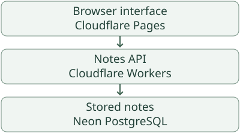

---
{
  "kind": "post",
  "publishedAt": "2026-11-28T07:52:00Z",
  "routeSlug": "2026-11-28-free-deployment-guide",
  "reviewedAt": "2026-11-28",
  "reviewStatus": "source-audited",
  "reviewSources": [
    "https://docs.github.com/en/pages/getting-started-with-github-pages/github-pages-limits",
    "https://developers.cloudflare.com/pages/platform/limits/",
    "https://developers.cloudflare.com/pages/functions/pricing/",
    "https://vercel.com/docs/plans/hobby",
    "https://vercel.com/docs/limits/fair-use-guidelines",
    "https://vercel.com/pricing",
    "https://developers.cloudflare.com/workers/platform/limits/",
    "https://render.com/docs/free",
    "https://render.com/docs/free#local-files-lost-on-redeploy",
    "https://neon.com/pricing",
    "https://supabase.com/pricing",
    "https://supabase.com/docs/guides/platform/free-project-pausing",
    "https://render.com/docs/free#free-postgres",
    "https://supabase.com/docs/guides/getting-started/api-keys",
    "https://supabase.com/docs/guides/database/postgres/row-level-security"
  ],
  "reviewScope": "Checked limits and inactivity rules against official documentation and pricing. No sign-ups, example deployments or response-time measurements.",
  "language": "en",
  "translationKey": "2026-11-28-free-deployment-guide",
  "title": "Free hosting for static sites, backend APIs and PostgreSQL",
  "description": "Compare build limits, idle services and database retention when choosing free hosting for a blog, notes app or demo.",
  "categories": [
    "tips"
  ],
  "tags": [
    "deployment",
    "hosting",
    "postgresql"
  ]
}
---

You can publish a blog or portfolio on **GitHub Pages or Cloudflare Pages**. To let visitors save notes, you could run the API on **Cloudflare Workers or Render** and store the data in PostgreSQL on **Neon or Supabase**. For an assignment or demo with a fixed end date, Render Postgres is also an option for 30 days.

Free plans handle limits and inactivity differently. A static host may block new builds. An idle API may take longer to answer the first request. Some databases wake on the next query, while others need someone to resume the project in a dashboard.

**Based on official documentation and pricing as of November 28, 2026. The configurations are examples. We did not sign up for services, deploy them or measure response times.**

## Static sites need a home for the build output

If your pages are generated at build time, as with an Astro blog or an HTML portfolio, static hosting is enough. Look at file size, build frequency and what you plan to use the site for.

| Service | Project fit | Free plan conditions |
| --- | --- | --- |
| GitHub Pages | Blogs, project docs and portfolios in public repositories | Published sites can be up to 1 GB, with a soft bandwidth limit of 100 GB per month. Usage restrictions apply to sites primarily intended to run an e-commerce business or deliver commercial SaaS. [GitHub Pages limits](https://docs.github.com/en/pages/getting-started-with-github-pages/github-pages-limits) |
| Cloudflare Pages | Astro or Vite sites and projects that need branch previews | 500 builds per month, 1 build at a time and up to 25 MiB per file. Static asset requests are unlimited when they do not invoke Functions. [Pages limits](https://developers.cloudflare.com/pages/platform/limits/) · [Static assets and Functions pricing](https://developers.cloudflare.com/pages/functions/pricing/) |
| Vercel Hobby | Personal, non-commercial Next.js projects | Deploy static pages and Functions in one project. Check both the terms of Hobby use and your Functions usage. [Hobby plan](https://vercel.com/docs/plans/hobby) · [Fair use guidelines](https://vercel.com/docs/limits/fair-use-guidelines) · [Vercel pricing](https://vercel.com/pricing) |

For a blog like this one, where posts are built before publication, GitHub Pages is an easy starting point. An earlier article explains how we separated building the site from publishing it. [From automatic Jekyll publishing to Astro draft PR reviews](../2026-04-07-jekyll-github-actions-content-pipeline/)

## Choose how the backend API runs

| Service | API fit | Free plan conditions |
| --- | --- | --- |
| Cloudflare Workers | Lightweight HTTP APIs that validate input, query a database and return JSON | 100,000 requests per day and 10 ms of CPU time per request. CPU time counts code execution and excludes time waiting for network responses. Pages Functions share the Workers free request allowance. [Workers limits](https://developers.cloudflare.com/workers/platform/limits/) · [Pages Functions pricing](https://developers.cloudflare.com/pages/functions/pricing/) |
| Render Free Web Service | Demos that run an HTTP server process such as FastAPI or Express | After 15 minutes without inbound traffic, the service spins down. The next request starts it again, which Render says takes about a minute. Each workspace gets 750 free instance hours per month. Local file changes are lost on restart, redeploy or spin-down. [Free deployment on Render](https://render.com/docs/free) |

Consider deploying the Python notes app from the earlier article on Render. Even if `GET /health` succeeds, notes written to a local SQLite file can disappear when the server spins down and restarts. Store them in an external PostgreSQL database and check that you can read the same note after a restart. [Self-hosting the notes app](../2026-11-28-self-hosting-ai-notes/) · [Render filesystem policy](https://render.com/docs/free#local-files-lost-on-redeploy)

## Compare PostgreSQL storage and inactivity rules

| Service | Free allowance | What happens after inactivity |
| --- | --- | --- |
| Neon Free | Per project: 1 GB of PostgreSQL storage and 100 CU-hours of compute per month | After 5 idle minutes, compute stops and wakes automatically on the next query. If the monthly compute allowance runs out, compute is suspended until the next billing period or an upgrade. [Neon pricing](https://neon.com/pricing) |
| Supabase Free | 500 MB of database storage per project, with managed PostgreSQL, Auth and the Data API | After 7 days of low database activity, the project may pause. Resume it from the dashboard. [Supabase pricing](https://supabase.com/pricing) · [Project pausing](https://supabase.com/docs/guides/platform/free-project-pausing) |
| Render Free Postgres | 1 free database per workspace, with 1 GB of storage | The database expires 30 days after creation regardless of activity. Render deletes the data unless you upgrade within 14 days after expiry. [Free Render Postgres](https://render.com/docs/free#free-postgres) |

If you plan to run a separate API server and write SQL directly, start by looking at Neon. If you also need login and a data access API, consider Supabase. Use a publishable key when calling the Supabase Data API from a browser. Use row-level security (RLS) policies to control which rows each user can read and write. Keep the database connection string and administrative secret keys on the server. [Supabase API keys](https://supabase.com/docs/guides/getting-started/api-keys) · [Row-level security](https://supabase.com/docs/guides/database/postgres/row-level-security)

## Match the services to the project

- **Technical blog or documentation site.** Deploy just the build output to GitHub Pages or Cloudflare Pages.
- **Lightweight notes app.** Host the interface on Cloudflare Pages, the API on Workers and the data on Neon. After a long idle period, show a loading state until the first query finishes.
- **Demo of an existing Python API.** Run the server on Render and store the data on Neon. Before the demo, time the first request after an idle period and check that data survives a redeploy.
- **Personal project with login.** Host the interface on Cloudflare Pages and connect it to Supabase Auth and the Data API. Sign in with two accounts and check that neither can read or edit the other's notes.

Once the home page loads, **save a new record, redeploy the API and read that same record again**. If you need the data beyond the demo, check the free plan’s expiry date and how to export it.
