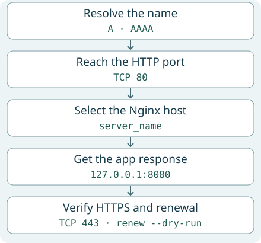

---
{
  "kind": "post",
  "publishedAt": "2026-11-28T04:31:00Z",
  "routeSlug": "2026-11-28-nginx-dns-https",
  "reviewedAt": "2026-11-28",
  "reviewStatus": "source-audited",
  "reviewSources": [
    "https://www.duckdns.org/spec.jsp",
    "https://letsencrypt.org/docs/ipv6-support/",
    "https://nginx.org/en/docs/beginners_guide.html#proxy",
    "https://nginx.org/en/docs/switches.html",
    "https://letsencrypt.org/docs/challenge-types/",
    "https://eff-certbot.readthedocs.io/en/stable/using.html"
  ],
  "reviewScope": "We checked this procedure against official documentation. We did not change live DNS, firewall or server settings, run Certbot, issue a certificate or test a live deployment.",
  "language": "en",
  "translationKey": "2026-11-28-nginx-dns-https",
  "title": "From Duck DNS to HTTPS with Nginx: what to ask AI and how to check the answers",
  "description": "Follow an external request from DNS to your app, distinguish a timeout from a proxy error, then check the certificate and renewal.",
  "categories": [
    "tips"
  ],
  "tags": [
    "self-hosting",
    "nginx",
    "dns",
    "https"
  ]
}
---

Assume a Linux server with public IPv4, one Duck DNS name and a public-facing app already listening on `127.0.0.1:8080` on the same machine as Nginx. The earlier notes app was a local exercise. Use a separate app intended for publication here.

## Ask for a plan you can check

> Connect my Duck DNS name to Nginx on Linux with public IPv4. My app runs on the same host at `127.0.0.1:8080`. Use `example.com` as a placeholder. Give me the commands and expected results for the DNS A record, inbound access, reverse proxy and HTTPS, in order. If DNS looks right, explain how to distinguish a timeout from a `502`. Show the smallest configuration change and how to undo it. Ask about unknown values. Do not execute anything.

Keep tokens and SSH keys out of the prompt. Review the answer one connection at a time.



## Check DNS and the local app

Substitute your own name for `example.com` throughout. Update Duck DNS so A points to your public IPv4. Publish AAAA only if inbound IPv6 works end to end. This Nginx example listens on IPv4. Use dig to check DNS, then run curl on the server and look for the app’s usual response. [Duck DNS](https://www.duckdns.org/spec.jsp) · [Let’s Encrypt · IPv6](https://letsencrypt.org/docs/ipv6-support/)

```sh
dig +short example.com A
dig +short example.com AAAA
curl --fail --show-error http://127.0.0.1:8080/
```

## Route the HTTP request to the app

Back up the active configuration. Add this server block in the http context for your site, using your actual hostname. Test with `nginx -t` and reload using your OS service manager only after the test passes. [NGINX · proxy_pass](https://nginx.org/en/docs/beginners_guide.html#proxy) · [nginx -t](https://nginx.org/en/docs/switches.html)

```nginx
server {
    listen 80;
    server_name example.com;

    location / {
        proxy_pass http://127.0.0.1:8080;
        proxy_set_header Host $host;
        proxy_set_header X-Forwarded-Proto $scheme;
    }
}
```

From another network, request the site over HTTP. Expect the same app content. If DNS is correct but the request times out, check the line, router forwarding and firewall first. If Nginx returns `502`, check the local app and upstream port first. To roll back, restore the saved configuration, test it and reload.

```sh
curl --fail --show-error http://example.com/
```

## Verify HTTPS and rehearse renewal

With the Certbot Nginx plugin installed and TCP `80` reachable from outside, HTTP-01 can validate the name. Save the working HTTP configuration first because the plugin can install the certificate and edit Nginx. Run Certbot on the server, check HTTPS from another network, then test renewal on the server. [Let’s Encrypt · HTTP-01 / DNS-01](https://letsencrypt.org/docs/challenge-types/) · [Certbot](https://eff-certbot.readthedocs.io/en/stable/using.html)

```sh
sudo certbot --nginx -d example.com
```

```sh
curl --fail --show-error https://example.com/
```

```sh
sudo certbot renew --dry-run
```

Record the external HTTPS response, the certificate hostname and the dry-run result. If TCP `80` is blocked, DNS-01 can validate ownership via a DNS zone you control. Visitors still need a working HTTPS path, normally on TCP `443`.

We checked this procedure against official documentation. We did not change live DNS, firewall or server settings, run Certbot, issue a certificate or test a live deployment.

[Local notes app](https://youdozi.github.io/en/posts/2026-11-28-self-hosting-ai-notes/) · [Four free subdomain services for a home Nginx server](https://youdozi.github.io/en/posts/2026-11-28-nginx-free-subdomains/)
