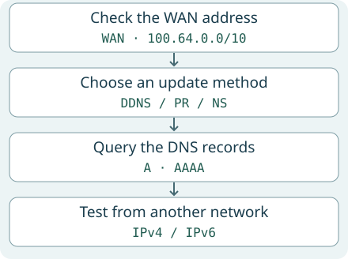

---
{
  "kind": "post",
  "publishedAt": "2026-11-28T04:30:00Z",
  "routeSlug": "2026-11-28-nginx-free-subdomains",
  "reviewedAt": "2026-11-28",
  "reviewStatus": "source-audited",
  "reviewSources": [
    "https://www.duckdns.org/spec.jsp",
    "https://dynv6.com/",
    "https://dynv6.com/docs/apis",
    "https://github.com/is-a-dev/register#-register",
    "https://nic.eu.org/register.html",
    "https://nic.eu.org/top-policy.html",
    "https://www.rfc-editor.org/info/rfc6598/"
  ],
  "reviewScope": "This comparison is based on the providers’ documentation. We did not register an account or request a name.",
  "language": "en",
  "translationKey": "2026-11-28-nginx-free-subdomains",
  "title": "Four free subdomain services for a home Nginx server",
  "description": "A changing home IP, a developer portfolio and a domain with its own nameservers call for different kinds of addresses.",
  "categories": [
    "tips"
  ],
  "tags": [
    "self-hosting",
    "nginx",
    "dns"
  ]
}
---

Once Nginx is running at home, what name should visitors type? Each service below offers a free subdomain under a name its operator controls. You still run the server and arrange inbound access.

## Can someone outside your network reach the server?

DDNS updates the IP address returned by DNS. Whether traffic reaches Nginx depends on the connection, router and firewall. With carrier-grade NAT (CGNAT), forwarding a port on the home router alone may be insufficient. If its WAN address falls within `100.64.0.0/10`, ask your ISP whether it offers a public IPv4 address. [RFC 6598](https://www.rfc-editor.org/info/rfc6598/)

## Choose by how you will maintain the name

| Service | How the name is managed | When it fits |
| --- | --- | --- |
| [Duck DNS](https://www.duckdns.org/spec.jsp) | The update client keeps `name.duckdns.org` current. The API can detect IPv4 automatically. Supply IPv6 explicitly when updating it. | A first exercise with a changing public IPv4 address. |
| [dynv6](https://dynv6.com/) · [API](https://dynv6.com/docs/apis) | A hostname with APIs for updating A and AAAA records and the IPv6 prefix. | IPv6 or dual stack. The service offers no enterprise SLA. |
| [is-a.dev](https://github.com/is-a-dev/register#-register) | Submit a GitHub pull request for review. The maintainers ask applicants to write their own submission. | A developer portfolio. DDNS is easier if the IP changes often. |
| [EU.org](https://nic.eu.org/register.html) · [EU.org NS](https://nic.eu.org/top-policy.html) | Prepare authoritative nameservers before applying. After approval, NS delegation lets you manage A and AAAA in your zone. | Choose this if you want to manage DNS records yourself. Arrange dynamic updates separately. |

## Check the name you chose



For a first exercise, confirm you have public IPv4, then point a Duck DNS name at it. With dig installed, replace the sample name below and query both address families. Expect A to match the public address. If you publish AAAA, test the IPv6 path from another network too.

```sh
dig +short name.duckdns.org A
dig +short name.duckdns.org AAAA
```

This comparison is based on the providers’ documentation. We did not register an account or request a name.

[Local notes app](https://youdozi.github.io/en/posts/2026-11-28-self-hosting-ai-notes/) · [From Duck DNS to HTTPS with Nginx: what to ask AI and how to check the answers](https://youdozi.github.io/en/posts/2026-11-28-nginx-dns-https/)
