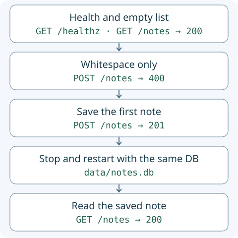

---
{
  "kind": "post",
  "publishedAt": "2026-11-28T02:37:00Z",
  "routeSlug": "2026-11-28-self-hosting-ai-notes",
  "reviewedAt": "2026-11-28",
  "reviewStatus": "source-audited",
  "reviewSources": [
    "https://docs.python.org/3/library/http.server.html",
    "https://docs.python.org/3/library/sqlite3.html"
  ],
  "reviewScope": "Checked loopback HTTP responses and read the saved note from the same SQLite file after restarting the process on Python 3.13.0.",
  "language": "en",
  "translationKey": "2026-11-28-self-hosting-ai-notes",
  "title": "Self-hosting an AI-built app: start with a notes API",
  "description": "Ask AI for a notes API, stop the process, and check that the first note survives in the same SQLite file.",
  "categories": [
    "tips"
  ],
  "tags": [
    "self-hosting",
    "python",
    "sqlite"
  ]
}
---

Your AI-built notes app just saved its first note. Close the app and start it again. Is the note still there? Getting an app to respond is one early test of self-hosting. Reading your data after a restart is another. Here we ask AI for a small notes app and instructions, then try them on our own computer. The example uses only Python and SQLite.

## Give the AI operating constraints alongside features

“Build me a notes app” leaves the model to choose how to store notes and who can connect. Specify where the data should live, who should have access, and what you need to see before you consider the app ready.

**Prompt** Build a personal notes API with the Python standard library and SQLite. Bind only to `127.0.0.1` and save notes in `data/notes.db`. Have `GET /healthz` return the status and `GET /notes` list the notes. Have `POST /notes` accept `{"text":"첫 메모"}` and reject whitespace-only input with `400`. Provide `app.py`, start and stop commands, and curl examples. Check health → save a note → stop the process → restart with the same DB → read the note. State the listening address and the file the app creates.

## Check the address and storage path before starting

Check that the server binds to `127.0.0.1` and SQLite opens `data/notes.db` on disk. A relative path can point to a different database if you launch from another directory. The example resolves the path from the app file. Python’s `http.server` is for this local learning exercise. [http.server](https://docs.python.org/3/library/http.server.html) · [sqlite3](https://docs.python.org/3/library/sqlite3.html)

Save the following code as `app.py` in an empty practice directory.

```python
import json
import sqlite3
from http.server import BaseHTTPRequestHandler, HTTPServer
from pathlib import Path

db_path = Path(__file__).resolve().parent / "data" / "notes.db"


class Notes(BaseHTTPRequestHandler):
    def reply(self, status, value):
        body = json.dumps(value, ensure_ascii=False).encode("utf-8")
        self.send_response(status)
        self.send_header("Content-Type", "application/json; charset=utf-8")
        self.send_header("Content-Length", str(len(body)))
        self.end_headers()
        self.wfile.write(body)

    def do_GET(self):
        if self.path == "/healthz":
            self.reply(200, {"status": "ok"})
        elif self.path == "/notes":
            rows = db.execute("SELECT text FROM notes ORDER BY id")
            self.reply(200, [{"text": text} for (text,) in rows])
        else:
            self.reply(404, {"error": "unknown path"})

    def do_POST(self):
        if self.path != "/notes":
            self.reply(404, {"error": "unknown path"})
            return
        try:
            size = int(self.headers.get("Content-Length", "0"))
            if not 0 < size <= 8192:
                raise ValueError
            data = json.loads(self.rfile.read(size))
            if not isinstance(data, dict):
                raise ValueError
            text = data.get("text")
            if not isinstance(text, str) or not text.strip():
                raise ValueError
        except ValueError:
            self.reply(400, {"error": "invalid note"})
            return
        with db:
            db.execute("INSERT INTO notes (text) VALUES (?)", (text,))
        self.reply(201, {"text": text})


if __name__ == "__main__":
    db_path.parent.mkdir(exist_ok=True)
    db = sqlite3.connect(db_path)
    try:
        db.execute("CREATE TABLE IF NOT EXISTS notes (id INTEGER PRIMARY KEY, text TEXT NOT NULL)")
        with HTTPServer(("127.0.0.1", 0), Notes) as server:
            print(f"http://127.0.0.1:{server.server_port}", db_path, sep="\n", flush=True)
            server.serve_forever()
    except KeyboardInterrupt:
        pass
    finally:
        db.close()
```

## Test the AI’s instructions with real requests



To check that the note reached disk, stop the process that wrote it and read it from a new one.

Run `python3 app.py` from the app directory. The first line shows the address with a temporary port, and the second shows the database path. Run these commands in another terminal. When `read` waits for input, paste the address from the first line.

```sh
read -r base
```

```sh
curl -i "$base/healthz"
curl -i "$base/notes"
curl -i -H 'Content-Type: application/json' -d '{"text":"   "}' "$base/notes"
curl -i -H 'Content-Type: application/json' -d '{"text":"첫 메모"}' "$base/notes"
```

Press `Ctrl+C` in the app terminal and wait for the shell prompt to return. Run `python3 app.py` again. Check that the database path matches and enter the new address in the second terminal.

```sh
read -r base
```

```sh
curl -i "$base/notes"
```

In a temporary local environment running Python `3.13.0`, we tested on loopback with a temporary port. The health check and initial empty list returned `200`, whitespace-only input returned `400`, and saving the first note returned `201`. After confirming the process had stopped and restarting with the same DB, the list returned `200` and the saved note. If the list looks empty, compare the actual database paths from both runs. Give the AI the launch commands, database paths, and HTTP responses.

## Prepare a backup and restore procedure for an app you plan to keep

“If this computer fails, can I open my notes somewhere else?” Ask the AI to identify the data path and explain how to restore a backup into a new directory and read the notes there. When moving to a server, check how the app starts after reboot and who has access. This exercise covered local requests, storage, and reading after restart. External access and restoring a backup were outside the test. [Use a MacBook as a personal server on a private network](https://youdozi.github.io/ko/posts/2026-11-23-macbook-personal-server/)
