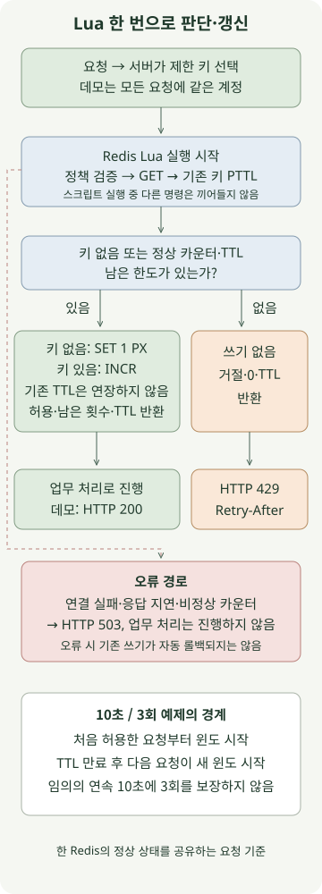

**여러 애플리케이션 서버에서 같은 사용자의 요청 횟수를 제한하려면, Redis에서 한도 판단과 카운터 갱신을 한 번에 처리해야 합니다.** 이 글은 Lua 스크립트로 고정 윈도 제한을 구현하고, 한도 초과는 `429`, Redis가 판단할 수 없는 상황은 `503`으로 구분합니다.

예제 정책은 **계정 하나에 첫 허용 요청부터 10초 동안 최대 3회**입니다. 고정 윈도를 가장 단순한 출발점으로 사용하며, 토큰 버킷이나 슬라이딩 윈도와 같은 정책으로 취급하지 않습니다. 환경은 Spring Boot 3.5.16·JDK 21·Gradle 8.14.3·Redis 8.2.1입니다. 재현 버전을 고정한 것이며 운영용 최신 패치 버전 추천은 아닙니다.

## 왜 애플리케이션에서 GET 다음 INCR를 하면 안 될까?

서버 A와 B가 모두 카운터 `2`를 읽으면, 한도가 `3`이어도 두 요청을 함께 허용할 수 있습니다. JVM의 `synchronized`는 다른 프로세스까지 잠그지 못합니다. `INCR` 자체는 원자적이지만, 그 앞의 허용 판단까지 자동으로 묶어 주지는 않습니다.

`INCR` 후 별도 명령으로 `EXPIRE`를 보내는 방식에는 다른 문제가 있습니다. 두 명령 사이에서 클라이언트가 중단되면 TTL 없는 키가 남을 수 있습니다. Redis의 [INCR 공식 요청 제한 예제](https://redis.io/docs/latest/commands/incr/)도 이 경쟁 조건과 Lua 사용을 설명합니다.

아래 스크립트는 첫 요청에 `SET ... PX`로 값과 TTL을 함께 만들고, 이후에는 Lua 안에서 한도를 확인한 뒤 허용 요청만 증가시킵니다. 거절 요청은 카운터도, 만료 시각도 바꾸지 않습니다.

## 요청 제한은 어떤 순서로 처리할까?



그림의 파란 영역은 Redis 내부 판단이고, HTTP 응답은 애플리케이션이 만듭니다. 키가 없으면 새 윈도를 시작하고, 기존 키에는 양의 정수 카운터와 유효한 TTL이 있어야 합니다. 이 예제의 제한은 입장 횟수를 셉니다. 허용된 뒤 업무가 실패해도 횟수를 환불하지 않습니다.

## Spring MVC와 Redis Lua로 구현하기

다음 여섯 파일을 같은 Gradle 프로젝트에 저장합니다. 인증 구현은 포함하지 않습니다. `/demo`는 모든 요청을 `demo-account` 한 계정으로 처리하므로, 아래 키는 사용자별 정책을 재현하는 데 사용한 고정 예시입니다. 서버는 로컬 주소에만 바인딩합니다.

실제 서비스에서는 인증이 끝난 `Principal` 등 **서버가 검증한 주체**로 키를 만들어야 합니다. 요청의 임의 `userId` 헤더를 그대로 사용하면 값을 바꿔 제한을 피할 수 있습니다. 예를 들어 `rl:orders:v1:<tenant-and-subject-digest>`처럼 작업 범위·정책 버전·주체를 구분하고, 개인정보 원문 대신 서버 비밀키 기반 HMAC 같은 식별자를 고려합니다. 프록시의 전달 IP 헤더도 신뢰할 프록시 경계 안에서만 해석해야 합니다.

### `settings.gradle`

```groovy
rootProject.name = 'redis-lua-rate-limit'
```

### `build.gradle`

```groovy
plugins {
    id 'java'
    id 'application'
}
repositories { mavenCentral() }
java { toolchain { languageVersion = JavaLanguageVersion.of(21) } }
dependencies {
    implementation platform('org.springframework.boot:spring-boot-dependencies:3.5.16')
    implementation 'org.springframework.boot:spring-boot-starter-web'
    implementation 'org.springframework.boot:spring-boot-starter-data-redis'
    testImplementation 'org.springframework.boot:spring-boot-starter-test'
    testRuntimeOnly 'org.junit.platform:junit-platform-launcher'
}
application { mainClass = 'example.RateLimitApplication' }
test {
    useJUnitPlatform()
    systemProperty 'demo.redis.port', providers.gradleProperty('redisPort').getOrElse('6379')
}
```

### `src/main/resources/application.yml`

```yaml
server:
  address: 127.0.0.1
spring:
  data:
    redis:
      host: 127.0.0.1
      port: ${REDIS_PORT:6379}
      connect-timeout: 200ms
      timeout: 200ms
```

### `src/main/resources/rate-limit.lua`

```lua
local limit = tonumber(ARGV[1])
local window = tonumber(ARGV[2])
if not limit or limit < 1 or limit > 1000000 or limit ~= math.floor(limit)
   or not window or window < 1 or window > 3600000 or window ~= math.floor(window) then
    return redis.error_reply('invalid rate limit policy')
end

local raw = redis.call('GET', KEYS[1])
if raw then
    local count = tonumber(raw)
    local ttl = redis.call('PTTL', KEYS[1])
    if not count or count < 1 or count ~= math.floor(count) or ttl < 0 then
        return redis.error_reply('invalid counter state')
    end
    if count >= limit then
        return {0, 0, ttl}
    end
    local updated = redis.call('INCR', KEYS[1])
    return {1, limit - updated, ttl}
end

redis.call('SET', KEYS[1], 1, 'PX', window)
return {1, limit - 1, window}
```

### `src/main/java/example/RedisRateLimiter.java`

```java
package example;

import java.time.Duration;
import java.util.List;
import org.springframework.core.io.ClassPathResource;
import org.springframework.data.redis.core.StringRedisTemplate;
import org.springframework.data.redis.core.script.DefaultRedisScript;
import org.springframework.stereotype.Component;

@Component
public class RedisRateLimiter {
    private static final DefaultRedisScript<List> SCRIPT = new DefaultRedisScript<>();
    static {
        SCRIPT.setLocation(new ClassPathResource("rate-limit.lua"));
        SCRIPT.setResultType(List.class);
    }
    private final StringRedisTemplate redis;

    public RedisRateLimiter(StringRedisTemplate redis) {
        this.redis = redis;
    }

    public Decision check(String key, int limit, Duration window) {
        long milliseconds = window.toMillis();
        if (key == null || key.isBlank() || key.length() > 160 || limit < 1 || limit > 1_000_000
                || milliseconds < 1 || milliseconds > 3_600_000) {
            throw new IllegalArgumentException("Invalid rate limit policy");
        }
        List<?> result = redis.execute(SCRIPT, List.of(key),
                Integer.toString(limit), Long.toString(milliseconds));
        if (result == null || result.size() != 3) {
            throw new IllegalStateException("Invalid limiter result");
        }
        return new Decision(((Number) result.get(0)).longValue() == 1,
                ((Number) result.get(1)).longValue(), ((Number) result.get(2)).longValue());
    }

    public record Decision(boolean allowed, long remaining, long ttlMillis) {
        public long retryAfterSeconds() {
            return Math.max(1, (ttlMillis + 999) / 1000);
        }
    }
}
```

### `src/main/java/example/RateLimitApplication.java`

```java
package example;

import java.time.Duration;
import org.springframework.boot.SpringApplication;
import org.springframework.boot.autoconfigure.SpringBootApplication;
import org.springframework.dao.DataAccessException;
import org.springframework.http.ResponseEntity;
import org.springframework.web.bind.annotation.GetMapping;
import org.springframework.web.bind.annotation.RestController;

@SpringBootApplication
@RestController
public class RateLimitApplication {
    private final RedisRateLimiter limiter;

    public RateLimitApplication(RedisRateLimiter limiter) {
        this.limiter = limiter;
    }

    public static void main(String[] args) {
        SpringApplication.run(RateLimitApplication.class, args);
    }

    @GetMapping("/demo")
    public ResponseEntity<String> demo() {
        try {
            var decision = limiter.check("rl:demo:v1:demo-account", 3, Duration.ofSeconds(10));
            if (!decision.allowed()) {
                return ResponseEntity.status(429)
                        .header("Retry-After", Long.toString(decision.retryAfterSeconds()))
                        .body("rate limit exceeded\n");
            }
            return ResponseEntity.ok("ok\n");
        } catch (DataAccessException | IllegalStateException unavailable) {
            return ResponseEntity.status(503).body("limiter unavailable\n");
        }
    }
}
```

이 스크립트는 키 하나만 사용합니다. Redis Cluster에서는 그 키가 있는 슬롯에서 실행됩니다. 여러 키에 대한 제한을 하나의 스크립트로 확장한다면 같은 슬롯 제약부터 다시 설계해야 합니다.

`StringRedisTemplate`은 문자열 키·인자를 사용하고, 스크립트의 숫자 배열은 `List` 결과로 받습니다. `DefaultRedisScript`를 재사용하는 이유와 기본 실행기의 `EVALSHA` → 캐시 미존재 시 `EVAL` 동작은 [Spring Data Redis 스크립팅 문서](https://docs.spring.io/spring-data/redis/reference/redis/scripting.html)에서 확인할 수 있습니다.

## 실행하면 어떤 응답이 나올까?

Docker가 실행 중이고 Redis 포트 `16379`, 애플리케이션 포트 `8080`을 다른 프로세스가 사용하지 않는 환경에서 실행합니다. Redis는 호스트의 로컬 주소에만 노출하고, 데이터 저장과 영속 볼륨은 사용하지 않습니다. 처음 실행할 때 Redis 이미지와 Maven 의존성을 내려받으므로 네트워크가 필요합니다.

```sh
docker run --rm -d --name redis-rate-limit-demo \
  -p 127.0.0.1:16379:6379 \
  redis:8.2.1-alpine@sha256:987c376c727652f99625c7d205a1cba3cb2c53b92b0b62aade2bd48ee1593232 \
  redis-server --save '' --appendonly no
REDIS_PORT=16379 gradle run
```

다른 터미널에서, 서버가 준비된 뒤 10초 안에 네 번 호출합니다.

```sh
for attempt in 1 2 3 4; do
  curl -s -o /dev/null -w '%{http_code}\n' http://127.0.0.1:8080/demo
done
curl -i http://127.0.0.1:8080/demo
```

새 윈도에서 앞의 네 요청을 연속으로 보내면 예상 상태는 다음과 같습니다.

```text
200
200
200
429
```

거절 응답의 `Retry-After`는 남은 TTL을 초로 올림한 정수이며 최소 1초입니다. 값은 호출 시점에 따라 달라집니다. `429`와 선택적인 `Retry-After`의 의미는 [RFC 6585의 4절](https://www.rfc-editor.org/rfc/rfc6585#section-4)을 따릅니다. 이 값은 다른 요청까지 고려한 예약권이 아니므로, 기다렸다 다시 요청해도 그 사이 다른 요청이 한도를 쓰면 다시 거절될 수 있습니다.

`gradle run`을 종료하고 테스트용 컨테이너도 정리합니다.

```sh
docker stop redis-rate-limit-demo
```

## 동시 요청과 오류는 어디까지 확인했나?

로컬 Docker의 실제 Redis와 임베디드 Tomcat을 사용한 별도 재현 테스트에서 다음을 확인했습니다. 처리량 벤치마크가 아니라 동작 검증입니다.

| 조건 | 확인한 결과 |
| --- | --- |
| 같은 키로 40개 호출을 스레드 풀에서 동시 실행 | 허용 3개, Redis 카운터 3 |
| 제한기 객체 두 개가 같은 Redis·키 사용 | 한도를 공유함. 두 객체는 같은 클라이언트 빈을 공유하며, 별도 JVM 두 개를 띄운 시험은 아님 |
| 허용 3회 뒤 초과 요청 | 거절, 카운터 증가·TTL 연장 없음 |
| 다른 계정 키와 만료된 키 | 다른 키는 독립 허용, 만료 후 새 윈도 시작 |
| 비정상 값 또는 TTL 없는 키 | 임의 복구 없이 오류로 처리 |
| 실제 HTTP 연속 호출 | 200 세 번 이후 429, `Retry-After` 존재 |
| 비정상 카운터가 있는 HTTP 요청 | 503 |
| 연결은 받지만 Redis 응답이 없는 별도 TCP 엔드포인트 | 제한기 오류를 503으로 변환 |

검증한 카운터에는 TTL이 붙어 있어야 합니다. [PTTL 문서](https://redis.io/docs/latest/commands/pttl/)에서 `-1`은 TTL 없음, `-2`는 키 없음을 뜻합니다. 기존 상태가 잘못됐을 때 TTL을 새로 붙여 조용히 허용하면 정책 오류를 숨길 수 있어, 이 구현은 오류를 반환하도록 했습니다.

**Lua의 원자적 실행은 오류 시 자동 롤백을 뜻하지 않습니다.** [공식 스크립팅 문서](https://redis.io/docs/latest/develop/programmability/eval-intro/)가 설명하는 실행 격리와 오류 처리를 구분해야 합니다. 재현 테스트에서는 `SET` 뒤 의도적인 오류를 반환한 별도 스크립트의 값이 남는 것도 확인했습니다. 본문 스크립트는 입력·기존 상태 검증을 쓰기 전에 수행하고, 쓰기는 마지막 `SET` 또는 `INCR`로 제한합니다.

## 운영에서 어떤 한계와 장애 정책을 선택해야 할까?

**고정 윈도는 임의의 연속 10초마다 3회를 보장하지 않습니다.** 이전 윈도가 끝나기 직전에 남은 한도를 쓰고, 새 윈도 직후 다시 요청하면 짧은 구간에 요청이 몰릴 수 있습니다. 일정 기간의 정확한 이동 합계가 필요하면 슬라이딩 로그·윈도를, 평균 유입률과 허용할 버스트를 따로 정하려면 토큰 버킷을 검토합니다. 이 글에서는 그 알고리즘을 구현하거나 비교 측정하지 않았습니다.

이 예제는 Redis 오류 때 요청을 통과시키지 않는 **fail-closed** 정책을 선택했습니다. 결제처럼 제한 우회 비용이 큰 작업에서 고려할 수 있지만, Redis 문제가 API 가용성까지 떨어뜨립니다. 조회 API처럼 가용성이 더 중요한 경우에는 제한된 로컬 버킷으로 잠시 허용하는 정책도 가능합니다. 다만 서버 수만큼 허용량이 늘 수 있으므로 이를 전역 한도와 같은 보장으로 표현해서는 안 됩니다.

설정의 200ms는 연결·명령 타임아웃 설정값이며, HTTP 요청 전체가 반드시 200ms 안에 끝난다는 보장은 아닙니다. 대기열·재연결·스케줄링 시간도 따로 봐야 합니다. 코드에 애플리케이션 재시도를 추가하지 않았으며, 클라이언트의 재연결·명령 재전송 정책도 함께 확인해야 합니다. Redis가 이미 허용 횟수를 기록한 뒤 응답이 유실되면 호출자는 실패로 판단해도 횟수는 소비될 수 있습니다. 재시도에 같은 요청을 한 번만 세어야 한다면 요청 식별자와 별도 멱등성 정책이 필요합니다.

Redis 키가 메모리 압박으로 축출되거나 재시작·장애 조치 중 카운터가 유실되면, 새 윈도로 판단해 추가로 허용할 수 있습니다. 원자적 Lua만으로 복제·복구까지 포함한 전역 한도가 생기지는 않습니다. 전용 인스턴스와 메모리 한도·축출 정책, 정책 변경 시 키 버전, 거절 수·Redis 오류 수·제한 판단 지연을 함께 관리해야 합니다. 키별 식별자를 메트릭 레이블에 그대로 넣으면 관측 데이터의 카디널리티도 커집니다.

이 재현은 단일 Redis 정상 동작과 일부 오류 처리를 대상으로 했습니다. Redis Cluster 장애 조치, 다중 리전, 실제 Redis 프로세스 중단 후 복구, 운영 부하 성능은 시험하지 않았습니다. 요청 시작 횟수 제한만으로 DB 동시 점유나 긴 요청 수가 제한되는 것도 아니므로, 필요한 작업에는 동시성 제한을 별도로 둡니다.
