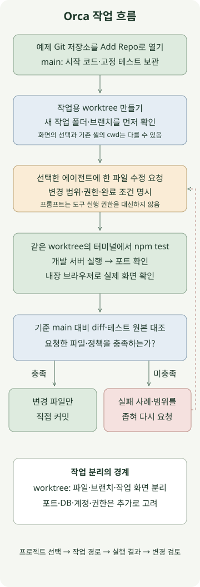

**Orca는 Git 작업 공간, 코딩 에이전트, 터미널, 브라우저와 변경 검토를 함께 다루는 개발 환경입니다.** 작업 하나를 worktree 하나로 나누면 서로 다른 변경을 별도 브랜치·폴더에서 진행할 수 있습니다. 다만 완료 여부는 에이전트의 답변보다 실제 작업 경로, 테스트 출력과 기준 브랜치 대비 diff로 확인해야 합니다.

대상은 Stably AI의 [Orca 공식 앱](https://www.onorca.dev/)입니다. 이 글은 macOS에 설치된 **Orca 1.4.256**, 동봉 CLI 가이드, Node.js 24.13.0·Python 3·Git을 기준으로 작성했습니다. 현재 작업 공간 조회, Orca 터미널에서 예제 테스트 실행, 포트 탐지와 내장 브라우저 표시를 확인했습니다. 새 AI 에이전트 작업이나 worktree 생성·병합은 실행하지 않았으며, 아래 프롬프트와 생성 명령은 독자가 따라 할 실습 절차입니다.

## 프로젝트와 worktree는 어떻게 다를까?

[공식 첫 세션 안내](https://www.onorca.dev/docs/first-session)의 **Add Repo**로 로컬 Git 저장소를 엽니다. Orca가 프로젝트를 관리하더라도 소스와 커밋은 Git 저장소에 남습니다. 모델·제공자의 사용 조건과 인증도 따로 준비합니다.

| 요소 | 이 실습에서 맡는 역할 |
| --- | --- |
| 프로젝트 | 예제 Git 저장소와 작업 공간을 묶는 단위 |
| Worktree | 특정 브랜치를 체크아웃한 작업 폴더와 그 작업 화면 |
| 에이전트 | 요청 범위에 맞춰 파일을 읽고 수정·명령 실행을 제안 |
| 터미널 | 해당 작업 폴더에서 테스트·개발 서버 실행 |
| 내장 브라우저 | 실제 개발 서버 화면과 경계값 확인 |

[Orca worktree 문서](https://www.onorca.dev/docs/model/worktrees)와 [CLI 안내](https://www.onorca.dev/docs/cli/overview)를 함께 보면 파일·브랜치와 작업 화면의 관계를 이해하기 쉽습니다. 화면에서 다른 worktree를 선택해도 이미 열린 셸의 현재 디렉터리가 자동으로 바뀐다고 가정하면 안 됩니다. **명령을 실행할 터미널에서 경로와 브랜치를 확인하는 것**이 첫 단계입니다.

## 작은 예제를 만들고 시작 상태를 확인하기



설명용 배송비 정책을 사용합니다. **주문 금액이 50,000원 이상이면 무료, 미만이면 3,000원**이며, 음이 아닌 안전한 정수만 받습니다. 특정 서비스의 실제 정책은 아닙니다. 다음 네 파일을 새 `orca-shipping-example` 폴더에 저장하세요. 외부 npm 패키지는 필요하지 않습니다.

### `package.json`

```json
{
  "name": "orca-shipping-example",
  "private": true,
  "type": "module",
  "engines": { "node": ">=24" },
  "scripts": { "test": "node --test shipping.test.mjs" }
}
```

### `shipping.mjs`

```javascript
export function shippingFee(orderTotal) {
  return orderTotal > 50_000 ? 0 : 3000;
}
```

### `shipping.test.mjs`

```javascript
import test from 'node:test';
import assert from 'node:assert/strict';
import { shippingFee } from './shipping.mjs';

for (const [total, expected] of [[0, 3000], [49_999, 3000], [50_000, 0], [50_001, 0]]) {
  test(`shippingFee(${total}) = ${expected}`, () => {
    assert.equal(shippingFee(total), expected);
  });
}
for (const [label, total] of [
  ['negative', -1],
  ['fraction', 50_000.5],
  ['string', '50000'],
  ['NaN', Number.NaN],
  ['Infinity', Number.POSITIVE_INFINITY],
  ['unsafe integer', Number.MAX_SAFE_INTEGER + 1],
]) {
  test(`rejects ${label}`, () => {
    assert.throws(() => shippingFee(total), RangeError);
  });
}
```

### `index.html`

```html
<!doctype html>
<html lang="ko">
<meta charset="utf-8">
<meta name="viewport" content="width=device-width, initial-scale=1">
<title>Orca 배송비 예제</title>
<h1>배송비 경계값 확인</h1>
<pre id="result"></pre>
<script type="module">
  import { shippingFee } from './shipping.mjs';
  const totals = [49_999, 50_000, 50_001];
  document.querySelector('#result').textContent = totals
    .map(total => `${total}원 → 배송비 ${shippingFee(total)}원`)
    .join('\n');
</script>
</html>
```

예제 폴더에서 Git 작성자 설정이 준비된 상태로 실행합니다.

```sh
git init -b main
git add package.json shipping.mjs shipping.test.mjs index.html
git commit -m "Add shipping exercise"
npm test
```

시작 코드는 경계값 `50,000`을 잘못 처리하고 잘못된 입력도 거르지 않습니다. 실제로 **10개 중 3개 통과·7개 실패**를 확인했습니다. 이 상태를 기준 커밋으로 기록해 두면 나중에 테스트나 설정이 바뀌었는지도 비교할 수 있습니다.

## 작업용 worktree에서 에이전트에 요청하기

이 예제 저장소를 Orca의 **Add Repo**로 연 뒤, 그 저장소에 연결된 터미널에서 CLI를 확인합니다. CLI가 없다면 [공식 CLI 문서](https://www.onorca.dev/docs/cli/overview)의 Settings → General → Orca CLI 안내로 등록합니다. 아래 명령은 macOS의 `orca` 실행 파일 기준입니다.

```sh
orca skills get orca-cli
orca worktree current --json
```

작업을 나눌 때는 현재 프로젝트의 `main`에서 새 worktree를 만듭니다.

```sh
orca worktree create --name shipping-fee-fix \
  --parent-worktree active --base-branch main \
  --setup skip --activate --json
```

`--parent-worktree active`는 Orca의 작업 관계를 기록하고, `--base-branch main`은 Git 시작점을 정합니다. 둘은 서로 다른 설정입니다. 이 예제는 설치할 외부 의존성이 없어 setup을 생략했습니다. 실제 프로젝트에서는 필요한 setup 정책을 따르세요. 이 명령에는 `--agent`가 없으므로 에이전트 작업 요청을 포함하지 않습니다.

새 작업 공간의 터미널을 열고 확인합니다. 원래 명령을 실행한 셸과 새 worktree의 셸을 구분하세요.

```sh
git rev-parse --show-toplevel
git branch --show-current
orca worktree current --json
```

브랜치 이름은 Orca의 접두어 설정 등에 따라 달라질 수 있습니다. JSON에 표시된 worktree와 Git 경로·브랜치가 의도한 작업 공간인지 확인한 뒤, 준비된 에이전트 탭을 열어 다음 프롬프트를 보냅니다. 사용 가능한 에이전트와 채팅/CLI 실행 방식은 해당 환경의 설정을 따릅니다.

```text
현재 작업 디렉터리와 브랜치를 먼저 확인하고 shipping.mjs와 shipping.test.mjs를 읽어 주세요.
설명용 배송비 정책을 다음 계약대로 고쳐 주세요.

- 주문 금액이 50,000원 이상이면 배송비 0원, 미만이면 3,000원입니다.
- 주문 금액은 음이 아닌 안전한 정수만 허용하고, 그 외 입력은 RangeError입니다.
- shipping.mjs만 수정하고 테스트·package.json·index.html은 바꾸지 마세요.
- 의존성 설치, 외부 네트워크 호출, 커밋·푸시·PR 생성은 하지 마세요.

npm test를 실행한 실제 결과와 변경 이유를 알려 주세요.
실행하지 못한 검사는 실행하지 못했다고 명시해 주세요.
```

Orca가 작업을 묶어 보여 주더라도 실제 도구 권한은 에이전트와 실행 환경에 달려 있습니다. 프롬프트의 제한만으로 접근 범위가 강제되지는 않습니다. 이 글에서는 특정 에이전트의 권한 버튼 이름이나 모든 제공자의 동일한 동작을 가정하지 않습니다.

## 같은 작업 공간에서 테스트와 브라우저 확인하기

[내장 터미널](https://www.onorca.dev/docs/terminal)에서 `npm test`를 실행합니다. 자동화가 필요하면 현재 worktree에 테스트용 터미널을 만들 수도 있습니다.

```sh
orca terminal create --title "tests" --command "npm test" --json
```

자동화에서는 반환된 터미널 handle을 이후 명령의 대상으로 고정합니다. `terminal read --screen`은 현재 화면을 읽고, 일반 `terminal read`는 누적 출력을 읽습니다. 입력이 받아들여졌다는 사실과 명령·에이전트 작업이 실제로 시작됐다는 사실도 구분해야 합니다. 이 글에서는 직접 만든 테스트용 터미널의 출력에서 **10개 모두 통과**와 변경 파일 `shipping.mjs` 하나를 확인했습니다. 참고 정답을 직접 넣어 확인한 결과이며 AI 작업 실행 기록은 아닙니다.

브라우저 확인은 같은 worktree의 터미널에서 서버를 실행한 뒤 진행합니다. 4877 포트가 비어 있는 환경입니다.

```sh
python3 -m http.server 4877 --bind 127.0.0.1
```

다른 터미널에서 포트를 확인합니다.

```sh
orca ports --json
orca tab create --url http://127.0.0.1:4877/ --json
```

실제 서버가 다른 포트를 사용한다면 조회 결과의 포트와 접속 주소를 사용합니다. `orca ports`에 보이는 항목이 모두 HTTP 웹 페이지인 것은 아닙니다. [내장 브라우저 안내](https://www.onorca.dev/docs/browser/overview)에 따라 연결한 뒤, 예제 화면에서 다음 값을 확인합니다.

```text
49999원 → 배송비 3000원
50000원 → 배송비 0원
50001원 → 배송비 0원
```

참고 정답을 적용한 예제에서 위 세 줄을 실제 Orca 브라우저로 확인했습니다. 서버는 확인을 마친 뒤 실행한 터미널에서 `Ctrl+C`로 종료합니다. 작업이 끝났다는 이유로 관계없는 터미널까지 일괄 종료하지 말고, 해당 작업의 프로세스와 탭을 구분해 정리하세요.

## diff를 확인하고 변경 파일만 기록하기

[Orca diff 보기](https://www.onorca.dev/docs/review/diff-viewer)에서 기준 ref와 파일 변경을 확인합니다. [변경 줄 주석](https://www.onorca.dev/docs/review/annotate-ai-diff)을 사용하면 위치를 짚어 에이전트에 피드백할 수 있습니다. 예를 들어 “50,000원도 무료여야 한다. 테스트의 기대값은 유지하고 비교 연산을 확인해 달라”처럼 좁혀 전달합니다.

터미널에서도 기준 `main`과 비교합니다.

```sh
git status --short
git diff main --name-only
git diff main -- shipping.mjs
git diff --exit-code main -- shipping.test.mjs package.json index.html
npm test
```

이번 작업의 변경 파일은 `shipping.mjs` 하나여야 합니다. 테스트·설정·화면 파일이 달라졌다면 이유를 먼저 확인합니다. 새 파일은 일반 diff에 빠질 수 있으므로 Git 상태도 함께 봅니다. 에이전트가 실행하지 못한 검사는 직접 실행하고, “완료”라는 답변을 통과 결과로 대신하지 않습니다.

다음은 직접 검증한 참고 정답입니다. 실습 뒤 에이전트가 제안한 코드와 비교하세요. 실행할 때는 프로젝트 루트의 `shipping.mjs`에 들어갈 코드입니다.

### `reference/shipping.mjs`

```javascript
export function shippingFee(orderTotal) {
  if (!Number.isSafeInteger(orderTotal) || orderTotal < 0) {
    throw new RangeError('orderTotal must be a nonnegative safe integer');
  }
  return orderTotal >= 50_000 ? 0 : 3000;
}
```

참고 정답으로 같은 테스트 10개가 모두 통과했고, 테스트·설정·HTML 원본은 유지됐습니다. 조건을 확인한 뒤 해당 작업 브랜치에 필요한 파일만 커밋합니다.

```sh
git add shipping.mjs
git commit -m "Fix free-shipping boundary and input validation"
```

커밋과 기준 브랜치로 합치는 단계는 별개입니다. 다른 작업이 `main`을 바꿨다면 합치기 전에 diff와 테스트를 다시 확인합니다. worktree는 소스 작업 공간을 나누지만 보안 샌드박스는 아닙니다. 같은 데이터베이스·포트·계정·시크릿을 사용하면 별도 worktree라도 실행 자원이 겹칠 수 있습니다.

처음에는 여러 에이전트를 동시에 늘리기보다 이 흐름을 한 작업으로 익히는 편이 문제 위치를 찾기 쉽습니다. 병렬 작업은 파일·기능 경계와 완료 조건이 나뉠 때 확장하세요.
