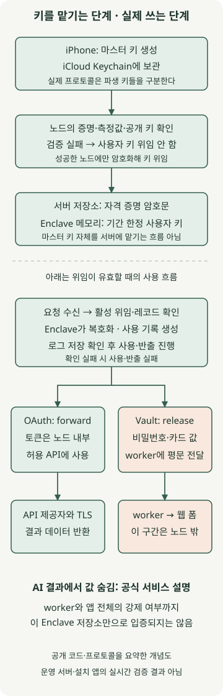
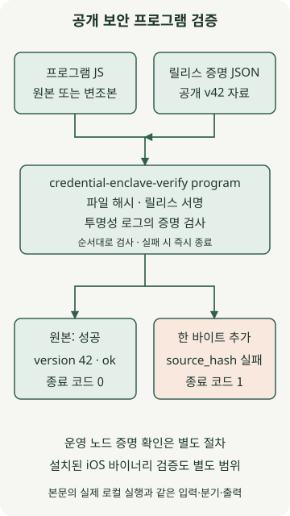

**Pickle AI의 공식 설명은 iPhone 속 다른 앱의 화면을 직접 조작하는 방식보다, 별도 브라우저와 연결 계정으로 작업을 대신하는 구조를 가리킵니다.** 비밀번호는 모델과 분리해 암호화하지만, 실제 로그인에 쓰이는 값이 어디까지 보호되는지는 OAuth와 웹사이트 비밀번호를 나눠 봐야 합니다.

대상은 Pickle, Inc.의 개인 AI 에이전트 [Pickle](https://pickle.com/)입니다. 2026년 11월 13일 조회한 공식 도움말과 공개 `credential-enclave` 소스의 **`cff16a343bf5bb7953e5b65df6ab3600107e127d` 커밋**을 분석했습니다. 공개 보안 프로그램의 릴리스 검증은 직접 실행했으며, 설치된 iOS 앱이나 운영 서버 전체를 감사한 결과는 아닙니다.

## 실제로 iPhone의 다른 앱을 누르는 걸까?

[로그인 저장 도움말](https://www.pickle.com/help/connect/save-login)은 Pickle의 브라우저가 휴대전화와 분리돼 있어 휴대전화에 저장된 로그인을 그대로 사용할 수 없다고 설명합니다. [작업 위임 안내](https://www.pickle.com/help/tasks/delegate)도 웹사이트에서 실제 브라우저로 작업하며 앱을 닫아도 작업이 계속된다고 안내합니다.

따라서 주문·예약이 수행됐다는 사실만으로 설치된 쇼핑 앱의 화면을 눌렀다고 판단하면 안 됩니다. 공개 자료에서 확인되는 실행 경로는 다음과 같습니다.

| 경로 | 확인한 근거와 의미 |
| --- | --- |
| 별도 브라우저 | 웹사이트에 로그인하고 폼을 채우는 작업. 휴대전화의 앱 화면과는 별개 |
| 연결 계정 API | 공개 `forward` 코드가 허용된 제공자 API에 인증 정보를 붙여 요청 |
| 전화 | 웹으로 처리할 수 없는 일을 대신 전화하는 기능을 공식 작업 안내가 설명 |

Apple도 [타사 앱 샌드박스](https://support.apple.com/en-gb/guide/security/sec15bfe098e/web)를 설명하며, 다른 정보에 접근할 때는 iOS가 제공한 서비스를 사용하도록 제한합니다. 이것만으로 모든 자동화 가능성을 부정할 수는 없지만, Pickle이 샌드박스를 우회해 다른 앱을 제어한다는 근거는 확인하지 못했습니다.

현재 자료로는 Pickle의 브라우저가 어떤 DOM 도구·화면 인식 모델을 사용하는지, 모든 작업이 어느 실행 경로를 선택하는지까지 확정할 수 없습니다. 이 글에서 말하는 작동 원리는 공식 안내와 공개 자격 증명 경로를 연결한 분석입니다.

## 비밀번호를 AI에 주지 않고 어떻게 로그인할까?

모델이 비밀번호 문자열을 직접 출력하지 않아도, 별도의 실행기가 필요한 값만 받아 로그인 폼에 넣을 수 있습니다. Pickle의 [개인정보 보호 설명](https://www.pickle.com/privacy)은 비밀번호·카드 값을 기기에서 암호화하고 모델이 받는 결과에서 숨긴다고 안내합니다. 이 설명의 기술적 경계를 공개 코드와 대조해야 합니다.



그림 위쪽은 미리 키를 위임하는 설정 단계, 아래쪽은 위임이 유효한 동안 자격 증명을 사용하는 단계입니다. 로그인할 때마다 휴대전화에서 키를 새로 보내야 한다는 뜻은 아닙니다. 작업 실행기 전체의 상세 구현을 재현한 그림도 아닙니다.

### 기기 키와 암호화 레코드

[공개 프로토콜](https://github.com/pickle-com/credential-enclave/blob/cff16a343bf5bb7953e5b65df6ab3600107e127d/docs/protocol.md#3-keys)은 기기에서 만든 마스터 키를 iCloud Keychain에 보관하고, 서명·로그 복호화·자격 증명용 키를 나누어 파생하도록 정의합니다. 저장 레코드는 ChaCha20-Poly1305로 암호화하며 계정·레코드 종류 같은 문맥도 인증에 묶습니다.

기기는 노드의 증명과 공개 키를 검증한 뒤 **파생한 사용자 키**를 해당 노드에 암호화해 위임합니다. 원격 증명(attestation)은 “이 공개 키가 어떤 측정값의 실행 환경에 속하는가”를 확인하는 절차입니다. [AWS Nitro Enclaves](https://docs.aws.amazon.com/enclaves/latest/user/)는 부모 서버와 메모리를 격리하고 직접적인 외부 네트워크·영구 저장소를 제공하지 않습니다. Pickle 노드는 호스트가 중계하는 통신을 사용하며, 이 사실이 호스트에 복호화 권한을 준다는 뜻은 아닙니다.

위임된 사용자 키는 노드 메모리에서 기간 한정으로 사용합니다. [공개 구조 설명](https://github.com/pickle-com/credential-enclave/blob/cff16a343bf5bb7953e5b65df6ab3600107e127d/README.md#structure)은 위임 한도를 최대 30일로 명시합니다. 기기의 Keychain과 서버의 Nitro Enclave는 서로 다른 보호 계층입니다.

### OAuth 토큰은 노드 안에서 사용

[API 전달 코드](https://github.com/pickle-com/credential-enclave/blob/cff16a343bf5bb7953e5b65df6ab3600107e127d/enclave/src/api/forward.rs)는 활성 위임을 확인하고 OAuth 레코드를 열어 허용된 제공자 요청을 준비합니다. 사용 기록이 저장된 것을 확인한 뒤 요청을 실행합니다. 토큰을 모델에 건네는 대신 인증된 요청을 수행하는 경로입니다.

그러나 **토큰을 숨기는 것과 토큰으로 읽은 데이터를 숨기는 것은 다릅니다.** [반출 정책](https://github.com/pickle-com/credential-enclave/blob/cff16a343bf5bb7953e5b65df6ab3600107e127d/docs/egress-policy.md)은 제공자 응답을 운영 영역으로 반환하는 경로를 별도로 다룹니다. 메일을 읽을 권한을 주면 모델이 그 메일 내용을 처리할 수 있다는 점은 토큰 보호와 별개로 판단해야 합니다.

### 웹사이트 비밀번호는 release 뒤에 경계가 바뀜

[Vault 코드](https://github.com/pickle-com/credential-enclave/blob/cff16a343bf5bb7953e5b65df6ab3600107e127d/enclave/src/vault.rs)는 비밀번호·카드 값과 TOTP 코드를 선택해 반출 응답으로 만드는 타입을 정의합니다. [실제 release 처리](https://github.com/pickle-com/credential-enclave/blob/cff16a343bf5bb7953e5b65df6ab3600107e127d/enclave/src/api/release.rs)는 사용 기록의 저장 확인 후 값을 직렬화해 응답합니다. **이때 비밀번호·카드 값은 운영 측 worker가 사용할 수 있는 평문으로 노드 밖에 나옵니다.** TOTP는 시드 대신 계산된 일회용 코드가 반출됩니다.

공개 코드의 `origin` 검사는 HTTPS origin의 형식만 확인합니다. 그 주소가 저장된 로그인 사이트와 같은지 판단하는 책임은 호출 측에 있다고 주석으로 명시돼 있습니다. 따라서 사이트 제한과 모델 결과 마스킹을 Enclave 코드만으로 입증할 수는 없습니다.

이는 실제 유출이 있었다는 증거가 아닙니다. 다만 **모델 입력에서 숨김**, **암호화 저장**, **worker 메모리에서의 평문 사용**은 서로 다른 보안 성질입니다. “AI가 비밀번호를 받지 않는다”는 안내를 “복호화된 비밀번호가 보호 구역 밖으로 전혀 나오지 않는다”로 확대하면 안 됩니다.

## 사용 기록은 무엇을 보장할까?

[공식 사용 기록 안내](https://pickle.com/help/privacy/activity)는 기록을 먼저 저장하고, 저장에 실패하면 자격 증명을 사용하지 않는다고 설명합니다. 공개 API 코드도 로그 저장 확인 뒤에 사용·반출하는 순서를 보여줍니다. 암호화된 기록과 서명·연결 관계를 통해 변경이나 누락을 확인하려는 구조입니다.

기록이 있다는 사실은 그 작업을 사용자가 의도했다거나 외부 사이트에서 성공했다는 보증은 아닙니다. 예를 들어 기록 저장 후 실제 요청이 실패할 수도 있습니다. 결제 전 승인과 금액 재확인은 [공식 서비스 설명](https://pickle.com/en)의 실행 정책이며, 자격 증명 암호화만으로 자동으로 성립하는 성질은 아닙니다.

TOTP 시드까지 맡기면 에이전트가 코드도 생성할 수 있습니다. [로그인 저장 안내](https://www.pickle.com/help/connect/save-login)에 있는 편의 기능이지만, 그 작업마다 사용자가 별도로 2차 인증을 승인하는 구조와는 다릅니다. 비밀번호만 맡기는 경우보다 위임 범위를 넓게 판단해야 합니다.

## 공개 보안 프로그램의 증명을 직접 확인하기

[secure-program 문서](https://github.com/pickle-com/credential-enclave/blob/cff16a343bf5bb7953e5b65df6ab3600107e127d/secure-program/README.md)는 기기 측 보안 프로그램도 공개하고, 릴리스 서명과 투명성 로그의 증명을 확인하는 도구를 제공합니다. 다음 예제는 **공개 파일과 릴리스 증명의 일치 여부**를 검사합니다. 운영 노드에 접속하거나 실제 비밀번호를 넣는 코드는 아닙니다.



Git·curl·Rustup과 네이티브 빌드 도구가 필요하며, 소스와 Rust 의존성을 내려받는 과정에서 외부 통신이 발생합니다. **macOS arm64, Rust 1.100.0**에서 아래 고정 커밋으로 검증 도구를 빌드했습니다. 저장소가 고정한 도구 버전은 1.98.1이며, 여기서는 `+1.100.0`으로 실행 버전을 명시했습니다.

### `verify-example.sh`

```bash
# macOS·Linux 셸, Git·curl·Rustup 및 네이티브 빌드 도구가 필요합니다.
# 새 작업 폴더에서 실행합니다. 아래 검증은 계정 로그인이나 실제 비밀번호를 사용하지 않습니다.
git clone https://github.com/pickle-com/credential-enclave.git
cd credential-enclave
git checkout cff16a343bf5bb7953e5b65df6ab3600107e127d
rustup toolchain install 1.100.0 --profile minimal
cargo +1.100.0 build --locked -p credential-enclave-verify
curl --fail --location \
  https://github.com/pickle-com/credential-enclave/releases/download/secure-program-v42/secure-program.release.json \
  --output secure-program.release.json
./target/debug/credential-enclave-verify program \
  --source secure-program/secure-program.js \
  --release secure-program.release.json
```

원본 파일은 종료 코드 0과 다음 출력을 반환했습니다.

```text
program release secure-program-v42: version 42, sha256 31e7fa7fb51f87781313b1f97b60ae3c7b69ff8f2fbcee7de12b7a0ed034d8e8, log index 3761959022: ok
```

파일이 달라졌을 때 거부하는지도 확인합니다. 아래 명령은 같은 저장소 폴더에서 실행합니다.

### `tamper-example.sh`

```bash
cp secure-program/secure-program.js changed-program.js
printf '\n' >> changed-program.js
./target/debug/credential-enclave-verify program \
  --source changed-program.js \
  --release secure-program.release.json
echo $?
```

줄바꿈 한 바이트를 추가한 파일은 `source_hash` 불일치로 거부됐고 종료 코드는 1이었습니다. 이 검사는 공개 프로그램의 릴리스 증명에 관한 결과입니다. 실제 앱에 표시되는 버전·해시가 같은지 확인하는 단계, 운영 Enclave의 측정값을 원격 증명으로 확인하는 단계는 수행하지 않았습니다.

## 안전성을 판단할 때 남는 조건

[공개 저장소의 한계 설명](https://github.com/pickle-com/credential-enclave/blob/cff16a343bf5bb7953e5b65df6ab3600107e127d/README.md#what-it-does-not-guarantee)은 앱의 정직성, 제공자 API 계약, 릴리스 키와 로그 같은 신뢰 가정을 밝힙니다. 공개된 보안 프로그램이 있어도 iOS 앱 바이너리 전체가 그 프로그램을 바꾸지 않고 실행하는지는 별도 확인 대상입니다. 노드가 이후 릴리스로 위임을 넘길 수 있다는 점도 특정 버전의 보호가 영원히 고정된다는 뜻과 다릅니다.

기기 측 보안 프로그램의 [업데이트 한계](https://github.com/pickle-com/credential-enclave/blob/cff16a343bf5bb7953e5b65df6ab3600107e127d/secure-program/README.md#limits)도 중요합니다. 운영자가 새 코드를 서명하고 공개 로그에 등록해 로드 요건을 충족하면, 사전 대기시간 없이 로드될 수 있다고 문서가 명시합니다. **릴리스 검증은 공개·서명된 파일과의 일치를 확인하며 코드의 무해함을 보장하지 않습니다.** 후속 코드에도 운영자 신뢰가 남습니다. 이는 실제 악성 릴리스가 있었다는 주장이나 관측은 아닙니다.

| 확인할 대상 | 판단에 필요한 질문 |
| --- | --- |
| 연결 계정 | 어떤 읽기·쓰기 범위를 허용했고, 제공자 쪽에서 철회할 수 있는가? |
| Vault와 TOTP | 비밀번호뿐 아니라 일회용 코드 생성까지 맡길 필요가 있는가? |
| 결제·예약 | 실행 전 조건과 금액을 확인하고, 결과를 확인할 수 있는가? |
| 보안 프로그램·노드 | 앱의 버전·해시, 공개 릴리스, 실제 노드 증명이 대응하는가? |
| 대화와 연결 계정 데이터 | 자격 증명을 숨겨도 모델이 처리하는 내용은 무엇인가? |

Pickle의 보안 설계에서 핵심은 **어떤 키를 누구에게 맡기고, 어떤 값이 어느 경계에서 복호화돼 사용되는가**입니다. 공개 코드에는 그 경계를 점검할 근거가 있습니다. 사용자 입장에서는 실제 iPhone 앱 제어 여부와 계정 접근 위임을 구분하고, 필요한 권한만 연결한 뒤 사용 기록과 실행 결과를 함께 확인하는 것이 출발점입니다.
