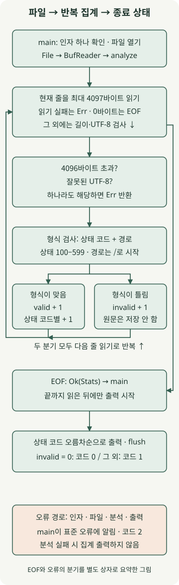

**Rust를 실제 작업에 써보려면 입력과 결과가 분명한 파일 처리 CLI부터 시작하기 좋습니다.** 이 글에서는 로그를 한 줄씩 읽어 HTTP 상태 코드별 요청 수를 집계합니다. 전체 파일을 문자열로 보관하지 않고, 잘못된 레코드와 읽기 실패를 다른 결과로 전달하는 것이 핵심입니다.

[앞선 Rust 입문 글](/ko/posts/2026-11-13-rust-ownership-guide/)의 소유권·빌림·`Result`를 파일 I/O에 적용합니다. **Rust 1.100.0, edition 2024, macOS arm64**에서 실행했으며 표준 라이브러리만 사용합니다. 외부 패키지나 네트워크 연결은 필요하지 않습니다. 아직 개발 도구가 없다면 [공식 Rust 설치 안내](https://rust-lang.org/tools/install/)부터 따라 하세요.

## 어떤 작업에 Rust를 활용하면 좋을까?

반복 실행하는 파일 변환·검증·집계 도구는 Rust의 자원 관리와 오류 처리를 익히기 좋은 대상입니다. 팀에서 바이너리를 배포할 때는 받는 운영체제·CPU와 필요한 시스템 라이브러리를 맞춰야 합니다. 한 기기에서 빌드한 실행 파일이 모든 환경에서 동작하는 것은 아닙니다.

일회성 분석은 익숙한 셸이나 Python으로 더 빨리 끝낼 수도 있습니다. Rust 도입은 처리량을 추측하기보다, 도구를 반복 유지할 필요와 팀의 학습 비용을 함께 보고 판단하세요. 여기서는 처리 흐름과 실패 동작을 검증하며, 다른 언어와의 속도나 메모리 사용량을 비교하지 않습니다.

## 로그 형식과 실패 정책부터 정하기

예제는 `상태코드 경로` 두 필드로 구성한 **간이 접근 로그**를 읽습니다. 실제 Nginx·Apache 기본 로그를 그대로 해석하는 파서는 아닙니다. 입력은 기록이 끝난 일반 파일이라고 가정하며, 파일 회전·실시간 추적·압축 해제는 다루지 않습니다.

| 조건 | 처리 |
| --- | --- |
| 공백으로 나눈 필드가 두 개, 상태가 ASCII 세 자리 숫자 100–599, 경로가 `/`로 시작 | `valid`와 상태 코드별 개수 증가 |
| 빈 줄, 필드 수·상태 코드·경로가 규칙에 맞지 않음 | `invalid` 증가 후 다음 줄 처리 |
| 파일 열기·읽기 실패, 잘못된 UTF-8, 한 줄이 4096바이트 초과 | 분석 실패, 집계 출력 없이 종료 코드 2 |
| EOF까지 처리, `invalid`가 0 | 집계 출력 후 종료 코드 0 |
| EOF까지 처리, `invalid`가 1 이상 | 집계 출력 후 종료 코드 1 |

공백 구분에는 연속 공백·탭도 포함합니다. 줄 길이 제한에는 LF나 CRLF 같은 줄 끝 바이트도 포함하며, 마지막 줄에는 개행이 없어도 됩니다. 빈 파일은 `valid=0 invalid=0`인 정상 결과입니다. 경로는 형식 확인에만 사용하고 집계 결과에 저장하지 않습니다.

출력 실패도 종료 코드 2입니다. 분석을 완료하기 전에는 집계를 출력하지 않지만, **출력 도중 장치가 실패하면 이미 쓴 일부 결과가 남을 수 있습니다.** 종료 코드를 확인한 뒤 결과를 사용하는 것이 실행 계약입니다.

## 실행 프로젝트 준비하기

다음 명령과 실행 예시는 macOS·Linux 셸 기준입니다. macOS에서는 네이티브 링크에 필요한 Command Line Tools도 준비합니다.

```bash
rustup toolchain install 1.100.0 --profile minimal --component rustfmt --component clippy
cargo +1.100.0 new access-summary --bin --edition 2024
cd access-summary
mkdir -p examples tests
```

아래 파일을 저장합니다. Cargo는 `src/lib.rs`를 라이브러리, `src/main.rs`를 실행 프로그램으로 연결합니다. 이 분리 덕분에 파일 열기·화면 출력과 집계 로직을 각각 확인할 수 있습니다.

### `Cargo.toml`

```toml
[package]
name = "access-summary"
version = "0.1.0"
edition = "2024"

[dependencies]
```

### `rust-toolchain.toml`

```toml
[toolchain]
channel = "1.100.0"
profile = "minimal"
components = ["rustfmt", "clippy"]
```

### `examples/access.log`

```text
200 /api/orders
503 /api/orders
200 /health
404 /missing
broken-line
700 /outside-range
```

## BufReader와 BTreeMap으로 집계하기



그림의 반복 경로는 한 줄을 처리한 뒤 다음 줄을 읽는 과정입니다. EOF 경로는 오른쪽 선으로 집계 반환에 연결합니다. 인자·파일·분석·출력 오류는 아래 오류 상자로 요약했으며, 코드에서는 `?`를 통해 `main`으로 전달됩니다.

### `src/lib.rs`

```rust
use std::{
    collections::BTreeMap,
    io::{self, BufRead, Read},
    str,
};

pub const MAX_LINE_BYTES: usize = 4096;

#[derive(Default, Debug, PartialEq, Eq)]
pub struct Stats {
    pub valid: u64,
    pub invalid: u64,
    pub by_status: BTreeMap<u16, u64>,
}

fn parse_status(line: &str) -> Option<u16> {
    let mut fields = line.split_whitespace();
    let code = fields.next()?;
    let path = fields.next()?;
    if fields.next().is_some() || !path.starts_with('/') {
        return None;
    }
    if code.len() != 3 || !code.bytes().all(|byte| byte.is_ascii_digit()) {
        return None;
    }
    let status = code.parse::<u16>().ok()?;
    (100..=599).contains(&status).then_some(status)
}

pub fn analyze<R: BufRead>(mut reader: R) -> io::Result<Stats> {
    let mut stats = Stats::default();
    let mut buffer = Vec::new();
    loop {
        buffer.clear();
        let read = reader
            .by_ref()
            .take((MAX_LINE_BYTES + 1) as u64)
            .read_until(b'\n', &mut buffer)?;
        if read == 0 {
            return Ok(stats);
        }
        if buffer.len() > MAX_LINE_BYTES {
            return Err(io::Error::new(
                io::ErrorKind::InvalidData,
                "line exceeds 4096 bytes",
            ));
        }
        let line = str::from_utf8(&buffer)
            .map_err(|_| io::Error::new(io::ErrorKind::InvalidData, "input is not UTF-8"))?;
        match parse_status(line) {
            Some(status) => {
                stats.valid += 1;
                *stats.by_status.entry(status).or_default() += 1;
            }
            None => stats.invalid += 1,
        }
    }
}
```

[`BufReader`](https://doc.rust-lang.org/std/io/struct.BufReader.html)는 작은 읽기 요청을 버퍼링합니다. `analyze<R: BufRead>`는 구체적인 파일 타입 대신 버퍼 읽기 동작을 요구하므로, 테스트에서는 메모리의 `Cursor`나 실패를 발생시키는 입력으로 바꿀 수 있습니다. 이 제네릭이 비동기나 병렬 처리를 뜻하는 것은 아닙니다.

한 줄씩 읽는 것만으로 크기 제한이 생기지는 않습니다. [`read_until`](https://doc.rust-lang.org/std/io/trait.BufRead.html#method.read_until)은 구분자나 EOF까지 버퍼에 추가합니다. 아주 긴 줄도 읽을 수 있으므로, 이 예제는 [`Read::take`](https://doc.rust-lang.org/std/io/trait.Read.html#method.take)로 **한 번의 반복에서 4097바이트까지만 소비**한 뒤 4096바이트 초과를 검사합니다. `take`는 바이트 제한이며 읽기 시간 제한은 아닙니다.

`buffer.clear()`는 다음 줄을 위해 버퍼 길이를 비우고 할당 공간을 재사용합니다. 집계용 벡터에는 현재 줄을 보관하며, `BufReader`에는 이후 바이트가 선읽기될 수 있습니다. 읽기 버퍼·벡터의 할당 공간·집계 맵에는 각각 메모리가 필요합니다. 상태 코드는 최대 500종류로 제한하므로 URL 수가 늘어도 맵의 키가 늘어나지 않습니다. 실제 프로세스의 메모리 사용량을 측정한 결과는 아닙니다.

`parse_status`는 문자열을 `&str`로 빌려 확인하고 상태 코드만 반환합니다. [`BTreeMap`](https://doc.rust-lang.org/std/collections/struct.BTreeMap.html)은 키 순서로 순회할 수 있어 상태 코드를 오름차순으로 출력하기에 적합합니다. `entry(...).or_default()`는 해당 상태의 카운터가 없으면 0부터 시작합니다.

## main에서 출력과 종료 코드를 결정하기

### `src/main.rs`

```rust
use access_summary::analyze;
use std::{
    env,
    fs::File,
    io::{self, BufReader, Write},
    process::ExitCode,
};

fn run() -> io::Result<u8> {
    let mut args = env::args_os().skip(1);
    let path = args
        .next()
        .filter(|_| args.next().is_none())
        .ok_or_else(|| {
            io::Error::new(io::ErrorKind::InvalidInput, "usage: access-summary <file>")
        })?;
    let stats = analyze(BufReader::new(File::open(path)?))?;
    let mut out = io::BufWriter::new(io::stdout().lock());
    writeln!(out, "valid={} invalid={}", stats.valid, stats.invalid)?;
    for (status, count) in &stats.by_status {
        writeln!(out, "status={status} count={count}")?;
    }
    out.flush()?;
    Ok(if stats.invalid == 0 { 0 } else { 1 })
}

fn main() -> ExitCode {
    match run() {
        Ok(code) => ExitCode::from(code),
        Err(error) => {
            let _ = writeln!(io::stderr().lock(), "error: {error}");
            ExitCode::from(2)
        }
    }
}
```

`args_os`는 파일 경로를 운영체제 문자열로 받습니다. 분석 함수의 `io::Result<Stats>`와 `run`의 `io::Result<u8>`가 연결되므로 파일 열기나 분석 실패를 `main`의 오류 분기로 전달할 수 있습니다. `BufWriter`는 출력도 버퍼링하며, `flush()?`로 남은 출력의 쓰기 실패를 확인합니다. 오류 진단을 표준 오류에 쓰는 것마저 실패하면 그 쓰기 오류는 무시하고 종료 코드 2를 유지합니다.

`invalid`는 읽을 수 있었지만 규칙에 맞지 않은 레코드 수입니다. 따라서 출력이 있다는 사실만으로 모든 입력이 정상이라고 판단하면 안 됩니다. 종료 코드 1은 분석을 완료했지만 잘못된 레코드가 하나 이상 있다는 뜻입니다. 모든 줄이 잘못됐다면 `valid=0`일 수 있습니다. 코드 2는 실행 실패를 뜻합니다. 아래 테스트와 별도 CLI 실행에서 이 구분을 확인합니다.

## 샘플 실행과 결과 확인

```bash
cargo check --offline
cargo fmt --check
cargo clippy --offline --all-targets -- -D warnings
cargo build --offline --release
./target/release/access-summary examples/access.log
echo $?
```

샘플은 정상 줄 4개와 잘못된 줄 2개입니다. 실제 출력은 다음과 같습니다. 마지막 `1`은 집계 내용이 아니라 `echo $?`로 확인한 종료 코드입니다.

```text
valid=4 invalid=2
status=200 count=2
status=404 count=1
status=503 count=1
1
```

| 추가 입력·실행 조건 | 표준 출력 | 종료 코드 |
| --- | --- | --- |
| 정상 줄만 있는 파일 | 전체 집계 | 0 |
| 빈 파일 | `valid=0 invalid=0` | 0 |
| 빈 줄 하나 | `valid=0 invalid=1` | 1 |
| 파일 인자 없음·인자 두 개·존재하지 않는 파일 | 없음, 표준 오류에 원인 | 2 |
| 정상 줄 뒤 잘못된 UTF-8 | 없음, 표준 오류에 원인 | 2 |
| 4097바이트짜리 줄 | 없음, 표준 오류에 원인 | 2 |

## 파일 없이 경계값과 실패를 테스트하기

`Cursor`는 메모리의 바이트를 입력처럼 읽게 합니다. 디스크나 네트워크에 의존하지 않고, 실제 파일에서 만들기 번거로운 읽기 실패도 별도 타입으로 주입합니다. 아래 파일을 저장하고 실행하세요.

```bash
cargo test --offline
```

### `tests/stream.rs`

```rust
use access_summary::{MAX_LINE_BYTES, analyze};
use std::io::{self, BufRead, Cursor, Read};

#[test]
fn counts_valid_and_invalid_lines_in_status_order() {
    let stats = analyze(Cursor::new(include_bytes!("../examples/access.log"))).unwrap();
    assert_eq!((stats.valid, stats.invalid), (4, 2));
    assert_eq!(
        stats.by_status.into_iter().collect::<Vec<_>>(),
        vec![(200, 2), (404, 1), (503, 1)]
    );
}

#[test]
fn accepts_crlf_and_a_final_line_without_newline() {
    let stats = analyze(Cursor::new(b"200 /a\r\n503 /b")).unwrap();
    assert_eq!((stats.valid, stats.invalid), (2, 0));
}

#[test]
fn empty_file_and_blank_line_are_different() {
    assert_eq!(analyze(Cursor::new(b"")).unwrap().invalid, 0);
    assert_eq!(analyze(Cursor::new(b"\n")).unwrap().invalid, 1);
}

#[test]
fn rejects_malformed_status_and_fields_as_invalid_records() {
    let data = "099 /a\n600 /a\n+20 /a\n２００ /a\n200 relative\n200 /a extra\n200\n";
    let stats = analyze(Cursor::new(data.as_bytes())).unwrap();
    assert_eq!((stats.valid, stats.invalid), (0, 7));
}

#[test]
fn invalid_utf8_aborts_instead_of_reporting_partial_statistics() {
    let error = analyze(Cursor::new(b"200 /a\n\xff\n")).unwrap_err();
    assert_eq!(error.kind(), io::ErrorKind::InvalidData);
    assert_eq!(error.to_string(), "input is not UTF-8");
}

#[test]
fn accepts_exact_byte_limit_including_newline() {
    let mut data = b"200 /".to_vec();
    data.resize(MAX_LINE_BYTES - 1, b'a');
    data.push(b'\n');
    assert_eq!(analyze(Cursor::new(data)).unwrap().valid, 1);
}

#[test]
fn stops_consuming_an_oversized_line_after_limit_plus_one() {
    let mut reader = Cursor::new(vec![b'x'; 100_000]);
    let error = analyze(&mut reader).unwrap_err();
    assert_eq!(error.to_string(), "line exceeds 4096 bytes");
    assert_eq!(reader.position(), (MAX_LINE_BYTES + 1) as u64);
}

struct FailingReader;
impl Read for FailingReader {
    fn read(&mut self, _: &mut [u8]) -> io::Result<usize> {
        Err(io::Error::other("injected read failure"))
    }
}
impl BufRead for FailingReader {
    fn fill_buf(&mut self) -> io::Result<&[u8]> {
        Err(io::Error::other("injected read failure"))
    }
    fn consume(&mut self, _: usize) {}
}

#[test]
fn propagates_reader_failure() {
    assert_eq!(
        analyze(FailingReader).unwrap_err().to_string(),
        "injected read failure"
    );
}
```

실행한 테스트 8개가 통과했습니다. 별도 CLI 검사에서는 debug·release 각각의 출력과 종료 코드를 대조하고, 동일한 정상 줄 100,000개를 처리한 개수도 확인했습니다. 이 입력은 집계 정확성 확인용이며 처리량·최대 파일 크기·메모리 사용량을 보증하는 부하 시험은 아닙니다.

운영 도구로 확장한다면 먼저 실제 로그 형식에 맞는 파서를 정하고, 기록이 끝난 파일을 처리하는 방식부터 적용하세요. URL별 집계나 실시간 수집을 추가할 때는 키 개수·보관 기간·파일 회전·재시작 시 중복 집계 규칙을 별도로 설계해야 합니다. 이 예제의 상태 코드 집계를 그대로 늘리는 것만으로 해결되지는 않습니다.
