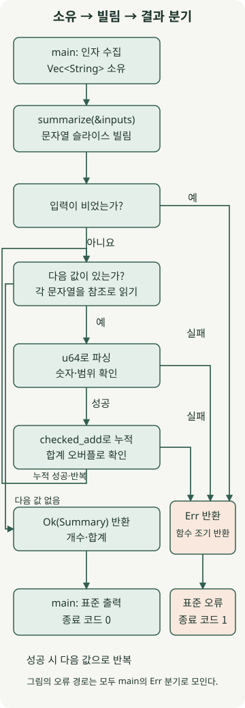

**Rust는 소유권과 타입 검사로 메모리 사용 규칙을 컴파일할 때 확인하는 개발 언어입니다.** Java·Kotlin처럼 가비지 컬렉터가 객체의 도달 가능성을 추적하는 방식 대신, 값을 누가 소유하고 얼마 동안 빌리는지를 코드로 표현합니다. 이 차이를 이해하면 컴파일러의 오류 메시지를 단순한 문법 제약이 아니라 데이터 사용 계약으로 읽을 수 있습니다.

이 글은 다른 언어로 함수를 작성해 본 개발자를 위한 입문 안내입니다. **Rust 1.100.0, edition 2024, macOS arm64**에서 실행했습니다. edition은 문법·호환 규칙을 선택하는 값이며 컴파일러 버전과 별개입니다. 아래 예제는 표준 라이브러리만 사용하고 외부 통신은 하지 않습니다.

## Rust는 어떤 문제에 도움이 될까?

Rust는 네이티브 코드로 컴파일되며, 언어의 기본 메모리 관리에 추적형 GC를 요구하지 않습니다. CLI, 시스템 구성 요소, 메모리·지연 예산이 중요한 프로그램을 검토할 때 유용한 선택지입니다. [공식 소개](https://rust-lang.org/)도 성능과 메모리 안전성을 주요 목표로 제시합니다. 다만 GC가 없다는 사실만으로 Java보다 빠르거나 응답 시간이 짧다고 결론 내릴 수는 없습니다. 이 글에서는 성능 비교를 측정하지 않았습니다.

| 기준 | Java·Kotlin/JVM | Rust |
| --- | --- | --- |
| 일반적인 객체 메모리 관리 | GC가 회수 대상을 추적 | 소유권과 `Drop`을 통한 자원 정리 |
| 데이터 전달 | 객체 참조를 여러 곳에서 보유 가능 | 타입에 따라 이동·복사하고 필요하면 참조로 빌림 |
| 실패 전달 | 예외나 결과 타입 등으로 표현 | `Result<T, E>`로 성공·실패를 명시하는 API가 흔함 |
| 도입할 때 확인할 비용 | 기존 JVM 라이브러리와 팀 경험 | 소유권 학습, 라이브러리·빌드·운영 도구 적합성 |

기존 서비스의 병목이 DB 대기나 외부 API라면 언어 교체 전에 그 경로부터 측정해야 합니다. 첫 도입은 경계가 분명한 작은 CLI부터 시작해 개발·배포 부담을 확인하는 편이 좋습니다.

## 소유권과 빌림은 어떻게 다를까?

먼저 운영체제별 [공식 설치 안내](https://rust-lang.org/tools/install/)에 따라 `rustup`과 Rust를 설치한 뒤 아래 예제를 실행하세요. macOS에서는 네이티브 링크에 필요한 Command Line Tools도 준비합니다.

`String`은 문자열 데이터를 소유합니다. 다음 코드를 `move_error.rs`로 저장하면 **의도적으로 컴파일에 실패**합니다.

```rust
fn main() {
    let name = String::from("Rust");
    let moved = name;
    println!("{name}, {moved}");
}
```

```bash
rustc --edition 2024 move_error.rs
```

`let moved = name`에서 소유권이 이동했기 때문에, 이후 `name`을 출력하는 부분에서 **E0382: borrow of moved value**가 발생합니다. 모든 대입이 이동인 것은 아닙니다. `u64`처럼 `Copy`를 구현한 타입은 대입할 때 복사됩니다. `String::clone()`은 별도의 문자열 데이터를 복제하므로 필요한 경우에만 사용합니다. 자세한 규칙은 [공식 소유권 설명](https://doc.rust-lang.org/book/ch04-01-what-is-ownership.html)을 참고하세요.

값을 읽기만 할 때는 소유권을 넘기는 대신 `&`로 빌릴 수 있습니다. 다음 코드를 별도 파일 `borrow_ok.rs`로 저장하세요.

```rust
fn main() {
    let mut name = String::from("Rust");
    let borrowed = &name;
    println!("{borrowed}");
    name.push_str(" language");
    println!("{name}");
}
```

```bash
rustc --edition 2024 borrow_ok.rs -o borrow_ok
./borrow_ok
```

실제 출력은 다음과 같습니다.

```text
Rust
Rust language
```

첫 `println!` 뒤에는 `borrowed`를 다시 사용하지 않아 공유 빌림이 끝납니다. 그래서 같은 블록 안에서도 이후 `name`을 수정할 수 있습니다. `push_str` 뒤에서 `borrowed`를 다시 출력하도록 바꾸면, 그 참조를 사용해야 하는 기간과 변경을 위한 배타적 빌림이 겹쳐 컴파일에 실패합니다.

같은 데이터에 대한 빌림은 **여러 공유 참조 `&T` 또는 하나의 배타적 참조 `&mut T`**라는 규칙으로 이해하면 출발하기 좋습니다. `&T`가 내부 가변성까지 전부 금지한다는 뜻은 아닙니다. 상세 조건은 [공식 빌림 문서](https://doc.rust-lang.org/book/ch04-02-references-and-borrowing.html)에 나옵니다. lifetime은 참조가 유효해야 하는 기간의 관계를 표현하며, 메모리를 더 오래 살려주는 기능은 아닙니다.

## Cargo로 금액 집계 CLI 만들기

입력한 정수 금액의 개수와 합계를 출력합니다. 특정 서비스의 결제 로직이 아닌 설명용 프로그램이며, 금액 단위는 입력 전체에서 같다고 가정합니다. 소수·음수는 받지 않고 각 금액과 합계는 `u64` 범위 안이어야 합니다.

아래 명령은 macOS·Linux 셸 기준입니다. Rust 도구가 설치된 환경에서 실습 버전을 준비합니다.

```bash
rustup toolchain install 1.100.0 --profile minimal --component rustfmt --component clippy
cargo +1.100.0 new expense-summary --bin --edition 2024
cd expense-summary
```

아래 세 파일로 내용을 맞춥니다. `rust-toolchain.toml`은 이 폴더에서 사용할 도구 버전을 고정하고, `Cargo.toml`은 패키지 설정을 담습니다. Cargo의 빌드·검사 명령은 [공식 Cargo 입문](https://doc.rust-lang.org/book/ch01-03-hello-cargo.html)에서도 확인할 수 있습니다.

### `Cargo.toml`

```toml
[package]
name = "expense-summary"
version = "0.1.0"
edition = "2024"

[dependencies]
```

### `rust-toolchain.toml`

```toml
[toolchain]
channel = "1.100.0"
profile = "minimal"
components = ["rustfmt", "clippy"]
```



그림은 `summarize`의 반복과 조기 반환을 보여줍니다. 왼쪽의 다음 값 검사로 돌아가는 선은 누적 성공 후의 반복이며, 오른쪽 오류 경로는 모두 `main`의 `Err` 분기로 모입니다.

### `src/main.rs`

```rust
use std::{env, process::ExitCode};

struct Summary {
    count: usize,
    total: u64,
}

#[derive(Debug)]
enum InputError {
    EmptyInput,
    InvalidAmount,
    TotalOverflow,
}

fn summarize(inputs: &[String]) -> Result<Summary, InputError> {
    if inputs.is_empty() {
        return Err(InputError::EmptyInput);
    }

    let mut total = 0_u64;
    for input in inputs {
        let amount = input
            .parse::<u64>()
            .map_err(|_| InputError::InvalidAmount)?;
        total = total.checked_add(amount).ok_or(InputError::TotalOverflow)?;
    }

    Ok(Summary {
        count: inputs.len(),
        total,
    })
}

fn main() -> ExitCode {
    let inputs: Vec<String> = env::args().skip(1).collect();
    match summarize(&inputs) {
        Ok(summary) => {
            println!("count={}, total={}", summary.count, summary.total);
            ExitCode::SUCCESS
        }
        Err(error) => {
            eprintln!("error: {error:?}");
            ExitCode::FAILURE
        }
    }
}
```

`inputs`는 `main`이 소유한 `Vec<String>`입니다. `summarize(&inputs)`는 벡터의 문자열들을 슬라이스 `&[String]`로 빌리므로 전체 데이터를 복제하거나 소유권을 넘기지 않습니다. `for input in inputs`도 문자열을 참조로 읽습니다. 이 예제에서 빌림은 입력 문자열 복사를 피하지만, 명령행 인자를 수집하는 과정의 메모리 할당까지 없애지는 않습니다.

`Summary`는 성공 결과를 묶는 구조체이고 `InputError`는 가능한 실패를 나열한 열거형입니다. `Result<Summary, InputError>`는 두 결과 중 하나를 반환한다는 계약입니다. `?`는 `Err`를 만나면 현재 함수에서 조기 반환하고, 성공이면 내부 값을 꺼냅니다. 예외를 던지거나 프로그램을 즉시 종료하는 연산자가 아닙니다. [공식 Result 설명](https://doc.rust-lang.org/book/ch09-02-recoverable-errors-with-result.html)에서 오류 전파 규칙을 확인할 수 있습니다.

`parse::<u64>()`는 개별 숫자의 형식과 범위를 검사합니다. `checked_add`는 두 값의 합이 범위를 넘으면 `None`을 반환하고, `ok_or`가 이를 `TotalOverflow` 오류로 바꿉니다. 이처럼 입력값은 각각 유효해도 합계는 실패할 수 있습니다. `main`은 `match`로 성공·실패를 모두 처리하며, `{:?}`는 `Debug` 형식으로 오류 이름을 출력합니다.

## 실행하면 무엇을 확인할 수 있을까?

```bash
rustc --version
cargo check --offline
cargo fmt --check
cargo clippy --offline -- -D warnings
cargo run --offline --quiet -- 12000 8000 0
```

위 실행의 표준 출력은 다음과 같습니다. `--` 뒤의 값이 Cargo가 아닌 예제 프로그램의 인자로 전달됩니다.

```text
count=3, total=20000
```

실제 CLI 실행에서 확인한 대표 결과입니다. 오류가 나면 부분 합계를 출력하지 않으며, 모두 종료 코드 1과 표준 오류로 전달됩니다.

| `cargo run --offline --quiet --` 뒤의 인자 | 출력 | 종료 코드 |
| --- | --- | --- |
| `12000 8000 0` | 표준 출력 `count=3, total=20000` | 0 |
| `0` | 표준 출력 `count=1, total=0` | 0 |
| 인자 없음 | 표준 오류 `error: EmptyInput` | 1 |
| `12000 abc` | 표준 오류 `error: InvalidAmount` | 1 |
| `-1` 또는 `1.5` | 표준 오류 `error: InvalidAmount` | 1 |
| `18446744073709551616` | 표준 오류 `error: InvalidAmount` | 1 |
| `18446744073709551615 0` | 표준 출력 `count=2, total=18446744073709551615` | 0 |
| `18446744073709551615 1` | 표준 오류 `error: TotalOverflow` | 1 |

`cargo check`는 코드를 실행하지 않고 타입 등을 검사합니다. `cargo fmt --check`는 포맷, Clippy는 정적 진단을 확인합니다. 이 명령들이 성공해도 계산 규칙이 맞는지는 별도로 실행해 확인해야 합니다. 여기서는 debug·release 실행의 출력과 오류·종료 코드를 대조했으며 처리량이나 운영 부하는 측정하지 않았습니다.

## Rust가 보장하는 범위는 어디까지일까?

Safe Rust의 타입·소유권 검사는 잘못된 참조 사용과 데이터 레이스를 예방하는 데 도움을 줍니다. 스레드로 값을 옮길 수 있는지와 참조를 공유할 수 있는지는 [`Send`·`Sync`](https://doc.rust-lang.org/book/ch16-04-extensible-concurrency-sync-and-send.html) 같은 타입 계약에도 연결됩니다. 그렇다고 모든 경쟁 조건, 교착 상태, 메모리 누수나 업무 로직 오류가 사라지는 것은 아닙니다.

[`unsafe`](https://doc.rust-lang.org/book/ch20-01-unsafe-rust.html)는 일부 연산의 안전 조건을 작성자가 책임지게 합니다. 빌림 검사 전체를 끄는 스위치는 아니며, 잘못 구현한 `unsafe`나 FFI 경계는 안전성에 영향을 줄 수 있습니다. 서버·비동기 실행·공유 상태 설계는 이번 CLI의 검증 범위에 포함하지 않았습니다.

다음 실습에서는 입력 금액을 파일에서 읽도록 확장해 보세요. 파일 읽기의 I/O 오류를 기존 `InputError`와 어떻게 구분할지 정하면, 소유권과 오류 타입이 실제 프로그램의 경계를 어떻게 드러내는지 더 구체적으로 이해할 수 있습니다.
