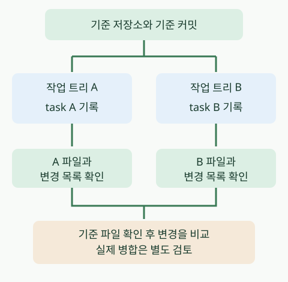

**코드 변경을 worktree별로 보고 브라우저·diff·PR을 한 화면에서 다루고 싶다면 Orca가 편하다. 터미널 중심 구성과 앱 화면을 직접 확장하고 싶다면 Herdr를 살펴볼 만하다.** 두 도구 모두 여러 코딩 에이전트를 실행하고 Git worktree를 활용할 수 있다. 선택 기준은 병렬 실행 가능 여부보다 작업 환경과 결과를 관리하는 방식이다.

비교 대상은 [Orca](https://orca.dev/)와 [Herdr](https://herdr.dev/)다. Herdr는 데스크톱 앱, 터미널용 **Herdr TUI**, 별도 터미널 런타임 **herdr-core**로 나뉜다. 아래 설명은 2026년 11월 15일 확인한 공식 문서 기준이며, 앱을 같은 작업으로 직접 비교한 성능 시험은 아니다. 제공자가 설명한 기능과 그에 근거한 선택 기준을 구분해 읽자.

## 한눈에 보는 차이

| 기준 | Orca | Herdr |
| --- | --- | --- |
| 중심 화면 | 에이전트·편집기·diff·브라우저를 모은 데스크톱 개발 환경 | 데스크톱 앱과 별도의 TUI; herdr-core는 화면 없이 터미널 실행 |
| 작업 분리 | 작업별 Git worktree를 만들고 브랜치·터미널·브라우저를 연결 | 앱 가이드와 TUI 설정에 worktree 생성 기능이 있음. 일반 터미널 pane 사용이 항상 독립 worktree를 뜻하지는 않음 |
| 코드 확인 | worktree diff, 변경 줄에 의견 전달, Git 및 PR 화면 | 터미널이나 사용자가 구성한 앱 화면 중심. 동일한 diff 기능과 범위는 설치한 구성에서 확인 필요 |
| 세션 유지 | 데몬이 살아 있으면 앱 종료 후에도 프로세스 유지; 호스트 재부팅 시 프로세스 종료 | 앱은 herdr-core, TUI는 별도 서버가 터미널 유지; 서버나 호스트 재시작 시 원래 프로세스 종료 |
| 확장 방식 | CLI·스킬·스케줄과 앱의 작업 화면 | 앱의 레이아웃·모드, TUI 플러그인, herdr-core CLI와 API |
| 라이선스 | MIT | Apache 2.0 |

Orca의 [worktree 문서](https://orca.dev/docs/model/worktrees)와 [diff 안내](https://orca.dev/docs/review/diff-viewer), Herdr의 [앱 가이드](https://herdr.dev/guide/)와 [TUI 설정 안내](https://herdr.dev/tui/docs/config-reference/)를 기준으로 정리했다. 표는 특정 버전에서 두 제품의 모든 기능을 실측한 결과가 아니다.

## 같은 일을 맡겼을 때 달라지는 흐름

예를 들어 한 저장소에서 API 수정과 테스트 보강을 동시에 맡긴다고 하자. 두 작업이 같은 파일을 건드릴 가능성이 있다면 먼저 작업별 worktree를 나눈다. 각 에이전트가 무엇을 읽고 쓸지 범위를 정하고, 작업이 끝나면 각각의 변경을 검토한 뒤 통합한다.

Orca에서는 작업마다 worktree를 열고 에이전트와 diff를 해당 작업 공간에 붙이는 흐름을 제공한다. [첫 작업 안내](https://orca.dev/docs/first-session)는 독립 worktree 여러 개에서 에이전트를 실행한 뒤 각 diff를 검토하는 과정을 설명한다.

Herdr 데스크톱 앱에서는 공식 가이드가 작업별 worktree 생성 요청과 에이전트 실행을 예로 든다. TUI는 workspace·tab·pane을 관리하며 별도의 worktree 기능도 제공한다. 일반 pane을 여러 개 열었다는 사실만으로 각각 다른 작업 디렉터리를 가진다고 가정하지 말고, 작업을 시작하기 전에 경로와 브랜치를 확인한다. [앱 가이드](https://herdr.dev/guide/) · [TUI worktree 명령](https://herdr.dev/tui/docs/cli-reference/)



그림은 아래 Git 예제의 파일 흐름을 보여 준다. 에이전트를 실행하거나 자동으로 결과를 병합하는 과정은 포함하지 않는다.

## worktree 분리를 직접 확인하는 예제

다음 예제는 Git이 설치된 macOS 또는 Linux 셸에서 실행한다. 임시 저장소와 두 worktree를 만들기 때문에 기존 프로젝트를 변경하지 않는다. Orca나 Herdr의 설치·설정 방법을 대체하는 예제는 아니다.

```sh
#!/bin/sh
set -eu
case_dir=$(mktemp -d)
git init -q "$case_dir/repo"
git -C "$case_dir/repo" config user.name 'Example Author'
git -C "$case_dir/repo" config user.email 'example@example.invalid'
printf 'base\n' > "$case_dir/repo/app.txt"
git -C "$case_dir/repo" add app.txt
git -C "$case_dir/repo" commit -qm 'Initial commit'
git -C "$case_dir/repo" worktree add -qb task-a "$case_dir/task-a" HEAD
git -C "$case_dir/repo" worktree add -qb task-b "$case_dir/task-b" HEAD
printf 'task A\n' > "$case_dir/task-a/app.txt"
printf 'task B\n' > "$case_dir/task-b/app.txt"
printf 'A: '; cat "$case_dir/task-a/app.txt"
printf 'B: '; cat "$case_dir/task-b/app.txt"
printf 'base: '; cat "$case_dir/repo/app.txt"
printf 'A 변경 파일: '; git -C "$case_dir/task-a" diff --name-only
printf 'B 변경 파일: '; git -C "$case_dir/task-b" diff --name-only
```

로컬 셸에서 확인한 출력은 다음과 같다.

```text
A: task A
B: task B
base: base
A 변경 파일: app.txt
B 변경 파일: app.txt
```

각 worktree의 파일 내용은 독립적이지만 두 작업 모두 `app.txt`를 수정했다. 따라서 실제 프로젝트에서 두 결과를 합칠 때 충돌이나 의미상 모순이 생길 수 있다. worktree는 파일 변경을 분리할 뿐 DB·포트·외부 서비스·자격 증명을 자동 격리하거나 코드 충돌을 해결하지 않는다. 임시 디렉터리는 예제가 자동으로 삭제하지 않는다.

실제 작업 환경에서 worktree를 정리할 때는 도구별 삭제 범위도 확인한다. Orca는 확인 후 worktree와 브랜치를 제거할 수 있으며, Herdr TUI의 worktree 제거 명령은 체크아웃을 제거해도 브랜치는 삭제하지 않는다고 설명한다. 수정 사항과 미병합 커밋을 확인한 뒤 정리한다. [Orca worktree](https://orca.dev/docs/model/worktrees) · [Herdr TUI CLI](https://herdr.dev/tui/docs/cli-reference/)

## Orca의 장점과 고려할 점

Orca의 강점은 **작업부터 결과 검토까지 이어지는 화면**이다. [diff viewer](https://orca.dev/docs/review/diff-viewer)는 변경된 파일과 줄을 보여 주고, 충돌 해결 화면과 부분 스테이징을 제공한다. 별도 브라우저와 편집기를 같은 작업 공간에서 사용할 수 있어 웹 UI를 고치고 직접 확인하는 흐름을 구성하기 좋다.

[원격 실행 안내](https://orca.dev/docs/ways-to-run)는 SSH 호스트나 사용자가 관리하는 서버를 선택하는 방법도 설명한다. 원격 작업이 가능하다는 것과 모든 환경이 기본적으로 같은 권한으로 안전하게 격리된다는 것은 다르다. 원격 머신의 계정과 비밀, 네트워크 접근은 별도로 관리해야 한다.

[세션 복원 안내](https://orca.dev/docs/model/session-restore)에 따르면 앱을 종료해도 백그라운드 데몬이 살아 있으면 에이전트가 계속 실행된다. 호스트가 재부팅되거나 데몬이 종료되면 실행 중인 프로세스는 사라지며, 복원된 작업 공간에서 에이전트를 다시 실행해야 한다.

고려할 점은 데스크톱 환경과 기능을 익혀야 한다는 것이다. 단일 터미널 작업만 필요하다면 여러 화면과 작업 공간이 오히려 불필요할 수 있다. 동시에 여러 에이전트를 돌리면 모델 사용량이 늘 수 있고, 독립적으로 변경한 결과마다 검토가 필요하다. Orca 자체가 모델 응답의 정확성을 보장하지는 않는다.

## Herdr의 장점과 고려할 점

Herdr의 강점은 **실행 중인 터미널과 에이전트를 유지하면서 작업 공간을 구성하는 유연성**이다. [herdr-core](https://herdr.dev/core/)는 창이 닫혀도 관리 중인 터미널을 유지하고, 에이전트가 다른 작업을 시작해 결과를 읽는 인터페이스를 설명한다. 앱의 레이아웃과 모드를 조정하는 사용 방식도 [공식 가이드](https://herdr.dev/guide/)에 소개돼 있다.

Herdr를 쓸 때는 앱과 TUI를 구분해야 한다. 공식 사이트에 따르면 데스크톱 앱은 herdr-core를 사용하지만, **Herdr TUI는 별도 서버를 사용하며 두 환경의 에이전트 목록은 공유되지 않는다.** 앱을 닫는 것과 컴퓨터 또는 런타임을 재시작하는 것도 다르다. 데스크톱 앱 쪽은 창을 닫거나 앱을 업데이트해도 core가 살아 있으면 프로세스가 유지되지만, 기기를 재부팅하거나 core가 중지되면 프로세스가 멈춘다. 공식 사이트는 그 경우 앱의 pane은 돌아오지만 에이전트가 자동 재시작되지는 않는다고 설명한다. [Herdr FAQ](https://herdr.dev/)

TUI에는 별도의 복원 규칙이 있다. 연결을 끊었다 다시 붙이면 서버가 살아 있는 동안 기존 프로세스가 유지된다. 서버가 재시작되면 프로세스는 종료되고, 레이아웃 복원과 지원 에이전트 세션 재개는 별도 기능이다. [TUI 세션 복원](https://herdr.dev/tui/docs/session-state/)

커스터마이징이 많을수록 어떤 모드가 어떤 권한과 외부 연결을 사용하는지 확인할 책임도 커진다. 또 Herdr 앱의 상태 표시는 [OSC 7501](https://herdr.dev/core/)을 보고하는 프로그램에 의존한다. 지원하지 않는 프로그램도 실행할 수 있지만 상태가 표시되지 않을 수 있다. TUI의 에이전트 감지 방식과 앱의 상태 표시를 같은 기능으로 단정하지 말자.

## 어떤 상황에서 선택할까?

- **변경 검토와 웹 화면 확인이 중심이라면:** Orca의 worktree별 diff·브라우저·PR 흐름부터 살펴본다.
- **터미널 유지와 화면 구성이 중심이라면:** Herdr 앱과 core를 살펴보고, 터미널 안에서 관리하고 싶다면 별도 TUI도 비교한다.
- **여러 서버와 에이전트를 함께 운영한다면:** 두 도구 모두 원격 기능을 제공하므로 실제 SSH 환경, 인증 방식, 세션 복구 조건을 확인한다.
- **하나의 짧은 수정만 필요하다면:** 기존 터미널과 Git만으로 충분할 수 있다. 관리 도구가 추가하는 복잡성과 편의를 비교하자.

두 도구를 고를 때는 같은 저장소·같은 작업·같은 모델과 권한으로 작은 시험을 해 보는 것이 좋다. 작업 생성, 중단 후 복귀, 변경 확인, 통합까지의 과정을 각각 따라가고 실제 걸린 시간과 오류를 기록하면 자신의 작업 방식에 맞는 선택을 할 수 있다. 이 글에서는 그런 비교 측정을 수행하지 않았다.
