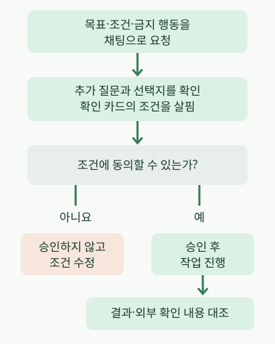

Pickle AI는 채팅으로 조사나 예약 같은 작업을 요청하고 진행 상황을 확인하는 개인 AI 에이전트입니다. 처음에는 결제나 계정 연결이 필요 없는 조사부터 맡기고, 결과가 맞는지 직접 확인하는 편이 좋습니다. 예약이나 구매로 범위를 넓힐 때는 날짜·예산·승인 조건을 함께 적습니다.

이 글은 [Pickle 공식 도움말](https://www.pickle.com/help)을 바탕으로 작성한 사용 안내입니다. 실제 계정에서 앱을 조작하거나 아래 예제를 실행한 기록은 아닙니다. 화면과 이용 가능 기능은 앱 버전, 계정, 지역에 따라 달라질 수 있습니다.

## 시작하기 전에

Pickle 앱과 계정을 준비하고, 앱 안에서 이용 가능한 요금제와 한도를 확인합니다. 한국어 [요금제 안내](https://www.pickle.com/help/credits/plans)는 한국에서 무료로 이용하되 매일 초기화되는 사용량 한도가 적용된다고 설명합니다. 한도에 도달하면 예약 작업이 건너뛰어질 수 있으므로 남은 한도와 초기화 시각을 앱의 **나의 피클** 탭에서 확인하세요. 요금제와 한도는 지역과 시점에 따라 다를 수 있습니다.

[공식 소개](https://www.pickle.com/help/start/what-is-pickle)에 따르면 Pickle은 채팅으로 요청을 받고, 별도 웹 브라우저로 사이트에서 일하며 웹에서 처리할 수 없는 경우 전화할 수 있습니다. 따라서 내 iPhone에 설치된 다른 앱을 직접 누르는 것으로 이해할 필요는 없습니다. 지역·서비스별 지원 여부와 전화 가능 여부는 실제 화면에서 확인해야 합니다.



그림은 사용자가 확인 카드를 받는 경우의 흐름을 단순화했습니다. 모든 요청에 카드가 나타나거나 외부 행동이 반드시 성공한다는 의미는 아닙니다. 아래 의사코드는 독자가 적용할 판단 절차이며 Pickle의 내부 구현이 아닙니다.

```text
요청 = 목표, 날짜·장소, 예산, 허용할 행동과 금지할 행동
Pickle에 요청을 보낸다
추가 질문이나 선택지가 있으면 조건에 맞게 답한다
확인 카드가 나타나면:
    내용과 조건을 확인한다
    조건이 맞지 않으면 승인하지 않고 수정한다
    조건이 맞으면 승인한다
결과가 도착하면 원래 요청과 외부 확인 내역을 대조한다
```

## 첫 작업: 결제 없이 후보 조사하기

예를 들어 식당을 고르는 상황이라면 Chat에 다음과 같이 입력합니다. 날짜·시간·지역은 예시이므로 실제 조건으로 바꾸세요.

```text
서울 강남역 근처에서 토요일 오후 6시에 2명이 식사할 곳을 찾아줘.
1인 예산은 3만 원 이하이고, 채식 메뉴가 있는 곳을 우선해줘.
후보별 이름, 위치, 영업시간, 메뉴 근거 링크를 알려줘.
예약하거나 전화하거나 결제하지 말고, 정보가 불확실하면 표시해줘.
```

Pickle이 날짜나 다른 조건을 물으면 답하고, 후보가 나오면 링크에서 해당 날짜의 영업시간과 메뉴를 확인합니다. 링크가 없거나 조건을 확인하지 못했다면 “어떤 출처에서 확인했는지 알려줘. 확인할 수 없는 항목은 추측하지 마”라고 추가로 요청하세요. 결과는 예시이며 실제 서비스에서 이 프롬프트의 실행 결과를 검증한 것은 아닙니다.

[작업 위임 안내](https://www.pickle.com/help/tasks/delegate)에 따르면 Chat에서 목표를 전달하면 필요한 정보를 묻고, 진행할 작업과 조건을 카드로 보여 확인을 받을 수 있습니다. 작업 카드는 채팅에 나타나며 앱을 닫아도 진행될 수 있습니다. 앱을 닫는 행동을 작업 취소로 여기지 말고, 중단이 필요하면 작업의 현재 상태와 취소 가능 여부를 확인하세요.

## 예약이나 구매를 맡길 때

후보 조사 결과를 확인한 후 별도 요청으로 행동 범위를 좁힙니다.

```text
앞에서 찾은 식당 중 내가 선택한 곳의 예약 가능 시간을 확인해줘.
2명, 토요일 오후 6시가 조건이야. 유료 예약금이나 결제가 필요하면
진행하지 말고 금액과 취소 조건을 먼저 보여줘.
시간이나 인원을 바꿔야 한다면 예약 전에 나에게 물어봐줘.
```

확인 카드가 나타나면 장소, 날짜와 시간, 인원, 금액과 취소 조건을 읽고 동의할 수 있을 때만 승인합니다. 공식 안내는 예약·결제 같은 되돌리기 어려운 작업 전에 조건을 표시하고 확인받는다고 설명합니다. 그래도 요청 문구가 모든 실수를 막는 것은 아니며, 승인한 뒤에는 식당이나 판매처의 확인 화면·이메일에서 실제 예약 및 결제 상태를 따로 확인해야 합니다. 취소 요청도 이미 외부에서 처리된 행동을 자동으로 되돌린다고 가정하지 마세요.

## 계정 연결과 로그인은 필요한 범위만

메일이나 캘린더를 사용하는 작업이라면 [공식 안내](https://www.pickle.com/help/start/what-is-pickle)의 **나의 피클 → (피클 이름)에 연결된 앱 및 서비스**에서 필요한 계정을 연결할 수 있습니다. 연결 화면에 표시되는 권한 범위를 읽고, 그 작업에 필요하지 않다면 연결하지 않습니다. 예를 들어 일정 후보만 찾는 요청에는 캘린더 접근이 꼭 필요한 것은 아닙니다.

웹사이트 로그인이 필요할 때는 채팅에 비밀번호나 카드 번호를 입력하지 마세요. 공식 문서가 안내하는 보안 입력 화면과 Vault를 사용하고, 요청한 사이트와 정보를 다시 확인합니다. [로그인 저장 안내](https://www.pickle.com/help/connect/save-login)에 따르면 Pickle의 브라우저는 휴대전화에 저장된 로그인과 분리되어 있습니다.

자격 증명 보호 방식에도 경계가 있습니다. 공식 설명은 모델에 비밀번호나 카드 번호를 전달하지 않는다고 말하지만, 실제 웹 폼 입력에 필요한 값이 처리되는 경로는 별도로 살펴야 합니다. 공개 코드에서 확인할 수 있는 보호 범위와 한계는 [Pickle AI 작동 원리와 비밀번호 보호](/ko/posts/2026-11-13-pickle-ai-security/)에 정리했습니다. 대화와 기억에 대한 접근 정책은 자격 증명 저장 정책과 다르므로 [개인정보 안내](https://pickle.com/privacy)도 확인하세요.

## 반복 작업과 사용 기록 확인하기

반복 알림이나 정보 요약이 필요하다면 Chat에서 할 일과 주기를 함께 요청할 수 있습니다. 예를 들어 “매주 월요일 오전 9시에 공개 기술 행사 소식을 찾아 링크와 함께 요약해줘. 등록이나 결제는 하지 마”처럼 범위를 명시합니다. 시간대와 실제 실행 조건은 만들어진 작업의 상세 화면에서 확인하세요.

[예약 작업 안내](https://www.pickle.com/help/tasks/scheduled)에 따르면 화면 위 피클 모습을 눌러 연 프로필의 **예약한 작업**에서 작업을 열어 일시 중지, 재개, 수정, 삭제와 실행 이력을 확인할 수 있습니다. 사용 한도에 도달하면 실행이 건너뛰어질 수 있으므로 이력에 있는 상태를 확인하고, 놓친 실행이 자동으로 다시 처리됐다고 가정하지 마세요.

연결된 계정이나 카드 사용은 [Access log 안내](https://pickle.com/help/privacy/activity)의 경로인 **나의 피클 → 연결된 앱 및 서비스 또는 연결된 결제 수단 → 암호화 배너**에서 확인할 수 있습니다. 기록은 어떤 요청을 하기 직전 남긴 것으로, 해당 예약이나 결제가 실제 성공했다는 증거는 아닙니다. 따라서 작업 결과와 외부 서비스의 확인 내용도 함께 대조해야 합니다.
