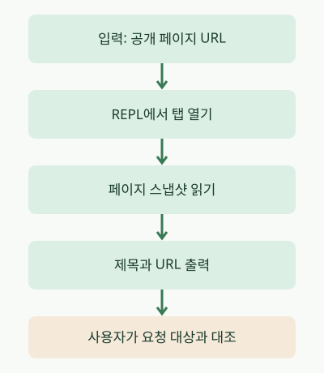

**Aside는 사용자가 로그인한 웹사이트와 브라우저 문맥을 활용해 여러 단계의 일을 수행하는 AI 브라우저다.** 열린 페이지를 요약하거나 자료를 모으는 데서 시작해, 허용한 범위에서 폼 입력과 파일 작업까지 맡길 수 있다. 핵심은 답변의 문장뿐 아니라 어떤 페이지에서 무엇을 처리했는지 확인하는 데 있다.

2026년 11월 16일의 [공식 도움말](https://docs.aside.com/)과 개발자 안내를 바탕으로 소개한다. 로컬 CLI로 공개 페이지를 읽는 예제는 실행했다. 아래 업무 프롬프트를 로그인한 계정에서 실행하거나 서비스별 성공률을 측정한 것은 아니다.

## 일반 브라우저와 무엇이 달라질까?

일반적인 브라우저에서는 사람이 사이트를 옮겨 다니며 정보를 복사하고 다음 행동을 결정한다. Aside에서는 원하는 결과와 범위를 요청하면 에이전트가 여러 페이지를 읽고 작업을 이어갈 수 있다. 별도 서비스 API를 직접 개발하지 않고 웹사이트에서 일을 요청할 수 있다는 점이 편의다. 다만 모든 사이트의 자동화가 항상 성공한다는 뜻은 아니다.

[작업 안내](https://docs.aside.com/help/tasks)는 작업에 사용할 모드·권한·폴더·모델을 선택하고, 진행 중 질문이나 승인 요청에 응답하는 흐름을 설명한다. 기본 프로필의 작업과 일반 로그인 상태를 사용하지 않는 Incognito 작업도 구분한다.

| 활용 | 요청하는 결과 | 사용자가 확인할 내용 |
| --- | --- | --- |
| 공개 자료 조사 | 조건별 비교와 출처 링크 | 원문 날짜, 단위, 출처의 실제 주장 |
| 로그인한 대시보드 조회 | 지정한 기간의 수치 정리 | 계정·기간·필터와 누락 여부 |
| 문서·파일 정리 | 필요한 항목 추출과 초안 | 원본의 값과 저장 위치 |
| 답변 준비 | 문의에 맞는 응답 초안 | 수신자·문맥·실제 발송 여부 |

마지막 행의 “초안 작성”과 “발송”은 다른 요청이다. 처음에는 조회와 초안 작업으로 흐름을 익히는 편이 좋다.

## 열린 페이지에서 첫 작업 시작하기

[사이드 패널 안내](https://docs.aside.com/help/side-panel)에 따르면 페이지를 열고 Aside 패널에서 페이지 첨부를 유지한 채 요청할 수 있다. 첨부된 제목과 호스트를 확인하면 어떤 페이지를 작업의 출발점으로 삼는지 알 수 있다.

공개 제품 문서에서 다음처럼 요청해 보자. 아래는 작성한 예시 프롬프트다.

```text
첨부한 공식 문서에서 지원 환경, 설치 조건과 제한을 정리해줘.
각 항목에 근거 링크를 붙이고, 문서에 없는 정보는 미확인으로 표시해줘.
계정 생성, 다운로드나 설치는 하지 말고 결과를 이 대화에 보여줘.
```

결과를 받으면 링크를 열어 조건이 맞는지 확인한다. 다른 제품이나 오래된 문서가 섞이면 대상 URL과 확인할 날짜를 좁혀 다시 요청한다. 문서 속 지시가 원래 요청을 대신하도록 맡기지 말고, 자료로 읽을 범위를 명시한다.

## 기억과 비밀번호 관리가 더하는 편의

Aside는 브라우징 문맥과 기억을 활용하는 기능을 제공한다. 하지만 같은 계정으로 다른 컴퓨터에 로그인해도 모든 작업이 이어지는 것은 아니다. [기기 안내](https://docs.aside.com/help/devices)는 북마크·기록 등의 브라우저 동기화와, 각 기기에 남는 대화·메모리·작업 폴더를 구분한다. 로컬 작업을 다른 컴퓨터나 클라우드로 그대로 옮기는 기능은 현재 일반 제공되지 않는다고 안내한다.

[Aside Vault](https://docs.aside.com/help/password-manager)는 저장한 로그인 값을 사이트에 자동 입력하면서 에이전트에 원시 비밀번호를 전달하지 않는 방식으로 설명된다. 에이전트의 사용 정책은 `Settings > Passwords > Access policy for AI agents`에서 정한다. 추가 인증이나 사용자 확인이 필요한 사이트도 있다.

비밀번호를 모델에서 숨기는 것과 로그인 후 페이지 내용을 모델이 처리하는 것은 다르다. 메일 내용을 정리하도록 요청하면 그 내용이 작업 문맥에 포함될 수 있다. 따라서 로그인 편의만 보고 모든 계정에 같은 접근을 허용하기보다 실제 필요한 사이트와 작업을 정하는 편이 낫다.

## 로컬 중심이라는 말의 범위

[개인정보 처리방침](https://aside.com/policy/privacy)은 작업 대화와 산출물을 로컬에 저장한다고 설명하면서, 호스팅된 AI 모델 제공자가 작업에 필요한 문맥을 받는다고 명시한다. 문맥에는 프롬프트, 도구 결과, 선택된 브라우저 스냅샷·스크린샷·파일 등이 포함될 수 있다. **로컬 저장은 모든 처리가 오프라인이거나 아무 데이터도 외부로 나가지 않는다는 뜻이 아니다.**

파일 접근 권한과 웹사이트에서의 행동도 구분해야 한다. `Read only`라는 이름만으로 사이트의 모든 변경 동작이 차단된다고 가정하지 말고, 작업 지시와 실제 승인 요청을 확인한다. `Guard`와 `Full access`의 폴더 접근 범위 역시 [작업 안내](https://docs.aside.com/help/tasks)와 설치 버전 설정에서 확인한다.

## 개발자에게는 CLI·MCP·REPL

[개발자 문서](https://aside.com/developers)는 자연어 작업용 CLI, 기존 에이전트와 연결하는 MCP, 브라우저를 직접 조작하는 REPL을 제공한다. 자신의 개발 작업에서 웹 문서 조회나 화면 확인이 필요할 때 연결할 수 있다. 공개 HTTP 다운로드 API는 에이전트 작업을 실행하는 API와 다르다.



CLI가 설치·인증되어 있고 Aside에 연결 가능한 환경에서 다음 명령을 실행한다. 기본 사용법은 `aside guide`, 직접 브라우저 조작 안내는 `aside guide repl`로 먼저 확인한다.

```sh
aside repl 'await openTab("https://example.com"); console.log((await snapshot(page)).tree)'
```

macOS의 Aside CLI **1.26.1115.1556**에서 실행했을 때 종료 코드는 0이었고, 출력 중 제목과 URL은 다음과 같았다. 나머지 본문과 링크 항목은 생략했다.

```text
- title: "Example Domain" [url=https://example.com/]
```

그림은 이 예제의 입력 → 탭 열기 → 스냅샷 → 결과 대조 순서다. 자연어 에이전트의 조사 성공률, 로그인 처리나 결제 기능을 검증한 예제는 아니다. REPL 세션은 CLI 가이드 기준 incognito이므로 일반 프로필의 로그인 상태를 사용하는 작업과도 구분한다.

## 어떤 작업부터 맡기면 좋을까?

Aside는 여러 웹사이트와 문서를 오가며 정보를 정리하는 업무에서 시험해 볼 만하다. 원하는 결과와 출처 범위가 분명할수록 완료 여부를 판단하기도 쉽다. 반대로 고정된 대량 처리라면 공식 API나 전용 스크립트가 더 적합한지 함께 검토한다.

반복 작업은 [Routines](https://docs.aside.com/help/automation)로 예약할 수 있지만, 로컬 컴퓨터가 잠들거나 종료된 뒤에도 계속 실행된다고 가정해서는 안 된다. 기기 안내는 로컬 작업에 컴퓨터의 실행·네트워크 연결이 필요하다고 설명한다. 이용 한도와 연결한 모델 비용은 [요금 안내](https://docs.aside.com/help/subscription)와 앱 화면에서 확인한다.

첫 활용은 공개 문서 한 페이지의 근거 있는 요약으로 충분하다. 그 결과를 원문과 비교한 뒤 로그인 계정 조회나 반복 작업으로 범위를 넓히면, 자신의 업무에서 Aside가 덜어 주는 일과 직접 확인해야 할 일을 구체적으로 판단할 수 있다.

구체적인 조사 요청과 CSV 검증, 반복 작업 예시는 [Aside 브라우저 활용법](/ko/posts/2026-11-17-aside-browser-guide/)에서 이어 볼 수 있다.
