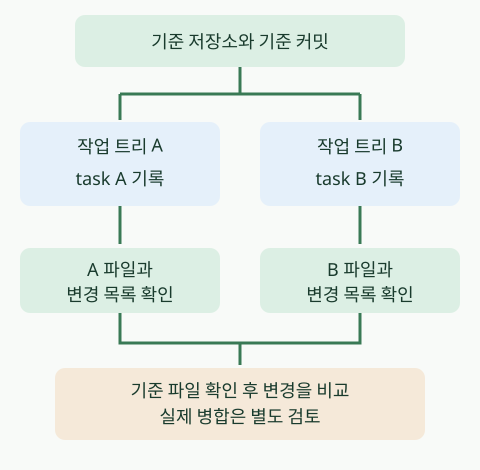

**T3 Code는 대화 스레드에서 작업·승인·변경을 따라가기 좋고, Orca는 worktree별 터미널·편집기·브라우저·diff를 함께 다루는 흐름이 두드러진다. Herdr는 터미널 실행을 유지하면서 작업 화면과 자동화를 직접 구성하려는 경우 살펴볼 만하다.** 세 도구 모두 기능이 겹치므로 하나의 기능 유무로 우열을 정하기보다, 작업을 시작하고 검토하고 중단 후 복귀하는 흐름을 비교하는 편이 낫다.

비교 대상은 [T3 Code](https://github.com/pingdotgg/t3code/tree/v0.1.9), [Orca](https://orca.dev/), [Herdr](https://herdr.dev/)다. T3 Stack이나 다른 이름이 비슷한 Hydra 프로젝트와는 별개다. 2026년 11월 16일 확인한 문서를 기준으로 하되, T3 Code의 구체적인 동작은 **v0.1.9 문서**에 범위를 고정했다. Orca와 Herdr는 현재 공식 문서를 참고했다. 아래 장단점은 문서에 근거한 선택 기준이며 세 앱을 동일 환경에서 실행한 성능 측정 결과가 아니다.

## 무엇을 중심으로 작업하는가?

| 기준 | T3 Code | Orca | Herdr |
| --- | --- | --- | --- |
| 주된 사용 흐름 | 프로젝트와 스레드에서 요청·승인·변경 확인 | worktree별 에이전트·파일·브라우저·diff 관리 | 앱·TUI에서 터미널과 에이전트 관리, 화면 구성 확장 |
| 작업 분리 | worktree 기능 제공; 작업의 실제 경로 확인 필요 | 작업별 worktree를 중심으로 브랜치와 화면 구성 | 앱과 TUI에 worktree 기능; pane 자체가 worktree는 아님 |
| 변경 검토 | 대화 턴의 변경과 브랜치 비교 범위를 구분 | worktree diff·줄 단위 의견·부분 스테이징 | 선택한 앱 구성과 터미널 도구의 검토 흐름 확인 |
| 권한 판단 | 스레드 권한 모드와 제공자별 동작을 함께 확인 | 에이전트 권한 설정과 실제 실행 범위 확인 | 실행한 에이전트·명령·확장 기능의 권한 확인 |
| 원격 활용 | 서버에 다른 기기를 연결 | SSH 호스트·원격 Orca 런타임 | 앱/core와 TUI의 별도 원격 기능 |
| 비용 판단 | 앱과 모델 제공자 비용, 연결 서비스 조건을 나눠 확인 | 앱과 모델 제공자·원격 컴퓨팅 비용을 나눠 확인 | 앱/core/TUI와 모델 제공자·서버 비용을 나눠 확인 |

T3 Code의 [소스 제어 문서](https://github.com/pingdotgg/t3code/blob/v0.1.9/docs/user/source-control.md), Orca의 [worktree 문서](https://orca.dev/docs/model/worktrees), Herdr의 [앱 가이드](https://herdr.dev/guide/)가 각 흐름의 근거다. 이 표에서 확인하지 않은 기능은 미지원으로 단정하지 않았다. 특히 T3 Code에도 worktree와 검토 화면이 있고 Herdr에도 데스크톱 앱이 있다.

## T3 Code: 대화와 실행 결과를 함께 따라가고 싶을 때

T3 Code는 설치된 제공자를 프로젝트와 스레드에 연결해 작업한다. [v0.1.9 README](https://github.com/pingdotgg/t3code/blob/v0.1.9/README.md)는 모바일·웹·데스크톱 클라이언트와 Codex·Claude Code 등 기존 제공자 연결을 설명한다. 모델 자체를 제공하는 도구라고 이해하면 설치와 인증 단계에서 혼동하기 쉽다.

장점은 작업 요청과 실행 과정, 승인, 변경 내용을 한 스레드에서 따라갈 수 있다는 점이다. 소스 제어 문서는 턴 자체의 변경과 기준 브랜치 전체의 변경을 구분한다. 예를 들어 에이전트가 최신 코드를 가져온 뒤 수정했다면, 턴의 변경 목록만 읽고 전체 브랜치 검토를 끝냈다고 판단해서는 안 된다.

고려할 점은 권한 모드의 의미가 제공자마다 같지 않다는 것이다. [권한 문서](https://github.com/pingdotgg/t3code/blob/v0.1.9/docs/user/permission-modes.md)를 기준으로 모드를 고르고 실제 승인 요청을 확인해야 한다. 승인 화면이 있다는 사실이 운영체제의 파일·네트워크 접근까지 격리했다는 뜻은 아니다.

원격 사용에서도 서버 수명이 중요하다. [원격 접속 문서](https://github.com/pingdotgg/t3code/blob/v0.1.9/docs/user/remote-access.md)는 데스크톱 앱의 마지막 창을 닫으면 로컬 서버가 중지된다고 설명한다. 지속 실행이 필요하면 지원되는 환경에서 별도 백그라운드 서비스를 구성해야 한다. 이 버전의 해당 서비스는 Windows에서 제공되지 않으므로 실행 방식을 구분한다. 서버에 제공자의 인증과 저장소도 준비해야 한다.

## Orca: 작업별 개발 화면과 변경 검토를 묶고 싶을 때

Orca는 작업마다 worktree를 만들고 해당 공간에서 에이전트·편집기·브라우저·diff를 다루는 개발 환경이다. [diff 문서](https://orca.dev/docs/review/diff-viewer)는 변경 줄, 부분 스테이징과 충돌 해결 화면 등을 설명한다. UI를 수정하면서 브라우저로 확인하고 변경 내용을 검토하는 개발 흐름을 구성하기 좋다.

장점은 작업의 파일과 검토 화면을 같은 worktree 문맥으로 관리한다는 점이다. 여러 에이전트를 쓰더라도 어느 브랜치의 변경인지 확인하는 과정을 화면과 연결할 수 있다. CLI와 스킬로 작업 공간과 터미널을 제어하는 방법도 제공한다. [CLI 안내](https://orca.dev/docs/cli/overview)

고려할 점은 개발 환경의 구성과 Git 흐름을 익혀야 한다는 것이다. 짧은 단일 수정이라면 worktree와 여러 화면을 관리하는 비용이 편의보다 클 수 있다. 에이전트 수를 늘릴수록 검토할 결과와 자원 사용량도 늘 수 있다. 병렬 실행이 같은 비율의 시간 절감으로 이어진다는 보장은 없다.

[세션 복원 문서](https://orca.dev/docs/model/session-restore)에 따르면 앱을 닫아도 데몬이 살아 있으면 에이전트가 계속 실행된다. 호스트 재부팅이나 데몬 종료 시에는 프로세스가 멈추며, 작업 공간과 스크롤백 복원은 실행 중인 프로세스의 복원과 다르다. [원격 실행](https://orca.dev/docs/ways-to-run)도 가능하지만 작업을 수행하는 호스트의 도구와 인증은 별도로 준비해야 한다.

## Herdr: 터미널과 작업 화면을 직접 구성하고 싶을 때

Herdr는 **데스크톱 앱·herdr-core·Herdr TUI를 구분**해야 한다. 앱은 herdr-core 위에서 동작하고, TUI는 별도 서버를 사용한다. 공식 FAQ는 앱과 TUI가 에이전트 목록을 공유하지 않는다고 명시한다. [Herdr 공식 사이트](https://herdr.dev/)

장점은 터미널 실행 환경과 화면 구성을 분리해 확장할 수 있다는 점이다. [core 안내](https://herdr.dev/core/)는 프로그램 실행, 다른 작업 시작, 결과 읽기와 원격 머신 연결을 설명한다. [앱 가이드](https://herdr.dev/guide/)는 레이아웃이나 기능을 에이전트에게 수정하도록 요청하는 사용 방식도 소개한다. 터미널 위주의 기존 개발 환경을 유지하면서 원하는 대시보드를 구성하려는 경우 검토할 만하다.

고려할 점은 구성 요소와 확장 기능을 이해할 책임이 늘어난다는 것이다. 앱의 상태 표시는 프로그램이 보고하는 OSC 7501에 의존하며, 상태 보고가 없는 프로그램은 실행되더라도 상태가 표시되지 않을 수 있다. 이를 TUI의 에이전트 감지 규칙과 혼동하지 않아야 한다. 사용자 모드나 플러그인이 어떤 명령과 외부 연결을 사용하는지도 확인한다.

앱 창을 닫아도 core가 살아 있으면 터미널은 유지된다. 기기 재부팅이나 core 중지 시에는 프로세스가 종료되며 앱은 에이전트를 자동 재시작하지 않는다고 FAQ가 설명한다. TUI는 서버 재시작 뒤 레이아웃 복원과 지원 에이전트의 세션 재개를 별도 기능으로 제공한다. [TUI 복원 문서](https://herdr.dev/tui/docs/session-state/)

## 세 도구에 공통인 worktree의 경계

여러 에이전트가 같은 파일을 동시에 바꾸는 상황이라면 작업별 worktree를 사용하는 편이 변경을 추적하기 쉽다. 하지만 파일 디렉터리를 나눠도 DB·개발 서버 포트·외부 계정·자격 증명까지 자동으로 분리되지는 않는다. 이 제약은 세 도구에 공통으로 적용된다.



아래 예제는 그림의 파일 분리를 확인하는 코드다. Git이 설치된 macOS·Linux 셸에서 임시 저장소를 만들며 기존 프로젝트는 수정하지 않는다. 에이전트 실행이나 제품 성능 비교는 포함하지 않는다.

```sh
#!/bin/sh
set -eu
case_dir=$(mktemp -d)
git init -q "$case_dir/repo"
git -C "$case_dir/repo" config user.name 'Example Author'
git -C "$case_dir/repo" config user.email 'example@example.invalid'
printf 'base\n' > "$case_dir/repo/app.txt"
git -C "$case_dir/repo" add app.txt
git -C "$case_dir/repo" commit -qm 'Initial commit'
git -C "$case_dir/repo" worktree add -qb task-a "$case_dir/task-a" HEAD
git -C "$case_dir/repo" worktree add -qb task-b "$case_dir/task-b" HEAD
printf 'task A\n' > "$case_dir/task-a/app.txt"
printf 'task B\n' > "$case_dir/task-b/app.txt"
printf 'A: '; cat "$case_dir/task-a/app.txt"
printf 'B: '; cat "$case_dir/task-b/app.txt"
printf 'base: '; cat "$case_dir/repo/app.txt"
printf 'A 변경 파일: '; git -C "$case_dir/task-a" diff --name-only
printf 'B 변경 파일: '; git -C "$case_dir/task-b" diff --name-only
```

로컬 셸에서 실행해 확인한 출력이다.

```text
A: task A
B: task B
base: base
A 변경 파일: app.txt
B 변경 파일: app.txt
```

A와 B는 서로 다른 내용을 보존하지만 같은 파일을 수정했다. 통합할 때 두 변경의 의도를 검토해야 한다. 예제는 임시 디렉터리를 자동으로 삭제하지 않는다.

## 어떤 도구부터 써 볼까?

작업 요청과 승인·변경을 대화에서 따라가는 방식이 맞는다면 **T3 Code**, 브라우저·편집기·diff를 작업별로 나눠 확인하는 방식이 맞는다면 **Orca**, 터미널과 대시보드를 직접 구성하는 방식이 맞는다면 **Herdr**부터 시험해 볼 수 있다. 이는 공식 문서의 기능 구성에서 도출한 선택 제안이다.

선택을 검증할 때는 세 도구에 같은 저장소와 작업, 같은 모델·권한·테스트 조건을 사용한다. 파일 수정보다 먼저 실패하는 테스트를 고정하고, 완료 후에는 실행 결과·diff·남은 변경을 확인한다. 앱 창 종료, 클라이언트 연결 끊기, 서버 중지, 호스트 재부팅은 서로 다른 시험으로 다룬다. 처리 시간뿐 아니라 복귀 과정과 검토에 든 수고도 비교하면 자신의 개발 방식에 맞는 차이가 드러난다.

개별 사용 흐름은 [T3 Code 예제](/ko/posts/2026-11-12-t3-code-workflow/), [Orca 사용법](/ko/posts/2026-11-12-orca-worktree-guide/), [Orca와 Herdr 상세 비교](/ko/posts/2026-11-15-orca-herdr-comparison/)에서 이어 볼 수 있다.
