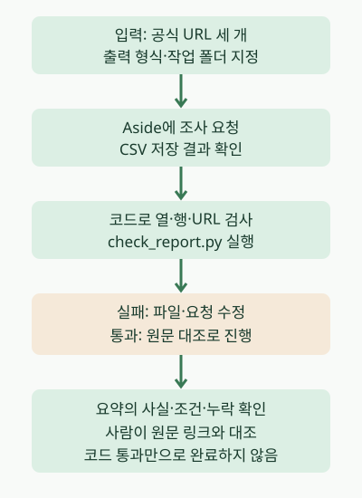

**Aside에는 “알아서 조사해줘”보다 사용할 페이지, 결과 형식, 완료 조건을 함께 전달하는 편이 좋다.** 공개 문서 몇 개를 정리하는 작은 작업부터 시작해 원문과 결과를 대조한 뒤, 로그인 페이지 조회나 반복 작업으로 범위를 넓혀 보자.

이 글은 2026년 11월 17일 확인한 공식 도움말을 바탕으로 작성했다. 아래 프롬프트는 활용 예시이며 Aside에서 해당 조사·로그인·예약 작업을 실행한 결과는 아니다. CSV 검증 코드는 별도의 가상 입력으로 실행해 확인했다.

## 작업을 시작하기 전에 범위 정하기

Aside를 설치하고 사용할 모델과 작업 폴더를 확인한다. 현재 페이지에서 시작하려면 사이드 패널을 열고 페이지 첨부의 제목과 호스트를 확인한다. 첨부를 유지하면 해당 페이지를 작업 문맥으로 사용할 수 있다. [사이드 패널 안내](https://docs.aside.com/help/side-panel)

로그인이 필요 없는 자료 조사에는 Incognito도 선택할 수 있다. 로그인된 계정을 조회하려면 해당 계정이 있는 기본 프로필을 사용한다. 두 모드는 브라우저 상태가 다르다. 파일을 저장할 작업이라면 지정한 폴더에 쓸 수 있는 권한도 필요하다. [작업 모드 안내](https://docs.aside.com/help/tasks)

권한은 `Settings > Agents`의 파일·도구·샌드박스 설정과 작업별 설정을 함께 확인한다. 공식 문서에서 `Guard`는 허용한 폴더에서 작업하고 다른 폴더 접근 전 확인하는 모드다. `Read only`는 파일 변경을 허용하지 않는 것으로 설명되므로 CSV 저장 예제에는 맞지 않을 수 있다. 이름만 보고 모든 웹사이트 변경 동작이 자동으로 차단된다고 판단하지 말자. [권한 안내](https://docs.aside.com/help/security)

## 예제 1: 공식 문서 세 페이지를 CSV로 정리하기

작업 폴더로 사용할 빈 폴더를 선택하고 다음 요청을 보낸다. 저장 위치는 실제 폴더로 바꾼다. 같은 이름의 파일이 있다면 새 이름을 지정한다.

```text
아래 공식 문서 세 페이지만 읽어 report.csv로 정리해줘.
https://docs.aside.com/help/tasks
https://docs.aside.com/help/automation
https://docs.aside.com/help/devices

UTF-8 CSV이며 열 순서는 topic,summary,source_url이야.
topic은 각각 tasks,automation,devices로 하고 페이지별 한 행만 작성해줘.
summary는 한국어 한 문장으로, 각 페이지의 핵심 사용 조건을 설명해줘.
쉼표가 있는 필드는 CSV 규칙에 맞게 따옴표로 감싸줘.
source_url은 위에 준 해당 페이지 주소를 그대로 사용해줘.

선택한 작업 폴더에 저장하되 기존 파일을 덮어쓰지 마.
읽지 못한 문서가 있으면 추측으로 채우지 말고 실패한 주소를 알려줘.
다른 사이트의 계정에 접속하거나 메시지를 보내지 마.
완료 후 파일 경로와 확인한 세 페이지를 알려줘.
```

페이지가 열리지 않는다면 먼저 접근 실패를 해결한다. 결과에서 특정 항목이 빠졌을 때도 재시도 전에 대상 URL을 확인한다. 읽지 못한 문서를 추측한 요약으로 채우는 것은 완료로 보지 않는다.



그림의 코드 검사는 결과 파일이 정해진 구조와 출처 범위를 지키는지 확인하는 단계다. 다음 코드를 `check_report.py`로 저장한다. Python 3 표준 라이브러리만 사용하며 외부 통신은 없다.

```python
import csv
import sys

expected = {
    "tasks": "https://docs.aside.com/help/tasks",
    "automation": "https://docs.aside.com/help/automation",
    "devices": "https://docs.aside.com/help/devices",
}

with open(sys.argv[1], newline="", encoding="utf-8-sig") as stream:
    reader = csv.DictReader(stream)
    if reader.fieldnames != ["topic", "summary", "source_url"]:
        raise SystemExit("FAIL: columns")
    rows = list(reader)

if len(rows) != len(expected) or {r["topic"] for r in rows} != set(expected):
    raise SystemExit("FAIL: topics")
for row in rows:
    if (None in row or any(value is None for value in row.values())
            or not row["summary"].strip()
            or row["source_url"] != expected[row["topic"]]):
        raise SystemExit("FAIL: row")
print("PASS: 3 topics and allowed source URLs")
```

생성된 CSV의 실제 경로를 인자로 전달한다.

```sh
python3 check_report.py report.csv
```

가상 입력으로 세 행과 허용된 URL을 넣었을 때 종료 코드 0과 다음 출력을 확인했다. 이 입력은 Aside가 생성한 결과물이 아니다.

```text
PASS: 3 topics and allowed source URLs
```

행 하나를 제거한 가상 입력은 `FAIL: topics`와 종료 코드 1을 반환했다. 코드는 열·주제·URL·빈 요약을 검사하지만 **요약의 사실성이나 페이지를 실제 읽었는지는 판별하지 못한다.** 통과 후에는 원문에서 각 요약을 뒷받침하는 문장을 직접 확인한다. 코드 실패를 해결하려고 검사 조건을 느슨하게 하기보다 파일과 프롬프트의 불일치부터 확인한다.

## 예제 2: 로그인한 대시보드에서 수치만 조회하기

계정 조회는 사용할 사이트와 계정, 기간, 필터를 좁혀 요청한다. 다음은 사용자가 접근 권한을 가진 업무 대시보드를 가정한 예시다.

```text
현재 첨부한 대시보드에서 내가 지정한 계정의 2026-11-01~2026-11-07
조회수를 읽어줘. 화면의 시간대와 필터도 함께 적어줘.
표에 날짜, 수치, 단위를 표시하고 빈칸은 0으로 추정하지 마.
설정 변경, 내보내기, 다른 계정 조회는 하지 마.
화면에서 확인하지 못한 값은 미확인으로 표시해줘.
```

숫자가 나오면 화면의 합계와 기간·시간대·필터가 같은지 먼저 비교한다. 전체 합계와 일부 상위 행의 합이 다를 수 있으므로 그 차이를 곧바로 오류로 단정하지 않는다. 내보내기가 필요하면 파일에 포함되는 범위와 저장 위치를 정해 별도 요청한다.

로그인 정보가 필요할 때는 비밀번호를 프롬프트에 붙이지 않는다. [Password Manager 안내](https://docs.aside.com/help/password-manager)에 따라 저장된 로그인 사용 정책을 확인하고, 사이트가 요구하는 추가 인증을 처리한다. 비밀번호가 모델에 전달되지 않는다는 설명과 로그인 후 페이지 내용을 모델이 처리하는 것은 별개다. [개인정보 처리방침](https://aside.com/policy/privacy)은 작업에 필요한 선택된 문맥이 호스팅 모델 제공자에게 전달될 수 있다고 설명한다.

## 진행 중 요청을 고칠 때

조사 대상이 잘못됐거나 범위를 줄여야 한다면 완료 후에만 말할 필요는 없다. [작업 안내](https://docs.aside.com/help/tasks)는 후속 메시지의 `Queue`와 `Steer`를 구분한다. `Queue`는 현재 실행이 끝난 뒤 후속 요청을 적용하고, `Steer`는 진행 중인 작업에 새 메시지를 전달해 방향을 바꾼다.

예를 들어 “다른 사이트는 조사하지 말고 처음 세 문서만 사용해줘”처럼 수정 범위를 구체적으로 알려 준다. 수정 메시지를 보냈다는 사실만으로 이미 발생한 외부 동작이 취소되는 것은 아니다. 실제 상태를 확인한 뒤 다음 요청을 결정한다.

## 예제 3: 검증한 조사 요청을 반복 작업으로 바꾸기

일회성 결과가 쓸 만했다면 반복 조사를 고려할 수 있다. [Routines 안내](https://docs.aside.com/help/automation)에 따르면 cron routine은 일정에 맞춰 새 작업을 시작하고, heartbeat routine은 기존 대화를 다시 이어간다. 독립적인 주간 요약이라면 새 작업을 만드는 방식부터 검토한다.

`Settings > Routines`에서 새 루틴을 만들고 다음과 같은 지시를 입력한다. 주기와 시간대는 실제 설정 화면에서 별도로 맞춘다.

```text
지정한 공식 문서 세 페이지를 읽고 지난 실행 결과와 비교해
사용 방법이나 제한이 바뀐 항목을 근거 링크와 함께 알려줘.
비교할 이전 결과가 없으면 이번 결과를 기준선으로 기록해줘.
문서를 읽지 못했으면 변경 없음으로 처리하지 말고 접근 실패로 알려줘.
계정 설정 변경, 메시지 발송, 유료 작업은 하지 마.
```

지난 결과를 어디에 보관하고 다음 실행이 어떻게 읽을지도 정해야 한다. 루틴이 새 작업을 만든다는 이유만으로 이전 대화가 자동으로 비교 자료가 된다고 가정하지 않는다. 지정한 폴더의 이전 보고서처럼 입력을 분명히 하거나, 처음에는 자동 비교 대신 보고서만 받아 직접 대조한다.

루틴 목록에서 즉시 실행해 입력과 출력, 실패 처리를 확인한 뒤 일정을 활성화한다. 공식 안내는 겹치는 실행을 건너뛰는 동작을 설명한다. [기기 안내](https://docs.aside.com/help/devices)는 로컬 작업에 컴퓨터가 켜져 있고 온라인이며 Aside가 실행 중이어야 한다고 설명한다. 다른 컴퓨터에 로그인했거나 유료 플랜을 쓴다는 이유만으로 잠든 기기의 작업이 클라우드에서 이어지는 것은 아니다.

처음에는 조회·정리·검증까지 한 번의 흐름을 익히는 것으로 충분하다. 이 과정에서 어떤 입력이 필요한지와 결과의 확인 방법이 정해져야 반복 실행도 믿고 활용할 수 있다.
