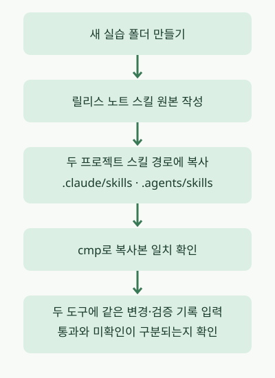

반복해서 쓰는 요청이 있다면 스킬로 묶어 보자. 변경 요약과 검증 기준을 매번 다시 입력하는 대신, 스킬에 입력 범위와 결과 형식을 저장해 두고 작업마다 대상 파일만 바꿀 수 있다. 개발팀은 `skill-creator`와 `webapp-testing`부터, 문서 작업이 많은 팀은 실제로 다루는 파일 형식의 스킬부터 시작하기 좋다.

Claude는 터미널에서 사용하는 **Claude Code**, Codex는 **Codex CLI**를 기준으로 한다. 아래 순서는 2026년 11월 18일 공식 자료에서 후보를 확인한 뒤 **반복 사용 빈도, 결과 검증의 쉬움, 설치와 외부 연결 부담**을 기준으로 정한 실무 추천이다. 설치 수나 성능을 집계한 순위는 아니다. OpenAI의 이전 스킬 카탈로그는 사용 중단을 권고하므로 Codex 항목의 설치 출처는 현행 문서와 플러그인을 기준으로 삼았다. [Claude Code 스킬 문서](https://code.claude.com/docs/en/skills) · [Codex 스킬 문서](https://learn.chatgpt.com/docs/build-skills) · [이전 카탈로그 안내](https://github.com/openai/skills) · [OpenAI 플러그인 저장소](https://github.com/openai/plugins)

## 실무 추천 10선

아래 ‘출처와 환경’은 공식 제공 또는 배포 경로를 뜻한다. Claude Code용 예제를 Codex로 옮길 때도 `SKILL.md`의 공통 형식은 활용할 수 있다. 함께 제공되는 스크립트, 도구 이름, 호스트 전용 설정은 별도로 대조해야 한다.

| 순위 | 스킬 | 출처와 환경 | 활용 요청과 확인 기준 |
| --- | --- | --- | --- |
| 1 | `skill-creator` | Codex 내장 / [Claude Code 예제](https://github.com/anthropics/skills/tree/main/skills/skill-creator) | “PR 설명 작성 스킬을 만들고, 수정 PR과 문서 PR의 입력 예시를 각각 만들어줘.” 호출해야 할 요청과 건너뛸 요청을 한 번씩 넣어 범위가 맞는지 본다. |
| 2 | `webapp-testing` | [Claude Code 예제](https://github.com/anthropics/skills/tree/main/skills/webapp-testing) | “로컬 주문 화면에서 정상 제출과 필수값 누락을 Playwright로 확인해줘.” 실제 화면 상태와 실행 로그를 남긴다. 브라우저와 앱 실행 환경이 필요하다. |
| 3 | `frontend-design` | [Claude Code 예제](https://github.com/anthropics/skills/tree/main/skills/frontend-design) | “장애 대응 대시보드의 모바일 화면을 설계해줘. 상태와 다음 행동을 먼저 보여줘.” 빈 상태, 긴 문구, 키보드 탐색까지 확인한다. |
| 4 | `openai-docs` | Codex 내장 / [OpenAI Developers 안내](https://developers.openai.com/learn/developers-codex-plugin) | “Codex CLI에서 프로젝트 스킬을 저장할 위치와 호출 방법을 공식 문서로 확인해줘.” 출처가 CLI 화면과 설명한 기능을 직접 뒷받침하는지 본다. |
| 5 | `xlsx` | [Claude Code 문서 스킬](https://github.com/anthropics/skills/tree/main/skills/xlsx) | “주문 CSV를 월별 집계 통합문서로 만들어줘. 취소 건은 분리하고 합계는 수식으로 계산해줘.” 원본 행 수와 집계 범위, 합계와 수식 오류를 대조한다. |
| 6 | `pdf` | [Claude Code 문서 스킬](https://github.com/anthropics/skills/tree/main/skills/pdf) | “요구사항 PDF에서 납품 조건과 예외를 페이지 번호와 함께 뽑아줘.” 표의 행·열 순서와 누락 여부를 원본 화면과 대조한다. 스캔본은 OCR 품질을 따로 본다. |
| 7 | `docx` | [Claude Code 문서 스킬](https://github.com/anthropics/skills/tree/main/skills/docx) | “첨부한 Word 템플릿에 프로젝트 인계서를 작성하고 제목 스타일과 표 구조를 유지해줘.” 결과를 Word나 호환 편집기에서 열어 페이지 나눔과 표 잘림을 확인한다. |
| 8 | `pptx` | [Claude Code 문서 스킬](https://github.com/anthropics/skills/tree/main/skills/pptx) | “운영 회고를 6장으로 구성해줘. 수치 옆에 측정 기간과 단위를 표시해줘.” 슬라이드를 렌더링해 수치, 축, 글자 잘림을 확인한다. |
| 9 | `openai-api-troubleshooting` | [Codex용 OpenAI Developers 플러그인](https://github.com/openai/plugins/tree/main/plugins/openai-developers/skills/openai-api-troubleshooting) | “키를 제거한 API 오류 메시지를 바탕으로 원인을 좁혀줘. SDK 버전과 요청 ID는 첨부했어.” 가설과 확인 명령을 구분하고, 원본 키와 토큰은 제외한다. |
| 10 | `imagegen` | Codex 내장 / [스킬 원본](https://github.com/openai/codex/tree/main/codex-rs/skills/src/assets/samples/imagegen) | “블로그 글에 쓸 가로형 표지 시안을 만들어줘. 본문 제목을 그림에 합성하지 말아줘.” 생성 기능 사용 가능 여부를 확인하고 이미지 크기, 편집 범위, 글자 왜곡을 검토한다. |

`skill-creator`를 첫 순서에 둔 이유는 팀의 반복 절차를 프로젝트에 남길 수 있기 때문이다. `webapp-testing`은 앱과 브라우저를 준비해야 하지만 실행 로그와 화면으로 결과를 판정할 수 있다. 문서 스킬 네 개는 파일 형식에 따라 하나를 고르면 된다. API 진단과 이미지 생성은 해당 오류나 시각 자료가 필요할 때 효과가 분명한 도구다.

개발 작업에서는 화면 의도를 `frontend-design`으로 구체화하고 구현 뒤 `webapp-testing`으로 사용자 행동을 확인하는 조합이 유용하다. 디자인 초안이 있어도 ‘제출 실패 시 입력값이 남아 있는가’ 같은 동작은 테스트에 따로 넣어야 한다. 문서 작업에서는 `pdf`로 표를 읽고 `xlsx`로 집계하되, 첫 도구의 추출 결과를 원본과 대조한 뒤 다음 단계로 넘긴다.

## 설치하고 호출하는 방법

Claude Code에서 Anthropic 공식 마켓플레이스를 등록한 뒤 필요한 묶음을 선택한다. PDF·Word·Excel·PowerPoint를 다루는 경우 `document-skills`를, 스킬 작성이나 웹 테스트 예제를 확인하려면 `example-skills`를 선택한다. 설치된 플러그인의 스킬은 이름을 자연어로 언급해 요청할 수 있다. [Anthropic 설치 안내](https://github.com/anthropics/skills#claude-code)

```text
/plugin marketplace add anthropics/skills
/plugin install document-skills@anthropic-agent-skills
/plugin install example-skills@anthropic-agent-skills
```

Codex CLI는 `/skills` 또는 `$` 선택기로 스킬을 찾아 명시적으로 호출한다. 내장 `skill-creator`는 `$skill-creator`로 호출한다. OpenAI API 진단 스킬을 추가하려면 Codex CLI의 `/plugins`에서 **OpenAI Developers**를 찾아 `Install plugin`을 선택한다. 새 세션을 열고 `/skills`에서 진단 스킬을 확인한다. [Codex 스킬 호출 안내](https://learn.chatgpt.com/docs/build-skills) · [OpenAI Developers 플러그인](https://developers.openai.com/learn/developers-codex-plugin)

프로젝트 안에서 직접 관리하는 스킬은 Claude Code의 `.claude/skills/<이름>/SKILL.md`, Codex의 `.agents/skills/<이름>/SKILL.md`에 둔다. 공식 예제를 복사할 때는 `SKILL.md`가 참조하는 파일과 도구를 같이 확인한다. 연결이 필요한 스킬은 사용하는 계정과 접근 범위도 확인한 뒤 실행한다. [Claude Code 스킬 위치](https://code.claude.com/docs/en/skills#choose-where-skills-load) · [Codex 스킬 위치](https://learn.chatgpt.com/docs/build-skills#where-to-save-skills)

## 실습: 같은 릴리스 노트 스킬을 두 도구에서 사용하기

새 실습 디렉터리에서 아래 명령을 실행한다. 하나의 `SKILL.md`를 작성해 두 프로젝트 경로에 복사하고, `cmp`로 두 파일이 같은지 확인하는 예제다. POSIX 셸과 `mkdir`, `cp`, `cmp`가 필요하다.



```sh
set -eu
mkdir skills-demo
cd skills-demo

mkdir -p .claude/skills/release-note-draft .agents/skills/release-note-draft

cat > release-note-source.md <<'SKILL'
---
name: release-note-draft
description: Draft a release note from a provided change list and test evidence.
---
Write three sections in Korean: 사용자 변경, 검증, 미확인.
Describe user-facing changes using only the supplied change list.
Put a test in 검증 only when the input explicitly says it ran and gives the result.
If a test is mentioned without a result, put it in 미확인.
Return the draft in the chat.
SKILL

cp release-note-source.md .claude/skills/release-note-draft/SKILL.md
cp release-note-source.md .agents/skills/release-note-draft/SKILL.md
cmp .claude/skills/release-note-draft/SKILL.md .agents/skills/release-note-draft/SKILL.md
printf '%s\n' 'Skill copies match.'
```

macOS의 임시 디렉터리에서 실행해 아래 출력과 종료 코드 `0`을 확인했다. 같은 상위 폴더에서 다시 실행하면 기존 `skills-demo` 때문에 첫 `mkdir`에서 멈춘다.

```text
Skill copies match.
```

`skills-demo` 디렉터리를 기준으로 별도 터미널 세션에서 각각 `claude`와 `codex`를 실행한다. Claude Code는 `/release-note-draft`, Codex CLI는 `$release-note-draft`를 선택한다. 스킬 이름과 다음 변경·테스트 기록을 한 메시지로 전송한다.

```text
변경: 설정 화면에서 이메일 입력을 지우면 저장 버튼이 비활성화된다.
검증 기록: 설정 화면 단위 테스트 3개를 실행했고 모두 통과했다.
예정: 모바일 브라우저에서도 확인할 예정이다.
위 기록으로 릴리스 노트 초안을 작성해줘.
```

기대 결과는 사용자 변경에 버튼 동작, 검증에 단위 테스트 3개 통과, 미확인에 모바일 브라우저 확인이 각각 들어가는 것이다.

## 같은 입력으로 응답을 비교하기

두 CLI는 같은 스킬 파일과 가상의 변경·검증 기록으로 실행했다. 앱 테스트를 새로 돌리는 과제가 아니라, 제공된 기록에서 **실행을 마친 테스트와 예정된 테스트를 분리하는 과제**다.

Codex CLI 0.169.0에서 GPT-6.2 Sol로 실행했을 때 로그에서 프로젝트의 스킬 파일을 읽은 것을 확인했다. 최종 응답의 핵심 문장은 다음과 같다.

| 구분 | Codex 응답 |
| --- | --- |
| 사용자 변경 | 설정 화면에서 입력한 이메일을 지우면 저장 버튼이 비활성화됩니다. |
| 검증 | 설정 화면 단위 테스트 3개를 실행했으며 모두 통과했습니다. |
| 미확인 | 모바일 브라우저에서의 동작은 확인할 예정입니다. |

Claude Code 2.0.76과 2.1.327에서도 프로젝트 스킬은 목록에 표시됐다. 모델 호출은 로그인 오류에서 멈췄다. 이 기록에서 확인할 수 있는 범위는 Claude Code의 스킬 탐색과 Codex의 응답 한 건이다.
