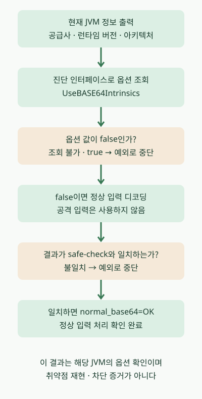

**Java4Shell은 특정 x86-64 CPU에서 사용하는 OpenJDK의 Base64 디코딩 최적화 경로에 있는 메모리 손상 취약점이며, 조건이 맞으면 메모리 유출이나 원격 코드 실행으로 이어질 수 있다. 영향받는 런타임과 CPU 조건, 외부 입력이 그 경로에 도달하는지를 함께 확인하고 공급사의 수정 JDK를 적용해야 한다.** 패치를 바로 배포하기 어렵다면 발견자가 제시한 `-XX:-UseBASE64Intrinsics`를 임시 조치로 검토할 수 있다.

Java4Shell은 발견자 Calif가 붙인 이름이며 CVE 번호는 **CVE-2026-114938**이다. [Oracle 2026년 11월 보안 공지](https://www.oracle.com/security-alerts/cspunov2026.html)와 [OpenJDK 보안 공지](https://openjdk.org/groups/vulnerability/advisories/2026-11-17)에 공개됐다. 아래 버전 정보는 2026년 11월 18일 확인한 공개 자료를 기준으로 한다.

## Java에서 왜 메모리 손상이 발생하나

HotSpot은 자주 실행되는 연산을 JIT로 최적화하고, 일부 연산에는 CPU 명령을 활용하는 전용 구현인 intrinsic을 사용한다. Calif가 공개한 원인은 **x86-64 Base64 intrinsic의 패딩 처리에서 저장할 바이트를 선택하는 마스크를 잘못 계산해 출력 버퍼 밖에 쓰는 문제**다. Java 계층이 나중에 잘못된 입력을 `IllegalArgumentException`으로 거부하더라도 그 전에 메모리가 손상될 수 있다. 따라서 예외를 잡는 코드만으로 이 문제를 해결했다고 판단하면 안 된다.

Oracle 공지의 구성요소 이름은 `Compiler`, OpenJDK의 분류는 `hotspot/compiler`다. 애플리케이션이 외부 Java 소스를 컴파일하는 기능을 제공해야만 노출되는 문제는 아니다. 일반적인 Base64 디코딩도 JVM 내부의 최적화 경로를 사용할 수 있다.

Calif는 영향 조건으로 **AVX-512 VBMI를 지원하는 x86-64 CPU**를 명시하고, Linux에서는 `avx512f`, `avx512bw`, `avx512vbmi`, `bmi2`를 모두 확인하도록 안내한다. 공개된 설명에서 ARM64는 해당 취약 경로의 영향 대상이 아니다. 다만 CPU 조건 충족만으로 모든 애플리케이션의 원격 코드 실행 가능성이 확정되는 것은 아니다. 애플리케이션별 입력 경로와 악용 조건이 다르며 보편적인 단일 공격 입력이 모든 제품을 장악한다는 의미도 아니다. VM·컨테이너에서는 실제 JVM에 노출된 CPU 기능을 확인한다.

심각도는 평가 주체와 CVSS 버전을 함께 읽어야 한다.

| 평가 주체 | 평가 | 의미 |
| --- | --- | --- |
| Oracle CNA | CVSS 3.1 **8.1, High** | 네트워크 공격, 높은 공격 복잡도, 인증·사용자 상호작용 불필요 |
| Calif | CVSS 4.0 **9.2, Critical** | 발견자가 별도 평가 체계로 발표한 점수 |

Oracle의 벡터는 `CVSS:3.1/AV:N/AC:H/PR:N/UI:N/S:U/C:H/I:H/A:H`다. 두 점수는 평가 주체와 CVSS 버전이 다르므로 구분해야 한다. [CVE 원본 기록](https://www.cve.org/CVERecord?id=CVE-2026-114938)

## 어떤 JDK를 교체해야 하나

Oracle이 명시한 영향받는 지원 버전과 확인한 수정 릴리스는 다음과 같다. 다른 배포판의 빌드 번호를 이 표로 대신 판정하지 않는다.

| 제품 | Oracle이 명시한 영향 버전 | 확인한 Oracle 수정 릴리스 |
| --- | --- | --- |
| Oracle Java SE 17 | `17.0.21.0.3` | [17.0.21.1+4](https://www.oracle.com/java/technologies/javase/17-0-21-1-relnotes.html) |
| Oracle Java SE 21 | `21.0.13.0.3` | [21.0.13.1+4](https://www.oracle.com/java/technologies/javase/21-0-13-1-relnotes.html) |
| Oracle Java SE 25 | `25.0.5.0.3` | [25.0.5.1+4](https://www.oracle.com/java/technologies/javase/25-0-5-1-relnotes.html) |
| Oracle Java SE 27 | `27.0.1.0.3` | [27.0.1.1+4](https://www.oracle.com/java/technologies/javase/27-0-1-1-relnotes.html) |
| Oracle Java SE 8 Performance Pack | `8u511b33-perf` | 이 글에서 정확한 수정 빌드를 확정하지 않음 |
| Oracle GraalVM for JDK | `17.0.21.0.3`, `21.0.13.0.3` | 제품별 보안 업데이트 확인 필요 |
| Oracle GraalVM Enterprise Edition | `21.3.20.0.3` | 제품별 보안 업데이트 확인 필요 |

이 목록은 **수정 전의 모든 취약 버전을 빠짐없이 열거한 목록이 아니다.** Oracle은 이전 릴리스가 영향받을 가능성도 설명하며 지원 버전으로의 업데이트를 권고한다. Java 8의 일반 빌드와 Performance Pack도 구분한다. [Oracle 위험표](https://www.oracle.com/security-alerts/cspunov2026.html#AppendixJAVA)

Temurin·Corretto·Zulu 등 OpenJDK 기반 배포판도 공급사의 이 CVE 대응 공지와 수정 빌드를 확인한다. 버전 번호가 Oracle 표와 다르다는 이유로 안전하다고 판정하지 않는다. Calif의 영향 설명도 특정 하드웨어·런타임 경로에 관한 것이며, 이미 수정된 릴리스까지 계속 취약하다는 뜻은 아니다.

## 패치와 임시 완화를 적용하는 순서

먼저 **실제 서비스 프로세스가 사용하는 JDK**를 확인한다. 셸의 `java -version`은 현재 PATH에 잡힌 실행 파일만 보여주므로, 이미 실행 중인 서비스의 런타임과 다를 수 있다. 서비스 실행 경로, 컨테이너 이미지, JVM 버전과 공급사를 함께 수집한다.

정식 조치는 해당 배포판의 수정 JDK로 런타임을 교체하는 것이다. 컨테이너는 수정된 기반 이미지로 다시 빌드하고 배포하며, 기존 JVM이 남지 않도록 롤링 교체 후 실행 버전을 다시 확인한다. 애플리케이션 의존성 파일만 바꾸거나 호스트에 새 JDK를 설치해 두는 것으로 끝내지 않는다.

패치 배포가 지연된다면 Calif가 제시한 다음 **JVM 시작 옵션**을 검토한다. JAR 이름은 실제 애플리케이션으로 바꾼다.

```sh
java -XX:-UseBASE64Intrinsics -jar app.jar
```

이 옵션은 하드웨어 가속 Base64 인코딩·디코딩을 비활성화하는 발견자의 임시 완화책이다. 이 글에서 확인한 Oracle 보안 공지는 보안 업데이트 적용을 권고한다. 기존 JVM 옵션을 보존해 추가하고 JVM을 재시작한 뒤 실제 값을 확인한다. Base64 사용량이 많은 서비스는 처리량·CPU 사용량·지연 변화를 함께 관찰한다. 이 글에서는 성능 변화량을 측정하지 않았다.

Calif는 대안으로 `-XX:UseAVX=2`도 제시하지만 **x86-64에만 적용**하도록 경고한다. ARM의 OpenJDK에서는 인식하지 못해 시작에 실패할 수 있으므로 혼합 아키텍처 배포에 같은 옵션을 일괄 적용하지 않는다. Nginx 요청 본문 버퍼링도 모든 악용 경로를 차단하는 대책으로 제시되지 않았다.

## 임시 옵션 적용 여부를 코드로 확인하기

다음 예제는 **HotSpot 기반 JDK 17 이상에서 현재 JVM의 옵션 값과 정상 Base64 디코딩만 확인**한다. 취약점 탐지기나 공격 차단 검증 코드는 아니다. 진단 인터페이스·옵션을 지원하지 않으면 확인할 수 없는 상태이므로 해당 런타임의 관리 도구를 사용한다.



진단 인터페이스가 없거나 옵션이 꺼져 있지 않으면 예외로 중단한다. 조건을 통과한 경우에만 정상 문자열을 디코딩하고 예상 값과 일치하는지 확인한다.

`Base64MitigationCheck.java`로 저장한다.

```java
import com.sun.management.HotSpotDiagnosticMXBean;
import java.lang.management.ManagementFactory;
import java.nio.charset.StandardCharsets;
import java.util.Base64;

public class Base64MitigationCheck {
    public static void main(String[] args) {
        System.out.println("java.vendor=" + System.getProperty("java.vendor"));
        System.out.println("java.runtime.version="
                + System.getProperty("java.runtime.version"));
        System.out.println("os.arch=" + System.getProperty("os.arch"));

        HotSpotDiagnosticMXBean diagnostic = ManagementFactory
                .getPlatformMXBean(HotSpotDiagnosticMXBean.class);
        if (diagnostic == null) {
            throw new IllegalStateException("HotSpot diagnostic interface unavailable");
        }
        String enabled = diagnostic.getVMOption("UseBASE64Intrinsics").getValue();
        System.out.println("UseBASE64Intrinsics=" + enabled);
        if (!"false".equals(enabled)) {
            throw new IllegalStateException("Base64 intrinsic is not disabled");
        }

        String decoded = new String(
                Base64.getDecoder().decode("c2FmZS1jaGVjaw=="),
                StandardCharsets.UTF_8);
        if (!"safe-check".equals(decoded)) {
            throw new IllegalStateException("Unexpected Base64 result");
        }
        System.out.println("normal_base64=OK");
    }
}
```

실행 명령은 다음과 같다. 두 명령은 같은 대상 JDK의 `javac`와 `java`로 실행한다.

```sh
javac --release 17 Base64MitigationCheck.java
java -XX:-UseBASE64Intrinsics Base64MitigationCheck
```

ARM64 macOS의 Zulu `21.0.1+12-LTS`에서 실제 실행한 출력은 다음과 같다. 이 오래된 빌드는 예제의 동작 확인 환경이며 운영에 권장하는 버전이 아니다. Corretto `17.0.8.1+8-LTS`에서도 비활성 옵션과 정상 디코딩을 확인했다.

```text
java.vendor=Azul Systems, Inc.
java.runtime.version=21.0.1+12-LTS
os.arch=aarch64
UseBASE64Intrinsics=false
normal_base64=OK
```

같은 두 환경에서 `-XX:+UseBASE64Intrinsics`로 실행했을 때는 `Base64 intrinsic is not disabled` 예외와 종료 코드 `1`을 확인했다. ARM64에서 확인한 것은 **옵션 조회·분기·정상 입력 처리**이며, 영향받는 x86-64의 메모리 손상 재현이나 완화 효과·성능 검증은 수행하지 않았다.

이 예제를 별도 프로세스로 실행한 결과가 운영 애플리케이션의 설정까지 증명하지는 않는다. 운영에서는 해당 프로세스에 접근할 권한과 호환되는 진단 도구가 있을 때 다음처럼 직접 확인한다. JVM 구현이나 Attach 비활성화·권한·컨테이너 PID 네임스페이스 때문에 실패했다면 “안전”으로 처리하지 않는다.

```sh
# JCMD는 대상 런타임과 호환되는 도구의 경로, PID는 서비스 JVM의 PID다.
"$JCMD" "$PID" VM.version
"$JCMD" "$PID" VM.flags -all | grep 'UseBASE64Intrinsics'
```

수정 빌드 배포 후에는 실제 실행 버전, 인스턴스 교체 여부, 로그인·파일 업로드·연동 같은 주요 기능과 오류율을 확인한다. 임시 옵션을 제거할 때도 공급사 패치 적용과 정상 동작을 먼저 확인하고 변경 전후 지표를 비교한다.
