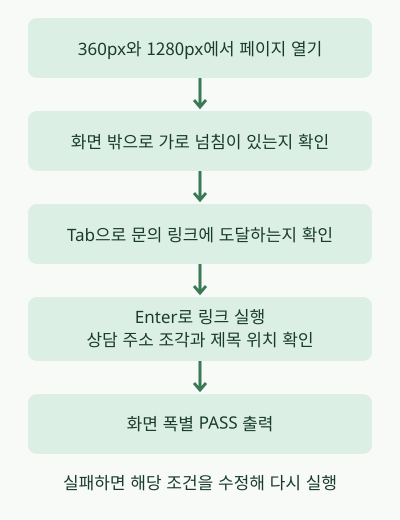

작은 회사 소개 사이트라면 **문구와 페이지 구조를 정리하고, 화면을 만든 다음, 브라우저에서 문의 동선을 확인하는 것**부터 시작하자. 로그인이나 결제가 들어가는 웹앱이라면 권한, 데이터 저장, 실패 복구까지 먼저 설계해야 한다. 사이트 유형을 정하면 어떤 스킬이 필요한지, 결과를 어떻게 판정할지도 구체적으로 정할 수 있다.

2026년 11월 19일 Anthropic·OpenAI·Vercel의 공식 스킬 원본을 기준으로 단계별 후보를 골랐다. 예시는 Claude Code와 Codex CLI에서 에이전트에게 일을 맡기는 상황을 기준으로 한다. [Anthropic 스킬 모음](https://github.com/anthropics/skills) · [OpenAI Build Web Apps](https://github.com/openai/plugins/tree/main/plugins/build-web-apps) · [Vercel Agent Skills](https://github.com/vercel-labs/agent-skills)

## 사이트 유형에 따라 스킬을 고르는 방법

| 제작 대상 | 먼저 정할 것 | 기본 조합 |
| --- | --- | --- |
| 소개·포트폴리오·블로그 | 방문자, 핵심 행동, 공개 페이지, 콘텐츠 수정 방법 | 페이지 문구 → 화면 구현 → 브라우저 테스트 → 배포 확인 |
| 예약·결제·관리자 웹앱 | 사용자별 권한, 저장할 데이터, 성공과 실패의 처리, 운영 기록 | 화면·상태 설계 → 화면과 서버 구현 → 정상·실패 흐름 테스트 → 미리보기 → 운영 확인 |

기존 저장소가 있다면 먼저 그 프로젝트의 프레임워크와 배포 방법을 확인한다. 예를 들어 Astro 블로그에 글과 문의 링크를 추가하는 작업은 기존 구성 안에서 끝낼 수 있다. React·Next.js 성능 스킬이나 결제 스킬은 해당 기술과 기능이 실제로 필요할 때 선택한다.

| 단계 | 추천 스킬 또는 기준 | 맡길 일과 확인 방법 |
| --- | --- | --- |
| 기획·문구 | 프로젝트용 `website-copywriting` 지침 | 대상 방문자와 핵심 행동을 정하고 제목·설명·문의 문구를 작성한다. 첫 화면에서 서비스가 누구에게 무엇을 제공하는지 읽어 본다. |
| 화면 설계 | 프로젝트용 `frontend-architecture-design` 지침 | 페이지 경로, 컴포넌트와 상태의 소유자, 성공·오류 화면을 정한다. 예약 웹앱이라면 제출 중 중복 클릭과 저장 실패 후 재시도를 설계한다. |
| 화면 구현 | [Claude Code의 `frontend-design`](https://github.com/anthropics/skills/tree/main/skills/frontend-design) 또는 [Codex의 `frontend-app-builder`](https://github.com/openai/plugins/tree/main/plugins/build-web-apps/skills/frontend-app-builder) | 승인한 카피와 화면 구조를 기존 프로젝트의 컴포넌트로 구현한다. 좁은 화면에서도 제목·행동 버튼·본문을 순서대로 읽을 수 있는지 확인한다. |
| 브라우저 검증 | [Claude Code의 `webapp-testing`](https://github.com/anthropics/skills/tree/main/skills/webapp-testing), [Codex의 `frontend-testing-debugging`](https://github.com/openai/plugins/tree/main/plugins/build-web-apps/skills/frontend-testing-debugging) | 모바일에서 문의 링크, 폼 오류, 콘솔을 점검한다. 확인한 URL과 화면 크기, 실제 재현 단계와 결과를 남긴다. |
| 접근성 검토 | [Vercel의 `web-design-guidelines`](https://github.com/vercel-labs/agent-skills/tree/main/skills/web-design-guidelines) | 레이블·대비·포커스를 코드에서 검토하고 브라우저에서 키보드 순서와 포커스 표시를 확인한다. 자동 검사 결과와 수동 검사를 기록한다. |
| React 성능 | [Build Web Apps의 `react-best-practices`](https://github.com/openai/plugins/tree/main/plugins/build-web-apps/skills/react-best-practices) | React·Next.js 프로젝트에서 직렬 데이터 요청과 초기 번들을 검토한다. 변경 전후를 같은 환경에서 측정한 뒤 개선 효과를 판단한다. |
| 배포 | [Vercel의 `deployments-cicd`](https://github.com/openai/plugins/tree/main/plugins/vercel/skills/deployments-cicd) 또는 프로젝트의 배포 지침 | 해당 호스트에서 미리보기 또는 스테이징 URL을 확인한 다음 승인된 버전을 배포한다. 최종 URL과 되돌릴 버전을 기록한다. |

표의 첫 두 항목은 프로젝트에 작성할 역할의 예다. 공개 스킬은 운영 팀이 제공하는 설치 경로에 맞춰 선택한다. Claude Code에서는 Anthropic 공식 마켓플레이스의 `example-skills`에 화면 구현과 테스트 스킬이 있다. Codex에서는 **Build Web Apps** 플러그인에 화면 구현·테스트·React 최적화 스킬이 함께 들어 있다. Vercel 배포 스킬은 사이트를 Vercel에 올릴 때 사용한다. GitHub Pages를 쓰는 프로젝트라면 저장소의 Actions와 미리보기 절차를 따른다. [Claude Code 설치 안내](https://github.com/anthropics/skills#claude-code) · [OpenAI Build Web Apps 구성](https://github.com/openai/plugins/blob/main/plugins/build-web-apps/README.md)

## 작은 사이트에서 스킬을 이어 쓰는 순서

제작 요청에 필요한 입력은 길지 않다. 아래처럼 서비스 정보와 화면 구조, 확인할 행동을 함께 주면 기획·구현·테스트 단계에서 같은 기준을 쓸 수 있다.

```text
가상의 사진 스튜디오 소개 페이지를 만든다.
방문자는 촬영 장소와 상담 방법을 확인하려는 사람이다.
한 페이지에 소개와 상담 안내를 배치하고 첫 화면의 ‘문의하기’ 링크를
페이지 안의 상담 안내로 연결해줘. 소개, 문의 링크, 상담 안내 순서를 유지해줘.
360px의 좁은 화면과 키보드 사용을 고려해줘.
구현 뒤 360px와 1280px에서 가로 넘침을 확인하고,
Tab으로 문의 링크에 도달해 Enter로 상담 안내를 열어줘.
각 단계의 결과와 확인하지 못한 항목을 기록해줘.
```

소개와 문의 링크는 화면 구현 단계에 넘기고, 화면 크기와 키보드 조건은 테스트의 판정 기준으로 사용한다. 테스트가 실패하면 실패한 화면 폭과 조작을 구현 담당 에이전트에게 전달하고 수정 후 같은 조건을 다시 실행한다. 접근성 검토는 이 흐름에 더해 대비, 화면 읽기 도구에서 읽는 이름, 다른 페이지로 이동한 뒤 포커스 위치까지 살피는 데 쓴다.

## 실습 — 문의 동선을 확인하는 Playwright 검사

실습에서는 사이트의 한 페이지를 테스트 파일에 넣고, 두 화면 폭에서 브라우저로 확인한다. 새 디렉터리에 Node.js 22와 Chrome을 준비한다. `npm init -y`를 실행한 다음 `npm install --save-dev playwright-core@1.64.1`로 의존성을 설치한다. 아래 내용을 `website-check.mjs`로 저장하고 macOS에서는 `node website-check.mjs`로 실행한다. Chrome 설치 위치가 다르면 `CHROME_PATH`에 실행 파일 경로를 지정한다. [Playwright 브라우저 실행 옵션](https://playwright.dev/docs/api/class-browsertype#browser-type-launch)



```js
import assert from 'node:assert/strict';
import { chromium } from 'playwright-core';

const html = `<!doctype html>
<html lang="ko">
<meta charset="utf-8">
<meta name="viewport" content="width=device-width, initial-scale=1">
<title>봄 사진 스튜디오</title>
<style>
  body { margin: 0; font: 1rem/1.6 system-ui; }
  main { max-width: 42rem; margin: auto; padding: 1rem; }
  section { min-height: 74vh; }
</style>
<main>
  <section>
    <h1>봄 사진 스튜디오</h1>
    <p>프로필 사진과 가족사진을 촬영합니다.</p>
    <a href="#contact">문의하기</a>
  </section>
  <section id="contact">
    <h2>상담 안내</h2>
    <p>촬영 목적과 희망 일정을 준비해 주세요.</p>
  </section>
</main>
</html>`;

const browser = await chromium.launch({
  executablePath: process.env.CHROME_PATH
    ?? '/Applications/Google Chrome.app/Contents/MacOS/Google Chrome',
});

try {
  for (const width of [360, 1280]) {
    const page = await browser.newPage({ viewport: { width, height: 700 } });
    try {
      await page.setContent(html);
      const overflow = await page.evaluate(
        () => document.documentElement.scrollWidth > window.innerWidth,
      );
      assert.equal(overflow, false, `가로 넘침: ${width}px`);

      await page.keyboard.press('Tab');
      const focused = await page.evaluate(
        () => document.activeElement?.getAttribute('href'),
      );
      assert.equal(focused, '#contact', `문의 링크 포커스: ${width}px`);
      await page.keyboard.press('Enter');
      await page.waitForURL(/#contact$/);
      const heading = await page.getByRole('heading', { name: '상담 안내' }).boundingBox();
      assert.ok(heading && heading.y >= 0 && heading.y + heading.height <= 700);
      console.log(`PASS ${width}px: no overflow, keyboard link reaches contact`);
    } finally {
      await page.close();
    }
  }
} finally {
  await browser.close();
}
```

실행 결과는 다음과 같다. 각 `PASS`는 가로 넘침이 없고, 키보드로 문의 링크에 도달한 뒤 상담 제목이 화면 안에 들어왔음을 뜻한다.

```text
PASS 360px: no overflow, keyboard link reaches contact
PASS 1280px: no overflow, keyboard link reaches contact
```

실제 프로젝트에서는 HTML 문자열 대신 로컬 서버를 띄우고 `page.goto()`로 구현된 페이지를 연다. 문의 폼이라면 필수값 누락, 전송 실패 후 입력 유지, 성공 메시지를 별도 검사로 추가한다. 문의 링크의 목적지를 다른 주소 조각으로 바꾼 경우에는 360px의 링크 검사에서 실패했다. 위 예제의 검증 범위는 실습용 HTML 한 페이지와 Chrome 두 화면 폭이다.

## 배포 후 확인할 항목

미리보기와 운영 URL에서 주요 페이지와 문의 동선을 다시 열고, 서버 응답과 정적 자산이 정상인지 확인한다. 검색에 공개할 페이지는 문서 제목·설명, 대표 주소, 내부 링크, 사이트맵을 살핀다. 검색엔진에서 실제로 발견하고 색인했는지는 운영 주소가 열린다는 사실과 별도로 Search Console에서 확인한다. [Google SEO 기본 가이드](https://developers.google.com/search/docs/fundamentals/seo-starter-guide)
