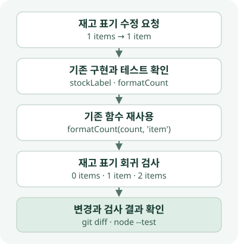

**Ponytail은 AI 코딩 에이전트가 기존 코드를 재사용하면서 요청한 동작을 완성하도록 돕는 스킬이다.** 예를 들어 재고가 하나일 때 `1 items`가 표시된다면, 먼저 프로젝트에 단수·복수 처리 함수가 있는지 확인한다. 그 함수를 재사용해 표시를 고치고, 수량이 0개나 2개일 때도 기존처럼 동작하는지 테스트한다.

## Codex와 Claude Code에서 시작하기

Codex에 독립형 Ponytail 스킬이 이미 있다면 대화 입력창에 `$ponytail-help`를 입력해 이름과 모드를 확인한다. `$ponytail full` 뒤에 바꿀 동작과 유지할 조건, 검사 명령을 적으면 된다. 아래 실습은 사용자 경로인 `~/.agents/skills/ponytail/SKILL.md`에 등록된 독립형 스킬로 진행했다. 이 구성에서 모드는 현재 대화의 작업 선호로 적용되며, `$ponytail off`로 해제할 수 있다. [Codex 스킬 문서](https://learn.chatgpt.com/docs/build-skills)

Ponytail 프로젝트가 배포하는 플러그인도 있다. Codex CLI에서는 셸에서 아래 두 명령을 실행한다. 이후 Codex를 열고 `/hooks`에서 두 훅의 실행 내용을 검토한다. 훅을 사용하려면 신뢰 처리 후 새 대화를 시작한다. 훅을 실행하는 환경의 `PATH`에는 `node`가 필요하다. [Ponytail 설치 안내](https://github.com/DietrichGebert/ponytail/blob/main/INSTALL.md#codex)

```bash
codex plugin marketplace add DietrichGebert/ponytail
codex plugin add ponytail@ponytail
```

Claude Code에서는 입력창에서 아래 두 명령을 한 줄씩 실행한 뒤 `/ponytail full`로 모드를 선택한다. 함께 제공되는 검토 명령은 `/ponytail-review`다. Codex 플러그인에서는 검토 스킬이 `$ponytail:ponytail-review`처럼 플러그인 이름을 포함해 표시된다. 두 플러그인의 설치와 훅 동작은 공개 문서를 기준으로 설명한다. [Claude Code 설치 안내](https://github.com/DietrichGebert/ponytail/blob/main/INSTALL.md#claude-code) · [Ponytail 명령 목록](https://github.com/DietrichGebert/ponytail#commands)

```text
/plugin marketplace add DietrichGebert/ponytail
/plugin install ponytail@ponytail
```

## Lite, Full, Ultra 중 무엇을 쓸까?

독립형 Codex 스킬에서는 `$ponytail`만 입력하면 기본값인 Full이 적용된다.

| 호출 | 작업 방식 | 예시 |
| --- | --- | --- |
| `$ponytail lite` | 요청을 처리하고, 더 작은 접근이 실질적으로 의미가 있으면 짧게 알려준다. | 이미 합의한 UI 문구를 바꾼다. |
| `$ponytail full` | 호출부와 기존 테스트를 확인하고, 필요한 동작을 가장 작은 변경으로 완성한다. 확인한 결과와 남은 위험을 보고한다. | 단수 표기 버그를 고치고 기존 입력도 검사한다. |
| `$ponytail ultra` | 요청한 작업을 진행하면서 불필요하게 넓어진 범위를 짚는다. | 특정 화면의 오류를 수정하면서 공통 UI 전면 개편의 필요성을 따로 판단한다. |

변경을 작게 유지하려면 요청에 **바꿀 동작, 유지할 동작, 확인 방법**을 적는다. 권한 확인, 입력 검증, 데이터 보호처럼 호출자가 의존하는 동작도 유지 조건에 포함한다. 스킬은 에이전트의 작업 방식에 영향을 주며, 파일 쓰기와 명령 실행 범위는 에이전트의 권한 설정에서 정한다.

## 실습 — 재고가 하나일 때 `1 item` 표시하기

Node.js 22.17.0과 Codex CLI 0.169.0으로 빈 실습 저장소에서 실행했다. 아래 최종 코드의 `stockLabel`에서 반환 줄을 ``return `${count} items`;``로 바꿔 시작 상태를 만들 수 있다. `stock.test.mjs`의 첫 번째 테스트는 시작 상태에 있던 테스트이고, 두 번째 테스트는 이번 작업에서 추가했다.

```text
$ponytail full
stockLabel(1)이 1 items를 반환하는 문제를 고쳐줘.
0과 2는 items를 유지해줘. 기존 formatCount를 재사용하고
stockLabel 회귀 테스트를 추가한 뒤 node --test를 실행해줘.
이 실습 저장소 밖은 수정하지 말고 커밋하지 마.
```



`stock.mjs`의 수정은 `stockLabel` 반환식 한 줄이었다. 이미 단수·복수를 처리하는 `formatCount`를 그대로 호출한다.

```javascript
export function formatCount(count, noun) {
  return `${count} ${count === 1 ? noun : noun + 's'}`;
}

export function stockLabel(count) {
  return formatCount(count, 'item');
}
```

`stock.test.mjs`에서 수량 0, 1, 2의 표시를 각각 검사한다. 두 파일을 같은 디렉터리에 놓고 `node --test`를 실행한다.

```javascript
import assert from 'node:assert/strict';
import test from 'node:test';
import { formatCount, stockLabel } from './stock.mjs';

test('formatCount handles singular and plural', () => {
  assert.equal(formatCount(1, 'item'), '1 item');
  assert.equal(formatCount(2, 'item'), '2 items');
});

test('stockLabel handles zero, one, and two items', () => {
  assert.equal(stockLabel(0), '0 items');
  assert.equal(stockLabel(1), '1 item');
  assert.equal(stockLabel(2), '2 items');
});
```

추가한 테스트를 수정 전 코드에 실행했을 때 수량 1에서 실패했다. 기대값은 `1 item`, 실제값은 `1 items`였다. 수정 후에는 다음 결과가 나왔다.

```text
ok 1 - formatCount handles singular and plural
ok 2 - stockLabel handles zero, one, and two items
# tests 2
# pass 2
# fail 0
```

이 실습에서 확인한 범위는 두 테스트와 두 파일의 변경이다. 에이전트의 완료 메시지를 받은 뒤 실제 `git diff`와 테스트 결과를 대조하면, 기존 함수 재사용과 요청 범위 준수를 직접 확인할 수 있다.

## 수정이 끝나면 검토할 범위를 지정한다

독립형 스킬이 함께 설치돼 있다면 아래 명령을 사용할 수 있다. 기존 코드의 어느 부분을 검토할지 명시하면 결과를 확인하기 쉽다. [Ponytail 명령 목록](https://github.com/DietrichGebert/ponytail#commands)

| 호출 | 쓰는 때 |
| --- | --- |
| `$ponytail-review` | 현재 diff와 연결된 코드를 검토한다. PR을 열기 전 호출부나 빠진 회귀 테스트를 확인할 때 쓴다. |
| `$ponytail-audit` | 저장소 전체의 문제를 읽기 전용으로 조사해 우선순위대로 정리한다. |
| `$ponytail-debt` | 기존 `shortcut:` 및 과거 `ponytail:` 주석을 모아 확인한다. |
| `$ponytail-gain` | 프로젝트가 공개한 벤치마크 보고서를 확인한다. 자기 저장소에서 절감한 시간이나 비용을 측정하려면 별도 비교 실행이 필요하다. |
| `$ponytail-help` | 설치된 스킬의 모드와 호출 방법을 확인한다. |
