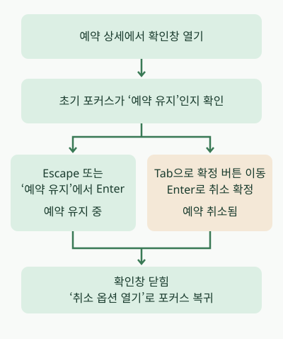

**화면을 그리기 전에 사용자가 무엇을 끝내야 하는지, 어느 지점에서 되돌아갈 수 있는지 정하자.** 예약 취소 화면을 예로 들면, 사용자는 취소 결과를 미리 알고 예약을 유지하거나 취소할 수 있어야 한다. 확인창의 문구, 기본 포커스, 닫은 뒤 돌아갈 위치까지 정해야 구현과 검증에서 같은 기준을 쓸 수 있다.

이 글은 웹사이트 제작 전체를 다룬 [이전 글](/ko/posts/2026-11-19-website-building-agent-skills/)에서 UI/UX 단계만 깊게 다룬다. 2026년 11월 20일 확인한 Claude Code·Codex의 공개 스킬과 Figma·Vercel·W3C 자료를 바탕으로, 예약 취소 흐름 하나를 기획에서 브라우저 확인까지 이어 본다.

## 산출물에 맞춰 스킬 고르기

| 필요한 산출물 | 스킬 또는 작업 방식 | 검토할 기준 |
| --- | --- | --- |
| 사용자 흐름과 화면 상태 | 프로젝트용 `frontend-architecture-design` 지침 | 진입, 확인, 이탈, 처리 중, 성공, 실패가 정의됐는지 확인한다. 실제 사용자 조사 자료가 있으면 관찰과 가설을 구분한다. |
| 검토용 프로토타입 | Codex의 [Product Design 플러그인](https://github.com/openai/plugins/tree/main/plugins/product-design) | 상태 전이를 검토할 수 있는 시안을 만든다. 예약을 유지하는 길과 취소를 확정하는 길이 모두 있는지 본다. |
| 시각 방향과 UI 코드 | Claude Code의 [`frontend-design`](https://github.com/anthropics/skills/tree/main/skills/frontend-design) | 제목·설명·행동 버튼의 시각적 우선순위를 구체화한다. 제목이 길거나 화면 폭이 좁아져도 의미와 순서가 유지되는지 확인한다. |
| Figma 화면 조립 | Figma 플러그인의 [`figma-generate-design`](https://github.com/openai/plugins/tree/main/plugins/figma/skills/figma-generate-design) | 기존 라이브러리의 버튼과 대화상자 인스턴스를 재사용하고 상태별 프레임을 만든다. 컴포넌트와 변수 연결이 유지되는지 확인한다. |
| 디자인 시스템 라이브러리 | Figma 플러그인의 [`figma-generate-library`](https://github.com/openai/plugins/tree/main/plugins/figma/skills/figma-generate-library) | 코드의 디자인 토큰과 컴포넌트를 바탕으로 Figma 변수·라이브러리를 만들거나 갱신한다. 변형과 변수 연결을 실제 코드의 이름과 대조한다. |
| 확정된 Figma 화면의 구현 | Figma 플러그인의 [`figma-design-to-code`](https://github.com/openai/plugins/tree/main/plugins/figma/skills/figma-design-to-code) | 대상 프레임을 읽고 기존 UI 코드로 구현한다. 화면 비교 뒤 키보드 상호작용과 실패 상태를 별도로 확인한다. |
| UI 문구 | 프로젝트용 `cms-ux-writing` 같은 UX 문구 지침 | 버튼을 눌렀을 때의 결과를 동사로 표현한다. ‘예약 유지’와 ‘예약 취소 확정’처럼 각 행동의 결과를 명확히 한다. |
| 인터페이스 검토 | Vercel의 [`web-design-guidelines`](https://github.com/vercel-labs/agent-skills/tree/main/skills/web-design-guidelines)과 브라우저 검사 | 코드에서 접근성·UI 문제 후보를 찾고 브라우저에서 키보드 순서, 포커스 이동, 화면 크기별 배치를 확인한다. |

프로젝트용 지침 두 가지는 특정 제품에 내장된 기능을 뜻하지 않는다. 팀이 가진 화면 설계 규칙과 문구 규칙을 재사용 가능한 스킬로 만드는 예다. 예약 흐름을 검토할 사람이 있다면 프로토타입을 먼저 보여주고, 검토 의견을 상태표에 반영한 뒤 구현에 넘긴다. 이미 합의된 Figma 프레임과 코드 컴포넌트가 있다면 구현과 접근성 검토부터 시작해도 된다.

Claude Code에서 Anthropic의 `frontend-design`은 공식 마켓플레이스의 `example-skills` 묶음에 있다. Codex에서 Figma 스킬을 쓸 때는 플러그인에 연결된 Figma 도구와 파일 접근 권한이 필요하다. 화면이나 컴포넌트를 Figma 안에 만드는 작업에서는 해당 제작 스킬과 함께 플러그인의 `figma-use` 지침을 적용한다. 구현할 시안을 읽는 작업에는 대상 프레임 링크를, 새 프레임을 그리는 작업에는 편집 가능한 파일과 재사용할 라이브러리를 제공한다. [Anthropic 설치 안내](https://github.com/anthropics/skills#claude-code) · [Codex용 Figma 플러그인](https://github.com/openai/plugins/tree/main/plugins/figma)

브랜드 가이드가 있다면 실제 로고, 색, 글꼴, 사용 금지 예시를 함께 전달한다. 이름만 보고 Anthropic의 `brand-guidelines`를 팀 브랜드에 적용하면 Anthropic의 색과 타이포그래피가 들어갈 수 있다. 이 스킬의 기본 자료는 Anthropic 브랜드용이다. [`brand-guidelines` 원본](https://github.com/anthropics/skills/tree/main/skills/brand-guidelines)

## 예약 취소 흐름을 디자인과 코드에 넘기기

화면을 그리기 전에 사용자 행동과 결과를 표로 정한다. 아래 표는 설계 예시다. 환불 규정이나 취소 수수료 안내는 실제 서비스 정책을 확인해서 작성한다.

| 사용자 행동 또는 서버 상태 | 화면에서 일어날 일 |
| --- | --- |
| 예약 상세에서 ‘취소 옵션 열기’ 선택 | 확인창이 열리고 ‘예약 유지’에 포커스를 둔다. |
| ‘예약 유지’ 또는 Escape | 확인창을 닫고 예약을 유지한다. 포커스는 확인창을 연 버튼에 돌아간다. |
| ‘예약 취소 확정’ 선택 | 운영 서비스에서는 요청을 제출하고 처리 중 상태를 표시한다. 같은 요청이 반복돼도 중복 처리를 방지한다. |
| 서버에서 성공 확인 | 예약 상태를 ‘예약 취소됨’으로 바꾸고 결과를 알린다. |
| 서버에서 실패 확인 | 예약 상태는 유지하고 실패 이유와 가능한 다음 행동을 알린다. |

되돌리기 어려운 행동을 확인하는 대화상자에서는 가장 덜 파괴적인 선택에 초기 포커스를 두는 방식이 적합할 수 있다. 닫을 때는 보통 대화상자를 연 요소로 돌려주되, 그 요소가 사라지는 경우에는 작업 흐름을 이어갈 수 있는 다른 요소를 선택한다. [W3C 모달 대화상자 패턴](https://www.w3.org/WAI/ARIA/apg/patterns/dialog-modal/)

구현 담당 에이전트에게는 다음처럼 행동과 판정 기준을 넘긴다.

```text
예약 상세에 취소 확인창을 설계해줘. 기존 대화상자와 버튼을 재사용해줘.
초기 포커스는 ‘예약 유지’로 보내고 Escape로 닫으면
예약 상태를 유지한 채 ‘취소 옵션 열기’에 포커스를 돌려줘.
취소 요청을 보낸 뒤에는 처리 중, 성공, 실패 상태를 각각 표현해줘.
실패 화면에는 재시도나 도움을 받을 다음 행동을 표시해줘.
화면과 상태표를 검토한 뒤 구현에 들어갈 수 있도록 프레임과 상태의 대응을 알려줘.
```

## 실습 — 확인창의 포커스와 두 가지 결과 확인하기

브라우저에서 첫 두 행과 취소 확정의 화면 변화를 검사한다. 실습의 취소 확정은 페이지 안의 상태만 바꾼다. 서버 요청, 실패 처리, 중복 제출 방지는 운영 프로젝트의 별도 검증 항목이다.



Node.js 22와 Chrome을 준비한다. 새 작업 폴더에서 `npm init -y`와 `npm install --save-dev playwright-core@1.64.1`을 실행한다. 아래 코드를 `dialog-check.mjs`로 저장해 `node dialog-check.mjs`로 실행한다. Chrome 경로가 기본 위치와 다르면 `CHROME_PATH`를 지정한다. [Playwright 실행 옵션](https://playwright.dev/docs/api/class-browsertype#browser-type-launch)

```js
import assert from 'node:assert/strict';
import { chromium } from 'playwright-core';

const browser = await chromium.launch({
  executablePath: process.env.CHROME_PATH
    ?? '/Applications/Google Chrome.app/Contents/MacOS/Google Chrome',
});

try {
  const page = await browser.newPage({ viewport: { width: 360, height: 700 } });
  page.setDefaultTimeout(2000);
  await page.setContent(`
    <button id="open">취소 옵션 열기</button>
    <p role="status">예약 유지 중</p>
    <dialog aria-labelledby="title" aria-describedby="description">
      <h2 id="title">예약을 취소할까요?</h2>
      <p id="description">확정하면 예약 상태가 취소됨으로 바뀝니다.</p>
      <form method="dialog">
        <button value="keep" autofocus>예약 유지</button>
        <button value="cancel">예약 취소 확정</button>
      </form>
    </dialog>
    <script>
      const trigger = document.querySelector('#open');
      const dialog = document.querySelector('dialog');
      const status = document.querySelector('[role="status"]');

      trigger.addEventListener('click', () => {
        dialog.returnValue = '';
        dialog.showModal();
      });
      dialog.addEventListener('close', () => {
        if (dialog.returnValue === 'cancel') {
          status.textContent = '예약 취소됨';
        }
      });
    </script>
  `);

  const trigger = page.getByRole('button', { name: '취소 옵션 열기' });
  const dialog = page.getByRole('dialog', { name: '예약을 취소할까요?' });
  const status = page.getByRole('status');
  const focused = () => page.evaluate(
    () => document.activeElement?.textContent?.trim(),
  );

  for (const close of ['Escape', '예약 유지']) {
    await trigger.focus();
    await page.keyboard.press('Enter');
    await dialog.waitFor({ state: 'visible' });
    assert.equal(await focused(), '예약 유지', '초기 포커스');
    await page.keyboard.press(close === 'Escape' ? 'Escape' : 'Enter');
    await dialog.waitFor({ state: 'hidden' });
    assert.equal(await status.textContent(), '예약 유지 중');
    assert.equal(await focused(), '취소 옵션 열기', '닫은 뒤 포커스');
    console.log(`PASS ${close}: 예약 유지 및 포커스 복귀`);
  }

  await page.keyboard.press('Enter');
  await dialog.waitFor({ state: 'visible' });
  assert.equal(await focused(), '예약 유지', '초기 포커스');
  await page.keyboard.press('Tab');
  assert.equal(await focused(), '예약 취소 확정', '확정 버튼 포커스');
  await page.keyboard.press('Enter');
  await page.waitForFunction(
    () => document.querySelector('[role="status"]').textContent === '예약 취소됨',
  );
  await dialog.waitFor({ state: 'hidden' });
  assert.equal(await focused(), '취소 옵션 열기', '확정 뒤 포커스');
  console.log('PASS 예약 취소 확정: 상태 변경 및 포커스 복귀');
} finally {
  await browser.close();
}
```

macOS Chrome에서 실행한 출력이다.

```text
PASS Escape: 예약 유지 및 포커스 복귀
PASS 예약 유지: 예약 유지 및 포커스 복귀
PASS 예약 취소 확정: 상태 변경 및 포커스 복귀
```

`autofocus`를 ‘예약 취소 확정’으로 옮긴 대조 실험에서는 초기 포커스 검사가 실패했다. 이 실습에서 확인한 항목은 확인창의 접근 가능한 이름, 키보드 동작, 초기 포커스, 닫은 뒤 포커스와 상태 표시다. 실제 화면에서는 키보드로 이동할 때 포커스 표시가 눈에 보이는지, 큰 글자에서 버튼이나 설명을 읽을 수 있는지, 보조 기술로 상태 메시지를 들을 수 있는지도 확인한다. [WCAG 2.2](https://www.w3.org/TR/WCAG22/)
