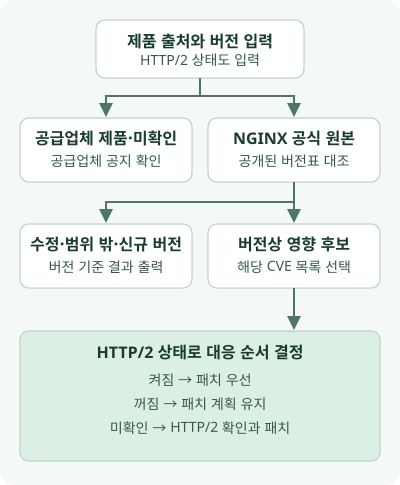

**NGINX에서 HTTP/2를 받는 서버를 먼저 확인하세요.** 2026년 11월 18일 공개된 CVE-2026-123007과 CVE-2026-123633은 HTTP/2 처리 중 메모리를 손상시킬 수 있으며, 조건에 따라 워커가 중단되거나 워커의 권한으로 원격 코드가 실행될 수 있습니다. NGINX Open Source의 수정 버전은 stable **1.30.7**, mainline **1.31.9**입니다. 배포판 패키지, NGINX Plus, Ingress 제품은 공급업체의 수정 버전을 기준으로 확인하세요. [NGINX 보안 공지](https://nginx.org/en/security_advisories.html) · [F5 11월 18일 보안 업데이트](https://my.f5.com/s/article/K000164058)

## 어떤 환경이 영향을 받나요?

여기서 **Nginx4Shell**은 독자가 찾는 별칭으로 사용합니다. 변경 티켓과 자산 인벤토리에는 두 CVE 번호를 각각 적어야 제품별 공지와 패치 상태를 정확히 대조할 수 있습니다.

| CVE | 영향 조건과 결과 | NGINX Open Source 영향 버전 |
| --- | --- | --- |
| CVE-2026-123007 | NGINX가 클라이언트 HTTP/2를 처리할 때 발생할 수 있는 메모리 손상입니다. 정적 콘텐츠만 제공하는 서버도 HTTP/2가 켜져 있다면 점검 대상입니다. | 1.9.5~1.30.6 및 1.31.0~1.31.8 |
| CVE-2026-123633 | 클라이언트 HTTP/2 요청을 업스트림으로 전달하는 환경에서 조건에 따라 이미 해제된 메모리를 참조할 수 있습니다. HTTP/2 역방향 프록시를 우선 점검하세요. | 1.19.7~1.30.6 및 1.31.0~1.31.8 |

두 범위 모두 1.30.7이 수정된 stable 릴리스입니다. 따라서 1.30.7보다 숫자가 큰 **1.31.8은 여전히 영향 범위**에 듭니다. 이번 업데이트는 HTTP/3, DNS 리졸버, 메일 프록시 등에도 수정 사항을 포함합니다. HTTP/2 설정 변경으로 임시 대응할 때도 제품 패치는 계속 준비하세요. [NGINX 릴리스 공지](https://nginx.org/news.html) · [F5 CVE-2026-123007](https://my.f5.com/s/article/K000163926) · [F5 CVE-2026-123633](https://my.f5.com/s/article/K000163928) · [CERT-EU 권고](https://cert.europa.eu/publications/security-advisories/2026-022)

## 실행 중인 제품과 HTTP/2 경로 확인하기

1. **실행 중인 바이너리의 출처를 확인합니다.** VM에서는 서비스가 사용하는 실행 파일과 패키지를, 컨테이너에서는 실제로 실행 중인 이미지와 다이제스트를 확인합니다. 해당 환경에서 `nginx -V`로 버전과 빌드 옵션을 볼 수 있습니다. Ubuntu 24.04 LTS처럼 수정 사항을 기존 버전에 적용하는 배포판도 있습니다. Ubuntu 공지에서 이 배포판의 수정 패키지는 `1.24.0-2ubuntu7.20`입니다. [NGINX 명령줄 옵션](https://nginx.org/en/docs/switches.html) · [Ubuntu USN-9159-1](https://ubuntu.com/security/notices/USN-9159-1)
2. **클라이언트 또는 앞단 프록시에서 NGINX로 들어오는 구간을 확인합니다.** 브라우저가 CDN과 HTTP/2로 연결한다는 사실만으로 CDN에서 원본 NGINX까지의 프로토콜을 알 수 없습니다. 실제 서비스가 쓰는 설정을 `nginx -T`로 확인하고 `http`·`server` 블록, 포함 파일, 구문 버전을 함께 봅니다. 설정 전체에는 내부 주소나 비밀값이 있을 수 있으므로 승인된 환경에서 확인합니다. [NGINX HTTP/2 모듈 문서](https://nginx.org/en/docs/http/ngx_http_v2_module.html)
3. **외부 요청이 닿는 영향을 받는 인스턴스부터 패치합니다.** 배포 뒤 새 바이너리 또는 이미지로 프로세스가 교체됐는지 확인합니다. 설정 검사 `nginx -t`와 함께 실제 서비스의 정상 HTTP 요청, 업스트림 상태, 오류율과 워커 재시작 지표를 봅니다. 클러스터라면 이전 이미지로 실행 중인 복제본이 남아 있는지도 확인합니다. [CERT-EU 권고](https://cert.europa.eu/publications/security-advisories/2026-022)

즉시 업데이트할 수 없다면 영향받는 리스너에서 HTTP/2를 끄는 방식으로 두 CVE의 노출을 줄일 수 있습니다. 현대 구문은 `http2 off;`를 사용하며, 이전 구문의 설정은 `listen`에 붙은 `http2` 옵션을 제거합니다. 변경 전에 gRPC처럼 HTTP/2에 의존하는 경로를 확인하고, 변경 뒤에는 해당 리스너의 실제 연결과 서비스 정상 요청을 확인합니다. [NGINX HTTP/2 설정 문서](https://nginx.org/en/docs/http/ngx_http_v2_module.html) · [Red Hat 대응 가이드](https://access.redhat.com/security/vulnerabilities/RHSB-2026-019)

## 실습 — 점검 결과를 패치 우선순위로 바꾸기

아래 예제는 운영자가 확인한 **제품 출처, 버전, HTTP/2 상태**를 입력받습니다. Python 3.10 이상에서 실행하며 표준 라이브러리만 사용합니다. 앞선 절차에서 확인한 정보로 패치 우선순위를 정할 때 쓸 수 있습니다.



`nginx_http2_triage.py`로 저장하세요. `upstream`은 NGINX 프로젝트가 배포한 Open Source 원본에만 사용합니다. 패키지 백포트나 공급업체 이미지에 해당하면 `vendor`를 지정합니다. 출처나 리스너의 실제 설정을 확인하지 못했으면 각각 `unknown`을 지정합니다.

```python
import argparse
import re


def upstream_version(value: str) -> tuple[int, int, int]:
    if not re.fullmatch(r"[0-9]{1,4}\.[0-9]{1,4}\.[0-9]{1,4}", value):
        raise argparse.ArgumentTypeError("use an upstream version such as 1.30.7")
    major, minor, patch = map(int, value.split("."))
    return major, minor, patch


def triage(origin: str, value: str, http2: str) -> str:
    if origin != "upstream":
        return "CHECK_VENDOR_ADVISORY"

    version = upstream_version(value)
    if version[0] != 1 or version > (1, 31, 9):
        return "CHECK_CURRENT_ADVISORY"
    if (1, 30, 7) <= version < (1, 31, 0) or version == (1, 31, 9):
        return "UPSTREAM_FIX_VERSION"

    affected = [
        cve
        for cve, first_version in (
            ("CVE-2026-123007", (1, 9, 5)),
            ("CVE-2026-123633", (1, 19, 7)),
        )
        if version >= first_version
    ]
    if not affected:
        return "OUTSIDE_LISTED_RANGES"

    action = {
        "on": "PRIORITIZE_PATCH",
        "off": "PATCH_STILL_REQUIRED",
        "unknown": "VERIFY_HTTP2_AND_PATCH",
    }[http2]
    return f"{action} {' '.join(affected)}"


def main() -> None:
    parser = argparse.ArgumentParser()
    parser.add_argument("origin", choices=("upstream", "vendor", "unknown"))
    parser.add_argument("version")
    parser.add_argument("http2", choices=("on", "off", "unknown"))
    args = parser.parse_args()
    try:
        print(triage(args.origin, args.version, args.http2))
    except argparse.ArgumentTypeError as error:
        parser.error(str(error))


if __name__ == "__main__":
    main()
```

```bash
python3 nginx_http2_triage.py upstream 1.31.8 on
python3 nginx_http2_triage.py upstream 1.30.7 on
python3 nginx_http2_triage.py upstream 1.19.6 unknown
python3 nginx_http2_triage.py vendor 1.24.0-2ubuntu7.20 on
```

Python 3.13.0에서 위 명령을 실행해 다음 출력을 확인했습니다.

```text
PRIORITIZE_PATCH CVE-2026-123007 CVE-2026-123633
UPSTREAM_FIX_VERSION
VERIFY_HTTP2_AND_PATCH CVE-2026-123007
CHECK_VENDOR_ADVISORY
```

출력의 CVE 목록은 **버전상 영향 후보**입니다. CVE-2026-123633의 업스트림 구성까지 판정하려면 실제 리스너를 대조해야 합니다. 이 예제는 입력값과 공개된 버전표로 분류하며, 운영 서버의 설정이나 패치 적용 상태를 자동으로 확인하지 않습니다.
