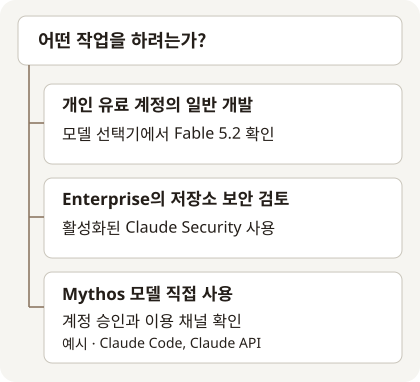

---
{
  "kind": "post",
  "publishedAt": "2026-11-22T16:41:21+09:00",
  "updatedAt": "2026-11-22T16:41:21+09:00",
  "reviewedAt": "2026-11-22",
  "reviewStatus": "source-audited",
  "reviewScope": "Checked Anthropic’s public documentation, shell syntax, and both localized diagram layouts. Authenticated Claude behavior was not tested.",
  "reviewSources": [
    "https://www.anthropic.com/claude-fable-and-mythos-5-2#availability",
    "https://support.claude.com/en/articles/15425695-covered-models",
    "https://support.claude.com/en/articles/14604842-cyber-verification-program",
    "https://www.anthropic.com/project/glasswing",
    "https://www.anthropic.com/claude/mythos",
    "https://www.anthropic.com/claude-fable-and-mythos-5-2",
    "https://support.claude.com/en/articles/14661296-use-claude-security",
    "https://claude.com/product/claude-security",
    "https://code.claude.com/docs/en/model-config",
    "https://support.claude.com/en/articles/15424964-claude-fable-models-on-your-plan",
    "https://platform.claude.com/docs/en/api/models/retrieve",
    "https://platform.claude.com/docs/en/models/fable-5-2/migration-guide"
  ],
  "language": "ko",
  "translationKey": "2026-11-22-claude-mythos-availability",
  "routeSlug": "2026-11-22-claude-mythos-availability",
  "title": "Claude Mythos 5.2는 어디서 쓸 수 있을까? Claude Security, Claude Code, API 비교",
  "description": "Claude Mythos 5.2 직접 접근을 승인받는 조건, Enterprise의 Claude Security 사용 조건, 유료 플랜에서 Fable 5.2를 확인하는 방법을 비교합니다.",
  "categories": [
    "ai"
  ],
  "tags": [
    "claude",
    "claude-mythos",
    "claude-fable",
    "claude-security",
    "claude-code"
  ]
}
---

**Claude Mythos 5.2를 모델로 직접 쓰려면 Anthropic의 검증 프로그램의 승인이 필요합니다.** 해당 플랜의 개인 사용자도 Cyber Verification Program(CVP)에서 Defense Access를 승인받으면 쓸 수 있습니다. Claude Enterprise 조직은 Claude Security를 활성화해 Mythos 5.2로 코드를 스캔할 수 있습니다. **Fable 5.2**는 유료 Claude 플랜에서 제공되며, 사용량 크레딧 조건은 플랜과 좌석에 따라 다릅니다. 이 글은 **2026년 11월 22일** 공개 문서를 기준으로 정리했습니다. [Anthropic 5.2 발표](https://www.anthropic.com/claude-fable-and-mythos-5-2#availability) · [Claude Help Center 모델 공개 범위](https://support.claude.com/en/articles/15425695-covered-models) · [Cyber Verification Program](https://support.claude.com/en/articles/14604842-cyber-verification-program)

## 내 계정에서 쓸 수 있는 경로



| 하고 싶은 일 | 확인할 곳 | 접근 조건 |
| --- | --- | --- |
| Claude에서 코드나 문서 작업에 5.2 계열 모델 쓰기 | Claude 웹·데스크톱·모바일의 모델 선택기 또는 Claude Code | 유료 플랜에서 Fable 5.2 사용 가능. 사용량 크레딧 조건은 플랜과 좌석에 따라 다름 |
| 회사 저장소의 코드 보안 검토에 Mythos 활용하기 | Claude 웹의 Claude Security | Enterprise 공개 베타. 조직 설정 활성화와 Claude Code 포함 좌석 필요 |
| Claude Code나 Claude API에서 Mythos를 모델로 직접 사용하기 | 계정의 모델 접근 권한 또는 API에서 사용하는 워크스페이스 | 검증 프로그램 승인 필요. 해당 플랜의 개인 사용자도 Defense Access 신청 가능 |

**Mythos Preview**는 Anthropic이 2026년 4월 Project Glasswing의 참가 조직에 제공한 연구 프리뷰입니다. Anthropic은 11월 9일 **Mythos 5.2**를 발표했습니다. Mythos 이용 범위를 다룬 자료를 비교할 때는 발표 날짜와 모델 버전을 함께 확인합니다. [Project Glasswing 발표](https://www.anthropic.com/project/glasswing) · [Claude Mythos 모델 안내](https://www.anthropic.com/claude/mythos)

## Enterprise에서 Mythos가 쓰이는 곳

**Claude Security에서는 저장소 스캔에 Mythos 5.2를 사용합니다.** 예를 들어 사내 웹 서비스의 코드에서 권한 확인이 빠진 위치를 검토하고, 발견 항목의 근거와 수정 제안을 팀에서 확인하는 용도입니다. Anthropic은 Cyber Verification Program에 참여하지 않은 Enterprise 고객에게도 Claude Security를 제공한다고 밝혔습니다. 도움말 기준으로 사용자는 Claude Code가 포함된 좌석이 필요하며, 좌석 기반 Enterprise 플랜에서는 사용량 크레딧을 켜야 합니다. Claude Code가 포함된 좌석을 가진 조직 소유자가 `Organization settings → Claude Security`에서 기능을 활성화합니다. [Anthropic 출시 발표](https://www.anthropic.com/claude-fable-and-mythos-5-2) · [Claude Security 사용 조건](https://support.claude.com/en/articles/14661296-use-claude-security)

발견 항목은 Claude Code에서 열어 수정 작업에 활용할 수 있습니다. **스캔과 Claude Code 세션에는 각각의 모델 권한이 적용됩니다.** 스캔은 Mythos를 쓰고, Claude Code 세션은 계정에 제공되는 모델을 사용합니다. 그래서 Enterprise에 Claude Security가 표시되더라도 일반 채팅의 모델 목록에는 Mythos가 없을 수 있습니다. [Claude Security 제품 안내](https://claude.com/product/claude-security) · [Claude Code 모델 설정 문서](https://code.claude.com/docs/en/model-config)

## 개인 플랜에서는 Fable 5.2 확인하기

Anthropic에 따르면 Fable 5.2와 Mythos 5.2는 같은 기반 모델을 공유합니다. Fable에는 사이버보안과 생명과학 분야에 추가 보호 조치가 적용됩니다. 저장소의 구조를 이해하거나 리팩터링 계획을 세우는 일반 개발 작업에는 개인 유료 계정에서 선택할 수 있는 Fable 5.2를 살펴볼 수 있습니다. Pro와 일부 표준 좌석은 Fable을 사용할 때 처음부터 사용량 크레딧이 필요합니다. [Anthropic 모델 발표](https://www.anthropic.com/claude-fable-and-mythos-5-2) · [플랜별 Fable 이용 조건](https://support.claude.com/en/articles/15424964-claude-fable-models-on-your-plan)

웹·데스크톱·모바일에서는 모델 선택기에서 `Fable 5.2`를 찾습니다. Claude Code를 터미널에서 쓰고 있다면 도움말이 안내하는 최소 버전 **2.1.321**을 충족하는지 먼저 확인하고, 세션에서 `/model`을 열어 선택 가능한 모델을 살펴봅니다. [Claude 플랜 도움말](https://support.claude.com/en/articles/15424964-claude-fable-models-on-your-plan) · [Claude Code 모델 설정 문서](https://code.claude.com/docs/en/model-config)

```sh
claude --version
```

Claude API를 쓰는 경우에는 모델 메타데이터만 조회해 Fable 모델 ID를 확인할 수 있습니다. 아래 예제를 실행하려면 셸에 `curl`이 설치되어 있고, 해당 워크스페이스의 API 키가 `ANTHROPIC_API_KEY` 환경 변수에 설정되어 있어야 합니다. 성공 시 예상하는 응답의 `id`는 `claude-fable-5-2`입니다. 공식 요청 형식을 대조하고 셸 구문을 확인했습니다. 메타데이터 응답이나 모델 선택 등 인증이 필요한 Claude 동작은 검증하지 않았습니다. [Claude API 모델 조회 문서](https://platform.claude.com/docs/en/api/models/retrieve)

```sh
curl --fail-with-body --silent --show-error \
  'https://api.anthropic.com/v1/models/claude-fable-5-2' \
  -H 'anthropic-version: 2026-10-21' \
  -H "Authorization: Bearer ${ANTHROPIC_API_KEY}"
```

## Mythos 직접 사용 권한을 확인할 때

Cyber Verification Program 도움말에 따르면 독립 보안 연구자와 오픈소스 유지관리자 등도 Pro·Max·Ultra 같은 해당 플랜에서 **Defense Access**를 신청할 수 있습니다. 이 등급을 승인받으면 Mythos 5.2를 쓸 수 있습니다. 유료 구독만으로는 접근 권한이 생기지 않습니다. Anthropic은 생명과학 연구에 별도의 검증 프로그램을 운영합니다. [Cyber Verification Program 도움말](https://support.claude.com/en/articles/14604842-cyber-verification-program) · [Anthropic 이용 범위 발표](https://www.anthropic.com/claude-fable-and-mythos-5-2#availability)

Claude API 문서에 기재된 Mythos 5.2 모델 ID는 `claude-mythos-5-2`입니다. 이용 가능 여부는 계정이나 조직에 부여된 권한과 이용 채널에 따라 달라집니다. Claude와 Claude Console의 접근 권한은 별도로 관리되며, Console 권한은 지정된 워크스페이스에 적용됩니다. 클라우드를 통해 Claude를 이용하는 조직은 연결된 클라우드 계정과 플랫폼 지원 범위도 확인합니다. [Claude API 모델 가이드](https://platform.claude.com/docs/en/models/fable-5-2/migration-guide) · [Claude Help Center 플랜·워크스페이스·클라우드 계정 안내](https://support.claude.com/en/articles/14604842-cyber-verification-program)
