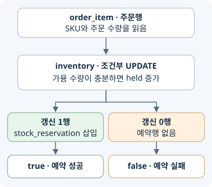

---
{
  "kind": "post",
  "publishedAt": "2026-11-22T22:23:59+09:00",
  "updatedAt": "2026-11-22T22:23:59+09:00",
  "reviewedAt": "2026-11-22",
  "reviewStatus": "source-audited",
  "reviewScope": "PostgreSQL 제약·트랜잭션·인덱스 문서와 Stripe 웹훅 문서를 대조했습니다. PostgreSQL 17.12에서 재고 예약 경합, 가격 스냅샷, 중복 예약 오류 시 롤백을 확인했습니다. PG 연동, 만료 처리 경합, 운영 부하는 별도 검증이 필요합니다.",
  "reviewSources": [
    "https://www.postgresql.org/docs/17/ddl-constraints.html#DDL-CONSTRAINTS-CHECK-CONSTRAINTS",
    "https://www.postgresql.org/docs/17/ddl-constraints.html#DDL-CONSTRAINTS-UNIQUE-CONSTRAINTS",
    "https://docs.stripe.com/webhooks#handle-duplicate-events",
    "https://www.postgresql.org/docs/17/transaction-iso.html#XACT-READ-COMMITTED",
    "https://www.postgresql.org/docs/17/indexes-multicolumn.html",
    "https://www.postgresql.org/docs/17/indexes-partial.html"
  ],
  "translationKey": "2026-11-22-commerce-database-design",
  "routeSlug": "2026-11-22-commerce-database-design",
  "categories": [
    "architecture"
  ],
  "tags": [
    "ecommerce",
    "postgresql",
    "inventory",
    "payments"
  ],
  "language": "ko",
  "title": "커머스 DB 설계 방법 — SKU·주문·재고·결제를 어떤 테이블에 담을까?",
  "description": "SKU, 주문 금액 스냅샷, 재고 예약, 결제 시도를 PostgreSQL 테이블로 모델링하고 두 세션에서 마지막 재고 한 개의 예약 경합을 확인합니다."
}
---

**커머스 DB는 현재 판매 조건, 거래 당시 주문 금액, 실제 재고 예약, PG의 결제 결과를 각각 보존해야 합니다.** 키보드 가격이 내일 바뀌어도 어제 주문 금액은 그대로 보여야 하고, 오늘 재고가 한 개라면 동시에 들어온 두 주문 중 하나만 그 수량을 확보해야 합니다. 어떤 테이블과 제약이 이 두 가지를 지키는지 PostgreSQL로 확인합니다.

[앞 글의 마지막 재고 하나 예제](/ko/posts/2026-11-22-commerce-system-design-last-unit-of-stock/)를 이어갑니다. 한 판매자, 실물 상품, 단일 창고, 원화 결제를 가정합니다. 재고와 주문은 같은 DB에 두고, 출고 이후 반품과 정산은 별도의 업무 모델로 남깁니다.

## 구매 한 건에서 남겨야 할 사실부터 고른다

| 질문 | 읽거나 기록할 테이블 | 기준 키와 값 |
| --- | --- | --- |
| 검은색 키보드를 지금 얼마에 팔까? | `product` → `sku` | 상품 ID, 판매 가능한 SKU, 현재 가격 |
| 어제 주문에서 왜 43,000원을 받았나? | `orders` → `order_item` | 주문 ID, 확정 수량·단가·할인·배송비 |
| 누가 마지막 한 개를 확보했나? | `inventory`, `stock_reservation` | SKU별 실재고와 주문행별 예약 |
| PG 응답을 잃은 뒤 같은 거래를 어떻게 찾나? | `payment_attempt`, `payment_event` | 주문별 결제 시도, PG 거래 ID, 이벤트 ID |

예제의 `product`는 전시 상품이고 `sku`는 검은색 키보드처럼 주문 가능한 옵션입니다. 주문행은 SKU를 참조하면서 **거래 당시의 이름·옵션명·단가를 복사해 보관**합니다. 수량 한 개에 단가 42,000원, 할인 2,000원, 배송비 3,000원이면 주문 총액은 43,000원입니다. 현재 SKU 가격으로 다시 계산할 필요가 없습니다. 거래 금액과 예약 수량의 근거가 되는 주문행은 주문 생성 후 수정하지 않는 경로로 관리합니다. 거래에 사용한 SKU는 판매 중지로 관리하며, 과거 주문이 참조하는 행에는 연쇄 삭제를 적용하지 않습니다.

## PostgreSQL의 키와 제약으로 옮긴다

아래 DDL은 빈 실습 DB에 한 번 실행합니다. ID는 예제에서 직접 지정하고, 금액은 원 단위 정수로 저장합니다. 장바구니에서 같은 SKU는 하나의 주문행으로 합친다는 가정이 있어 `(order_id, sku_id)`가 주문행과 예약의 키가 됩니다.

```sql
CREATE TABLE product (
    id bigint PRIMARY KEY,
    name text NOT NULL
);

CREATE TABLE sku (
    id bigint PRIMARY KEY,
    product_id bigint NOT NULL REFERENCES product(id),
    code text NOT NULL UNIQUE,
    option_name text NOT NULL,
    current_price_krw bigint NOT NULL CHECK (current_price_krw >= 0),
    sellable boolean NOT NULL
);

CREATE TABLE inventory (
    sku_id bigint PRIMARY KEY REFERENCES sku(id),
    on_hand integer NOT NULL CHECK (on_hand >= 0),
    held integer NOT NULL CHECK (held >= 0),
    allocated integer NOT NULL CHECK (allocated >= 0),
    CHECK (held <= on_hand - allocated)
);

CREATE TABLE orders (
    id bigint PRIMARY KEY,
    customer_id bigint NOT NULL,
    request_key text NOT NULL,
    request_hash text NOT NULL,
    status text NOT NULL CHECK (status IN ('PENDING_PAYMENT', 'CONFIRMED', 'CANCELLED')),
    total_krw bigint NOT NULL CHECK (total_krw >= 0),
    shipping_krw bigint NOT NULL CHECK (shipping_krw >= 0),
    created_at timestamptz NOT NULL DEFAULT now(),
    UNIQUE (customer_id, request_key)
);

CREATE TABLE order_item (
    order_id bigint REFERENCES orders(id),
    sku_id bigint REFERENCES sku(id),
    item_name text NOT NULL,
    option_name text NOT NULL,
    quantity integer NOT NULL CHECK (quantity > 0),
    unit_price_krw bigint NOT NULL CHECK (unit_price_krw >= 0),
    discount_krw bigint NOT NULL CHECK (discount_krw >= 0),
    CHECK (discount_krw <= quantity * unit_price_krw::numeric),
    PRIMARY KEY (order_id, sku_id)
);

CREATE TABLE stock_reservation (
    order_id bigint,
    sku_id bigint REFERENCES inventory(sku_id),
    state text NOT NULL CHECK (state IN ('HELD', 'ALLOCATED', 'RELEASED', 'SHIPPED')),
    expires_at timestamptz NOT NULL,
    PRIMARY KEY (order_id, sku_id),
    FOREIGN KEY (order_id, sku_id) REFERENCES order_item(order_id, sku_id)
);

CREATE TABLE payment_attempt (
    id bigint PRIMARY KEY,
    order_id bigint NOT NULL REFERENCES orders(id),
    attempt_no integer NOT NULL CHECK (attempt_no > 0),
    provider text NOT NULL,
    merchant_account text NOT NULL,
    provider_request_key text NOT NULL,
    provider_payment_id text,
    amount_krw bigint NOT NULL CHECK (amount_krw >= 0),
    state text NOT NULL CHECK (state IN
        ('PENDING', 'UNKNOWN', 'PAID', 'CLOSED_UNPAID', 'REFUND_PENDING', 'REFUNDED')),
    UNIQUE (order_id, attempt_no),
    UNIQUE (provider, merchant_account, provider_request_key),
    UNIQUE (provider, merchant_account, provider_payment_id)
);

CREATE TABLE payment_event (
    provider text,
    merchant_account text,
    event_id text,
    received_at timestamptz NOT NULL DEFAULT now(),
    PRIMARY KEY (provider, merchant_account, event_id)
);

CREATE INDEX orders_customer_history
    ON orders (customer_id, created_at DESC, id DESC);

CREATE INDEX reservation_expiry
    ON stock_reservation (expires_at, order_id, sku_id)
    WHERE state = 'HELD';
```

`CHECK`는 재고 행 하나에서 `held + allocated ≤ on_hand`를 보장합니다. 주문 총액이 주문행 합계와 맞는지, 예약행 수량의 합이 재고의 `held`와 맞는지는 여러 행을 읽어야 합니다. 주문 작성 트랜잭션에서 합계와 예약을 함께 기록하고, 운영에서는 집계값과 예약 내역을 주기적으로 대조합니다. [PostgreSQL CHECK 제약 문서](https://www.postgresql.org/docs/17/ddl-constraints.html#DDL-CONSTRAINTS-CHECK-CONSTRAINTS)

같은 구매자가 동일한 `request_key`를 재전송하면 기존 주문을 조회합니다. 저장한 `request_hash`가 다르면 키 재사용 충돌로 처리합니다. PG 거래 ID는 요청 시점에 없을 수 있으므로 처음에는 `NULL`을 허용하고, 확정된 외부 ID는 PG와 가맹점 계정 범위에서 유일하게 관리합니다. `payment_event`는 수신 기록 중복을 거르는 키입니다. 다른 이벤트 ID로 같은 성공 상태가 다시 올 수 있으므로, 출고 요청은 주문별 유일 키와 상태 전이로 별도로 보호합니다. [PostgreSQL UNIQUE 제약 문서](https://www.postgresql.org/docs/17/ddl-constraints.html#DDL-CONSTRAINTS-UNIQUE-CONSTRAINTS) · [Stripe 웹훅 중복 처리 안내](https://docs.stripe.com/webhooks#handle-duplicate-events)

## 마지막 재고는 조건부 UPDATE로 예약한다



가용 수량은 `on_hand - allocated - held`입니다. 화면을 그릴 때 읽은 수량과 무관하게, 주문 시점에 **수량을 확인하는 조건과 예약 수량을 늘리는 명령을 같은 UPDATE에 둡니다.** 갱신 결과가 있을 때만 예약행을 삽입합니다. SQL 오류로 삽입이 실패하면 같은 SQL 문장에서 늘린 예약 수량도 롤백됩니다.

```sql
CREATE FUNCTION reserve_stock(p_order_id bigint, p_sku_id bigint,
                              p_expires_at timestamptz)
RETURNS boolean
LANGUAGE sql
AS $$
    WITH held_stock AS (
        UPDATE inventory AS i
           SET held = i.held + line.quantity
          FROM order_item AS line
         WHERE line.order_id = p_order_id
           AND line.sku_id = p_sku_id
           AND i.sku_id = line.sku_id
           AND i.on_hand - i.allocated - i.held >= line.quantity
         RETURNING i.sku_id
    ), reservation AS (
        INSERT INTO stock_reservation (order_id, sku_id, state, expires_at)
        SELECT p_order_id, sku_id, 'HELD', p_expires_at
        FROM held_stock
        RETURNING 1
    )
    SELECT EXISTS (SELECT 1 FROM reservation);
$$;
```

실제 체크아웃은 새 주문·주문행, 모든 SKU 예약, 초기 결제 시도와 발행할 작업을 같은 DB 트랜잭션에 넣습니다. 예약 함수가 한 품목이라도 `false`를 반환하면 호출자가 전체 트랜잭션을 롤백합니다. 여러 SKU를 잡을 때는 SKU ID 순서처럼 일관된 잠금 순서를 사용합니다. 같은 주문을 재전송했을 때는 호출자가 주문 유일 키를 확인한 뒤 이미 예약한 주문에 이 함수를 다시 호출하지 않습니다. 예약 삽입에 `ON CONFLICT DO NOTHING`을 붙여 재고 카운터만 증가하게 만드는 동작도 피합니다.

PG는 로컬 커밋 이후에 호출합니다. 결제가 확정되면 예약을 `ALLOCATED`로 옮기고 `held`를 줄인 만큼 `allocated`를 늘립니다. 해제는 `held`만 줄이고, 출고는 `on_hand`와 `allocated`를 함께 줄입니다. 이 후속 변경을 구현할 때는 예약과 재고 행을 같은 트랜잭션에서 잠그고 기대하는 이전 상태를 확인해야 같은 예약을 두 번 차감하지 않습니다.

## 두 세션에서 마지막 한 개를 경쟁시킨다

앞의 DDL과 함수를 실행한 실습 DB에 아래 데이터를 넣습니다. 예약 경합만 재현하려고 주문행 두 개는 미리 준비합니다.

```sql
INSERT INTO product VALUES (1, 'Keyboard');
INSERT INTO sku VALUES (101, 1, 'KB-BLK', 'Black', 42000, true);
INSERT INTO inventory VALUES (101, 1, 0, 0);

INSERT INTO orders (id, customer_id, request_key, request_hash,
                    status, total_krw, shipping_krw)
VALUES (41, 1001, 'checkout-a', 'fixture-a', 'PENDING_PAYMENT', 43000, 3000),
       (42, 1002, 'checkout-b', 'fixture-b', 'PENDING_PAYMENT', 43000, 3000);

INSERT INTO order_item
VALUES (41, 101, 'Keyboard', 'Black', 1, 42000, 2000),
       (42, 101, 'Keyboard', 'Black', 1, 42000, 2000);
```

같은 DB에 연결된 `psql` 세션 두 개를 엽니다. **A**에서 아래를 실행하면 `true`가 나오고 트랜잭션은 열린 채로 남습니다.

```sql
BEGIN ISOLATION LEVEL READ COMMITTED;
SELECT reserve_stock(41, 101, now() + interval '10 minutes') AS reserved;
```

A가 열린 상태에서 **B**에 아래를 실행합니다. B의 `SELECT`는 같은 재고 행을 갱신하려다 대기합니다.

```sql
BEGIN ISOLATION LEVEL READ COMMITTED;
SELECT reserve_stock(42, 101, now() + interval '10 minutes') AS reserved;
```

A에서 `COMMIT;`을 실행하면 B는 잠금이 풀린 뒤 최신 행에 `WHERE` 조건을 다시 적용합니다. 남은 수량은 0이어서 B는 `false`를 반환합니다. B에서 `ROLLBACK;`으로 실습을 마칩니다. [PostgreSQL Read Committed 동작](https://www.postgresql.org/docs/17/transaction-iso.html#XACT-READ-COMMITTED)

```sql
SELECT sku_id, on_hand, held, allocated FROM inventory;
SELECT order_id, sku_id, state FROM stock_reservation ORDER BY order_id;
```

PostgreSQL 17.12에서 두 DB 연결을 동시에 실행했습니다. `pg_stat_activity`에서 B의 잠금 대기를 확인한 뒤 A를 커밋했습니다. 실행 결과 A는 `true`, B는 `false`였고, 최종 `inventory`의 `on_hand / held / allocated`는 `1 / 1 / 0`이었습니다. 예약은 **주문 41의 `HELD` 한 건**만 남았습니다.

추가로 카탈로그 가격을 45,000원으로 바꾼 뒤에도 주문 41의 단가 42,000원과 총액 43,000원이 유지됐습니다. 재고를 한 개 보충한 뒤 주문 41의 예약 함수를 다시 호출하자 유일 키 위반이 발생했고 `held`는 1로 유지됐습니다. 이 실습은 두 연결의 경합과 SQL 제약을 검증했으며, PG 호출·만료 처리의 경합·운영 부하는 별도의 검증 대상입니다.

## 인덱스는 운영 화면의 첫 쿼리에서 고른다

고객 주문 내역은 `WHERE customer_id = … ORDER BY created_at DESC, id DESC LIMIT …` 형태입니다. DDL의 복합 인덱스는 고객 필터와 조회 순서를 함께 반영합니다. 예약 정리 작업은 `WHERE state = 'HELD' AND expires_at <= now()`를 사용하므로, 종료된 예약을 빼는 부분 인덱스를 둡니다. 만료 인덱스는 대상을 찾는 용도입니다. 실제 해제 여부는 잠금을 잡고 결제 상태까지 확인한 뒤 결정합니다. [PostgreSQL 다중 열 인덱스](https://www.postgresql.org/docs/17/indexes-multicolumn.html) · [PostgreSQL 부분 인덱스](https://www.postgresql.org/docs/17/indexes-partial.html)
