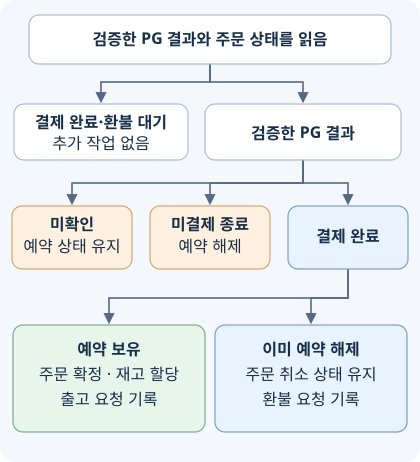

---
{
  "kind": "post",
  "publishedAt": "2026-11-22T21:00:52+09:00",
  "updatedAt": "2026-11-22T21:00:52+09:00",
  "reviewedAt": "2026-11-22",
  "reviewStatus": "source-audited",
  "reviewScope": "Stripe의 멱등 요청·웹훅과 AWS의 트랜잭셔널 아웃박스 문서를 대조했습니다. JDK 21.0.1에서 순차 상태 전이 일곱 건을 확인했습니다. 실제 DB 경합, PG 연동, 운영 결제는 별도 검증이 필요합니다.",
  "reviewSources": [
    "https://docs.stripe.com/api/idempotent_requests",
    "https://docs.stripe.com/webhooks#event-delivery-behaviors",
    "https://docs.stripe.com/webhooks#handle-duplicate-events",
    "https://docs.aws.amazon.com/prescriptive-guidance/latest/cloud-design-patterns/transactional-outbox.html"
  ],
  "translationKey": "2026-11-22-commerce-system-design-last-unit-of-stock",
  "routeSlug": "2026-11-22-commerce-system-design-last-unit-of-stock",
  "categories": [
    "architecture"
  ],
  "tags": [
    "ecommerce",
    "inventory",
    "payments",
    "transactional-outbox"
  ],
  "language": "ko",
  "title": "커머스 시스템 설계 — 마지막 재고 한 개를 누가 살 수 있을까?",
  "description": "마지막 재고 한 개를 둘러싼 주문 경합을 예로 들어 SKU 예약, 결제 결과 대사, 예약 해제 후 환불 요청의 경계를 살펴봅니다."
}
---

**재고가 한 개 남은 상품을 두 사람이 동시에 결제하려고 하면, 한 주문만 그 수량을 예약할 수 있어야 합니다.** 예약에 성공해 결제를 요청했는데 결제대행사(PG)의 응답이 끊기면 주문은 결제 확인 중으로 남깁니다. 나중에 결제 완료가 확인돼도 재고가 이미 풀린 주문은 출고하지 않습니다. 한 건의 구매를 따라가 보면 상품·재고·주문·결제가 각각 어떤 데이터를 책임져야 하는지 드러납니다.

한 판매자가 실물 상품을 자체 판매하고, 원화로 한 번 결제한 뒤 단일 창고에서 출고하는 예제입니다. 취소와 환불은 결제 미확인과 늦은 성공을 처리하는 데 필요한 범위로 다룹니다. 여러 판매자의 정산이나 부분 출고·반품은 후속 설계로 남깁니다.

## 상품 상세에서 본 수량과 주문에서 확보한 수량

카탈로그의 **상품**은 고객이 보는 페이지이고, **SKU**는 실제 주문·재고 관리의 단위입니다. 같은 키보드 상품이라도 흰색과 검은색 옵션은 서로 다른 SKU입니다. 상세 화면에는 조회 시점의 재고를 보여줍니다. 재고 모듈이 응답하지 않으면 상품은 표시하고 수량은 ‘확인 중’으로 둡니다. 장바구니에 담는 동작도 이 설계에서는 재고를 확보하지 않습니다.

| 책임 | 변경 권한을 가진 데이터 | 예시 |
| --- | --- | --- |
| 카탈로그·가격 | 상품, SKU, 판매 가능 여부, 현재 단가 | 검은색 키보드 `KB-BLK`의 단가 수정 |
| 재고 | 창고별 실재고, 예약, 출고 할당 | `KB-BLK` 한 개를 특정 주문에 예약 |
| 주문 | 구매자, 거래 당시 주문행과 금액, 주문 상태 | 주문 `O-42`의 수량·단가·할인 배분·배송비 저장 |
| 결제 | 결제 시도, PG 거래 ID, 결제·환불 상태 | 결제 시도 `P-1`의 PG 결과 대사 |
| 출고 | 출고 요청과 이행 상태 | 결제와 재고 할당이 완료된 주문을 피킹 |

상품을 결제하기 직전에 서버가 판매 가능 여부와 가격을 다시 확인합니다. 구매자는 인증된 세션에서 확인하고, 금액은 서버의 가격·할인·배송 조건으로 계산합니다. 예를 들어 장바구니에서 검은색 키보드가 39,000원이었는데 현재 가격이 42,000원이면 변경 금액을 보여주고 다시 동의를 받습니다. 주문을 생성할 때도 고객이 확인한 가격 버전과 서버의 적용 버전이 일치하는지 검사합니다. 주문을 만들 때 확정한 SKU·옵션명·수량·단가·할인·배송비·통화를 보존합니다. 바뀐 단가 42,000원에 할인 2,000원과 배송비 3,000원을 적용했다면 PG에 전달할 금액은 43,000원입니다. 다음 날 카탈로그에서 상품명을 바꾸거나 가격을 낮춰도 이미 승인된 주문 금액은 그대로 조회돼야 합니다. 기존 [Spring Boot 상품 조회 실습](/ko/posts/2026-11-22-spring-boot-4-2-restclient-migration/)의 화면 조회를 주문으로 확장할 때 추가되는 경계입니다.

## 어디까지 한 트랜잭션으로 묶을까?

카탈로그·재고·주문·결제 기록을 **한 애플리케이션의 별도 모듈**로 시작합니다. 하나의 DB를 쓰면서 각 모듈이 자기 테이블의 변경 규칙을 담당합니다. 이렇게 하면 주문과 예약을 한 로컬 트랜잭션에서 커밋할 수 있습니다. PG는 외부 시스템이므로 그 커밋이 끝난 뒤에 호출합니다.

1. **주문 생성과 재고 예약.** 구매자와 주문 요청 키를 기준으로 동일 요청을 식별합니다. 같은 키에 다른 요청 내용이 오면 충돌로 처리합니다. 재고 모듈은 SKU 행을 잠그거나 조건부 갱신으로 가용 수량을 확인하고 예약을 생성합니다. 여러 SKU가 들어 있는 주문은 모두 확보됐을 때 주문행·예약·결제 시도 기록을 함께 저장합니다. 한 품목이라도 부족하면 전체를 롤백하고 품절을 알립니다. 결제 요청을 재개할 수 있도록 실행할 작업도 같은 로컬 커밋에 남깁니다.
2. **PG 요청.** 로컬에 저장한 결제 시도 ID와 연결된 PG 멱등 키로 결제를 요청합니다. 서버가 호출 직후 종료돼도 처리 기록을 찾아 같은 시도를 대사할 수 있어야 합니다. 응답을 잃었다면 기존 PG 거래의 상태를 조회하고, 재전송은 PG가 해당 키와 요청 내용의 동일성을 보장하는 범위에서만 합니다. 결제 결과가 불분명한 동안 새 결제 시도를 만들지 않습니다. [Stripe 멱등 요청 문서](https://docs.stripe.com/api/idempotent_requests)
3. **결제 결과 반영.** 서명을 검증한 웹훅을 기록하거나 서버에서 PG 거래를 조회합니다. 주문·결제 시도·가맹점 계정·금액·통화가 일치하는지 확인합니다. 주문과 예약을 잠근 상태에서 최신 상태를 읽은 뒤 결제 상태, 재고 전이, 후속 작업을 한 트랜잭션에 저장합니다. 출고 또는 환불 요청은 같은 커밋에 아웃박스 레코드로 남깁니다. [Stripe 웹훅 전달 규칙](https://docs.stripe.com/webhooks#event-delivery-behaviors) · [AWS 트랜잭셔널 아웃박스 패턴](https://docs.aws.amazon.com/prescriptive-guidance/latest/cloud-design-patterns/transactional-outbox.html)

가용 수량은 이 예제에서 **실재고 − 활성 예약량 − 출고 할당량**입니다. 예약이 결제로 확정되면 예약량을 줄이고 같은 수량만큼 출고 할당량을 늘립니다. 출고 시 실재고와 출고 할당량을 함께 줄입니다. 재고가 한 개 남았을 때 두 주문이 동시에 들어오면 첫 예약이 커밋된 뒤 다음 주문이 가용 수량 0을 확인하게 해야 합니다. 이 규칙이 유지되는지는 실제 DB에서 두 트랜잭션을 겹쳐 검증합니다.

## 결제 미확인과 늦은 결제에 대응하기



그림은 재고 예약 이후에 결제 결과를 반영하는 흐름입니다. 코드에서는 결제 상태가 이미 `PAID` 또는 `REFUND_PENDING`이면 상태를 유지하고 후속 작업을 추가하지 않습니다.

주문, 결제, 재고 예약은 각자 상태를 가집니다. 화면에는 이를 조합해 고객이 이해할 수 있는 상태를 보여줍니다. 예를 들어 PG 응답이 지연되면 주문은 `PENDING_PAYMENT`, 결제는 `UNKNOWN`, 예약은 `HELD`입니다. 고객에게는 ‘결제 확인 중’으로 표시하고 같은 주문의 상태를 다시 조회하게 합니다.

| 상황 | 저장할 상태와 후속 동작 |
| --- | --- |
| 결제 완료 확인, 예약 보유 | 주문 `CONFIRMED` · 결제 `PAID` · 재고 `ALLOCATED`. 출고 요청 기록 |
| 응답 유실 또는 PG 처리 중 | 주문 `PENDING_PAYMENT` · 결제 `UNKNOWN` · 재고 `HELD`. 기존 결제 상태 재확인 |
| 과금 없이 종료 확정 | 주문 `CANCELLED` · 결제 `CLOSED_UNPAID` · 예약 `RELEASED` |
| 예외로 예약 해제한 뒤 결제 완료 확인 | 주문 `CANCELLED` · 결제 `REFUND_PENDING` · 예약 `RELEASED`. 환불 요청 기록 |

예약 기한이 지났는데 결제가 미확인이면 PG에서 상태를 먼저 확인합니다. 확인이 계속 실패하면 운영자가 거래를 찾아 대사할 수 있게 보류 건을 남깁니다. 이 예제에서는 예외로 예약을 먼저 해제한 주문에 결제 완료가 도착하면 재고를 다시 잡지 않고 환불을 요청합니다. 환불 성공은 PG 확인 후에 기록합니다. 예약을 얼마나 오래 유지할지와 누가 예외 해제를 승인할지는 매장의 재고 회전과 PG 계약에 맞춰 정해야 합니다.

웹훅 이벤트 ID로 동일 전송을 거르고, 이벤트 ID가 달라도 같은 결제에 대한 출고 요청은 한 번만 기록되도록 보호합니다. 예를 들어 출고 아웃박스에 `order_id`와 작업 종류의 유일 제약을, 환불 아웃박스에 `payment_attempt_id`와 작업 종류의 유일 제약을 둡니다. 아웃박스 발행이 재시도될 수 있으므로 출고·환불 작업자도 같은 작업 식별자로 중복 실행을 막습니다. PG 환불 재전송에는 해당 PG가 지원하는 환불별 멱등 키를 사용합니다. PG가 이미 확정한 결제에는 이전 처리 중 통지로 상태를 되돌리지 않습니다. 식별자나 금액이 다르거나 확정 경과와 모순되는 결과는 자동 반영 대신 대사 목록에 올립니다. [Stripe 웹훅 중복 처리 안내](https://docs.stripe.com/webhooks#handle-duplicate-events) · [AWS 트랜잭셔널 아웃박스 패턴](https://docs.aws.amazon.com/prescriptive-guidance/latest/cloud-design-patterns/transactional-outbox.html)

## Java로 결제 결과에 따른 전이를 확인하기

`CheckoutPolicy.java`에 아래 코드를 저장하고 `java CheckoutPolicy.java`를 실행합니다. 예제의 입력은 주문에 연결된 **한 결제 시도의 서버 측 검증 결과**입니다. `CLOSED_UNPAID`는 거절 메시지 하나가 아니라 과금 없이 거래가 종료됐음을 확인한 결과입니다. 코드는 주문 상태와 예약 상태가 일치한다고 가정합니다. 결제 대기 주문은 예약을 보유하고, 취소 주문은 이미 예약을 해제한 상태입니다. 식별자·금액 검증과 모순된 결과의 대사는 호출하는 쪽에서 처리합니다. 코드는 상태 전이와 기록할 후속 작업을 돌려줍니다.

```java
public class CheckoutPolicy {
    enum Order { PENDING_PAYMENT, CONFIRMED, CANCELLED }
    enum Payment { PENDING, UNKNOWN, PAID, CLOSED_UNPAID, REFUND_PENDING }
    enum Reservation { HELD, ALLOCATED, RELEASED }
    enum Result { UNRESOLVED, CLOSED_UNPAID, PAID }
    enum Effect { NONE, REQUEST_FULFILLMENT, REQUEST_REFUND }

    record State(Order order, Payment payment, Reservation reservation) {}
    record Decision(State state, Effect effect) {}

    static Decision apply(State current, Result result) {
        if (current.payment() == Payment.PAID
                || current.payment() == Payment.REFUND_PENDING) {
            return new Decision(current, Effect.NONE);
        }

        if (current.order() == Order.CANCELLED) {
            return switch (result) {
                case PAID -> new Decision(
                    new State(Order.CANCELLED, Payment.REFUND_PENDING, Reservation.RELEASED),
                    Effect.REQUEST_REFUND);
                case CLOSED_UNPAID -> new Decision(
                    new State(Order.CANCELLED, Payment.CLOSED_UNPAID, Reservation.RELEASED),
                    Effect.NONE);
                case UNRESOLVED -> new Decision(current, Effect.NONE);
            };
        }

        return switch (result) {
            case PAID -> new Decision(
                new State(Order.CONFIRMED, Payment.PAID, Reservation.ALLOCATED),
                Effect.REQUEST_FULFILLMENT);
            case CLOSED_UNPAID -> new Decision(
                new State(Order.CANCELLED, Payment.CLOSED_UNPAID, Reservation.RELEASED),
                Effect.NONE);
            case UNRESOLVED -> new Decision(
                new State(Order.PENDING_PAYMENT, Payment.UNKNOWN, Reservation.HELD),
                Effect.NONE);
        };
    }

    static void check(String label, Decision expected, Decision actual) {
        if (!expected.equals(actual)) {
            throw new AssertionError(label + ": " + actual);
        }
        System.out.println("PASS " + label);
    }

    public static void main(String[] args) {
        State held = new State(Order.PENDING_PAYMENT, Payment.PENDING, Reservation.HELD);
        State unknown = new State(Order.PENDING_PAYMENT, Payment.UNKNOWN, Reservation.HELD);
        State paid = new State(Order.CONFIRMED, Payment.PAID, Reservation.ALLOCATED);
        State closed = new State(
            Order.CANCELLED, Payment.CLOSED_UNPAID, Reservation.RELEASED);
        State released = new State(Order.CANCELLED, Payment.UNKNOWN, Reservation.RELEASED);
        State refundPending = new State(
            Order.CANCELLED, Payment.REFUND_PENDING, Reservation.RELEASED);

        check("unresolved retains hold", new Decision(unknown, Effect.NONE),
            apply(held, Result.UNRESOLVED));
        check("paid allocates stock", new Decision(paid, Effect.REQUEST_FULFILLMENT),
            apply(unknown, Result.PAID));
        check("duplicate paid has no effect", new Decision(paid, Effect.NONE),
            apply(paid, Result.PAID));
        check("old unresolved does not reopen payment", new Decision(paid, Effect.NONE),
            apply(paid, Result.UNRESOLVED));
        check("closed unpaid releases hold", new Decision(closed, Effect.NONE),
            apply(unknown, Result.CLOSED_UNPAID));
        check("late paid requests refund", new Decision(refundPending, Effect.REQUEST_REFUND),
            apply(released, Result.PAID));
        check("duplicate late paid has no effect", new Decision(refundPending, Effect.NONE),
            apply(refundPending, Result.PAID));
    }
}
```

JDK 21.0.1에서 다음 일곱 검사를 실행했습니다. 중복 결제 완료는 추가 작업을 만들지 않았고, 예약이 해제된 뒤 도착한 결제 완료는 출고 대신 환불 요청을 반환했습니다.

```text
PASS unresolved retains hold
PASS paid allocates stock
PASS duplicate paid has no effect
PASS old unresolved does not reopen payment
PASS closed unpaid releases hold
PASS late paid requests refund
PASS duplicate late paid has no effect
```

실제 구현에서 별도로 확인할 경합은 두 가지입니다. 서로 다른 주문이 마지막 한 개를 동시에 예약하면 성공은 한 번이어야 합니다. 같은 주문에서 만료 처리와 결제 완료가 동시에 들어오면, 예약이 있는 주문의 출고 또는 이미 해제된 주문의 환불 중 하나만 기록돼야 합니다. Java 예제의 순차 실행은 이 DB 경합, PG 연동, 운영 결제는 별도 검증이 필요합니다.

재고를 별도 서비스로 옮길 시점은 창고 운영 단위가 늘거나 재고 모듈의 독립 배포·확장 필요가 확인됐을 때입니다. 분리하면 주문 DB와 재고 DB가 같은 커밋을 공유할 수 없으므로, 재고 서비스가 예약 ID 기준으로 요청을 한 번만 반영하고 주문은 예약 결과를 재조회하거나 실패 보상을 해야 합니다. 경계를 옮겨도 **초과 판매를 막고 결제와 출고를 한 번씩 반영한다는 업무 규칙**은 유지해야 합니다.
