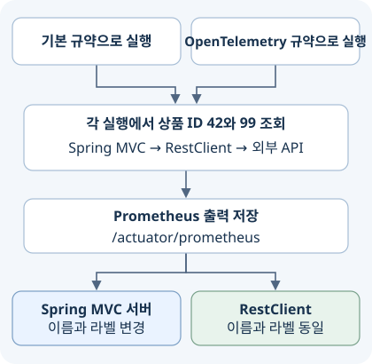

---
{
  "kind": "post",
  "publishedAt": "2026-11-22T09:57:06+09:00",
  "updatedAt": "2026-11-22T09:57:06+09:00",
  "reviewedAt": "2026-11-22",
  "reviewStatus": "source-audited",
  "reviewScope": "Checked official Spring Boot documentation and compared Korean and English code and diagram flows. Verified Spring MVC and RestClient series from two real Tomcat runs on Spring Boot 4.2.0, JDK 21.0.1 and Maven 3.9.11 with a local Python HTTP upstream. Checked both queries with promtool 3.5.0.",
  "reviewSources": [
    "https://github.com/spring-projects/spring-boot/wiki/Spring-Boot-4.2-Release-Notes#semantic-conventions",
    "https://docs.spring.io/spring-boot/reference/actuator/metrics.html#actuator.metrics.supported.http-clients",
    "https://docs.spring.io/spring-boot/reference/actuator/observability.html#actuator.observability.semantic-conventions",
    "https://prometheus.io/docs/prometheus/latest/querying/basics/",
    "https://prometheus.io/docs/prometheus/latest/querying/functions/#rate"
  ],
  "translationKey": "2026-11-22-spring-boot-4-2-otel-http-metrics",
  "routeSlug": "2026-11-22-spring-boot-4-2-otel-http-metrics",
  "categories": [
    "springboot"
  ],
  "tags": [
    "spring-boot",
    "opentelemetry",
    "prometheus",
    "micrometer",
    "restclient"
  ],
  "language": "ko",
  "title": "Spring Boot 4.2에서 OpenTelemetry 규약을 켜면 HTTP 메트릭이 어떻게 바뀔까?",
  "description": "Spring Boot 4.2.0에서 관측 규약을 바꿔 Spring MVC와 RestClient의 Prometheus 메트릭을 비교하고 404 쿼리를 옮깁니다."
}
---

**Spring Boot 4.2.0에서 OpenTelemetry 관측 규약을 켜면, Spring MVC 서버의 Prometheus 메트릭 이름이 `http_server_requests_seconds_count`에서 `http_server_request_duration_seconds_count`로 바뀝니다.** 404를 찾는 라벨도 `status`에서 `http_response_status_code`로 바뀝니다. 같은 앱에서 외부 API를 호출하는 `RestClient` 메트릭은 기존 이름과 라벨로 기록됐습니다. 대시보드나 알림 쿼리를 수정할 때 인바운드와 아웃바운드 메트릭을 각각 확인해야 하는 이유입니다. [Spring Boot 4.2 릴리스 노트](https://github.com/spring-projects/spring-boot/wiki/Spring-Boot-4.2-Release-Notes#semantic-conventions)

## 같은 요청 두 개를 두 설정에서 실행하기

[앞 글의 상품 조회 예제](/ko/posts/2026-11-22-spring-boot-4-2-restclient-migration/)를 사용합니다. 앱은 `GET /products/{id}`를 받으면 `RestClient`로 외부 API의 `GET /items/{id}`를 호출합니다. 이 실습에서 ID `42`는 `200`과 상품명 `Keyboard`를, ID `99`는 빈 `404`를 반환합니다.



그림은 두 실행을 보여줍니다. 각 실행에서 같은 요청을 보내고 비교할 Prometheus 출력을 따로 저장합니다.

Spring Boot 4.2.0, JDK 21을 사용합니다. 앞 글의 `pom.xml`과 `src/main/java/example/CatalogApplication.java`를 복사하세요. 이번 실습에 사용하지 않는 `spring-boot-starter-webmvc-test` 의존성을 빼고, Maven 의존성 목록에 아래 두 항목을 추가합니다. `CatalogApplication.java`에는 Boot가 구성한 `RestClient.Builder`를 주입받는 코드가 이미 들어 있습니다. [Spring Boot HTTP 클라이언트 메트릭 문서](https://docs.spring.io/spring-boot/reference/actuator/metrics.html#actuator.metrics.supported.http-clients)

```xml
<dependency>
    <groupId>org.springframework.boot</groupId>
    <artifactId>spring-boot-starter-actuator</artifactId>
</dependency>
<dependency>
    <groupId>io.micrometer</groupId>
    <artifactId>micrometer-registry-prometheus</artifactId>
</dependency>
```

실습용 앱을 실행 파일로 패키징하려면 `pom.xml`의 `<project>` 아래에 다음 설정을 추가합니다.

```xml
<build>
    <plugins>
        <plugin>
            <groupId>org.springframework.boot</groupId>
            <artifactId>spring-boot-maven-plugin</artifactId>
        </plugin>
    </plugins>
</build>
```

터미널 하나에서 외부 API를 대신할 로컬 서버를 시작합니다. `/items/42`는 파일을 읽어 반환하고, `/items/99`는 해당 파일이 없어 404를 반환합니다. 두 포트가 비어 있는 로컬 개발 환경을 사용합니다.

```sh
upstream_dir=$(mktemp -d)
mkdir -p "$upstream_dir/items"
printf '%s' Keyboard > "$upstream_dir/items/42"
python3 -m http.server 18081 --bind 127.0.0.1 --directory "$upstream_dir"
```

다른 터미널의 Maven 프로젝트 루트에서 앱을 빌드하고 기본 규약으로 시작합니다. 조회에 사용할 Actuator 엔드포인트를 열고 앱을 루프백 주소에 바인딩합니다.

```sh
mvn package

java -jar target/restclient-migration-1.0.0.jar \
  --server.address=127.0.0.1 \
  --server.port=18080 \
  --catalog.base-url=http://127.0.0.1:18081 \
  --management.endpoints.web.exposure.include=health,prometheus
```

앱이 기동되면 세 번째 터미널에서 아래 요청을 실행합니다. 먼저 요청 두 개의 응답을 확인하고, 그다음 누적 요청 횟수를 나타내는 `_count` 시계열이 포함된 Prometheus 출력을 저장합니다.

```sh
curl -sS -i http://127.0.0.1:18080/products/42
curl -sS -i http://127.0.0.1:18080/products/99
curl -fsS http://127.0.0.1:18080/actuator/prometheus > default.prom
```

앱을 종료한 뒤 같은 `java -jar` 명령에 `--management.observations.conventions=open-telemetry`를 추가해 다시 시작합니다. 조회 명령 세 개를 다시 실행하고 마지막 출력 파일만 `open-telemetry.prom`으로 바꿉니다. 새 프로세스에서 다시 시작하면 이전 실행의 누적 횟수가 섞이지 않습니다.

```sh
grep -E '^http_(server|client).*_count\{.*(/products/|/items/)' \
  default.prom open-telemetry.prom
```

## 실제 출력에서 달라진 이름과 라벨

JDK 21.0.1, Maven 3.9.11, Spring Boot 4.2.0과 내장 Tomcat에서 두 설정을 실행해 확인했습니다. 각 실행에서 `200`과 `404`를 한 번씩 요청했고, 네 조회 응답의 상태와 본문이 예제의 동작과 일치했습니다.

| MVC 서버 메트릭 | 기본 규약 | OpenTelemetry 규약 |
| --- | --- | --- |
| Prometheus 요청 횟수 | `http_server_requests_seconds_count` | `http_server_request_duration_seconds_count` |
| HTTP 메서드 라벨 | `method` | `http_request_method` |
| 응답 상태 라벨 | `status` | `http_response_status_code` |
| 라우트 라벨 | `uri` | `http_route` |
| 이 예제의 라우트 값 | `/products/{id}` | `/products/{id}` |

라벨에서 실제 ID 대신 라우트 템플릿이 보입니다. 아래는 캡처한 404 시계열 중 쿼리에 사용하는 라벨을 발췌한 것입니다. 두 실행 모두 서버 쪽 404 횟수가 `1`입니다.

```text
http_server_requests_seconds_count{status="404",uri="/products/{id}"} 1
http_server_request_duration_seconds_count{http_response_status_code="404",http_route="/products/{id}"} 1
```

같은 캡처에서 아웃바운드 요청은 두 설정 모두 `http_client_requests_seconds_count`에 기록됐습니다. 라벨은 `method="GET"`, `uri="/items/{id}"`, 그리고 `status="200"` 또는 `status="404"`였습니다. 이 결과는 이 예제의 Boot 자동 설정과 `RestClient.Builder` 조합에서 확인한 것입니다. 여기서는 Micrometer의 Prometheus 레지스트리로 메트릭을 확인했습니다. 규약을 고르는 설정과 데이터를 어느 방식으로 내보낼지는 별개입니다. [Spring Boot 관측성 문서](https://docs.spring.io/spring-boot/reference/actuator/observability.html#actuator.observability.semantic-conventions)

## 404 쿼리를 옮기기

기존 Grafana 패널이 이 라우트의 누적 404 횟수를 다음 식으로 조회한다면,

```text
sum(http_server_requests_seconds_count{uri="/products/{id}",status="404"})
```

OpenTelemetry 규약에서는 메트릭 이름과 두 라벨을 함께 바꿉니다.

```text
sum(http_server_request_duration_seconds_count{http_route="/products/{id}",http_response_status_code="404"})
```

실측한 두 시계열을 Prometheus 3.5.0의 `promtool`에 넣어 검증했습니다. 각 쿼리는 대응하는 규약의 시계열에서 `1`을 반환했고, 다른 규약의 시계열에서는 결과가 비었습니다.

위 식은 단일 실습 앱의 누적 횟수를 비교합니다. 운영에서 최근 구간의 초당 요청 수를 보고 있다면 기존 `rate(...[5m])` 같은 집계 방식은 유지하고 그 안의 메트릭 선택자를 바꾸세요. 구버전과 새 버전이 함께 수집되는 동안에는 배포 대상별로 조회해 두 이름이 각각 어디에서 들어오는지 확인하는 편이 쉽습니다. [Prometheus 쿼리 기본 문법](https://prometheus.io/docs/prometheus/latest/querying/basics/) · [Prometheus `rate()` 문서](https://prometheus.io/docs/prometheus/latest/querying/functions/#rate)

기존에 `management.observations.http.server.requests.name`으로 서버 메트릭 이름을 직접 지정했다면 그 이름을 참조하는 패널과 알림부터 확인하세요. OpenTelemetry 규약에서는 이 이름 설정이 적용되지 않습니다. 메트릭을 확인한 뒤 요청 하나를 로그와 트레이스에서 찾아보려면 [Grafana LGTM에서 로그와 트레이스 연결하기](/ko/posts/2026-11-02-grafana-lgtm-log-trace/)를 이어서 볼 수 있습니다. [Spring Boot 4.2 릴리스 노트](https://github.com/spring-projects/spring-boot/wiki/Spring-Boot-4.2-Release-Notes#semantic-conventions)
