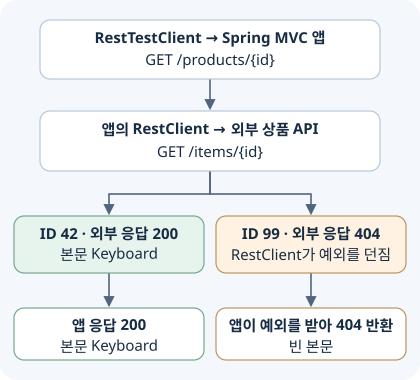

---
{
  "kind": "post",
  "publishedAt": "2026-11-21T16:35:26+00:00",
  "updatedAt": "2026-11-21T16:35:26+00:00",
  "reviewedAt": "2026-11-22",
  "reviewStatus": "source-audited",
  "reviewScope": "Checked Spring Boot 4.2 deprecations and HTTP status handling against official documentation. Compared Korean and English code and diagram branches. Executed three tests on Boot 4.2.0, JDK 21.0.1 and Maven 3.9.11 with real Tomcat and a local JDK HttpServer.",
  "reviewSources": [
    "https://github.com/spring-projects/spring-boot/wiki/Spring-Boot-4.2-Release-Notes#deprecation-of-testresttemplate-support",
    "https://docs.spring.io/spring-framework/reference/integration/rest-clients.html",
    "https://docs.spring.io/spring-boot/api/java/org/springframework/boot/resttestclient/TestRestTemplate.html",
    "https://docs.spring.io/spring-boot/reference/testing/spring-boot-applications.html#testing.spring-boot-applications.with-running-server"
  ],
  "translationKey": "2026-11-22-spring-boot-4-2-restclient-migration",
  "routeSlug": "2026-11-22-spring-boot-4-2-restclient-migration",
  "categories": [
    "springboot"
  ],
  "tags": [
    "spring-boot",
    "resttemplate",
    "testresttemplate",
    "restclient",
    "resttestclient",
    "http-client"
  ],
  "language": "ko",
  "title": "Spring Boot 4.2에서 RestTemplate과 TestRestTemplate 옮기기",
  "description": "Spring Boot 4.2에서 RestTemplate을 RestClient로, TestRestTemplate을 RestTestClient로 옮기고 실제 서버 테스트로 200과 404 응답을 확인합니다."
}
---

**외부 API를 호출하는 코드는 `RestClient`로, 내 서버에 요청을 보내고 응답을 검증하는 테스트는 `RestTestClient`로 옮깁니다.** Spring Boot 4.2에서는 `RestTemplate`을 위한 자동 설정과 빌더, `TestRestTemplate` 지원이 사용 중단 예정(deprecated)으로 표시됐습니다. 마이그레이션할 때는 정상 응답만 비교하기 쉽습니다. 예전 테스트가 404를 응답 상태로 확인했다면 새 테스트에도 그 검증을 남겨야 합니다. [Spring Boot 4.2 릴리스 노트](https://github.com/spring-projects/spring-boot/wiki/Spring-Boot-4.2-Release-Notes#deprecation-of-testresttemplate-support)

## 어떤 코드를 어디로 옮기나요?

| 기존 코드 | 바꿀 코드 | 함께 확인할 동작 |
| --- | --- | --- |
| `RestTemplateBuilder`와 `getForObject()` | `RestClient.Builder`와 `get().uri().retrieve().body()` | 기본 URL, 요청 헤더, 4xx·5xx 처리 |
| `RestTemplateCustomizer` | `RestClientCustomizer` | 인터셉터, 타임아웃, 요청 팩토리 |
| `@AutoConfigureTestRestTemplate`과 `TestRestTemplate` | `@AutoConfigureRestTestClient`와 `RestTestClient` | 실제 서버를 띄우는 방식, 상태 코드, 본문 |

`RestClient.retrieve()`의 기본 처리에서는 4xx·5xx가 예외가 됩니다. 기본 설정의 `RestTemplate`도 오류 응답을 예외로 처리합니다. 반면 `TestRestTemplate`은 4xx·5xx 응답도 상태 코드로 검사할 수 있게 돌려줍니다. 새 테스트에서는 `RestTestClient.exchange()` 뒤에 `expectStatus()`를 붙여 이 검증을 유지할 수 있습니다. 기존 호출 코드에 커스텀 오류 처리기가 있었다면 새 클라이언트의 `defaultStatusHandler()` 또는 요청별 `onStatus()`로 처리 범위를 다시 표현하세요. [Spring Framework REST 클라이언트 문서](https://docs.spring.io/spring-framework/reference/integration/rest-clients.html) · [TestRestTemplate API](https://docs.spring.io/spring-boot/api/java/org/springframework/boot/resttestclient/TestRestTemplate.html)

## 상품 조회 API로 두 경계 확인하기



상품 ID가 `42`면 외부 API가 상품명 `Keyboard`를, 그 외에는 404를 돌려주는 예제입니다. 그림은 앱을 거치는 통합 테스트 두 개의 흐름입니다. 외부 API는 테스트가 띄운 로컬 HTTP 서버로 대체합니다.

### `pom.xml`

Spring Boot 4.2.0과 JDK 21을 사용합니다. MVC 테스트 스타터에 `RestTestClient` 자동 설정 모듈이 포함됩니다.

```xml
<project xmlns="http://maven.apache.org/POM/4.0.0">
    <modelVersion>4.0.0</modelVersion>
    <parent>
        <groupId>org.springframework.boot</groupId>
        <artifactId>spring-boot-starter-parent</artifactId>
        <version>4.2.0</version>
    </parent>
    <groupId>example</groupId>
    <artifactId>restclient-migration</artifactId>
    <version>1.0.0</version>
    <properties>
        <java.version>21</java.version>
    </properties>
    <dependencies>
        <dependency>
            <groupId>org.springframework.boot</groupId>
            <artifactId>spring-boot-starter-webmvc</artifactId>
        </dependency>
        <dependency>
            <groupId>org.springframework.boot</groupId>
            <artifactId>spring-boot-starter-restclient</artifactId>
        </dependency>
        <dependency>
            <groupId>org.springframework.boot</groupId>
            <artifactId>spring-boot-starter-webmvc-test</artifactId>
            <scope>test</scope>
        </dependency>
    </dependencies>
</project>
```

### `src/main/java/example/CatalogApplication.java`

기존 호출이 `restTemplate.getForObject("/items/{id}", String.class, id)`였다면 아래처럼 URI 템플릿과 응답 타입을 그대로 옮길 수 있습니다. Boot가 구성한 빌더를 주입받아 외부 API의 기본 URL을 지정합니다. 이 예제에서 컨트롤러는 상품이 없을 때 외부 API가 보낸 404를 앱의 404로 바꿉니다.

```java
package example;

import org.springframework.beans.factory.annotation.Value;
import org.springframework.boot.SpringApplication;
import org.springframework.boot.autoconfigure.SpringBootApplication;
import org.springframework.http.ResponseEntity;
import org.springframework.stereotype.Service;
import org.springframework.web.bind.annotation.GetMapping;
import org.springframework.web.bind.annotation.PathVariable;
import org.springframework.web.bind.annotation.RestController;
import org.springframework.web.client.HttpClientErrorException;
import org.springframework.web.client.RestClient;

@SpringBootApplication
public class CatalogApplication {
    public static void main(String[] args) {
        SpringApplication.run(CatalogApplication.class, args);
    }
}

@Service
class CatalogClient {
    private final RestClient http;

    CatalogClient(RestClient.Builder builder, @Value("${catalog.base-url}") String baseUrl) {
        this.http = builder.baseUrl(baseUrl).build();
    }

    String findName(long id) {
        return http.get()
            .uri("/items/{id}", id)
            .retrieve()
            .body(String.class);
    }
}

@RestController
class ProductController {
    private final CatalogClient catalog;

    ProductController(CatalogClient catalog) {
        this.catalog = catalog;
    }

    @GetMapping("/products/{id}")
    ResponseEntity<String> product(@PathVariable("id") long id) {
        try {
            return ResponseEntity.ok(catalog.findName(id));
        } catch (HttpClientErrorException.NotFound ex) {
            return ResponseEntity.notFound().build();
        }
    }
}
```

### `src/test/java/example/CatalogApplicationTests.java`

`RANDOM_PORT`를 유지하면 실제 내장 서버에 HTTP 요청을 보냅니다. Boot가 주입한 `RestTestClient`는 상대 경로를 테스트 서버 주소에 붙여 줍니다. 기존 테스트가 `getForEntity("/products/99", String.class).getStatusCode()`로 404를 확인했다면, 새 테스트는 `exchange().expectStatus().isNotFound()`로 같은 상태를 확인합니다. [Spring Boot 실제 서버 테스트 문서](https://docs.spring.io/spring-boot/reference/testing/spring-boot-applications.html#testing.spring-boot-applications.with-running-server)

```java
package example;

import java.io.IOException;
import java.io.UncheckedIOException;
import java.net.InetSocketAddress;
import java.nio.charset.StandardCharsets;

import com.sun.net.httpserver.HttpServer;
import org.junit.jupiter.api.AfterAll;
import org.junit.jupiter.api.Test;
import org.springframework.beans.factory.annotation.Autowired;
import org.springframework.boot.resttestclient.autoconfigure.AutoConfigureRestTestClient;
import org.springframework.boot.test.context.SpringBootTest;
import org.springframework.test.context.DynamicPropertyRegistry;
import org.springframework.test.context.DynamicPropertySource;
import org.springframework.test.web.servlet.client.RestTestClient;
import org.springframework.web.client.HttpClientErrorException;

import static org.assertj.core.api.Assertions.assertThatThrownBy;

@SpringBootTest(webEnvironment = SpringBootTest.WebEnvironment.RANDOM_PORT)
@AutoConfigureRestTestClient
class CatalogApplicationTests {
    private static final HttpServer upstream = startUpstream();

    @Autowired
    private RestTestClient app;

    @Autowired
    private CatalogClient catalog;

    @DynamicPropertySource
    static void configureUpstream(DynamicPropertyRegistry properties) {
        properties.add("catalog.base-url",
            () -> "http://127.0.0.1:" + upstream.getAddress().getPort());
    }

    @AfterAll
    static void stopUpstream() {
        upstream.stop(0);
    }

    @Test
    void returnsProductName() {
        app.get().uri("/products/42").exchange()
            .expectStatus().isOk()
            .expectBody(String.class).isEqualTo("Keyboard");
    }

    @Test
    void returnsNotFoundForMissingProduct() {
        app.get().uri("/products/99").exchange()
            .expectStatus().isNotFound()
            .expectBody().isEmpty();
    }

    @Test
    void turnsUpstream404IntoAnException() {
        assertThatThrownBy(() -> catalog.findName(99))
            .isInstanceOf(HttpClientErrorException.NotFound.class);
    }

    private static HttpServer startUpstream() {
        try {
            HttpServer server = HttpServer.create(new InetSocketAddress("127.0.0.1", 0), 0);
            server.createContext("/items/", exchange -> {
                try (exchange) {
                    if (exchange.getRequestURI().getPath().equals("/items/42")) {
                        byte[] body = "Keyboard".getBytes(StandardCharsets.UTF_8);
                        exchange.getResponseHeaders().set("Content-Type", "text/plain; charset=UTF-8");
                        exchange.sendResponseHeaders(200, body.length);
                        exchange.getResponseBody().write(body);
                    } else {
                        exchange.sendResponseHeaders(404, -1);
                    }
                }
            });
            server.start();
            return server;
        } catch (IOException ex) {
            throw new UncheckedIOException(ex);
        }
    }
}
```

## 테스트 실행하기

세 파일을 저장한 뒤 프로젝트 루트에서 다음을 실행합니다.

```sh
mvn test
```

JDK 21.0.1과 Maven 3.9.11로 실행했고, 내장 Tomcat과 외부 API를 대체한 로컬 HTTP 서버 모두 임의 포트에서 동작했습니다. 아래 세 테스트가 모두 통과했습니다.

| 검증 대상 | 확인한 결과 |
| --- | --- |
| `GET /products/42` | `200 OK`와 본문 `Keyboard` |
| `GET /products/99` | `404 Not Found`와 빈 본문 |
| `catalog.findName(99)` | `HttpClientErrorException.NotFound` 발생 |

```text
Tests run: 3, Failures: 0, Errors: 0, Skipped: 0
BUILD SUCCESS
```

실제 프로젝트에 적용할 때는 기존 테스트가 확인하던 상태와 본문부터 적어 두세요. 예를 들어 외부 404를 빈 결과로 바꾸던 코드와 컨트롤러가 반환하는 404는 서로 다른 동작입니다. 외부 API 호출과 내 서버의 응답을 각각 검사하면 어느 쪽에서 동작이 달라졌는지 알 수 있습니다. 동기식 호출과 반응형 호출의 선택 기준은 [WebClient와 RestClient 비교](/ko/posts/2026-10-31-webclient-restclient-comparison/)에 정리했습니다.
