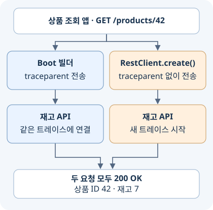

---
{
  "kind": "post",
  "publishedAt": "2026-11-22T10:48:22+09:00",
  "updatedAt": "2026-11-22T10:48:22+09:00",
  "reviewedAt": "2026-11-22",
  "reviewStatus": "source-audited",
  "reviewScope": "Checked the Spring Boot tracing documentation, W3C Trace Context and the Tempo API, and compared the code and diagrams across both languages. Verified HTTP responses and span relationships on Spring Boot 4.2.0, JDK 21.0.1, Maven 3.9.11 and Tempo 2.9.0.",
  "reviewSources": [
    "https://docs.spring.io/spring-boot/4.2/reference/actuator/tracing.html#actuator.micrometer-tracing.propagating-traces",
    "https://www.w3.org/TR/trace-context/#traceparent-header",
    "https://docs.spring.io/spring-boot/4.2/reference/actuator/tracing.html#actuator.micrometer-tracing.sampling",
    "https://grafana.com/docs/tempo/latest/api_docs/#query"
  ],
  "translationKey": "2026-11-22-spring-boot-4-2-restclient-traceparent",
  "routeSlug": "2026-11-22-spring-boot-4-2-restclient-traceparent",
  "categories": [
    "springboot"
  ],
  "tags": [
    "spring-boot",
    "restclient",
    "opentelemetry",
    "micrometer",
    "tempo",
    "distributed-tracing"
  ],
  "language": "ko",
  "title": "Spring Boot 4.2에서 RestClient의 traceparent 전파 확인하기",
  "description": "Spring Boot 4.2.0에서 RestClient 생성 방식에 따라 traceparent 전파와 Tempo의 span 연결이 어떻게 달라지는지 확인합니다."
}
---

**Spring Boot가 주입한 `RestClient.Builder`로 호출하면 상품 조회 앱과 재고 API를 한 트레이스로 볼 수 있습니다.** 이 예제에서 `RestClient.create()`로 만든 클라이언트도 같은 상품을 조회해 200을 받지만, 재고 API는 `traceparent`를 받지 않아 새 트레이스를 시작합니다. 두 앱의 응답과 Tempo에 저장된 span을 비교해 어디에서 문맥이 끊겼는지 확인합니다. [Spring Boot 트레이스 전파 문서](https://docs.spring.io/spring-boot/4.2/reference/actuator/tracing.html#actuator.micrometer-tracing.propagating-traces)

[RestClient 마이그레이션 글](/ko/posts/2026-11-22-spring-boot-4-2-restclient-migration/)의 상품 조회 흐름을 이어갑니다. [HTTP 메트릭 글](/ko/posts/2026-11-22-spring-boot-4-2-otel-http-metrics/)에서 요청 횟수를 확인했다면, 이번에는 요청 한 건의 실행 경로를 추적합니다.

## 상품 조회와 재고 조회를 연결하는 헤더

`traceparent`는 HTTP 요청에 트레이스 문맥을 전달하는 W3C 표준 헤더입니다. 이번 실습의 헤더는 `00-<trace-id>-<parent-id>-<trace-flags>` 형태입니다. `trace-id`는 전체 요청의 식별자입니다. `parent-id`는 보내는 쪽의 HTTP 클라이언트 span ID라서, 받는 쪽 서버 span이 어느 span 밑에 붙을지 알 수 있습니다. [W3C Trace Context 명세](https://www.w3.org/TR/trace-context/#traceparent-header)



그림은 상품 42를 조회하는 두 가지 경로를 보여줍니다. 두 경로 모두 같은 재고 수량을 반환합니다. 이 예제에서는 traceparent 헤더를 받은 재고 서버 span만 상품 조회 트레이스에 연결됩니다.

## 같은 JAR를 두 앱으로 실행하기

JDK 21, Maven, Docker, `curl`, `jq`가 필요합니다. 실습은 로컬 포트 `13200`, `14318`, `18180`, `18181`을 사용합니다. 빈 폴더에 아래 파일을 만듭니다. 같은 JAR를 `product`와 `inventory`라는 서비스 이름으로 각각 실행합니다. 예제는 확인을 위해 현재 trace ID와 수신한 헤더를 응답에 포함합니다.

### `pom.xml`

```xml
<project xmlns="http://maven.apache.org/POM/4.0.0">
    <modelVersion>4.0.0</modelVersion>
    <parent>
        <groupId>org.springframework.boot</groupId>
        <artifactId>spring-boot-starter-parent</artifactId>
        <version>4.2.0</version>
    </parent>
    <groupId>example</groupId>
    <artifactId>trace-propagation</artifactId>
    <version>1.0.0</version>
    <properties>
        <java.version>21</java.version>
    </properties>
    <dependencies>
        <dependency>
            <groupId>org.springframework.boot</groupId>
            <artifactId>spring-boot-starter-webmvc</artifactId>
        </dependency>
        <dependency>
            <groupId>org.springframework.boot</groupId>
            <artifactId>spring-boot-starter-restclient</artifactId>
        </dependency>
        <dependency>
            <groupId>org.springframework.boot</groupId>
            <artifactId>spring-boot-starter-opentelemetry</artifactId>
        </dependency>
    </dependencies>
    <build>
        <plugins>
            <plugin>
                <groupId>org.springframework.boot</groupId>
                <artifactId>spring-boot-maven-plugin</artifactId>
            </plugin>
        </plugins>
    </build>
</project>
```

### `src/main/java/example/TraceApplication.java`

```java
package example;

import io.micrometer.tracing.Tracer;
import org.springframework.beans.factory.annotation.Value;
import org.springframework.boot.SpringApplication;
import org.springframework.boot.autoconfigure.SpringBootApplication;
import org.springframework.web.bind.annotation.GetMapping;
import org.springframework.web.bind.annotation.PathVariable;
import org.springframework.web.bind.annotation.RequestHeader;
import org.springframework.web.bind.annotation.RequestParam;
import org.springframework.web.bind.annotation.RestController;
import org.springframework.web.client.RestClient;

@SpringBootApplication
public class TraceApplication {
    public static void main(String[] args) {
        SpringApplication.run(TraceApplication.class, args);
    }
}

@RestController
class ProductController {
    private final RestClient bootClient;
    private final RestClient directClient;
    private final Tracer tracer;

    ProductController(RestClient.Builder builder, Tracer tracer,
            @Value("${inventory.base-url}") String inventoryUrl) {
        this.bootClient = builder.baseUrl(inventoryUrl).build();
        this.directClient = RestClient.create(inventoryUrl);
        this.tracer = tracer;
    }

    @GetMapping("/products/{id}")
    ProductReply product(@PathVariable("id") long id,
            @RequestParam("instrumented") boolean instrumented) {
        RestClient client = instrumented ? bootClient : directClient;
        InventoryReply inventory = client.get().uri("/items/{id}", id)
            .retrieve().body(InventoryReply.class);
        return new ProductReply(tracer.currentSpan().context().traceId(), inventory);
    }
}

@RestController
class InventoryController {
    private final Tracer tracer;

    InventoryController(Tracer tracer) {
        this.tracer = tracer;
    }

    @GetMapping("/items/{id}")
    InventoryReply item(@PathVariable("id") long id,
            @RequestHeader(name = "traceparent", required = false) String traceparent) {
        return new InventoryReply(id, 7, traceparent, tracer.currentSpan().context().traceId());
    }
}

record ProductReply(String productTraceId, InventoryReply inventory) {}
record InventoryReply(long id, int stock, String traceparent, String inventoryTraceId) {}
```

### `src/main/resources/application.properties`

```properties
server.address=127.0.0.1
inventory.base-url=http://127.0.0.1:18181
management.tracing.sampling.probability=1.0
management.opentelemetry.tracing.export.otlp.endpoint=http://127.0.0.1:14318/v1/traces
management.otlp.metrics.export.enabled=false
```

샘플링 확률을 `1.0`으로 설정해 이 실습의 요청을 모두 기록하고, OTLP에는 트레이스만 전송합니다. 헤더가 비어 있는지와 Tempo에 span이 없는지는 다른 증상입니다. 먼저 HTTP 응답으로 전파 여부를 확인하면 저장이나 조회 문제를 따로 진단할 수 있습니다. [Spring Boot 샘플링 문서](https://docs.spring.io/spring-boot/4.2/reference/actuator/tracing.html#actuator.micrometer-tracing.sampling)

### `tempo.yaml`

아래 설정으로 Tempo가 OTLP HTTP로 span을 받고 로컬 저장소에 기록합니다. 조회 API와 수신 포트는 호스트의 루프백 주소에만 공개합니다.

```yaml
server:
  http_listen_port: 3200

distributor:
  receivers:
    otlp:
      protocols:
        http:
          endpoint: 0.0.0.0:4318

storage:
  trace:
    backend: local
    wal:
      path: /tmp/tempo/wal
    local:
      path: /tmp/tempo/blocks
```

프로젝트 루트에서 Tempo와 앱을 실행합니다. Tempo는 첫 번째 터미널에서 시작합니다.

```sh
docker run --rm --name traceparent-tempo \
  -p 127.0.0.1:13200:3200 -p 127.0.0.1:14318:4318 \
  --mount "type=bind,source=$PWD/tempo.yaml,target=/etc/tempo.yaml,readonly" \
  grafana/tempo:2.9.0 -config.file=/etc/tempo.yaml
```

별도 터미널에서 `curl -fsS http://127.0.0.1:13200/ready`가 성공하는지 확인하고 Maven으로 빌드합니다. 아래 두 `java` 명령은 각각 별도 터미널에서 실행합니다.

```sh
mvn package

java -jar target/trace-propagation-1.0.0.jar \
  --spring.application.name=inventory --server.port=18181

java -jar target/trace-propagation-1.0.0.jar \
  --spring.application.name=product --server.port=18180
```

## 응답에서 헤더와 trace ID 비교하기

두 앱이 시작되면 같은 상품을 조회합니다. `instrumented` 값만 바꿔 호출에 사용할 클라이언트를 고릅니다.

```sh
curl -fsS 'http://127.0.0.1:18180/products/42?instrumented=true' -o boot.json
curl -fsS 'http://127.0.0.1:18180/products/42?instrumented=false' -o direct.json

jq '{id: .inventory.id, stock: .inventory.stock,
     headerReceived: (.inventory.traceparent != null),
     sameTrace: (.productTraceId == .inventory.inventoryTraceId)}' boot.json direct.json
jq -r .inventory.traceparent boot.json
```

두 요청 모두 200을 반환했습니다. Boot 빌더를 쓴 요청은 재고 API가 받은 `traceparent`의 trace ID까지 두 앱의 trace ID와 일치했습니다. 직접 만든 클라이언트로 보낸 요청은 재고 API의 응답에 `traceparent`가 `null`로 나왔고 두 앱의 trace ID가 달랐습니다.

| 클라이언트 생성 | 상품 ID·재고 | 헤더 수신 | 두 앱의 trace ID |
| --- | --- | --- | --- |
| Boot가 주입한 `RestClient.Builder` | 42·7 | 확인 | 일치 |
| `RestClient.create()` | 42·7 | 없음 | 다름 |

## Tempo에서 한 트레이스와 두 트레이스 확인하기

응답에서 얻은 trace ID로 Tempo를 조회합니다. span 전송에 몇 초가 걸릴 수 있으므로 아직 조회되지 않으면 잠시 기다렸다가 다시 실행합니다. [Grafana Tempo trace ID 조회 API](https://grafana.com/docs/tempo/latest/api_docs/#query)

```sh
show_spans() {
  curl -fsS "http://127.0.0.1:13200/api/traces/$1" | jq -r '
    (.batches // .resourceSpans)[] as $batch
    | ($batch.resource.attributes[]
       | select(.key == "service.name").value.stringValue) as $service
    | $batch.scopeSpans[].spans[]
    | [$service, .kind, .name, .spanId, (.parentSpanId // "-")] | @tsv'
}

show_spans "$(jq -r .productTraceId boot.json)"
show_spans "$(jq -r .productTraceId direct.json)"
show_spans "$(jq -r .inventory.inventoryTraceId direct.json)"
```

Spring Boot 4.2.0, JDK 21.0.1, Maven 3.9.11, Tempo 2.9.0으로 실행했습니다. 두 요청에서 얻은 ID 세 개를 Tempo API로 조회한 결과입니다.

| 조회한 trace ID | Tempo에서 확인한 span |
| --- | --- |
| Boot 빌더로 호출한 요청 | 상품 서버 → 상품 HTTP 클라이언트 → 재고 서버 |
| 직접 만든 클라이언트로 호출한 요청의 상품 앱 ID | 루트 상품 서버 span 1개 |
| 직접 만든 클라이언트로 호출한 요청의 재고 앱 ID | 루트 재고 서버 span 1개 |

Boot 빌더 경로에서는 Tempo의 재고 서버 `parentSpanId`가 상품 HTTP 클라이언트의 `spanId`와 같았습니다. 이 버전의 Tempo 조회 응답은 span ID를 Base64로, `traceparent`는 16진수로 표시합니다. Base64를 바이트로 디코딩해 16진수로 바꾸니 헤더의 `parent-id`와도 일치했습니다.

요청은 성공하는데 서비스 간 추적이 끊긴다면, 먼저 대상 서비스가 `traceparent`를 받는지 보세요. 헤더가 없다면 호출부에서 Boot가 구성한 빌더를 쓰는지 확인합니다. 헤더의 trace ID가 이어지는데 Tempo에서 일부 span이 빠진다면 샘플링과 OTLP 전송 설정을 확인할 차례입니다. 이제 같은 trace ID로 로그를 찾고 싶다면 [Grafana LGTM에서 로그와 트레이스 연결하기](/ko/posts/2026-11-02-grafana-lgtm-log-trace/)를 이어서 볼 수 있습니다.
