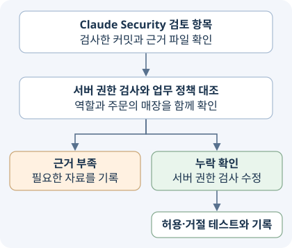

**Claude Security에서 검토 항목을 받으면, 먼저 검토한 커밋과 근거 파일을 확인하세요.** 그다음 애플리케이션이 지켜야 할 규칙을 한 문장으로 적고, 규칙대로 허용되는 경우와 거절되는 경우를 테스트합니다. 이 글에서는 ‘환불 요청은 같은 매장의 환불 담당자만 할 수 있다’는 가상 커머스 정책으로 그 과정을 따라갑니다.

Anthropic은 Claude Enterprise의 Claude Security에서 Mythos 5.2를 포함한 모델로 저장소를 검사한다고 설명합니다. 이 글은 권한이 있는 저장소의 방어적 검토 결과 한 건을 읽고 수정하는 예제입니다. 계정에서 어떤 기능을 쓸 수 있는지는 [Mythos 이용 조건 글](/ko/posts/2026-11-22-claude-mythos-availability/)에 정리했습니다. [Anthropic 모델 발표](https://www.anthropic.com/claude-fable-and-mythos-5-2) · [Claude Security 도움말](https://support.claude.com/en/articles/14661296-use-claude-security)



## 검토 항목에서 수정 근거를 고른다

Claude Security의 검토 항목에는 심각도, 파일과 줄 위치, 해당 코드를 검사한 브랜치와 커밋, 수정 제안이 표시됩니다. 먼저 인용된 파일을 **같은 커밋**에서 열어 확인합니다. 현재 브랜치에서 코드가 바뀌었다면, 같은 규칙이 현재 버전에서도 누락되어 있는지 따로 확인합니다. [Claude Security 검토 항목 문서](https://support.claude.com/en/articles/14661296-use-claude-security)

| 확인할 내용 | 이 예제에서 답할 질문 |
| --- | --- |
| 검사한 버전과 위치 | 어느 커밋의 환불 요청 서비스와 권한 검사에 대한 보고인가? |
| 실제 업무 정책 | 매장이 같아도 조회 전용 운영자는 환불을 요청할 수 없는가? |
| 기존 검사의 적용 범위 | 화면 버튼 표시와 별개로, 서버의 환불 요청 경로에서도 역할과 매장을 확인하는가? |
| 판단에 필요한 근거 | 공통 인가 정책을 확인하지 못했다면 어떤 파일이나 설정을 더 봐야 하는가? |

예를 들어 보고서가 ‘환불 요청 권한 검토 필요’라고 표시하면, 해당 경로에 이미 공통 권한 검사가 적용되는지부터 확인합니다. 공통 정책을 읽지 못했다면 검토 항목에 확인할 자료를 남깁니다. 반대로 누락이 확인됐다면 서버가 호출하는 권한 검사와 관련 테스트를 수정 대상으로 정합니다. [커머스 관리자 화면의 권한 설계](/ko/posts/2026-11-23-commerce-admin-screen/)

## 수정 도구에 업무 규칙과 완료 조건을 준다

Claude Security의 **Fix**에서 Claude Code로 수정 작업을 이어갈 수 있습니다. Claude Code in the cloud를 사용할 수 없다면 제시된 프롬프트를 자신의 Claude Code에 복사합니다. 세션에서는 계정에 사용 가능한 모델이 적용됩니다. 아래 요청은 검토자가 파일과 정책 근거를 확인한 다음 사용하는 가상 예제입니다. 파일 경로와 커밋은 자신의 저장소에 맞게 바꿉니다. [Claude Security 수정 안내](https://support.claude.com/en/articles/14661296-use-claude-security) · [Claude Security 제품 안내](https://claude.com/product/claude-security)

```text
검토한 커밋과 첨부한 파일에서 환불 요청의 서버 권한 검사를 확인해줘.

업무 정책
- 같은 매장의 환불 담당자만 환불을 요청할 수 있다.
- 조회 권한은 환불 요청 권한과 별개다.
- 사용자의 역할과 매장은 인증된 서버 문맥에서 읽는다.

공통 권한 규칙이 이미 적용되는지 먼저 확인하고 근거 파일을 적어줘.
누락이 확인되면 기존 권한 검사 지점을 최소 범위로 수정해줘.
같은 매장 담당자는 허용하고, 조회 전용 사용자·다른 매장 담당자·
인증되지 않은 요청은 거절하는 회귀 테스트를 추가해줘.
확인한 파일, 변경 내용, 실행한 테스트 결과와 미확인 사항을 보고해줘.
```

완료 조건은 테스트 수가 아니라 **환불 요청을 허용할 범위가 기존 정책과 일치하는지**입니다. 역할 검사만 추가하면 다른 매장의 담당자도 통과할 수 있고, 매장 검사만 추가하면 조회 전용 사용자를 거르지 못합니다. 인증된 사용자 문맥과 저장소에서 읽은 주문의 매장을 서버에서 비교하는지 변경분을 읽어 확인합니다.

## 정상 경로와 거절 경로를 함께 확인한다

다음 코드는 수정 후 권한 결정만 독립적으로 확인합니다. 인증·주문 조회를 마친 뒤 서버가 `actor`와 `order`를 넘긴다고 가정합니다. 실제 환불 실행이나 결제 대행사 통신은 이 함수의 범위 밖입니다.

```javascript
import assert from "node:assert/strict";

function canRequestRefund(actor, order) {
  return actor !== null &&
    actor.role === "REFUND_MANAGER" &&
    actor.storeId === order.storeId;
}

const order = { storeId: "store-a" };
const manager = { role: "REFUND_MANAGER", storeId: "store-a" };

const cases = [
  ["same-store refund manager", manager, true],
  ["read-only operator", { ...manager, role: "VIEWER" }, false],
  ["different-store refund manager", { ...manager, storeId: "store-b" }, false],
  ["unauthenticated request", null, false]
];

for (const [label, actor, expected] of cases) {
  assert.equal(canRequestRefund(actor, order), expected, label);
  console.log(`PASS ${label}`);
}
```

`refund-policy.mjs`로 저장하고 `node refund-policy.mjs`를 실행했습니다. Node.js 22.17.0에서 네 가지 판단이 예상대로 나왔습니다.

```text
PASS same-store refund manager
PASS read-only operator
PASS different-store refund manager
PASS unauthenticated request
```

실제 저장소에서는 환불 요청 경로가 이 권한 결정을 거치는지도 확인해야 합니다. 거절된 요청에서 환불 작업이 등록되지 않는지, 허용된 요청에서 기존 처리 흐름이 유지되는지를 통합 테스트로 확인합니다. 검토 항목을 정리할 때 수정 커밋이나 PR, 실행한 테스트, 남은 사항을 기록합니다. 보고가 잘못됐다고 판단했다면 기존 공통 검사 등 그 근거를 함께 남깁니다. [Claude Security 검토 결과 추적](https://support.claude.com/en/articles/14661296-use-claude-security)

이 글의 검토 항목은 설명용으로 만든 사례입니다. Claude Security에서 실제 저장소를 스캔하거나 Mythos 응답을 수집하지 않았으며, 위 실행 결과는 로컬 권한 결정 함수의 테스트입니다. 인증된 모델 실행, 실제 환불 처리와 결제 연동도 시험하지 않았습니다.
