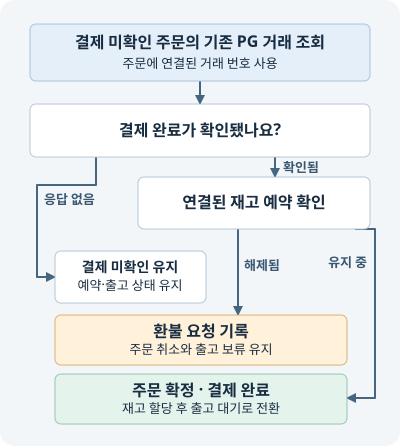

---
{
  "kind": "post",
  "publishedAt": "2026-11-23T00:00:00+09:00",
  "updatedAt": "2026-11-23T00:00:00+09:00",
  "reviewedAt": "2026-11-22",
  "reviewStatus": "source-audited",
  "reviewScope": "앞선 커머스 시스템·DB 설계의 결제 대사와 재고 예약 흐름을 대조했고 Node.js 24.13.0에서 가상 주문의 세 가지 결과를 확인했습니다. 실제 결제대행사 조회, 인증, 환불 실행, 창고 연동은 운영 구현에서 별도로 검증해야 합니다.",
  "reviewSources": [
    "https://youdozi.github.io/ko/posts/2026-11-22-commerce-system-design-last-unit-of-stock/",
    "https://youdozi.github.io/ko/posts/2026-11-22-commerce-database-design/"
  ],
  "translationKey": "2026-11-23-commerce-admin-screen",
  "routeSlug": "2026-11-23-commerce-admin-screen",
  "categories": [
    "architecture"
  ],
  "tags": [
    "ecommerce",
    "admin-ui",
    "order-management",
    "payments",
    "inventory"
  ],
  "language": "ko",
  "title": "커머스 관리자 화면 설계 방법 — 주문 작업 큐에서 결제와 출고를 잇기",
  "description": "커머스 관리자 메뉴를 운영 작업으로 나누고, 주문 작업 큐와 상세 화면에서 결제 미확인·재고 예약 해제·환불 요청을 다루는 방법을 살펴봅니다."
}
---

**커머스 관리자 화면은 운영자가 지금 처리할 주문을 찾고, 다음 행동을 판단할 근거를 확인하는 곳입니다.** 첫 화면에서 결제 확인, 출고 대기, 환불 후속 작업으로 들어갈 수 있게 구성합니다. 주문 상세에서는 결제 결과와 해당 주문이 확보한 재고를 함께 보여줍니다. 결제가 뒤늦게 확인됐더라도 예약을 이미 풀었다면 출고를 보류하고 환불 요청을 추적할 수 있어야 합니다.

한 판매자가 실물 상품을 원화로 판매하고 단일 창고에서 출고하는 경우를 가정합니다. 앞선 시스템 설계 글의 마지막 재고 한 개 사례와 DB 설계 글의 주문행·예약·결제 시도 모델을 관리자 화면으로 이어갑니다. 결제대행사(PG)에 보낸 기존 거래를 조회하는 상황을 따라갑니다. [커머스 시스템 설계](/ko/posts/2026-11-22-commerce-system-design-last-unit-of-stock/) · [커머스 DB 설계](/ko/posts/2026-11-22-commerce-database-design/)

## 메뉴를 열자마자 시작할 작업을 정합니다

주문 메뉴는 운영의 출발점입니다. 결제·환불과 출고 메뉴는 담당자가 자기 업무의 대기 건으로 바로 들어가는 경로입니다. 어느 경로로 들어오든 같은 주문번호에서 동일한 상세와 이력을 읽을 수 있어야 교대나 부서 간 인계가 쉬워집니다.

| 메뉴 | 운영자가 여기서 시작하는 작업 | 판단에 필요한 정보 |
| --- | --- | --- |
| 주문 | 미확인 결제, 출고 대기, 환불 요청 건을 골라 엽니다. | 주문번호, 주문 당시 상품과 금액, 네 가지 처리 상태 |
| 상품 | SKU의 판매 여부, 옵션, 현재 판매가를 수정합니다. | SKU별 현재 판매 조건, 변경 전후 값 |
| 재고 | 예약이 잡힌 주문을 찾거나 실사 차이를 조정합니다. | SKU별 실재고·예약·출고 할당, 연결 주문, 조정 이력 |
| 결제·환불 | 기존 PG 거래를 대사하고 환불 요청 이후의 결과를 확인합니다. | 결제 시도, PG 거래 번호, 원거래 금액, 조회·환불 이력 |
| 출고 | 할당된 상품의 피킹과 출고를 처리합니다. | SKU·수량, 출고 가능 조건, 발송 기록 |
| 역할·권한 | 직원에게 조회와 실행 권한을 부여하고 변경 이력을 확인합니다. | 업무별 권한, 적용 범위, 부여·회수 이력 |

상품 메뉴에서 가격을 바꾸면 이후 판매에 적용합니다. 주문 상세의 거래 금액은 주문행에 저장한 값에서 읽습니다. 예를 들어 검정 키보드 주문 `O-42`는 단가 42,000원에서 할인 2,000원을 빼고 배송비 3,000원을 더한 43,000원입니다. 현재 판매가가 달라져도 이 거래의 상세와 환불 검토 화면에는 당시 금액이 남습니다.

## 주문 목록에서는 작업을 고르고 상세에서 근거를 봅니다

**결제 확인**은 결제가 미확인인 주문, **출고 대기**는 재고 할당이 끝나 출고할 차례인 주문, **환불 후속**은 환불 요청이 기록되고 최종 결과를 기다리는 주문을 모읍니다. 운영에서는 작업 큐의 정렬 기준도 정합니다. 결제 미확인 큐는 최초 이상을 감지한 시각이 오래된 순으로 보여주고, 출고 대기 큐는 창고 작업 마감 시각을 기준으로 정렬하는 식입니다.

목록에는 주문번호·접수 시각·상품·금액과 현재 상태를 둡니다. 주문번호·상품명·SKU 검색과 결제 상태 필터를 함께 쓸 수 있습니다. 작업 옆 숫자는 검색 전 전체 건수로 두고 목록 위에는 현재 표시 건수를 따로 표시합니다. 운영에서는 날짜와 담당 범위까지 필요한 만큼 추가하고, 상세를 닫아도 검색·필터·목록 위치를 유지합니다. 상태 변경으로 원래 행이 목록에서 빠졌다면 선택한 작업으로 포커스를 돌려 다음 건을 볼 수 있게 합니다.

| 상태 | 보여줄 내용 | 상태를 읽는 이유 |
| --- | --- | --- |
| 주문 | 결제 대기, 주문 확정, 주문 취소 | 주문이 어떤 절차에 있는지 파악합니다. 취소된 주문에도 늦은 결제가 도착할 수 있습니다. |
| 결제 | 결제 미확인, 결제 완료, 환불 요청, 환불 완료 | 기존 거래를 더 확인해야 하는지, 환불 결과를 기다리는지 판단합니다. |
| 재고 | 예약 중, 예약 해제, 출고 할당, 재고 출고 | 해당 주문이 확보한 수량과 현재 상태를 확인합니다. |
| 출고 | 출고 보류, 출고 대기, 출고 완료 | 창고가 지금 작업할 수 있는지, 이미 이행했는지 확인합니다. |

상세를 열면 주문 당시 금액과 SKU·수량, 그 주문에 연결된 예약 번호와 PG 거래 번호를 상태 바로 아래에 배치합니다. 결제 미확인 상태에서 현재 판매 가능한 재고 수만 보면 주문이 그 재고를 확보했는지 알 수 없습니다. 이력에는 상태가 바뀐 시각, 변경 주체, 출처와 식별자를 남겨 앞뒤 사정을 확인할 수 있게 합니다. 좁은 화면에서도 라벨을 붙여 상태를 읽을 수 있어야 하며, 색상은 상태의 강조에 사용합니다.

## 결제 미확인은 기존 거래에서 확인합니다

`O-42`는 결제 요청 뒤 응답이 끊겼습니다. 결제가 미확인인 시간이 길어져 예외 승인을 거쳐 예약 `R-42`를 해제하고 주문을 취소한 상태입니다. 결제 담당은 상세에서 기존 거래 `PG-DEMO-42`의 결과를 조회합니다. 결제 완료가 확인되면 **환불 요청**을 기록합니다. 주문 취소와 출고 보류는 그대로이며, 예약을 다시 잡지 않습니다. 환불 완료는 이후 PG의 확정 결과를 받아 기록합니다.



그림은 가상 주문 세 건에서 발생하는 분기를 보여줍니다. `O-43`은 조회 응답이 없어 **결제 미확인·예약 중·출고 보류**가 유지됩니다. `O-44`는 결제 완료가 확인되고 활성 예약이 있어 **주문 확정·결제 완료·출고 할당·출고 대기**로 바뀝니다. 그림은 응답 없음과 결제 완료를 다룹니다. 운영에서 미결제 종료가 확정되면 예약 해제와 주문 취소를 처리할 수 있습니다. 거래가 불일치하면 상태를 바꾸기 전에 대사 예외로 남깁니다.

### 상태 전이를 담은 JavaScript 예제

다음 코드는 결제 미확인 상태로 출고를 보류한 가상 주문 세 건에 조회 결과를 반영합니다. 별도 설치 없이 브라우저 개발자 도구 콘솔에 붙여 넣어 실행할 수 있습니다. 이 함수는 메모리에 있는 주문 객체의 상태만 바꿉니다.

```javascript
function applyDemoPaymentResult(order, result) {
  if (order.payment !== 'UNKNOWN' || result !== 'PAID') return 'NO_CHANGE';

  if (order.stock === 'RELEASED') {
    order.payment = 'REFUND_PENDING';
    return 'REFUND_REQUESTED';
  }

  if (order.stock === 'HELD') {
    order.order = 'CONFIRMED';
    order.payment = 'PAID';
    order.stock = 'ALLOCATED';
    order.shipping = 'READY';
    return 'READY_TO_SHIP';
  }

  return 'NO_CHANGE';
}

const examples = [
  ['O-42', 'CANCELLED', 'RELEASED', 'PAID'],
  ['O-43', 'PENDING_PAYMENT', 'HELD', 'UNAVAILABLE'],
  ['O-44', 'PENDING_PAYMENT', 'HELD', 'PAID'],
];

for (const [id, state, stock, result] of examples) {
  const order = { order: state, payment: 'UNKNOWN', stock, shipping: 'BLOCKED' };
  console.log(id, applyDemoPaymentResult(order, result), ...Object.values(order));
}
```

예상 콘솔 출력은 주문번호, 처리 결과, 주문·결제·재고·출고 상태 순서입니다.

```text
O-42 REFUND_REQUESTED CANCELLED REFUND_PENDING RELEASED BLOCKED
O-43 NO_CHANGE PENDING_PAYMENT UNKNOWN HELD BLOCKED
O-44 READY_TO_SHIP CONFIRMED PAID ALLOCATED READY
```

Node.js 24.13.0에서 코드 블록을 실행해 세 줄이 예상 출력과 일치하는 것을 확인했습니다.

## 운영에서는 화면 상태와 실행 권한을 서버가 검증합니다

결제 담당에게 기존 거래 조회를, 창고 담당에게 출고 기록을, 정해진 승인 담당에게 예외 해제나 환불 승인을 맡깁니다. 상품 담당의 가격 변경 권한도 별도로 부여합니다. 상세 응답에는 현재 사용자에게 필요한 필드와 가능한 작업을 내려주고, 실행 API는 요청마다 인증·작업 권한·대상 주문의 접근 범위·현재 상태를 다시 확인해야 합니다. 결제 조회 API는 주문에 이미 연결된 거래를 서버에서 찾습니다. PG 계정, 거래 번호, 금액, 통화를 대조해 결과를 반영하는 동안 최신 주문과 연결 예약을 읽고, 재시도나 웹훅과 경합해도 같은 환불·출고 요청이 중복 기록되지 않게 합니다. 창고의 출고 요청도 서버에서 주문 확정·결제 완료·재고 할당 조건을 재검사합니다.

기존 거래 조회처럼 새 과금을 만들지 않는 작업은 해당 거래와 영향 범위를 버튼 가까이에 알립니다. 결제 완료가 확인되면 재고 예약 상태에 따라 환불 요청이나 출고 대기가 이어질 수 있습니다. 수동 환불 발행이나 예외 예약 해제처럼 금액과 재고에 직접 영향을 주는 작업은 별도의 확인과 권한을 둡니다. 예를 들어 수동 환불 확인 화면에는 **주문 `O-42`, 원거래 `PG-DEMO-42`, 환불 요청액 43,000원, 사유**를 표시합니다. 작업이 접수되면 ‘환불 요청’으로 보여주고, 승인자·실행자·요청 시각·이전/이후 상태·관련 거래·결과를 서버의 감사 이력에 남깁니다. 요청 결과가 끊겼다면 같은 요청의 상태부터 확인합니다.

## 빈 목록과 결과 미확인을 다른 문장으로 안내합니다

| 상황 | 표시와 다음 행동 |
| --- | --- |
| 작업에 해당하는 주문이 없음 | “이 작업에 해당하는 주문이 없습니다.” 다른 작업을 열 수 있게 합니다. |
| 검색이나 필터에 걸린 주문이 없음 | “조건에 맞는 주문이 없습니다.” 현재 작업은 유지하며 검색어와 필터를 지울 수 있게 합니다. |
| 목록 요청 실패 | “주문을 불러오지 못했습니다.” 검색 조건을 유지하고 목록 다시 불러오기를 제공합니다. 이전 결과를 계속 표시한다면 조회 시각도 보입니다. |
| 주문은 열렸으나 PG 결과 미확인 | “조회 응답이 없습니다. 결제 미확인과 출고 보류를 유지했습니다.” 같은 거래를 다시 조회할 수 있게 합니다. |
| 작업 권한이 없음 | “기존 결제 조회는 결제 담당의 작업입니다.” 현재 역할이 볼 수 있는 상태와 이력을 표시합니다. |


## 예제의 결과를 작업 큐에 반영합니다

‘결제 확인’ 작업에서 주문을 열고 ‘기존 결제 결과 확인’을 실행한다고 가정합니다. `O-43`은 조회 응답이 없어 결제 확인 큐에 남습니다. 조회 이력에 응답 없음과 예약 유지를 기록합니다. `O-42`는 환불 요청을 기록한 뒤 ‘환불 후속’에서, `O-44`는 재고를 할당한 뒤 ‘출고 대기’에서 이어서 볼 수 있습니다. 출고 담당에게는 주문 상태와 이력을 보여주고, 결제 조회 위치에는 결제 담당이 실행할 수 있다는 안내를 표시합니다.

이 예제는 준비된 주문과 결제 응답만 사용합니다. 로그인, 고객 데이터, 실제 PG 조회와 환불, 창고 연동은 운영 구현에서 별도로 다룹니다.
