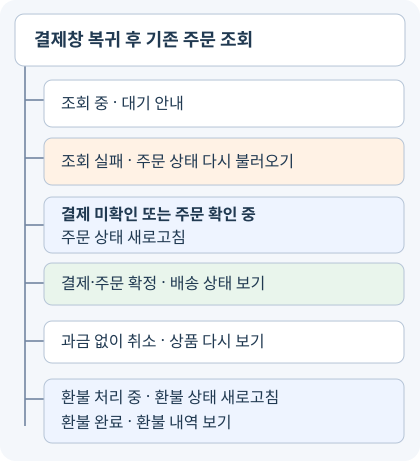

---
{
  "kind": "post",
  "publishedAt": "2026-11-23T00:00:00+09:00",
  "updatedAt": "2026-11-23T00:00:00+09:00",
  "reviewedAt": "2026-11-23",
  "reviewStatus": "source-audited",
  "reviewScope": "앞선 커머스 설계 글과 W3C 지침을 대조했고 Node.js 22.17.0에서 주문 상태를 화면 문구와 행동으로 바꾸는 예제의 아홉 가지 입력을 확인했습니다.",
  "reviewSources": [
    "https://youdozi.github.io/ko/posts/2026-11-23-commerce-admin-screen/",
    "https://youdozi.github.io/ko/posts/2026-11-22-commerce-system-design-last-unit-of-stock/",
    "https://youdozi.github.io/ko/posts/2026-11-22-commerce-database-design/",
    "https://www.w3.org/WAI/WCAG22/Understanding/error-prevention-legal-financial-data.html",
    "https://www.w3.org/WAI/WCAG22/Understanding/status-messages.html"
  ],
  "translationKey": "2026-11-23-commerce-storefront-design",
  "routeSlug": "2026-11-23-commerce-storefront-design",
  "categories": [
    "architecture"
  ],
  "tags": [
    "ecommerce",
    "storefront",
    "checkout",
    "order-management",
    "payments"
  ],
  "language": "ko",
  "title": "커머스 구매자 화면 설계 — 상품 선택부터 결제 확인까지",
  "description": "상품 목록부터 주문 상세까지 구매자가 확인할 정보와 행동을 정하고, 결제창 복귀 후 서버의 주문·결제 상태에 맞춰 안내하는 화면을 설계합니다."
}
---

**구매자가 결제를 마치고 빈 화면으로 돌아왔다면, 가장 먼저 알고 싶은 것은 ‘돈이 나갔나’입니다.** 이때는 기존 주문의 결과를 확인할 수 있는 화면을 보여줍니다. 상품 상세부터 주문 내역까지, 각 화면에서 확실히 말할 수 있는 사실과 구매자가 할 수 있는 행동을 짝지어 설계합니다.

[커머스 관리자 화면 글](/ko/posts/2026-11-23-commerce-admin-screen/)에서 운영자가 결제 미확인 주문을 찾았다면, 이번에는 같은 상황을 구매자 쪽에서 봅니다. 한 판매자의 실물 상품을 원화로 구매하고 배송받는 매장을 가정합니다. 회원 주문을 기준으로 하며 할인과 배송 정책은 예시입니다.

## 어떤 화면에서 무엇을 결정하나?

| 화면 | 먼저 보여줄 정보 | 구매자의 다음 행동 |
| --- | --- | --- |
| 상품 목록·검색 | 상품명·사진, 비교 가능한 가격, 선택한 필터 | 조건을 좁히거나 상품 상세 보기 |
| 상품 상세 | 선택한 옵션에 해당하는 가격과 판매 상태, 배송 조건 | 옵션·수량 선택 후 장바구니에 담기 |
| 장바구니 | 품목별 옵션·수량·금액, 예상 합계, 주문을 막는 항목 | 수량·품목을 수정하고 주문서로 이동 |
| 주문서 | 배송지, 배송비·할인·최종 결제 금액, 수정할 곳 | 거래 조건을 검토한 뒤 결제 요청 |
| 주문 상세 | 주문번호, 결제·배송·환불 상태, 처리 이력 | 현재 상태에 맞춰 결과 확인 또는 배송 조회 |

상품 목록에서 ‘39,000원부터’라고 표시했다면 상세 화면에서 선택한 옵션의 실제 가격을 바로 보여줍니다. 품절 옵션은 어떤 옵션이 품절인지 텍스트로 표시합니다. 검색 결과가 비었다면 선택한 조건을 확인하고 필터를 해제할 수 있게 합니다. 조회에 실패한 상태에는 다시 불러올 행동을 둡니다.

[재고 예약을 다룬 커머스 설계 글](/ko/posts/2026-11-22-commerce-system-design-last-unit-of-stock/)과 같은 정책을 적용합니다. 상품 상세의 재고는 조회 시점 값입니다. 장바구니는 고른 물건을 보관하고, 재고 예약은 서버가 주문을 생성할 때 합니다. 다른 사람이 마지막 한 개를 먼저 확보했다면 장바구니에서 해당 품목과 옵션을 표시하고, 나머지 품목과 배송지 입력은 유지합니다.

## 주문서에는 결제 직전에 바꿀 수 있는 정보를 둔다

구매자가 옵션·수량·배송지와 최종 금액을 한 자리에서 검토하고 수정하게 합니다. 결제 버튼에는 **‘43,000원 결제하기’**처럼 실제 요청을 표시합니다. 사용자에게 제출 전 거래 내용을 검토하고 수정할 수 있게 하는 방법은 WCAG의 금융 거래 오류 예방에도 나옵니다. [W3C 금융 거래 오류 예방](https://www.w3.org/WAI/WCAG22/Understanding/error-prevention-legal-financial-data.html)

담을 때 39,000원이던 키보드 가격이 주문서에서 42,000원으로 바뀌었다면 ‘검은색 키보드 가격이 39,000원에서 42,000원으로 바뀌었습니다’라고 영향받은 상품을 표시합니다. 할인·배송비를 다시 계산한 총액을 보여주고 구매자가 그 금액을 확인한 뒤 결제를 요청하게 합니다. 서버도 주문 생성 시점에 고객이 확인한 견적과 적용할 금액을 대조하고 거래 조건을 보존합니다. [커머스 DB의 주문 금액 보존 설계](/ko/posts/2026-11-22-commerce-database-design/)

모바일에서는 배송지와 품목 수정 링크를 각 정보 옆에 두고, 최종 금액과 결제 버튼을 가까이 배치합니다. 하단 고정 버튼을 쓴다면 마지막 입력란과 오류 메시지까지 스크롤해서 읽을 수 있게 합니다. 장바구니의 합계 변화나 결제 확인 결과처럼 포커스를 옮길 필요가 없는 새 상태는 보조 기술에도 전달할 수 있습니다. 예를 들어 결과 문구를 실제로 갱신하는 영역에 `role="status"`를 사용합니다. [W3C 상태 메시지 지침](https://www.w3.org/WAI/WCAG22/Understanding/status-messages.html)

## 결제가 끝났는지는 서버에서 확인한다



결제창에서 돌아오면 서버에 기존 주문을 조회합니다. 결제 버튼을 누른 뒤 주문 생성 응답을 잃었을 때도 같은 주문 요청 키로 기존 접수 여부를 확인합니다. 버튼을 잠시 비활성화하면 연속 클릭을 줄일 수 있습니다. 중복 주문 방지는 요청 키와 서버의 유일성 검사가 맡습니다. 주문 상세와 상태 조회 API는 현재 구매자가 해당 주문을 열 권한이 있는지도 확인합니다.

| 서버에서 확인한 상태 | 구매자에게 보여줄 문구와 행동 |
| --- | --- |
| 주문 상태 조회 자체가 실패 | ‘주문 상태를 불러오지 못했습니다.’ → **주문 상태 다시 불러오기** |
| 주문은 있고 결제 결과 미확인 | ‘결제 결과를 확인 중입니다.’ → **주문 상태 새로고침** |
| 결제 완료, 주문 확인 중 | ‘결제는 완료됐고 주문을 확인 중입니다.’ → **주문 상태 새로고침** |
| 결제와 주문 확정 | ‘주문이 접수됐습니다.’ → **배송 상태 보기** |
| 과금 없이 취소 확정 | ‘주문이 취소됐으며 결제된 금액이 없습니다.’ → **상품 다시 보기** |
| 주문 취소 후 결제 확인, 환불 진행 | ‘환불을 처리 중입니다.’ → **환불 상태 새로고침** |
| 환불 완료 확인 | ‘환불이 완료됐습니다.’ → **환불 내역 보기** |

배송 상태 보기에서는 배송 준비, 배송 중, 배송 완료를 실제 출고 상태에 맞춰 표시합니다. 취소나 반품은 운영에서 접수 가능한 상태와 권한을 확인한 뒤에만 버튼을 제공합니다. 접수 이후에는 진행 상태를 보여주고, 환불 완료 문구는 서버가 환불 결과를 확인한 뒤에 표시합니다.

## 화면 문구를 서버 상태와 대조해 보기

아래 예제는 이미 서버에서 읽은 주문·결제 상태를 제목과 다음 버튼으로 바꾸는 함수입니다. 네트워크 오류와 주문의 결제 미확인을 별도 입력으로 받습니다. 정의되지 않은 상태 조합에서도 성공을 표시하지 않습니다. `order-view.mjs`로 저장한 뒤 `node order-view.mjs`를 실행할 수 있습니다.

```javascript
const labels = {
  loading: ["주문 상태를 불러오는 중입니다.", null],
  unavailable: ["주문 상태를 불러오지 못했습니다.", "주문 상태 다시 불러오기"],
  pending: ["결제 결과를 확인 중입니다.", "주문 상태 새로고침"],
  paidReview: ["결제는 완료됐고 주문을 확인 중입니다.", "주문 상태 새로고침"],
  confirmed: ["주문이 접수됐습니다.", "배송 상태 보기"],
  closed: ["주문이 취소됐으며 결제된 금액이 없습니다.", "상품 다시 보기"],
  refundPending: ["환불을 처리 중입니다.", "환불 상태 새로고침"],
  refunded: ["환불이 완료됐습니다.", "환불 내역 보기"]
};

function orderView(snapshot) {
  if (snapshot.kind === "loading") return labels.loading;
  if (snapshot.kind === "unavailable") return labels.unavailable;

  const { order, payment } = snapshot;
  if (order === "CANCELLED" && payment === "REFUND_PENDING") {
    return labels.refundPending;
  }
  if (order === "CANCELLED" && payment === "REFUNDED") {
    return labels.refunded;
  }
  if (order === "CANCELLED" && payment === "CLOSED_UNPAID") {
    return labels.closed;
  }
  if (order === "CONFIRMED" && payment === "PAID") {
    return labels.confirmed;
  }
  if (order === "PENDING_PAYMENT" && payment === "PAID") {
    return labels.paidReview;
  }
  if (order === "PENDING_PAYMENT" &&
      (payment === "PENDING" || payment === "UNKNOWN")) {
    return labels.pending;
  }
  return labels.unavailable;
}

const verified = (order, payment) => ({ kind: "loaded", order, payment });
const cases = [
  [{ kind: "loading" }, "loading"],
  [{ kind: "unavailable" }, "unavailable"],
  [verified("PENDING_PAYMENT", "UNKNOWN"), "pending"],
  [verified("PENDING_PAYMENT", "PAID"), "paidReview"],
  [verified("CONFIRMED", "PAID"), "confirmed"],
  [verified("CANCELLED", "CLOSED_UNPAID"), "closed"],
  [verified("CANCELLED", "REFUND_PENDING"), "refundPending"],
  [verified("CANCELLED", "REFUNDED"), "refunded"],
  [verified("CONFIRMED", "UNKNOWN"), "unavailable"]
];

for (const [input, key] of cases) {
  if (orderView(input) !== labels[key]) throw new Error(key);
  console.log("PASS", key);
}
```

Node.js 22.17.0에서 예제의 9개 입력을 실행했습니다. 조회 실패·결제 미확인·과금 없는 취소·환불 진행이 각각 지정한 문구와 행동으로 연결됐습니다. 이 검증은 상태를 화면 문구로 바꾸는 함수에 한정했습니다. 모바일 사용성, 보조 기술 동작, 실제 결제 연동은 화면 구현에서 확인할 대상입니다.
