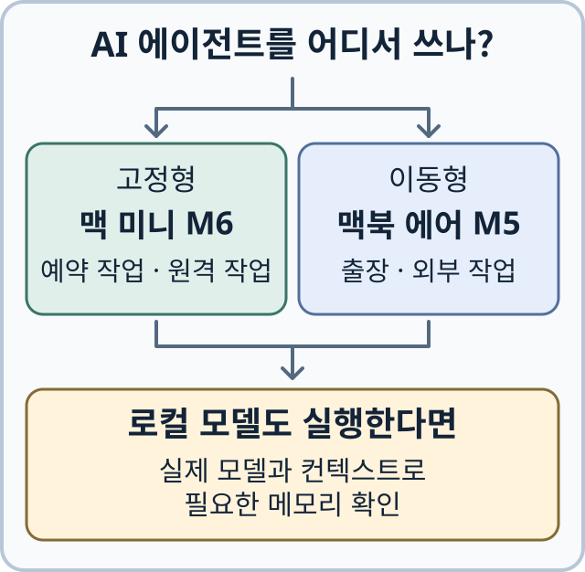

---
{
  "kind": "post",
  "publishedAt": "2026-11-23T14:25:00Z",
  "reviewedAt": "2026-11-23",
  "reviewStatus": "source-audited",
  "reviewScope": "Apple Korea specifications and prices checked; diagnostic commands executed on macOS; hardware and model performance not measured.",
  "reviewSources": [
    "https://www.apple.com/kr/mac-mini/specs/",
    "https://www.apple.com/kr/macbook-air/specs/",
    "https://www.apple.com/kr/newsroom/2026/09/the-new-mac-mini-and-mac-studio-are-available-today/"
  ],
  "language": "ko",
  "translationKey": "2026-11-23-mac-for-ai-agents",
  "routeSlug": "2026-11-23-mac-for-ai-agents",
  "title": "AI 에이전트용 맥북 vs 맥 미니, 어떤 걸 사야 할까?",
  "description": "AI 에이전트의 작업 위치와 메모리 요구량을 기준으로 맥 미니와 맥북 에어를 비교합니다.",
  "categories": [
    "tips"
  ],
  "tags": [
    "macos",
    "ai-agents",
    "hardware"
  ]
}
---

이미 노트북이 있고 AI 에이전트에 브라우저 테스트나 예약 작업을 맡기고 싶다면 **맥 미니 M6**를 추천한다. 출퇴근이나 출장 중에도 같은 개발 환경을 쓰고 컴퓨터 한 대로 끝내고 싶다면 **13형 맥북 에어 M5**가 더 잘 맞는다. Ollama 같은 도구로 모델까지 직접 돌릴 계획이라면 원하는 모델과 컨텍스트에서 필요한 메모리부터 확인하자. 고정형으로 쓸 기기에 32GB를 넘는 용량이 필요하다면 **맥 미니 M5 Pro의 48GB·64GB 구성**을 비교해 볼 만하다. [Apple 맥 미니 제품 사양](https://www.apple.com/kr/mac-mini/specs/) · [Apple 맥북 에어 제품 사양](https://www.apple.com/kr/macbook-air/specs/)



## 에이전트와 모델이 각각 어디서 실행되나

내 맥의 터미널에서 Claude Code나 Codex를 실행하면서 클라우드 모델을 쓰는 경우를 보자. 모델 응답은 원격 서비스가 만들고, 에이전트가 내 맥에서 실행하는 빌드나 테스트는 맥의 CPU, 메모리, 저장 공간을 사용한다. 예를 들어 에이전트 하나로 코드 리뷰를 받아보는 날과 두 작업 폴더에서 Docker, 테스트, 브라우저를 동시에 돌리는 날의 장비 요구는 다르다. 클라우드 모델을 쓸 때는 평소 맥에서 실제로 겹치는 작업을 기준으로 사양을 고르면 된다.

로컬 추론에서는 모델도 맥의 메모리를 쓴다. 같은 모델이라도 가중치를 어떤 정밀도로 저장하는지, 한 번에 얼마나 긴 입력을 주는지에 따라 필요한 메모리가 달라진다. 짧은 대화에 성공했더라도 코드와 로그를 길게 넣고 브라우저까지 켰을 때는 응답이 느려질 수 있다. 구매 전에 가능하면 **실제로 쓸 모델·양자화 버전·컨텍스트 길이**로 응답 지연과 메모리 압력을 함께 확인하자. [Ollama 컨텍스트 길이 문서](https://docs.ollama.com/context-length)

## 사용 패턴별 추천 구성

| 주로 하는 일 | 내가 고를 구성 | 구매 전 확인할 점 |
| --- | --- | --- |
| 고정 자리에서 클라우드 모델로 코딩하고 가끔 테스트한다 | 맥 미니 M6 16GB | 256GB 기본형으로 충분한지 살핀다. 빌드 캐시와 Docker 이미지를 꾸준히 보관한다면 512GB부터 비교한다. |
| 카페나 사무실을 오가며 직접 작업한다 | 13형 맥북 에어 M5 16GB·512GB | 컨테이너와 브라우저 테스트를 자주 겹쳐 돌린다면 24GB 구성을 우선 본다. |
| 작업 폴더 여러 개에서 컨테이너와 테스트를 동시에 돌린다 | 고정형은 맥 미니 M6, 이동형은 맥북 에어 M5의 24~32GB 구성 | 동시에 켜는 서비스 수와 메모리 압력을 본다. Docker Desktop의 가상 머신에 할당한 메모리도 확인한다. |
| 로컬 모델을 매일 돌리고 32GB를 넘는 메모리가 필요하다 | 고정형은 맥 미니 M5 Pro 48GB·64GB | 모델을 올린 뒤 브라우저와 IDE를 함께 쓰는 상태까지 계산한다. 외부에서도 같은 모델을 실행해야 한다면 필요한 용량을 고른 뒤 해당 용량의 맥북 프로도 비교한다. |

16GB, 24GB, 32GB는 작업량에 따른 구매 출발점이다. 프로젝트마다 빌드 방식과 컨테이너 수가 달라 실제 요구량도 달라진다. [Docker Desktop 리소스 설정](https://docs.docker.com/desktop/settings-and-maintenance/settings/#resources)

### 애플 한국 스토어 기준 시작 가격

2026년 11월 23일에 확인한 기본 구성의 일반 판매 시작가다.

| 모델 | 기본 메모리·SSD | 시작가 |
| --- | --- | ---: |
| 맥 미니 M6 | 16GB·256GB | 1,499,000원 |
| 13형 맥북 에어 M5 | 16GB·512GB | 2,190,000원 |
| 맥 미니 M5 Pro | 24GB·512GB | 2,990,000원 |

16GB 기본형끼리 시작가는 69만 1천 원 차이다. 맥북 에어에는 화면·키보드·배터리가 있고 기본 SSD도 더 크다. 모니터와 입력 기기를 이미 갖췄다면 맥 미니 쪽의 가격 이점이 크다. SSD나 메모리를 늘릴 계획이라면 원하는 구성을 각각 장바구니에서 비교하는 편이 정확하다. [Apple 한국 스토어](https://www.apple.com/kr/shop/buy-mac) · [맥 미니 출시 가격](https://www.apple.com/kr/newsroom/2026/09/the-new-mac-mini-and-mac-studio-are-available-today/) · [맥 미니 제품 사양](https://www.apple.com/kr/mac-mini/specs/) · [맥북 에어 제품 사양](https://www.apple.com/kr/macbook-air/specs/)

## 새로 사기 전에 지금 맥에서 확인할 것

1. 아래 명령으로 메모리와 홈 폴더가 위치한 볼륨의 남은 공간을 확인한다.
2. 평소처럼 에이전트와 IDE를 열고, 가장 자주 겹치는 빌드·Docker·브라우저 작업을 실행한다. **활성 상태 보기 → 메모리**에서 메모리 압력과 스왑 사용량을 확인한다.
3. 메모리 압력이 반복해서 높아지고 앱 반응도 느려지면 메모리 증설 구성을 비교한다. 컨테이너 실행 중에만 문제가 생긴다면 Docker Desktop의 할당 한도도 같이 살핀다. [Apple 활성 상태 보기 안내](https://support.apple.com/guide/activity-monitor/view-memory-usage-actmntr1004/mac) · [Docker Desktop 리소스 설정](https://docs.docker.com/desktop/settings-and-maintenance/settings/#resources)

```sh
sw_vers -productVersion
sysctl -n hw.memsize | awk '{ printf "Unified memory: %.0f GiB\n", $1 / 1073741824 }'
df -h "$HOME" | awk 'NR == 2 { print "Free storage:", $4 }'
```

메모리와 디스크가 충분해도 예약 작업을 맡길 기기는 따로 확인할 게 있다. 퇴근 후 화면이 꺼진 상태에서 예약 작업을 한 번 실행하고 로그가 남는지 보자. 잠자기나 재부팅 후에도 작업이 필요한 환경이라면 두 조건에서 다시 확인한다. 이미 맥북이 있다면 이 점검부터 해 보면 전용 맥 미니가 필요한지 판단하기 쉽다. [맥북을 서버처럼 사용하는 방법](https://youdozi.github.io/ko/posts/2026-11-23-macbook-personal-server/)

제품 사양과 가격은 애플 한국 페이지에서 대조했고 위 세 명령은 macOS에서 실행했다. 기기 간 빌드 성능과 로컬 모델 응답 시간은 측정하지 않았다.
