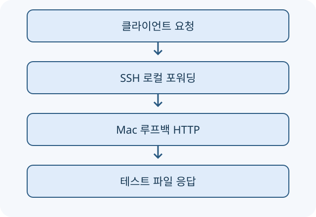

---
{
  "kind": "post",
  "publishedAt": "2026-11-23T09:45:00Z",
  "updatedAt": "2026-11-23T09:54:05Z",
  "reviewedAt": "2026-11-23",
  "reviewStatus": "source-audited",
  "reviewScope": "Official documentation self-review; loopback HTTP checked locally; SSH and tunnel not tested.",
  "reviewSources": [
    "https://support.apple.com/guide/mac-help/allow-a-remote-computer-to-access-your-mac-mchlp1066/mac",
    "https://docs.python.org/3/library/http.server.html",
    "https://man.openbsd.org/ssh"
  ],
  "language": "ko",
  "translationKey": "2026-11-23-macbook-personal-server",
  "routeSlug": "2026-11-23-macbook-personal-server",
  "title": "맥북을 사설 네트워크의 개인 서버로 사용하기",
  "description": "SSH 터널로 루프백 HTTP 서버를 시험하고 맥의 가용성 한계를 살펴봅니다.",
  "categories": [
    "tips"
  ],
  "tags": [
    "macos",
    "ssh",
    "home-server"
  ]
}
---

맥북을 신뢰할 수 있는 사설 네트워크에서 짧은 개발 데모용 서버로 사용할 수 있습니다. HTTP 서버를 맥의 루프백 주소에만 띄우고 다른 컴퓨터에서 SSH 로컬 포워딩으로 접속합니다. 공개 서비스나 상시 운영 구성이 아닌 임시 실습입니다.



그림은 요청과 응답을 요약하며 인증과 정리는 아래에서 설명합니다.

## 접속 준비

관리하는 사설 네트워크에서 두 컴퓨터를 사용합니다. 공유 또는 공용 네트워크에는 신뢰할 수 없는 기기가 있을 수 있으며 사설 주소만으로 접근이 제한되지는 않습니다. 공유기 포트 포워딩은 하지 않습니다. 별도의 macOS 표준 계정을 만들고 필요한 파일에만 접근을 허용합니다. 맥에서 시스템 설정 → 일반 → 공유 → 원격 로그인을 켜고 “다음 사용자만”을 선택해 그 계정을 허용합니다. 별도로 필요하지 않다면 원격 사용자의 전체 디스크 접근은 끕니다. 원격 로그인 패널에서 맥의 SSH 주소를 확인합니다. macOS 버전이나 기기 관리 정책에 따라 화면이 다를 수 있습니다. [Apple: 원격 로그인](https://support.apple.com/guide/mac-help/allow-a-remote-computer-to-access-your-mac-mchlp1066/mac)

클라이언트에서 전용 키를 만들고 암호와 새 파일 이름을 선택합니다.

```sh
ssh-keygen -t ed25519 -f ~/.ssh/macbook_demo
```

신뢰할 수 있는 경로로 `~/.ssh/macbook_demo.pub`의 공개 키 한 줄을 맥에 복사합니다. 맥에서 허용한 계정으로 로컬 로그인한 뒤 아래 명령을 실행하고 공개 키 한 줄을 붙여 넣은 다음 새 줄에서 Ctrl-D를 누릅니다. 기존 항목을 보존하면서 `~/.ssh/authorized_keys`에 추가합니다. 개인 키는 복사하지 않습니다.

```sh
umask 077
mkdir -p ~/.ssh
chmod 700 ~/.ssh
cat >> ~/.ssh/authorized_keys
chmod 600 ~/.ssh/authorized_keys
```

[OpenSSH 공개 키 파일](https://man.openbsd.org/sshd#AUTHORIZED_KEYS_FILE_FORMAT)과 [ssh-keygen](https://man.openbsd.org/ssh-keygen)을 참고합니다.

맥의 로컬 터미널에서 호스트 키 지문을 확인합니다.

```sh
ssh-keygen -lf /etc/ssh/ssh_host_ed25519_key.pub
```

클라이언트에서 허용한 계정과 원격 로그인에 표시된 주소로 접속합니다. 아래 `demo`와 `192.168.1.20`은 예시이므로 실제 값으로 바꿉니다. 처음 접속할 때 표시되는 ED25519 지문을 맥에서 확인한 값과 비교하고 다르면 중단해 원인을 조사합니다. 호스트 키 변경 경고도 자동으로 승인하지 말고 확인합니다. [OpenSSH 호스트 확인](https://man.openbsd.org/ssh#VERIFYING_HOST_KEYS)

```sh
ssh -i ~/.ssh/macbook_demo -o HostKeyAlgorithms=ssh-ed25519 demo@192.168.1.20
```

로그인 성공을 확인하고 `exit`를 입력합니다. 키를 추가해도 암호 인증이 자동으로 꺼지지는 않습니다.

## 테스트 서버와 포워딩

맥에서 허용된 계정의 터미널로 빈 임시 디렉터리와 무해한 파일을 만들고 Python 3.7+ 서버를 시작합니다. 서버는 맥의 IPv4 루프백 주소에만 바인딩됩니다. 이 터미널을 열어 둡니다.

```sh
sample_dir=$(mktemp -d)
printf 'home server test\n' > "$sample_dir/index.html"
python3 -m http.server 8000 --bind 127.0.0.1 --directory "$sample_dir"
```

포트 8000이 이미 사용 중이면 중단하고 서버와 포워딩 명령 모두에서 사용하지 않는 포트를 고릅니다. Python의 간단한 HTTP 서버는 운영용이 아니며 심볼릭 링크를 따라가므로 빈 테스트 디렉터리와 무해한 파일만 사용합니다. [Python http.server](https://docs.python.org/3/library/http.server.html)

클라이언트의 두 번째 터미널에서 터널을 열고 유지합니다.

```sh
ssh -N -o ExitOnForwardFailure=yes -i ~/.ssh/macbook_demo -L 127.0.0.1:18000:127.0.0.1:8000 demo@192.168.1.20
```

클라이언트의 다른 터미널에서 실행합니다.

```sh
curl http://127.0.0.1:18000/
```

예상 출력은 `home server test`입니다. 클라이언트 자신의 18000 포트로 접속하면 SSH가 요청을 맥으로 전달하고 맥의 루프백 8000 포트에 연결합니다. 터널이 실패하면 주소, 허용 목록, 지문과 키를 확인합니다. 터널이 열렸지만 curl이 실패하면 Python 프로세스와 두 포트가 일치하는지 확인합니다. `ExitOnForwardFailure`는 로컬 리스너의 생성 여부를 확인할 뿐 대상 HTTP 서버의 접근 가능성을 보장하지 않습니다. [OpenSSH 포워딩](https://man.openbsd.org/ssh#L)

SSH 터널 터미널에서 Ctrl-C를 눌러 종료합니다. 맥 터미널에서 Ctrl-C로 Python을 종료한 다음 위에서 만든 테스트 디렉터리만 지웁니다.

```sh
rm "$sample_dir/index.html"
rmdir "$sample_dir"
```

이 실습을 위해서만 공개 키와 원격 로그인을 추가했다면 해당 키 줄을 지우고 원격 로그인을 끕니다. 기존 키와 접근 설정은 보존합니다.

## 가용성과 다음 선택

화면이 꺼진 상태와 맥이 잠든 상태는 다릅니다. 노트북 덮개를 닫으면 보통 잠자기 상태가 되므로 덮개를 닫거나 네트워크 깨우기 또는 전원 설정 변경만으로 테스트가 계속된다고 가정하지 마세요. FileVault가 켜진 맥을 재시동한 뒤 필요하면 사람이 직접 잠금 해제할 수 있도록 준비합니다. Apple은 macOS 26 이상의 Apple Silicon에서 특정 조건을 충족할 때 SSH로 FileVault를 잠금 해제하는 방법을 안내하지만 모든 환경에 적용된다고 가정하지 마세요. [Apple: 잠자기](https://support.apple.com/guide/mac-help/put-your-mac-to-sleep-or-wake-it-mh10330/mac) · [Apple: FileVault](https://support.apple.com/guide/security/managing-filevault-sec8447f5049/web)

일회성 데모는 끝나면 프로세스를 종료합니다. 파일 공유에는 macOS 파일 공유와 접근 권한을 고려할 수 있습니다. 장기 실행 서비스에는 별도의 launchd 설정, 업데이트, 백업과 복구 계획이 필요하며 전용 하드웨어가 더 적합할 수도 있습니다. 집 밖에서 접속하려면 사설 VPN을 별도로 검토할 수 있지만 맥과 서비스의 보안은 여전히 필요합니다.

루프백 HTTP 응답은 임시 파일과 프로세스로 로컬에서 확인했습니다. SSH 접속과 터널은 독자가 수행할 문서상 절차이며 이 맥에 대한 연결은 시험하지 않았습니다.
