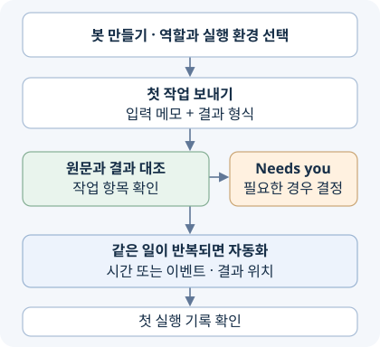

**Orca Bot을 처음 만든다면, 반복 업무를 예약하기 전에 결과를 직접 확인할 수 있는 일 하나를 맡겨보세요.** 예를 들어 짧은 기술 메모를 주고 블로그 제목과 글의 구성을 받아봅니다. 결과가 원하는 형식으로 나오면 봇의 역할을 다듬고 반복 작업을 추가합니다. 이 글에서는 블로그 원고를 준비하는 봇으로 그 과정을 따라갑니다.

Orca Bot은 이름과 목적, 메모리를 가진 작업 단위입니다. 봇이 실행될 컴퓨터와 Claude Code·Codex 같은 에이전트를 고릅니다. 사용하는 에이전트는 해당 컴퓨터에 설치하고 로그인해 둡니다. 첫 실습은 Orca 안에서 끝납니다. Slack·GitHub·Linear에서 봇을 부르거나 해당 서비스 이벤트로 실행하려면 필요한 연결을 추가합니다. [Orca Bots 빠른 시작](https://orca.dev/docs/bots) · [Orca 봇 커넥터 안내](https://orca.dev/docs/bots/connectors)



## 봇을 만들고 첫 요청을 보냅니다

Orca 사이드바의 **Bots**에서 **+ → New bot → Start from scratch**을 선택합니다. 이름을 정하고 **Who it is and what it does**에 역할을 한 문장으로 적습니다. 예제 이름은 `블로그 초안`, 목적은 ‘개발 메모를 기술 블로그 초안으로 정리한다’입니다. 이름 아래에서 실행 컴퓨터와 에이전트를 확인한 뒤 **Create**을 선택합니다. 사이드바에 Bots가 보이지 않으면 **Settings → Bots → Enable bots**를 확인합니다. [Orca 봇 생성 안내](https://orca.dev/docs/bots)

봇의 채팅에서 아래처럼 입력 자료와 결과 형식을 함께 줍니다. 이 메모는 글쓰기 실습용으로 만든 가상 자료입니다.

```text
다음 실습 메모로 한국어 기술 블로그 초안을 준비해줘.

메모
- Java 서비스에서 외부 API를 호출한다.
- 테스트에서 정상 응답과 404 응답을 확인했다.
- 운영 지연 시간은 측정하지 않았다.

제목 1개, 도입 문단 1개, 소제목 3개를 제안해줘.
메모에 없는 버전이나 성능 수치는 추가하지 말고,
본문을 쓰려면 더 확인할 내용이 있으면 끝에 적어줘.
결과는 이 채팅에 보여줘.
```

결과를 받으면 본문에 ‘404를 확인했다’는 범위가 남아 있는지 봅니다. 버전이나 처리량을 새로 주장한다면 그 부분을 빼거나 근거를 요청합니다. 첫 요청의 성공 기준은 바로 게시할 원고가 생기는 것이 아니라, 입력 메모를 근거로 제목·도입·소제목이 나오는 것입니다.

## 다음 채팅에서도 쓸 규칙과 현재 작업을 구분합니다

| 어디에서 확인하나 | 적합한 내용 | 블로그 봇 예시 |
| --- | --- | --- |
| `SOUL.md` | 계속 적용할 역할과 작업 방식 | 공식 문서로 근거를 확인하고, 게시에는 별도 요청을 받는다 |
| `MEMORY.md` | 다음 채팅에서도 참고할 사실과 선호 | 독자는 Java 개발자이며, 설명에 실행 예제를 선호한다 |
| **Home**의 작업 항목 | 현재 진행 상황, 첨부 결과, 승인할 결정 | 새 원고가 검토를 기다리고 있다 |

두 Markdown 파일은 봇 폴더에 있습니다. ‘앞으로 예제에서 직접 실행한 결과와 예상 결과를 구분해줘’처럼 반복 적용할 방식을 알려주고 다음 작업에서도 지켜지는지 확인할 수 있습니다. 현재 작업이 끝났는지 확인하려면 봇의 작업 항목을 엽니다. 결정이 필요하면 **Needs you**에서 질문의 대상과 결과를 확인하고 답합니다. [Orca 봇 사용법](https://orca.dev/docs/bots) · [봇 메모리와 접근 범위](https://orca.dev/docs/bots/security)

저장소에서 코드 변경을 맡기면 봇이 별도 Git worktree의 작업자에게 넘길 수 있습니다. 그런 작업은 사이드바에서 작업자의 workspace를 열어 파일과 테스트를 보고, PR이 생기면 실제 변경분을 확인합니다. [Orca 봇의 작업자 안내](https://orca.dev/docs/bots) · [Orca worktree 사용법](/ko/posts/2026-11-12-orca-worktree-guide/)

## 반복 작업은 실행 조건과 결과 위치를 함께 정합니다

첫 작업이 맞으면 봇 채팅에 아래처럼 요청합니다. 이 예제에서는 공개 문서를 읽어 글감만 정리합니다.

```text
매주 월요일 오전 9시(한국 시간)에, 직전 7일 동안 발표된
Spring Boot 공식 릴리스에서 기술 글감 최대 3개를 골라줘.
각 후보에 발표일, 공식 링크, 실습해 볼 질문을 적어줘.
해당 발표가 없으면 없다고 알려줘.
결과는 Orca 안에서 내가 볼 수 있게 하고, 블로그에 게시하지는 마.
자동화가 어느 대화에 결과를 남기는지도 알려줘.
```

자동화가 생기면 봇 패널에서 **시간대·실행 조건·결과를 받는 곳**을 확인합니다. 시간이 아니라 새 GitHub PR 같은 사건에 반응해야 한다면 해당 커넥터가 연결돼 있고 그 이벤트를 지원하는지 먼저 확인합니다. 봇을 실행할 컴퓨터가 절전 중이거나 오프라인이면 예정대로 바로 작업할 수 없으므로, 첫 실행 결과는 자동화의 실행 기록에서 확인합니다. [Orca 자동화 안내](https://orca.dev/docs/bots) · [Orca 커넥터 안내](https://orca.dev/docs/bots/connectors)

CLI가 설치된 macOS 환경에서는 아래 명령으로 봇 이름과 사용 가능한 이벤트를 조회할 수 있습니다. 두 번째 줄의 이름을 자신의 봇 이름으로 바꿉니다.

```sh
orca bot list
orca automations trigger-options --bot '블로그 초안'
```

작성 환경의 **Orca CLI 1.4.271**에서 기존 봇으로 두 조회 명령을 확인했습니다. GitHub 연결이 없는 봇의 조회 결과에는 GitHub 이벤트가 그 봇을 시작할 수 없다고 표시됐습니다. 예제 이름과 메모는 설명용이며, 이 글을 위해 새 봇을 만들거나 자동화를 등록해 실행하지는 않았습니다. 버전에 맞는 CLI 참고는 `orca skills get orca-cli --reference bots`에서 읽을 수 있습니다.
