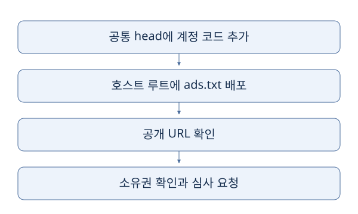

---
{
  "kind": "post",
  "publishedAt": "2026-11-24T08:00:00Z",
  "language": "ko",
  "translationKey": "2026-11-24-github-pages-ads-guide",
  "routeSlug": "2026-11-24-github-pages-ads-guide",
  "title": "GitHub Pages 블로그에 광고 달기 — 서비스 선택부터 AdSense 설치까지",
  "description": "GitHub Pages에서 광고 서비스를 고르고 AdSense와 루트 ads.txt를 설정한 뒤 사이트 심사와 광고 상태를 확인합니다.",
  "categories": [
    "tips"
  ],
  "tags": [
    "github-pages",
    "adsense",
    "ads-txt"
  ]
}
---

`username.github.io`에서 기술 블로그를 운영한다면 Google AdSense부터 살펴볼 만합니다. 개발자 독자가 꾸준히 찾아오는 사이트라면 Carbon Ads나 EthicalAds도 후보입니다. 어느 쪽이든 신청 전에 `https://username.github.io/ads.txt`를 내가 배포할 수 있는지 확인해 보세요. 프로젝트 주소가 `username.github.io/blog/`처럼 생겼을 때 특히 중요한 부분입니다.

GitHub는 콘텐츠가 중심인 사이트에 광고를 일반적으로 금지하지 않습니다. 다만 GitHub Pages를 온라인 상점이나 상업용 SaaS를 운영하는 무료 호스팅으로 쓰는 데에는 제한이 있습니다. 기술 글을 읽으러 오는 블로그에 광고를 곁들이는 경우라면 이 두 정책을 함께 보면 됩니다. [GitHub 광고 정책](https://docs.github.com/en/site-policy/acceptable-use-policies/github-acceptable-use-policies#10-advertising-on-github) · [GitHub Pages 사용 제한](https://docs.github.com/en/pages/getting-started-with-github-pages/github-pages-limits)

## 어떤 광고 서비스에 신청할까?

| 서비스 | 어떤 블로그에 어울리나 | 어디서 신청하나 |
|---|---|---|
| **Google AdSense** | 개인 블로그에서 처음 광고를 달거나, 자동 배치와 수동 배치 중 하나를 고르고 싶을 때 | [AdSense 시작하기](https://adsense.google.com/start/) |
| **Carbon Ads** | 개발자·디자이너가 주로 읽는 글, 문서, 도구를 운영할 때. 신청 안내는 월 1만 페이지뷰부터 검토하며 다른 광고 네트워크와의 병행을 허용하지 않는다고 밝힙니다. | [Carbon Ads 게시자 신청](https://www.carbonads.net/join?_hsmi=83378591) |
| **EthicalAds** | 개발자 중심 사이트로 월 5만 페이지뷰 이상이며, 읽는 흐름을 방해하지 않는 위치에 광고 한 곳을 마련할 수 있을 때 | [EthicalAds 게시자 가이드](https://www.ethicalads.io/publisher-guide/) |

처음이라면 광고를 어디에 둘지부터 정해 보세요. 예를 들어 코드 예제가 많은 블로그라면 글 아래 한 곳에만 두고 모바일에서 읽어 보는 편이 배치를 판단하기 쉽습니다. AdSense에서는 직접 위치를 정하는 **광고 단위**와 Google이 위치를 정하는 **자동 광고** 중에서 고를 수 있습니다. EthicalAds는 별도로 데스크톱과 모바일의 첫 화면에 광고를 배치하고, 모바일에서 불가능하면 모바일 광고를 끄도록 안내합니다. [AdSense 광고 설정](https://support.google.com/adsense/answer/7037624)



그림은 설정과 심사 요청까지의 순서를 요약합니다. 실제 광고 노출은 별도로 확인합니다.

## 1. AdSense에 가입하고 사이트를 등록한다

Google 계정으로 AdSense에 가입하고 지급 국가와 결제 정보를 입력합니다. 대시보드의 **사이트 → 새 사이트**에서 `https://username.github.io`를 등록하세요. `github.io`는 Public Suffix List에 올라 있고, AdSense는 이 목록에 포함된 플랫폼의 하위 도메인을 사이트로 추가할 수 있다고 안내합니다. 등록 후에는 소유권 확인과 사이트 심사가 이어집니다. [AdSense 계정 만들기](https://support.google.com/adsense/answer/7402253) · [AdSense 사이트 등록 기준](https://support.google.com/adsense/answer/12170421) · [Public Suffix List](https://publicsuffix.org/list/public_suffix_list.dat)

여기서 주소를 한 번 확인하세요. GitHub Pages의 사용자 사이트는 `username.github.io/`, 프로젝트 사이트는 보통 `username.github.io/blog/`에 열립니다. 프로젝트 배포 결과에 `ads.txt`를 넣으면 `/blog/ads.txt`에 올라갈 수 있습니다. Google은 호스트 루트인 `/ads.txt`부터 찾으므로, 사용자 사이트에서 루트 파일을 배포하거나 블로그에 연결한 커스텀 도메인의 루트에서 파일을 제공해야 합니다. [GitHub Pages 사이트 유형](https://docs.github.com/en/pages/getting-started-with-github-pages/what-is-github-pages#types-of-github-pages-sites) · [Google의 ads.txt 크롤링 안내](https://support.google.com/adsense/answer/7679060)

## 2. 공통 `<head>`에 코드 한 번, 루트에 `ads.txt` 하나

AdSense가 제시하는 소유권 확인 방법에는 코드 스니펫, `ads.txt`, 메타 태그가 있습니다. 코드 스니펫을 선택했다면 대시보드가 발급한 코드를 공통 레이아웃의 `<head>`에 넣으세요. 아래는 모양을 보여 주는 예시입니다. 실제 배포에는 계정에서 복사한 코드를 사용합니다. [AdSense 사이트 연결 안내](https://support.google.com/adsense/answer/7584263)

```html
<script async
  src="https://pagead2.googlesyndication.com/pagead/js/adsbygoogle.js?client=ca-pub-0000000000000000"
  crossorigin="anonymous"></script>
```

`ads.txt`에는 대시보드가 제공하는 줄을 그대로 복사합니다. 이 파일은 내 사이트의 광고 지면을 판매할 수 있는 계정을 공개합니다. 이미 다른 판매자 항목이 있다면 기존 줄을 보존하고 새 줄을 추가하세요.

```text
google.com, pub-0000000000000000, DIRECT, f08c47fec0942fa0
```

Astro로 만든 사용자 사이트라면 `public/ads.txt`를 두면 됩니다. Astro는 `public/`의 파일을 빌드 결과에 그대로 복사합니다. 배포 후에는 저장소에서 파일이 보이는지보다 **공개 주소에서 파일이 열리는지**가 중요합니다. [Astro의 `public/` 디렉터리](https://docs.astro.build/en/guides/images/#src-vs-public) · [Google ads.txt 가이드](https://support.google.com/adsense/answer/12171612)

```bash
curl -fsSL https://username.github.io/ads.txt
```

예상 출력은 위 예시의 판매자 줄입니다. 실제 사이트에서는 계정의 게시자 ID가 표시되어야 합니다. `username` 주소는 예시이므로 이 명령의 실제 실행 결과는 아닙니다.

다국어 블로그라면 `/ko/`와 `/en/`에 각각 `ads.txt`를 만들 필요가 없습니다. 같은 호스트를 쓰므로 루트 파일 하나를 두고, 각 언어의 대표 글에서 공통 스크립트가 한 번씩 들어가는지 확인하면 됩니다.

## 3. 배포, 심사, 광고 노출을 따로 확인한다

파일과 코드를 배포했다면 AdSense에서 소유권을 확인하고 사이트 심사를 요청합니다. 대시보드에서 **사이트 `Ready`**는 사이트가 광고를 게재할 준비가 됐다는 뜻이고, **ads.txt `Authorized`**는 Google이 파일에서 게시자 ID를 찾았다는 뜻입니다. 공개 URL에서 파일이 열려도 대시보드에 `Not found`가 남아 있다면 마지막 크롤링 이후 변경이 반영됐는지 확인하세요. 파일 내용과 경로가 맞으면 **업데이트 확인**으로 재확인을 요청할 수 있습니다. [AdSense 사이트 상태](https://support.google.com/adsense/answer/12170222) · [ads.txt 상태 업데이트](https://support.google.com/adsense/answer/12171612)

광고를 켜기 전에는 개인정보 처리방침에 광고로 인해 수집·공유되는 정보와 쿠키 등 사용 기술을 안내하세요. 유럽경제지역(EEA)·영국·스위스 방문자에게 개인 맞춤 광고를 제공하려면 IAB의 투명성 및 동의 프레임워크(TCF)와 통합된 Google 인증 동의 관리 플랫폼(CMP)이 필요합니다. AdSense의 **개인정보 보호 및 메시지**에서 제공하는 유럽 규정 메시지도 선택지입니다. [Google 게시자 개인정보 정책](https://support.google.com/adsense/answer/10502938) · [Google의 CMP 요구사항](https://support.google.com/adsense/answer/13554116)

심사가 끝나면 자동 광고 미리보기나 수동 광고 단위로 배치를 확인합니다. 휴대폰에서 글을 열어 목차·코드 복사 버튼·언어 전환 메뉴가 광고에 가려지지 않는지 보면 됩니다. 광고를 직접 클릭해 테스트하지 말고 미리보기와 대시보드 보고서를 사용하세요. [자동 광고 미리보기](https://support.google.com/adsense/answer/9261307) · [무효 트래픽 안내](https://support.google.com/adsense/answer/16737)

`youdozi.github.io`에서는 공개 루트의 `ads.txt`와 한국어 홈페이지의 AdSense 스크립트 한 개를 확인했습니다. 이번 확인 범위는 공개 파일과 HTML까지이며, 계정 심사 상태와 실제 광고 노출은 별도로 확인해야 합니다. [공개 ads.txt](https://youdozi.github.io/ads.txt) · [한국어 홈페이지](https://youdozi.github.io/ko/)
