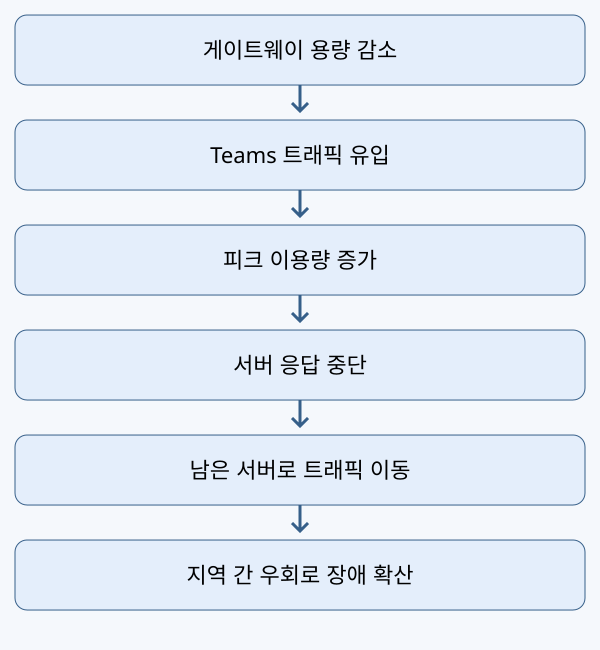

서버가 응답하지 않으면 정상 서버로 요청을 돌립니다. 평소에는 이 동작 덕분에 서버 몇 대가 멈춰도 사용자가 알아차리지 못합니다. 2026년 11월 Microsoft 365 장애에서는 같은 동작이 장애를 다른 지역으로 옮겼습니다. 요청을 넘겨받은 서버에도 같은 결함이 있었고, 부하가 늘자 그곳에서도 결함이 드러났기 때문입니다. [Microsoft 사후보고서 사본](https://www.365fanatic.com/wp-content/uploads/2026/11/postincidentreport-mo1550821.pdf)

줄어든 게이트웨이 용량에 Teams 트래픽과 피크 이용량이 겹치고, 우회로 같은 결함이 있는 서버에 부하가 퍼집니다.

## 7월에 들어간 결함이 왜 11월에 드러났을까

Microsoft 사후보고서에 따르면 결함은 Microsoft 365 네트워크 게이트웨이용 Windows 업데이트에 들어갔습니다. 7월부터 여러 주에 걸쳐 배포됐고, 석 달 넘게 고객 영향이 관찰되지 않았습니다. 그런데 코어 수가 많은 신형 서버에서는 더 많은 연결 요청이 동시에 처리되면서 내부 잠금 경합이 심해질 수 있었습니다. 당시 부하 시험에 쓴 서버는 코어 수가 더 적었고, 시험 트래픽도 장애 당시와 달랐습니다. [Microsoft 사후보고서 사본](https://www.365fanatic.com/wp-content/uploads/2026/11/postincidentreport-mo1550821.pdf)

11월 12일에는 정기 작업으로 게이트웨이 용량 일부가 빠진 상태에서 Teams 트래픽이 Exchange Online과 공유하는 게이트웨이로 넘어왔습니다. 한동안 서비스는 정상적으로 동작했습니다. 북미 이용량이 평소의 정점에 가까워지자 서버가 응답하지 않기 시작했고, 자동 우회로 남은 서버 한 대당 부하가 더 커졌습니다. 지역 간 우회도 같은 결함을 가진 서버로 요청을 보냈습니다. 보고서가 기록한 **활성 고객 영향 구간은 약 23시간 50분**이며, 이후에도 지연 메일 처리와 안정성 모니터링이 이어졌습니다. [Microsoft 사후보고서 사본](https://www.365fanatic.com/wp-content/uploads/2026/11/postincidentreport-mo1550821.pdf)

## 장애 조치에도 수신 한도가 필요하다

장애 조치(failover)를 설계할 때는 **받는 쪽이 지금 얼마나 더 처리할 수 있는지**를 확인해야 합니다. 예를 들어 A 리전이 같은 시간 구간에 요청 1,000건을 넘기려는데 B 리전의 여유가 300건이라면, 전량 우회로 두 리전 모두에 장애가 날 수 있습니다. 이때는 핵심 요청을 우선 받아들이고, 지연을 허용할 수 있는 작업은 대기열에 상한을 두거나 일시적으로 거절하는 방식이 있습니다. 과부하 때 일부 요청을 의도적으로 덜 받는 것을 **부하 차단(load shedding)**이라고 합니다. [Microsoft Learn의 과부하 제어 가이드](https://learn.microsoft.com/en-us/azure/well-architected/design-guides/throttling)

복구에도 같은 원칙이 적용됩니다. 이번 장애에서는 서버가 다시 서비스에 들어오는 순간 밀린 재연결 요청을 받아 또 응답하지 못했습니다. 운영팀이라면 복구한 인스턴스에 요청을 조금씩 돌려보내면서 연결 성공률과 지연, 대기열을 함께 볼 수 있습니다. 부하 시험에서는 운영과 같은 서버 세대에 **피크 트래픽, 정기 작업으로 줄어든 용량, 장애 조치, 재연결**을 겹쳐 봐야 합니다. 각각을 따로 시험하면 이번처럼 여러 조건이 맞물릴 때 생기는 문제를 놓칠 수 있습니다. [Microsoft 사후보고서 사본](https://www.365fanatic.com/wp-content/uploads/2026/11/postincidentreport-mo1550821.pdf)

## 채팅은 나눠도 판단 기록은 한곳에 둔다

Reuters가 확인한 내부 메모에 따르면 대응 인력은 Teams 채팅방 11개에서 메시지 1만 1천 건 이상을 주고받았습니다. 진단 데이터가 여러 시스템에 흩어져 있어 어떤 가설이 살아 있고, 누가 어떤 조치를 결정했는지 한눈에 보기 어려웠다고 합니다. Microsoft는 이후 재발 방지와 복구 개선에 우선순위를 두는 ‘Code Red’에 들어갔습니다. Reuters가 보도한 **전 세계 1시간 이내 복구**는 향후 장애에 대한 내부 목표입니다. [GeekNews 소개](https://news.hada.io/topic?id=37797) · [Reuters 기사 전재본](https://www.investing.com/news/stock-market-news/exclusivemicrosoft-declares-code-red-after-historic-outage-internal-memos-show-5048702)

팀별 조사 채널이 있어도 공통 장애 문서 한 장은 유지할 수 있습니다. 문서 맨 위에는 **현재 고객 영향, 확인된 사실, 진행 중인 가설과 담당자, 마지막 조치와 결과, 다음 공지 시각**을 둡니다. 예를 들어 “서버 재기동 완료”에 그치지 않고 “재기동 후 연결 성공률이 잠시 회복됐으나 재연결 요청이 몰리자 다시 하락”이라고 적습니다. 교대자는 그 한 줄을 보고 같은 조치를 바로 반복할지, 유입량부터 조절할지 판단할 수 있습니다. 장애 문서에 접근하는 경로도 복구 대상 서비스와 의존성이 겹치는지 확인해 두면 좋습니다. [Google SRE의 장애 대응 문서 운영법](https://sre.google/sre-book/managing-incidents/#live-incident-state-document)

다음 장애 훈련에서는 **피크 시간에 한 리전의 용량이 줄어든 상태**에서 시작해 보세요. 남은 리전이 요청을 얼마나 받을 수 있는지, 어떤 기능을 먼저 줄일지, 복구한 서버에 어느 속도로 요청을 돌려보낼지 정합니다. 종료 기준도 서버가 켜진 시점에서 한 걸음 더 나아가, 사용자가 핵심 기능을 다시 쓸 수 있고 밀린 요청이 줄어드는 시점으로 잡습니다. 그래야 복구 목표를 실제로 측정할 수 있습니다.

함께 읽기 · [Spring Boot 4.2에서 RestClient의 traceparent 전파 확인하기](https://youdozi.github.io/ko/posts/2026-11-22-spring-boot-4-2-restclient-traceparent/)
