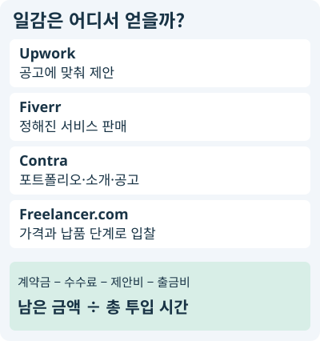

**한국에서 개발 부업을 처음 시작한다면, 공고에 직접 제안할 때는 Upwork, 정해진 작업을 반복 판매할 때는 Fiverr부터 살펴보세요.** 이미 소개받은 고객과 계약하고 대금을 받는 게 목적이라면 Contra가 맞을 수 있습니다. Freelancer.com은 입찰할 곳을 넓힐 때 쓸 만하지만, 응찰 전 잔액 요건과 고정가 계약을 수락하는 시점의 수수료를 먼저 확인해야 합니다.

가령 Spring Boot 테스트를 고치는 일도 어떤 방식으로 팔지에 따라 선택이 달라집니다. 원인이 밝혀지지 않은 장애라면 공고를 읽고 유료 진단 범위를 제안하는 편이 낫습니다. 같은 유형의 테스트 오류를 반복해서 고칠 수 있다면, 수정할 테스트와 납품물을 미리 정한 상품으로 만들 수 있습니다. 아래 비교는 2026년 11월 25일 기준 공식 문서를 바탕으로 했습니다.

## 어디서 고객을 만나고, 어떤 비용을 내나?

| 플랫폼 | 일감을 얻는 방식 | 프리랜서가 주의할 비용 |
| --- | --- | --- |
| Upwork | 고객 공고에 프로젝트별 제안서 제출 | 계약별 서비스 수수료 0~15%. 제안에 필요한 Connects는 공고마다 다르며 구매 가격은 개당 $0.15입니다. |
| Fiverr | 작업 범위와 가격을 정한 상품(Gig)을 등록해 주문을 받음 | 완료된 주문 금액의 80%가 프리랜서 수익입니다. |
| Contra | 포트폴리오와 Job Feed로 고객을 찾거나 기존 고객과 계약 | 프리랜서 커미션은 0%. 거래의 플랫폼·결제 처리 비용과 출금·환전 비용은 각각 확인해야 합니다. |
| Freelancer.com | 공고에 견적과 납품 단계를 제안해 입찰 | 일반 고정가는 10%와 $5 중 큰 금액, 일반 시간제는 10%. 입찰 전 표준 최소 계정 잔액은 $20입니다. |

[Upwork 서비스 수수료](https://support.upwork.com/hc/en-us/articles/211062538-Learn-about-the-Freelancer-Service-Fee) · [Upwork Connects](https://support.upwork.com/hc/en-us/articles/211062898-About-Connects-costs-uses-balances-and-expiration) · [Fiverr 수익 기준](https://help.fiverr.com/hc/en-us/articles/9234443621137-Your-earnings-page) · [Contra 수수료](https://help.contra.com/en/articles/9322934-fees-overview) · [Freelancer.com 요금표](https://www.freelancer.com/feesandcharges)

### Upwork — 공고마다 해결 방법을 제안한다

고객이 올린 공고를 골라 범위, 일정, 가격을 제안하기 좋습니다. 문제의 원인이 불확실하면 첫 계약을 “실패한 테스트 한 건을 재현하고 원인과 수정 계획을 전달”하는 유료 진단으로 좁힐 수 있습니다. 제안서를 쓰는 시간과 Connects 비용은 계약을 따내지 못한 지원에도 들어갑니다. 제안 전에는 화면에 표시되는 계약 수수료와 필요한 Connects를 함께 확인하세요.

고정가 계약은 단계별 대금을 고객이 미리 예치하는 마일스톤을 쓸 수 있습니다. 지급 보호를 받으려면 작업 전에 해당 단계에 대금이 전액 예치되어 있어야 하고, 합의한 범위의 결과물을 **Submit Work for Payment**로 제출해야 합니다. 한국 원화 계좌로 받는 **Direct to Local Bank**는 Upwork 기준 건당 $0.99이며, 은행별 비용과 조건이 붙을 수 있습니다. [고정가 지급 보호](https://support.upwork.com/hc/en-us/articles/211063748-How-Fixed-Price-Payment-Protection-works-for-freelancers-on-Upwork) · [한국 원화 계좌 출금](https://support.upwork.com/hc/en-us/articles/211063888-How-to-withdraw-earnings-with-Direct-to-Local-Bank)

### Fiverr — 범위가 일정한 작업을 상품으로 판다

“Spring Boot 프로젝트의 실패 테스트 1건을 수정하고 패치와 재현 명령을 전달한다”처럼 고객이 살 수 있는 단위를 정합니다. 가격표에 지원할 버전, 수정 횟수, 필요한 자료를 함께 쓰면 새 주문을 받을 때마다 범위를 처음부터 설명하는 일이 줄어듭니다. 다른 모듈로 수정이 번질 수 있다면 먼저 범위를 확인하거나 별도 견적을 보내는 편이 좋습니다.

고객은 주문 화면에서 납품물을 확인한 뒤 수락하거나 수정을 요청할 수 있습니다. 일반적으로 주문 완료 후 14일의 정산 대기 기간을 거쳐 출금할 수 있으며, 일부 등급·프로그램은 더 짧습니다. Payoneer를 통한 은행 이체 등은 출금 수단별 최소 금액과 지역 지원 조건을 확인하세요. [주문과 정산 대기 기간](https://help.fiverr.com/hc/en-us/articles/360010639617-A-freelancer-s-guide-to-the-Fiverr-order-process) · [Fiverr 출금 수단](https://help.fiverr.com/hc/en-us/articles/360010530058-Withdrawing-your-earnings-managing-payout-methods)

### Contra — 포트폴리오에서 계약으로 연결한다

이미 소개받은 고객에게 포트폴리오를 보여주고 계약과 결제를 한곳에서 관리하거나, Job Feed에서 새 일감을 찾을 수 있습니다. 프리랜서 커미션 0%와 별개로 무료 플랜의 플랫폼 수수료표에는 $1~$499 거래에 $15, $500 이상 거래에 $29가 표시됩니다. 결제 수단과 플랜에 따라 최종 청구액을 확인하세요. 한국 원화 계좌의 현지 이체 처리 비용은 공식 요금표 기준 $2이며, 환전 비용은 별도로 확인해야 합니다. [Contra 소개](https://help.contra.com/en/articles/9322235-contra-overview) · [일감 지원](https://help.contra.com/en/articles/9322973-applying-to-jobs-on-contra) · [결제와 출금 요금](https://help.contra.com/en/articles/9322934-fees-overview)

새 고객과는 작업 범위가 정해진 **Project**에서 예치형 결제 옵션을 비교하세요. Contra의 분쟁 지원 범위는 플랫폼에 예치된 자금에 적용됩니다. 독립형 인보이스나 결제 링크는 해당 지원 대상에서 제외됩니다. [유료 프로젝트 유형](https://help.contra.com/en/articles/9322763-paid-projects) · [분쟁 지원 범위](https://help.contra.com/en/articles/11329360-contra-s-dispute-assistance)

### Freelancer.com — 입찰부터 계약 수락까지의 비용을 확인한다

제안에 납품 단계와 가격을 명시해 입찰할 수 있습니다. 일반 입찰 전 필요한 최소 잔액은 기본 $20이며, 일부 프로젝트나 계정에는 더 높은 기준이 적용될 수 있습니다. 일반 고정가 프로젝트의 수수료는 낙찰된 작업을 수락할 때 청구됩니다. 예를 들어 $30짜리 작업이면 10%에 해당하는 $3보다 최소 수수료 $5가 커서, 출금 비용을 빼기 전 $25가 남습니다. [Freelancer.com 요금과 최소 잔액](https://www.freelancer.com/feesandcharges)

첫 작업은 단계별 **Milestone Payment**의 예치 여부를 확인하고 시작하세요. 분쟁 절차는 해당 마일스톤 결제에 연결됩니다. 출금은 계정에서 지원 수단을 먼저 확인할 필요가 있습니다. 공식 목록의 은행 직접 출금(Express Withdrawal) 대상에는 한국이 없고, PayPal·Payoneer 출금 안내에는 각각 최소 $50가 표시됩니다. [마일스톤 대금 지급](https://www.freelancer.com/support/payments/how-do-i-get-paid) · [직접 출금 지원 국가](https://www.freelancer.com/support/freelancer/payments/express-withdrawals) · [출금 수단과 최소 금액](https://www.freelancer.com/support/payments/how-to-withdraw-funds)

## 첫 계약을 받으면 시간당 얼마가 남을까?

계약서에 적힌 금액에서 수수료만 빼면 제안서 작성과 검수 시간이 빠집니다. 납품 6시간, 협의·검수 1시간, 제안서 6건에 각각 20분을 써서 $300 계약 하나를 땄다고 가정해 봅시다. Upwork 수수료는 이 계약에 표시된 값이 10%라고 가정하고, 제안당 구매한 Connects 12개와 원화 계좌 출금 1회를 계산에 넣습니다.



아래 코드는 Python 3의 표준 라이브러리만 사용합니다. 파일을 `estimate.py`로 저장하고 `python3 estimate.py`를 실행하면 됩니다. 환율 차이와 세금은 계산에서 제외했습니다.

```python
from decimal import Decimal

contract_usd = Decimal("300")
service_fee_rate = Decimal("0.10")
proposals = 6
connects_per_proposal = 12
connect_price_usd = Decimal("0.15")
withdrawal_usd = Decimal("0.99")

proposal_hours = Decimal(proposals * 20) / 60
delivery_hours = Decimal("6")
review_hours = Decimal("1")

proposal_cost = proposals * connects_per_proposal * connect_price_usd
remaining = contract_usd * (1 - service_fee_rate) - proposal_cost - withdrawal_usd
total_hours = proposal_hours + delivery_hours + review_hours

print(f"Costs deducted, before tax: ${remaining:.2f}")
print(f"Total hours: {total_hours:.1f}")
print(f"Per hour, before tax: ${remaining / total_hours:.2f}")
```

실행 결과는 다음과 같습니다.

```text
Costs deducted, before tax: $258.21
Total hours: 9.0
Per hour, before tax: $28.69
```

같은 $300 계약이어도 제안서를 다시 쓰거나 수정 요청이 늘면 시간당 금액이 달라집니다. 첫 의뢰는 “테스트 1건 재현 및 패치”처럼 납품 기준을 한 줄로 설명할 수 있는 일로 시작하세요. 실제 고객 코드를 대상으로 한 무료 시범 작업이나 계약 전 외부 결제 요청을 받으면, 공개 샘플을 보여주거나 플랫폼에서 유료 진단을 제안하는 편이 좋습니다. [Upwork의 사기 유형과 예방 안내](https://support.upwork.com/hc/en-us/articles/35088484250003-Recognize-red-flags-and-avoid-scams)
