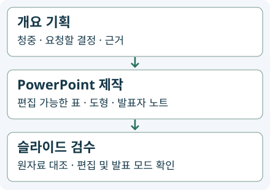

AI에 발표 자료를 맡길 때는 **누가 듣는지, 발표가 끝나면 어떤 결정을 내려야 하는지**부터 알려 주세요. “보기 좋은 PPT를 만들어 줘”라고 하면 표지와 목차는 금방 나오지만, 정작 회의에서 결정할 내용은 마지막 장까지 나오지 않을 수 있습니다. 먼저 슬라이드별 제목과 근거를 정하고, 그 개요를 .pptx로 만든 다음, 발표할 앱에서 직접 열어 검수하면 수정할 곳을 찾기 쉽습니다.



## PPT 제작에 쓸 수 있는 스킬과 도구

| 스킬·도구 | 쓰기 좋은 상황 | 맡길 작업 |
|---|---|---|
| **ai-guide-writing** | 사용법이나 교육 내용을 발표로 옮길 때 | 실습 순서, 예시 입력, 예상 결과, 확인 방법 정리 |
| **tech-blog-writing** | 기술 문서나 운영 기록을 발표로 바꿀 때 | 핵심 주장과 근거를 추리고, 설명을 슬라이드와 발표자 노트로 나누기 |
| **Anthropic pptx 스킬** | Claude Code에서 PowerPoint 파일을 직접 만들거나 기존 템플릿을 수정할 때 | .pptx 생성·편집, 슬라이드 내용 추출, 썸네일 및 파일 구조 검사. [공식 스킬](https://raw.githubusercontent.com/anthropics/skills/main/skills/pptx/SKILL.md) |
| **PptxGenJS** | Codex 같은 코딩 에이전트로 매주 비슷한 보고서를 만들 때 | JavaScript와 입력 데이터에서 편집 가능한 .pptx를 다시 생성. [공식 사용법](https://github.com/gitbrent/PptxGenJS#-quick-start-guide) |

ai-guide-writing과 tech-blog-writing은 이 환경에서 확인한 작성 스킬입니다. PowerPoint 파일을 만드는 단계에서는 Claude Code의 pptx 스킬이나 PptxGenJS를 쓸 수 있습니다. Claude Code에서 Anthropic 공식 스킬을 설치하려면 아래 두 줄을 순서대로 실행합니다. 설치한 뒤에는 프롬프트에서 pptx 스킬을 사용해 달라고 요청할 수 있습니다. [Anthropic 설치 안내](https://github.com/anthropics/skills#claude-code)

```text
/plugin marketplace add anthropics/skills
/plugin install document-skills@anthropic-agent-skills
```

이미 PowerPoint에서 작업하고 있다면 **Copilot**으로 프롬프트나 참고 파일을 바탕으로 초안을 만드는 방법도 있습니다. 회사 템플릿이 있다면 그 파일을 열고 시작하세요. 기능은 구독과 조직 설정에 따라 달라집니다. **Google Slides의 Gemini**를 쓴다면 슬라이드 생성 후 .pptx로 내려받을 수 있습니다. Google 공식 안내상 전체 프레젠테이션 생성 기능은 지원 요금제가 필요하며 데스크톱과 영어에서 제공됩니다. [PowerPoint에서 Copilot으로 새 프레젠테이션 만들기](https://support.microsoft.com/en-gb/powerpoint/copilot/create-a-new-presentation-with-copilot-in-powerpoint) · [Google Slides의 Gemini 발표 자료 생성](https://support.google.com/docs/answer/17111393) · [PPTX 다운로드](https://support.google.com/a/users/answer/9310270)

## 1. 개요 프롬프트에 회의에서 내릴 결정을 넣는다

아래는 개발팀에 **배포 전 점검 자동화 시범 운영**을 제안하는 가상 사례입니다. 발표 시간은 7분이고, 원하는 결정은 팀 한 곳에서 2주간 시범 운영을 승인받는 것입니다. 이 조건을 주면 AI가 자동화의 일반적인 장점보다 이번 회의에서 필요한 판단을 앞에 놓기 쉬워집니다.

```text
개발팀 리드와 운영 담당자에게 배포 전 점검 자동화를 제안하는
7분 발표의 개요를 작성해 줘. 슬라이드는 6장으로 구성해.
회의에서 받을 결정은 한 팀에서 2주간 시범 운영할지 여부야.

<자료>
- 현재 배포 전 환경 변수와 DB 마이그레이션 여부를 사람이 확인한다.
- 1차 자동 점검은 필수 환경 변수의 존재 여부와
  마이그레이션 파일 누락 여부만 확인한다.
- 점검은 진단 결과만 남기고 설정이나 DB를 변경하지 않는다.
- 시범 운영 중 점검 소요 시간, 누락 발견 건수, 오탐 건수를 기록한다.
- 절감 시간과 실패 감소율은 아직 측정하지 않았다.
</자료>

각 장에 결론형 제목, 화면 문구 최대 3개, 발표자 노트,
근거가 되는 자료 항목을 적어 줘.
첫 장에는 요청할 결정을, 마지막 장에는 시범 운영 후 판단 기준을 넣어.
자료에 없는 수치나 확정된 담당자는 만들어 내지 마.
```

개요를 받으면 **제목만 순서대로 읽어 보세요.** 첫 장에서 요청할 결정이 드러나고, 중간에서 현재 문제와 점검 범위가 설명되고, 마지막에서 시범 운영 결과를 어떻게 평가할지 읽혀야 합니다. “자동화 기대 효과”처럼 범위가 넓은 제목은 “시범 운영에서 점검 시간과 오탐을 기록한다”처럼 구체적으로 바꾸면 발표 흐름이 선명해집니다.

## 2. 편집 가능한 .pptx로 만들어 달라고 요청한다

글자나 도표를 나중에 바꿀 예정이라면, 제작 프롬프트에 **편집 가능해야 하는 요소**를 직접 적으세요. PowerPoint에서 문장 하나를 고쳐야 하는데 슬라이드 전체가 이미지 한 장으로 들어가 있으면 그 장을 다시 만들어야 합니다.

```text
아래에 붙여 넣은 확정 개요를 바탕으로 16:9 PowerPoint 파일
deployment-check-pilot.pptx를 만들어 줘.

- 제목, 본문, 표, 흐름도는 PowerPoint에서 개별 편집할 수 있게 만들어.
- 한 장에는 핵심 주장 하나를 두고, 긴 설명은 발표자 노트에 넣어.
- 자동 점검 장에는 ‘배포 요청 → 두 항목 검사 → 결과 기록’을
  세 개의 도형으로 표시해.
- 숫자가 없는 항목에는 차트를 만들지 말고 표나 흐름도를 사용해.
- 회사 템플릿을 첨부했다면 기존 제목 위치, 글꼴, 색상을 따라 줘.
- 원자료에 없는 효과나 시행 일정을 확정된 내용으로 쓰지 마.

<확정 개요>
여기에 1단계에서 검토한 슬라이드 개요를 붙여 넣는다.
</확정 개요>
```

코딩 에이전트로 매주 같은 보고서를 만든다면 여기에 **“PptxGenJS로 만들고, 다음에도 실행할 수 있도록 build-deck.js와 slides.json을 함께 남겨 줘”**를 추가하세요. 다음 주에는 입력 데이터만 바꿔 같은 배치로 다시 생성할 수 있습니다. 데이터가 들어가는 표와 차트는 가능하면 PowerPoint 객체로 유지하고, 삽화가 필요할 때만 별도 이미지를 넣으면 수정하기 편합니다. [PptxGenJS 텍스트 요소 문서](https://gitbrent.github.io/PptxGenJS/docs/api-text.html)

## 3. 검수 프롬프트는 슬라이드 번호와 수정 근거를 요구한다

검수를 부탁할 때는 완성 파일만 주지 말고 **확정 개요와 원자료**도 함께 주세요. 슬라이드에 “배포 실패율을 줄였다”라고 적혀 있으면, 원자료를 봐야 실제 결과인지 앞으로 측정할 항목인지 구분할 수 있습니다.

```text
완성된 PPTX를 확정 개요와 원자료에 대조해 검수해 줘.
슬라이드 번호별로 문제, 근거, 수정 문구를 제시해.

1. 원자료에 없는 수치, 확정되지 않은 일정, 과장된 효과를 찾아.
2. 슬라이드를 렌더링할 수 있다면 한글 글꼴 대체, 줄바꿈,
   잘린 글자, 도형 겹침을 확인해.
3. 발표자 노트가 화면의 문장을 반복하는 곳을 찾아.
4. 마지막 장만 봐도 청중이 무엇을 결정해야 하는지 알려 줘.

직접 확인하지 못한 항목은 ‘미확인’으로 표시해.
```

파일을 받으면 실제 발표에 쓸 PowerPoint에서 열어 **편집·발표 모드를 각각** 확인하세요. 편집 모드에서는 표의 숫자와 도형 안의 글을 직접 바꿔 보고, 발표 모드에서는 뒤쪽 자리에서도 제목과 핵심 문장이 읽힐 크기인지 봅니다. Google Slides에서 내보낸 파일이라면 한글 글꼴과 줄바꿈도 다시 확인합니다. 이 글의 프롬프트는 가상 사례를 위한 예시이며, 제품별 생성 결과는 공식 문서를 기준으로 설명했습니다.

함께 읽기 · [Claude Code·Codex 스킬 추천 10선과 실무 활용법](../2026-11-18-claude-code-codex-skills-top-10/)
