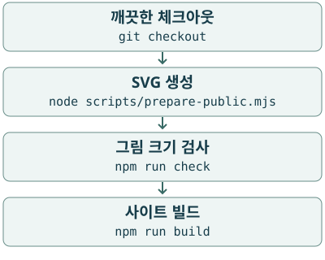

뉴스 초안 CI가 `ENOENT`로 멈췄습니다. 당시 살펴본 실패 4건 가운데 3건에서 Astro는 기존 글에 들어간 그림의 크기를 읽으려 했습니다. 깨끗한 체크아웃에는 그 SVG가 아직 없었습니다. 앞선 빌드가 남긴 SVG가 있으면 같은 검사도 통과할 수 있었습니다. [후보 검사가 멈춘 실행](https://github.com/youdozi/youdozi.github.io/actions/runs/45548722494)

## SVG가 생기기 전과 후에 같은 검사 실행하기

실패한 커밋을 별도 디렉터리에 체크아웃해 `npm run check`를 실행하자 종료 코드는 1이었습니다. 같은 디렉터리에서 `node scripts/prepare-public.mjs`로 공개 자산을 준비한 뒤 검사를 다시 실행하자 종료 코드는 0이었습니다. 빌드도 자산을 준비하지만, CI에서는 빌드보다 검사가 먼저였습니다.



CI와 같은 순서를 재현하려면 저장소 루트에서 Node.js 24와 Python 3.11을 사용하고 `npm ci`로 의존성을 설치한 뒤 아래 명령을 실행합니다. 각 단계가 성공해야 다음 단계로 넘어갑니다. [수정 PR](https://github.com/youdozi/youdozi.github.io/pull/198) · [PR의 빌드 결과](https://github.com/youdozi/youdozi.github.io/actions/runs/45734945701)

```sh
node scripts/prepare-public.mjs &&
  npm run check &&
  npm run build
```

## 별도 실패였던 Gemini 503

다른 한 건은 생성 단계에서 Gemini가 HTTP 503을 반환한 경우였습니다. 같은 모델로 첫 재시도 전 1초, 다음 재시도 전 2초를 기다리도록 바꿨습니다. 이 두 번의 재시도 한도는 한 실행의 모든 요청이 공유합니다. [생성 단계에서 실패한 실행](https://github.com/youdozi/youdozi.github.io/actions/runs/45098322259)

Spring 공식 글로 한영 초안을 시험할 때는 생성과 리뷰에 쓰는 모델 응답만 모의했습니다. 실제 원문과 인용을 대조하고 링크를 확인한 뒤 Python과 Astro 양쪽의 콘텐츠 스키마로 검사했습니다. 이 dry-run은 초안이나 대기열에 쓰지 않았고, 당시 Gemini가 실제 요청에 응답할 수 있었는지는 확인하지 않았습니다.

로컬에서만 검사가 통과한다면 깨끗한 체크아웃에서 누락된 파일을 처음 읽는 명령부터 찾으세요. 그 명령보다 파일을 만드는 단계가 앞서는지 보면, 전체 빌드가 성공하는데도 CI 검사가 멈추는 이유를 좁힐 수 있습니다.
