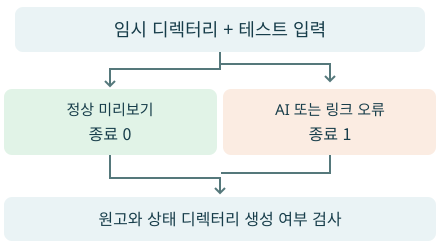

초안이 스키마를 통과해도 발행 대기열에 항목을 추가했다면 무발행 검증은 실패입니다. 그래서 테스트에서 두 가지를 따로 확인합니다. 입력에 맞는 종료 코드가 나왔는지, 그리고 실행 전후에 원고·대기열·상태 파일이 같은지 확인합니다.

## 미리보기 성공과 검증 실패를 각각 시험하기

저장소 루트에서 Python 3으로 아래 명령을 실행하세요. 두 테스트는 임시 디렉터리를 만들고 피드·초안 생성·링크 검사 결과를 테스트 데이터로 대체합니다. 네트워크나 모델 키 없이 실행할 수 있습니다.

```sh
PYTHONPATH=scripts python3 -B -m unittest \
  test_bilingual_digest.PublicationTests.test_preview_validates_without_writing_content_or_state \
  test_bilingual_digest.PublicationTests.test_ai_or_link_failures_do_not_write
```



첫 테스트는 `--dry-run --force`로 실행해 종료 코드 0과 `generated=false`를 확인합니다. 둘째는 `--check-links`로 AI 오류와 링크 오류를 각각 주입해 종료 코드 1을 확인합니다. 두 테스트 모두 임시 루트에 `src`와 `.pipeline`이 생기면 실패합니다. 위 명령의 실행 결과는 `Ran 2 tests`와 `OK`였습니다.

## Spring 원문을 넣었을 때 확인한 범위

별도의 로컬 실행에서는 [Spring AI 공식 글](https://spring.io/blog/2026/11/24/spring-ai-tool-call-confirmation-park-resume) 한 편을 골랐습니다. 격리된 실행에 `--dry-run --force --max-items 1 --check-links`를 넘기고 Gemini의 생성·리뷰 응답만 미리 준비한 데이터로 주입했습니다. CLI에 이 인자만 넘겨 실행하면 해당 데이터는 주입되지 않습니다.

원문은 HTTP 200으로 가져왔고, 링크를 확인한 뒤 한영 초안의 인용 4개를 실제 본문과 대조했습니다. Python과 Astro의 콘텐츠 스키마 검사도 통과했습니다. 출력은 `generated=false`였고, 별도로 비교한 원고·대기열·상태 파일 3,333개는 경로와 내용이 모두 같았습니다. 실제 Gemini 서비스의 가용성과 생성 품질은 이 실행에서 검증하지 않았습니다. [로컬 실행 기록](https://github.com/youdozi/youdozi.github.io/pull/198)

## PR에서 검증 작업의 권한 제한하기

당시 PR의 일반 CI에서 필수 `build / build`는 통과했고 `deploy`는 생략됐습니다. Spring 원문을 대조한 결과는 위 로컬 실행 기록에서 확인할 수 있습니다. [PR 검사 결과](https://github.com/youdozi/youdozi.github.io/actions/runs/45734945701) · [깨끗한 체크아웃에서 Astro 검사가 실패한 이유](https://youdozi.github.io/ko/posts/2026-11-26-astro-clean-checkout/)

독립 검증 작업을 추가한다면 체크아웃에는 `contents: read`만 주고 발행 자격 증명은 전달하지 마세요. 읽기 권한으로도 러너의 로컬 파일은 바꿀 수 있으므로, 원고·대기열·상태를 실행 전후에 비교하는 검사는 여전히 필요합니다. [GitHub의 작업별 토큰 설명](https://docs.github.com/en/actions/concepts/security/github_token)
