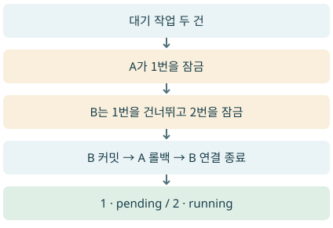

A가 첫 작업을 잠근 동안 B는 `SKIP LOCKED` 덕분에 다음 작업을 가져갈 수 있습니다. 그런데 B가 작업을 맡았다고 커밋한 직후 죽으면 그 작업은 `running`에 머뭅니다. 행 잠금은 작업을 나눠 갖는 데 쓰이고, 인계가 필요한 시점은 큐가 따로 기록해야 합니다.

## 두 세션에서 한 건씩 가져오기

빈 실습 DB에 연결한 세션 A에서 아래 준비 SQL을 자동 커밋으로 실행하세요. 같은 DB에 세션 B도 연결하고, 두 세션 모두 기본 격리 수준인 `READ COMMITTED`를 사용합니다.

```sql
CREATE TABLE queue_demo (
  id bigint GENERATED ALWAYS AS IDENTITY PRIMARY KEY,
  status text NOT NULL DEFAULT 'pending'
);
INSERT INTO queue_demo (status) VALUES ('pending'), ('pending');
```

다음 블록을 A에서 먼저 실행하고 트랜잭션을 열어 둡니다. 그 상태에서 B에서도 같은 블록을 실행하세요. 두 세션 모두 반환 행을 확인할 때까지 커밋하지 않습니다.

```sql
BEGIN;
WITH next_job AS (
  SELECT id FROM queue_demo
  WHERE status = 'pending'
  ORDER BY id
  LIMIT 1
  FOR UPDATE SKIP LOCKED
)
UPDATE queue_demo AS job
SET status = 'running'
FROM next_job
WHERE job.id = next_job.id
RETURNING job.id, job.status;
```



`ORDER BY id`는 후보를 살펴보는 순서를 정합니다. B가 먼저 커밋할 수 있으므로 처리 완료 순서까지 보장하지는 않습니다. PostgreSQL은 여러 소비자가 큐 테이블의 행 잠금을 두고 경합할 때 이 방식을 쓸 수 있다고 설명합니다. [PostgreSQL의 SELECT 잠금 절](https://www.postgresql.org/docs/current/sql-select.html#SQL-FOR-UPDATE-SHARE)

## 커밋한 뒤 연결을 닫으면

B에서 `COMMIT;`을, 이어서 A에서 `ROLLBACK;`을 실행하세요. B 연결을 닫은 뒤 A에서 남은 상태를 조회합니다.

```sql
SELECT id, status FROM queue_demo ORDER BY id;
```

격리한 로컬 PostgreSQL 17.12에서 두 연결로 실행했습니다. 작업을 가져올 때 A는 `(1, running)`을, B는 `(2, running)`을 반환했습니다. 마지막 조회 결과는 아래와 같습니다.

```text
id | status
1  | pending
2  | running
```

A의 롤백은 상태 변경까지 취소했습니다. B의 커밋은 잠금을 풀고 상태 변경을 확정했습니다. 다음 워커가 조회하는 조건은 `pending`이므로 2번은 계속 제외됩니다.

## 만료된 작업을 다른 워커에 넘기기

운영 큐라면 작업을 맡는 짧은 트랜잭션에서 처리 기한과 새 시도 ID를 함께 기록하고 시도 횟수를 올립니다. 커밋한 뒤 실제 작업을 수행합니다. 기한이 지난 실행 중 작업은 복구 워커가 잠금 아래 다시 확인하고, 시도 한도가 남았으면 새 시도 ID와 기한으로 인계합니다. 한도에 도달한 작업은 실패로 기록해 조사합니다.

늦게 돌아온 워커는 완료 처리 때 작업 ID, 실행 중 상태, 자신의 시도 ID를 모두 조건으로 갱신합니다. 인계가 끝났다면 갱신되는 행은 없습니다. 다만 이메일을 보낸 뒤 완료를 기록하기 전에 죽을 수 있습니다. 재시도마다 같은 발송 건의 멱등성 키를 재사용하고, 메일 서비스가 그 키로 중복 발송을 막도록 해야 합니다. 시도 ID는 인계할 때 바뀌지만 발송 키는 유지됩니다.
