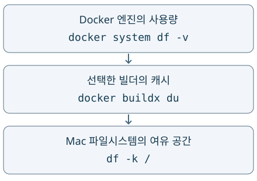

Docker가 표시하는 회수 가능 용량과 Mac의 여유 공간은 서로 다른 곳에서 잰 값입니다. Docker는 가상 머신 안의 이미지와 캐시를 집계합니다. macOS는 가상 머신의 디스크 이미지 `Docker.raw`에 실제로 할당한 공간까지 포함해 여유 공간을 계산합니다. 이미지와 공유하는 레이어는 빌드 캐시를 지워도 디스크에 남을 수 있습니다. [Docker Desktop FAQ](https://docs.docker.com/desktop/troubleshoot-and-support/faqs/macfaqs/) · [Buildx du](https://docs.docker.com/reference/cli/docker/buildx/du/)

## 어디에서 잰 숫자일까?

Mac에서 Docker Desktop을 실행하고 로컬 컨텍스트와 빌더를 확인하세요. 빌더 목록에서 별표가 붙은 행이 현재 선택입니다.

```sh
docker context show
docker buildx ls
docker system df -v
docker buildx du
df -k /
```



첫 번째 사용량 보고서는 이미지·컨테이너·볼륨·빌드 캐시를 다룹니다. 두 번째 보고서의 `Reclaimable`은 선택한 빌더에서 회수 가능한 캐시입니다. 마지막 명령의 `Available`은 Mac의 루트 파일시스템에서 쓸 수 있는 공간이며 단위는 KiB입니다. [Docker system df](https://docs.docker.com/reference/cli/docker/system/df/)

## Docker.raw는 실제로 얼마나 차지할까?

Docker Desktop의 Settings → Resources → Advanced에서 디스크 이미지 위치를 확인하고 아래 예시 경로를 실제 파일 경로에 맞추세요. `ls -klsh`의 첫 열은 할당량(KiB), 크기 열은 논리 크기입니다. 마지막 명령은 이미지가 다른 볼륨에 있을 때도 해당 파일시스템의 여유 공간을 보여줍니다.

```sh
image="$HOME/Library/Containers/com.docker.docker/Data/vms/0/data/Docker.raw"
ls -klsh "$image"
stat -f 'bytes=%z blocks=%b' "$image"
df -k "$image"
```

로컬 Mac의 `desktop-linux`에서 읽기 전용으로 확인한 빌드 캐시 회수 가능 용량은 61.76 MB였습니다. 디스크 이미지의 논리 크기는 63,999,836,160바이트, 실제 할당량은 12,272,488블록이었습니다. 블록당 512바이트로 약 6.28 GB입니다.

빌드 캐시만 정리할 때는 선택한 빌더를 먼저 확인하세요. 정리 직전과 몇 분 뒤에 같은 명령을 실행해 비교할 수 있습니다. 이번 확인에서는 캐시를 삭제하지 않아 Mac에 실제로 돌아온 용량은 측정하지 않았습니다. [Buildx prune](https://docs.docker.com/reference/cli/docker/buildx/prune/)

[관련 글 · du와 df로 확인한 Mac 디스크 정리](../2026-11-27-mac-disk-cleanup-du-df/)
