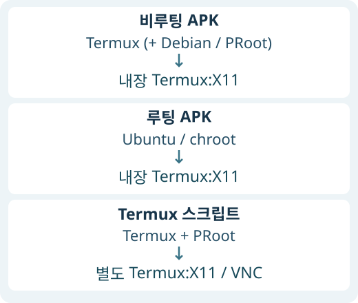

---
{
  "kind": "post",
  "publishedAt": "2026-11-27T06:08:31Z",
  "language": "ko",
  "translationKey": "2026-11-27-droiddesk-android-linux-desktop",
  "routeSlug": "2026-11-27-droiddesk-android-linux-desktop",
  "title": "DroidDesk 살펴보기 · 안드로이드 폰에서 리눅스 데스크톱은 어떻게 돌아갈까?",
  "description": "독립 APK와 Termux 설치 스크립트의 실행 환경과 화면 출력 방식을 비교하고, 내 폰에서 먼저 확인할 작업을 살펴봅니다.",
  "categories": [
    "tips"
  ],
  "tags": [
    "android",
    "linux",
    "termux"
  ],
  "reviewScope": "이 글은 2026년 11월 27일 기준으로 확인한 orailnoor/DroidDesk v1.3.1의 릴리스와 소스 코드를 바탕으로 작성했습니다. APK를 실기기에 설치하거나 앱별 성능을 측정하지는 않았습니다.",
  "reviewSources": [
    "https://github.com/orailnoor/DroidDesk/releases/tag/v1.3.1",
    "https://github.com/orailnoor/DroidDesk/blob/v1.3.1/README.md",
    "https://github.com/orailnoor/DroidDesk/blob/v1.3.1/app/android/app/src/main/kotlin/com/orailnoor/droiddesk/runtime/LinuxRuntime.kt",
    "https://github.com/orailnoor/DroidDesk/blob/v1.3.1/app/android/app/src/main/kotlin/com/orailnoor/droiddesk/runtime/ChrootRuntime.kt",
    "https://github.com/orailnoor/DroidDesk/blob/v1.3.1/app/android/app/build.gradle.kts",
    "https://github.com/orailnoor/DroidDesk/blob/v1.3.1/README.md#for-monitor-output--optional-",
    "https://github.com/termux/proot-distro#limitations"
  ]
}
---

안 쓰는 안드로이드 폰에 키보드를 연결하고, 리눅스용 편집기와 브라우저를 띄워 작업할 수 있을까요? DroidDesk는 안드로이드 위에서 리눅스 데스크톱을 실행하는 오픈소스 프로젝트입니다. 설치 방식을 고르기 전에 알아둘 점이 하나 있습니다. 독립 APK와 Termux 설치 스크립트는 서로 다른 실행 경로를 사용합니다.

이 글은 2026년 11월 27일 기준으로 확인한 orailnoor/DroidDesk v1.3.1의 릴리스와 소스 코드를 바탕으로 작성했습니다. APK를 실기기에 설치하거나 앱별 성능을 측정하지는 않았습니다. [릴리스 노트](https://github.com/orailnoor/DroidDesk/releases/tag/v1.3.1)

## APK와 Termux 스크립트는 어떻게 다를까?

| 설치 방식 | 실행 환경 | 화면 출력 |
| --- | --- | --- |
| 독립 APK · 비루팅 | 앱 내부 Termux 기본 데스크톱 + 선택형 Debian/PRoot | 앱 내장 Termux:X11 |
| 독립 APK · 루팅 | ARM64 Ubuntu 파일시스템을 chroot에서 실행 | 앱 내장 Termux:X11 |
| Termux 설치 스크립트 | 별도 Termux, 배포판 패키지용 PRoot | 별도 Termux:X11 앱 또는 선택형 VNC |

README는 비루팅 APK에서 PRoot를 사용하지 않는다고 설명합니다. 기본 데스크톱은 그 설명대로 Termux에서 바로 실행됩니다. 다만 v1.3.1의 LinuxRuntime에는 선택형 Debian 설치와 PRoot 실행기도 들어 있습니다. 같은 앱 안에서도 기본 데스크톱에서 실행하는 프로그램과 Debian 안에서 실행하는 프로그램의 조건이 달라질 수 있습니다. [README](https://github.com/orailnoor/DroidDesk/blob/v1.3.1/README.md) · [LinuxRuntime](https://github.com/orailnoor/DroidDesk/blob/v1.3.1/app/android/app/src/main/kotlin/com/orailnoor/droiddesk/runtime/LinuxRuntime.kt) · [ChrootRuntime](https://github.com/orailnoor/DroidDesk/blob/v1.3.1/app/android/app/src/main/kotlin/com/orailnoor/droiddesk/runtime/ChrootRuntime.kt)

## 내 폰에서 어디까지 쓸 수 있을까?

먼저 필요한 프로그램 하나를 기준으로 판단하는 게 좋습니다. 프로젝트는 Firefox, LibreOffice, VS Code 등을 실행 사례로 소개합니다. 한편 v1.3.1 릴리스에는 Firefox에 필요한 패키지와 VS Code 등의 설치·실행 오류를 수정했다는 기록도 있습니다. 편집기 아이콘이 뜨는 것과 매일 쓰는 확장·입력기·파일 경로까지 작동하는 것은 서로 다른 확인 항목입니다. [릴리스 노트](https://github.com/orailnoor/DroidDesk/releases/tag/v1.3.1)

그래픽 작업도 기기별로 차이가 날 수 있습니다. 소스에는 Adreno용 Turnip과 Zink를 사용하는 경로와, 소프트웨어로 렌더링하는 llvmpipe 경로가 있습니다. Blender처럼 그래픽 부하가 큰 앱을 쓰려면 실행 여부보다 내 기기에서 가속이 잡히는지, 실제 작업이 매끄러운지가 중요합니다. PRoot에서 빌드할 계획이라면 파일 접근이 많은 작업에 오버헤드가 생길 수 있다는 점도 고려해야 합니다. [PRoot의 제약](https://github.com/termux/proot-distro#limitations)

외부 모니터를 쓰려면 폰이 USB-C 영상 출력을 지원하는지 먼저 확인하세요. 프로젝트 문서의 Raspberry Pi 연결 방식은 Termux 스크립트가 제공하는 VNC 세션을 Pi에서 받아 모니터에 띄우는 구성입니다. 독립 APK의 내장 X11 화면과는 연결 방식이 다릅니다. [모니터 연결](https://github.com/orailnoor/DroidDesk/blob/v1.3.1/README.md#for-monitor-output--optional-)

## 처음 써본다면 어떤 작업으로 확인할까?

ARM64 안드로이드 기기에서 시작한다면, 저장소의 공식 릴리스 페이지에서 APK를 확인하고 폰 화면에서 먼저 테스트해 보세요. 예를 들어 편집기에서 한국어 파일을 작성하고, 저장한 뒤 세션을 다시 열어 같은 파일을 불러오는 식입니다. 여기까지 된다면 키보드·마우스나 외부 모니터를 연결해 평소 작업을 이어가 보면 됩니다. DroidDesk의 매력은 이미 가진 폰에서 리눅스 도구를 어디까지 쓸 수 있는지 시험해 볼 수 있다는 데 있습니다. 문서 편집이 목적이면 입력과 저장, 개발이 목적이면 필요한 패키지와 확장, 그래픽 작업이 목적이면 가속과 화면 반응부터 확인하면 내 환경에 맞는지 판단하기 쉽습니다. [Android 빌드 설정](https://github.com/orailnoor/DroidDesk/blob/v1.3.1/app/android/app/build.gradle.kts)

[Mac에서 Docker Desktop의 디스크 사용량 확인하기](../2026-11-27-docker-desktop-mac-disk-space/)
