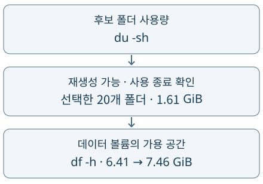

디스크 공간이 부족해 Mac에서 PostgreSQL 작업 큐 글의 전체 빌드를 끝내지 못했습니다. 원격 검사는 통과했고 GitHub Pages 배포도 성공했습니다. 앞서 다른 작업자가 보고한 `hostFault`가 이번 디스크 부족과 같은 사건인지는 확인되지 않았습니다. [게시 PR #202](https://github.com/youdozi/youdozi.github.io/pull/202)

## 어떤 폴더를 정리했나

별도로 수동 정리를 하면서 이미 끝난 작업에서 다시 만들 수 있는 폴더만 골랐습니다. 빌드가 만든 `dist`와 `.astro`, 일회성 검증에 쓴 의존성 폴더와 빌드 폴더를 합쳐 20개였습니다. 실행 중인 작업이 쓰는 경로는 제외했습니다.

아래는 두 빌드 폴더가 있는 macOS의 Git 저장소 루트에서 실행할 수 있는 읽기 전용 예시입니다. `du`는 지정한 경로별 사용량을 보여 줍니다. `git ls-files`는 그 안에서 Git이 추적하는 파일을, `git check-ignore`는 무시 규칙이 적용되는 경로를 보여 줍니다.

```sh
du -sh ./dist ./.astro
git ls-files -- dist .astro
git check-ignore -- dist .astro
```

Git이 무시하는 경로에도 작업 중인 파일이 있을 수 있습니다. 각 폴더를 다시 만들 수 있는지, 지금 사용하는 작업이 없는지 따로 확인한 뒤 정리 대상을 정했습니다.

## 얼마나 여유가 생겼나



선택한 폴더의 사용량 합계는 1.61 GiB였습니다. 정리 전후에 같은 데이터 볼륨을 확인하니 가용 공간은 6.41 GiB에서 7.46 GiB로 약 1.05 GiB 늘었습니다.

아래 명령의 `Avail` 열을 전후로 비교하면 됩니다. `df`는 지정한 경로가 속한 파일시스템의 가용 공간을 보여 줍니다. APFS에서는 한 컨테이너 안의 여러 볼륨이 남은 공간을 공유할 수 있습니다. 이번에 폴더 사용량 합계와 가용 공간 증가량이 달랐던 원인은 확인하지 못했습니다. [Apple의 APFS 공간 공유 설명](https://support.apple.com/ko-kr/guide/security/seca6147599e/web)

```sh
df -h /System/Volumes/Data
```
