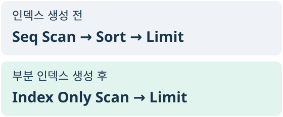

작업 300,000건 중 297,000건은 완료됐고 3,000건만 대기 중입니다. 이 큐에서 가장 오래된 대기 작업 20건을 찾을 때, 대기 행만 생성 시각과 ID 순으로 담은 부분 인덱스를 만들자 실행 계획에서 정렬 단계가 사라졌습니다.

## 같은 조회를 두 번 실행하기

빈 데이터베이스에서 아래 SQL을 순서대로 실행합니다. `ANALYZE`가 테이블 통계를 갱신합니다. 두 조회 사이에 추가하는 인덱스는 `status = 'pending'`을 만족하는 행만 담습니다. [부분 인덱스](https://www.postgresql.org/docs/19/indexes-partial.html)

```sql
CREATE TABLE jobs (id bigserial PRIMARY KEY, status text NOT NULL, created_at timestamptz NOT NULL);
INSERT INTO jobs (status, created_at)
SELECT CASE WHEN n % 100 = 0 THEN 'pending' ELSE 'done' END,
       timestamptz '2026-01-01 00:00:00+00' + n * interval '1 second'
FROM generate_series(1, 300000) AS g(n);
ANALYZE jobs;

EXPLAIN (ANALYZE, BUFFERS) SELECT id FROM jobs WHERE status = 'pending' ORDER BY created_at, id LIMIT 20;

CREATE INDEX jobs_pending_created_idx ON jobs (created_at, id) WHERE status = 'pending';

EXPLAIN (ANALYZE, BUFFERS) SELECT id FROM jobs WHERE status = 'pending' ORDER BY created_at, id LIMIT 20;
```

## 두 실행 계획에서 달라진 점



전체 테이블을 훑어 완료 행을 걸러낸 뒤 남은 후보를 정렬합니다. 인덱스를 만들면 `(created_at, id)` 순서로 대기 작업을 읽을 수 있어 `LIMIT 20`에 도달하는 순간 멈춥니다.

| 실행 계획 | 인덱스 생성 전 | 부분 인덱스 생성 후 |
| --- | --- | --- |
| 최상위 노드의 공유 버퍼 | `shared hit=1911` | `shared hit=1 read=2` |
| 스캔 노드에서 관측한 값 | `Rows Removed by Filter=297000` | `Heap Fetches=0` |
| 반환 행 수 | 20 | 20 |

격리된 인메모리 PGlite에서 각 조회를 한 번씩 실행한 결과입니다. 패키지는 `@electric-sql/pglite 0.6.0`이었고 `SHOW server_version`은 `19.0`을 반환했습니다. 여기서 `read`는 PostgreSQL이 공유 버퍼로 읽어 들인 블록 수입니다. 이 값만으로 물리 디스크 I/O를 계산할 수 없습니다. [EXPLAIN](https://www.postgresql.org/docs/19/sql-explain.html) · [PGlite](https://pglite.dev/docs/about)

이 실험은 읽기 쿼리만 측정했습니다. `FOR UPDATE SKIP LOCKED`로 작업을 선점하거나 상태를 갱신하는 비용, 워커가 동시에 실행될 때의 동작은 별도로 측정해야 합니다. [두 세션에서 SKIP LOCKED로 작업 가져오기](/ko/posts/2026-11-26-postgres-skip-locked-queue/)
