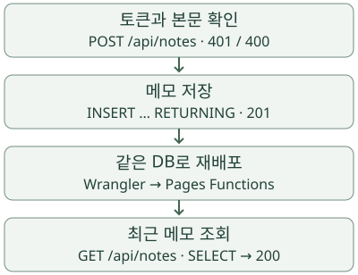

---
{
  "kind": "post",
  "publishedAt": "2026-11-28T14:00:00Z",
  "routeSlug": "2026-11-28-cloudflare-workers-neon-notes",
  "reviewedAt": "2026-11-28",
  "reviewStatus": "source-audited",
  "reviewSources": [
    "https://developers.cloudflare.com/pages/functions/get-started/",
    "https://developers.cloudflare.com/pages/functions/routing/",
    "https://neon.com/docs/serverless/serverless-driver",
    "https://developers.cloudflare.com/pages/get-started/direct-upload/",
    "https://developers.cloudflare.com/pages/functions/bindings/#secrets"
  ],
  "reviewScope": "공식 문서로 라우팅과 배포 환경, SQL 매개변수 전달 방식을 대조했다. 실제 서비스 배포 응답은 측정하지 않았다.",
  "language": "ko",
  "translationKey": "2026-11-28-cloudflare-workers-neon-notes",
  "title": "Cloudflare Workers와 Neon으로 메모 앱 배포하기",
  "description": "Cloudflare Pages에서 화면과 API를 같은 주소로 제공하고, 재배포한 API가 Neon에 저장된 메모를 다시 읽는지 확인한다.",
  "categories": [
    "tips"
  ],
  "tags": [
    "cloudflare",
    "neon",
    "postgresql"
  ]
}
---

정적 화면은 Cloudflare Pages에 올리고, `/api/notes`는 Workers 런타임에서 실행되는 Pages Functions로 처리한다. 화면과 API의 출처가 같아 브라우저에서 별도 CORS 설정 없이 메모 목록을 읽을 수 있다. 메모는 Neon PostgreSQL에 저장한다. [Pages Functions](https://developers.cloudflare.com/pages/functions/get-started/)

누구나 목록을 읽을 수 있고, 쓰려면 토큰이 필요하다. 연습용 메모만 저장한다. 아래 응답은 배포 후 확인할 예상 결과다.

## 메모 테이블과 API 만들기

연습용 Neon 데이터베이스의 SQL Editor에서 메모 테이블을 만든다.

```sql
CREATE TABLE notes (
  id integer GENERATED ALWAYS AS IDENTITY PRIMARY KEY,
  body text NOT NULL CHECK (char_length(body) BETWEEN 1 AND 200)
);
```

Node.js와 npm이 설치된 환경에서 프로젝트 루트를 열고 다음 명령을 실행한다.

```bash
npm init -y
npm install @neondatabase/serverless
npm install --save-dev wrangler
mkdir -p functions/api public
```

프로젝트 루트의 `functions/api/notes.js`에 아래 코드를 넣는다. Neon 드라이버의 태그 템플릿은 메모 본문을 SQL 매개변수로 전달한다. [Pages Functions](https://developers.cloudflare.com/pages/functions/routing/) · [Neon](https://neon.com/docs/serverless/serverless-driver)

```js
import { neon } from "@neondatabase/serverless";

export async function onRequest({ request, env }) {
  const reply = (data, status = 200) =>
    Response.json(data, {
      status,
      headers: { "Cache-Control": "no-store" },
    });

  if (request.method === "POST") {
    if (
      !env.DEMO_WRITE_TOKEN ||
      request.headers.get("Authorization") !== `Bearer ${env.DEMO_WRITE_TOKEN}`
    ) {
      return reply({ error: "Unauthorized" }, 401);
    }

    const input = await request.json().catch(() => null);
    const body = typeof input?.body === "string" ? input.body.trim() : "";

    if (!body || Array.from(body).length > 200) {
      return reply({ error: "Enter a note of 1 to 200 characters" }, 400);
    }

    const sql = neon(env.DATABASE_URL);
    const [note] = await sql`
      INSERT INTO notes (body) VALUES (${body}) RETURNING id, body
    `;
    return reply(note, 201);
  }

  if (request.method === "GET") {
    const sql = neon(env.DATABASE_URL);
    const notes = await sql`
      SELECT id, body FROM notes ORDER BY id DESC LIMIT 20
    `;
    return reply(notes);
  }

  return new Response(null, {
    status: 405,
    headers: { Allow: "GET, POST" },
  });
}
```

`public/index.html`은 목록을 읽어 각 메모의 본문을 `textContent`로 표시한다.

```html
<!doctype html>
<html lang="ko">
<meta charset="utf-8">
<title>메모 목록</title>
<h1>메모 목록</h1>
<pre id="notes">불러오는 중…</pre>
<script type="module">
  const output = document.querySelector("#notes");
  try {
    const response = await fetch("/api/notes");
    if (!response.ok) throw new Error();
    const notes = await response.json();
    output.textContent = notes.map((note) => note.body).join("\n") || "메모 없음";
  } catch {
    output.textContent = "메모를 불러오지 못했습니다.";
  }
</script>
</html>
```

## 배포 후 같은 메모를 다시 읽기



Wrangler에 로그인한 뒤 Pages Direct Upload 프로젝트를 만든다. 예시의 프로젝트 이름을 실제 사용할 이름으로 바꾼다. 여기서는 운영 브랜치를 `main`으로 지정한다.

```bash
PROJECT_NAME="my-neon-notes"
npx wrangler login
npx wrangler pages project create "$PROJECT_NAME" --production-branch main
```

Pages 프로젝트의 Production 환경에 Neon 연결 문자열 `DATABASE_URL`과 길고 무작위로 생성한 `DEMO_WRITE_TOKEN`을 시크릿으로 저장한다. 프로젝트 루트에서 배포하면 Wrangler가 화면과 함께 Functions도 빌드한다. 다른 브랜치로 배포하면 Preview 환경의 시크릿이 적용된다. [Direct Upload](https://developers.cloudflare.com/pages/get-started/direct-upload/) · [Pages Secrets](https://developers.cloudflare.com/pages/functions/bindings/#secrets)

```bash
npx wrangler pages deploy public --project-name "$PROJECT_NAME" --branch main
```

셸에서 `BASE_URL`을 프로젝트의 운영 주소로, `DEMO_WRITE_TOKEN`을 같은 쓰기 토큰으로 설정한 뒤 요청을 보낸다.

```bash
curl -i "$BASE_URL/api/notes" \
  -H "Authorization: Bearer $DEMO_WRITE_TOKEN" \
  -H "Content-Type: application/json" \
  --data '{"body":"재배포 후에도 남아야 하는 메모"}'

curl -i "$BASE_URL/api/notes"
```

저장 응답에서 201과 메모 id를 확인한다. 같은 데이터베이스를 연결한 채 같은 프로젝트와 운영 브랜치에 다시 배포하고 조회 명령을 반복한다. 200과 같은 id·본문이 돌아오면 새 API가 기존 메모를 읽은 것이다. 브라우저에서도 메모가 보이는지, 토큰 없는 쓰기 요청은 401을 반환하는지 확인한다.

[무료 배포 환경 비교](../2026-11-28-free-deployment-guide/) · [메모 앱 셀프호스팅](../2026-11-28-self-hosting-ai-notes/)
