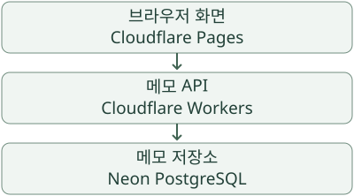

---
{
  "kind": "post",
  "publishedAt": "2026-11-28T07:52:00Z",
  "routeSlug": "2026-11-28-free-deployment-guide",
  "reviewedAt": "2026-11-28",
  "reviewStatus": "source-audited",
  "reviewSources": [
    "https://docs.github.com/en/pages/getting-started-with-github-pages/github-pages-limits",
    "https://developers.cloudflare.com/pages/platform/limits/",
    "https://developers.cloudflare.com/pages/functions/pricing/",
    "https://vercel.com/docs/plans/hobby",
    "https://vercel.com/docs/limits/fair-use-guidelines",
    "https://vercel.com/pricing",
    "https://developers.cloudflare.com/workers/platform/limits/",
    "https://render.com/docs/free",
    "https://render.com/docs/free#local-files-lost-on-redeploy",
    "https://neon.com/pricing",
    "https://supabase.com/pricing",
    "https://supabase.com/docs/guides/platform/free-project-pausing",
    "https://render.com/docs/free#free-postgres",
    "https://supabase.com/docs/guides/getting-started/api-keys",
    "https://supabase.com/docs/guides/database/postgres/row-level-security"
  ],
  "reviewScope": "공식 문서와 요금표로 한도와 휴면 조건을 확인했다. 서비스 가입, 예제 배포, 응답 시간 측정은 수행하지 않았다.",
  "language": "ko",
  "translationKey": "2026-11-28-free-deployment-guide",
  "title": "무료 배포 환경 비교 — 정적 사이트, 백엔드 API, PostgreSQL은 어디에 올릴까?",
  "description": "블로그, 메모 앱, 데모의 무료 배포 환경을 빌드 한도와 유휴 상태의 첫 요청, 데이터 보관 기한으로 비교한다.",
  "categories": [
    "tips"
  ],
  "tags": [
    "deployment",
    "hosting",
    "postgresql"
  ]
}
---

블로그나 포트폴리오는 **GitHub Pages 또는 Cloudflare Pages**로 배포할 수 있다. 메모를 저장하는 기능까지 필요하면 **Cloudflare Workers 또는 Render**에서 API를 실행하고, 데이터는 **Neon 또는 Supabase**의 PostgreSQL에 저장하는 구성을 고려할 수 있다. 과제나 데모처럼 종료일이 정해져 있다면 30일 동안 쓸 수 있는 Render Postgres도 선택지다.

같은 무료 플랜이라도 한도를 넘겼을 때 생기는 일은 다르다. 정적 사이트는 새 빌드가 막힐 수 있고, API는 유휴 상태에서 첫 응답이 늦어질 수 있다. 데이터베이스는 다음 요청에 자동으로 깨어나기도 하고, 대시보드에서 직접 재개해야 하기도 한다.

*2026년 11월 28일 공식 문서와 요금표 기준. 아래 조합은 구성 예시이며, 서비스 가입, 실제 배포나 응답 시간 측정은 수행하지 않았다.*

## 정적 사이트는 빌드 결과물을 올린다

Astro 블로그나 HTML 포트폴리오처럼 빌드 시점에 페이지가 만들어진다면 정적 호스팅만으로 공개할 수 있다. 플랫폼을 고를 때는 배포 파일 크기, 빌드 빈도, 사이트의 용도를 본다.

| 서비스 | 어떤 프로젝트에 맞나 | 무료 플랜에서 확인할 조건 |
| --- | --- | --- |
| GitHub Pages | 공개 저장소의 블로그, 프로젝트 문서, 포트폴리오 | 게시 사이트 최대 1 GB, 월 대역폭 소프트 한도 100 GB. 전자상거래 운영이나 상용 SaaS 제공이 주목적인 사이트에는 용도 제한이 있다. [GitHub Pages 한도](https://docs.github.com/en/pages/getting-started-with-github-pages/github-pages-limits) |
| Cloudflare Pages | Astro·Vite 정적 사이트, 브랜치별 미리보기가 필요한 프로젝트 | 월 500회 빌드, 동시 빌드 1개, 단일 파일 최대 25 MiB. Functions를 호출하지 않는 정적 파일 요청에는 요청량 한도가 없다. [Pages 한도](https://developers.cloudflare.com/pages/platform/limits/) · [정적 파일과 Functions 과금](https://developers.cloudflare.com/pages/functions/pricing/) |
| Vercel Hobby | Next.js를 쓰는 개인 비상업 프로젝트 | 정적 페이지와 Functions를 한 프로젝트에 배포할 수 있다. Hobby의 용도 제한과 Functions 사용량을 함께 확인한다. [Hobby 플랜](https://vercel.com/docs/plans/hobby) · [공정 사용 지침](https://vercel.com/docs/limits/fair-use-guidelines) · [Vercel 요금표](https://vercel.com/pricing) |

이 블로그처럼 글을 미리 빌드해 게시한다면 GitHub Pages로 시작하기 쉽다. 빌드와 실제 게시 단계를 어떻게 나눴는지는 기존 글에 정리했다. [Jekyll 자동 게시에서 Astro Draft PR 검토로 전환하기](../2026-04-07-jekyll-github-actions-content-pipeline/)

## 백엔드 API는 실행 방식부터 고른다

| 서비스 | 어떤 API에 맞나 | 무료 플랜에서 확인할 조건 |
| --- | --- | --- |
| Cloudflare Workers | 입력을 검증하고 DB를 조회한 뒤 JSON을 반환하는 가벼운 HTTP API | 하루 요청 10만 건, 요청당 CPU 시간 10 ms. CPU 시간은 네트워크 응답을 기다리는 시간을 제외한 코드 실행 시간이다. Pages Functions도 같은 Workers 무료 요청량을 사용한다. [Workers 한도](https://developers.cloudflare.com/workers/platform/limits/) · [Pages Functions 과금](https://developers.cloudflare.com/pages/functions/pricing/) |
| Render Free Web Service | FastAPI나 Express처럼 HTTP 서버 프로세스를 띄우는 데모 | 들어오는 트래픽이 15분 동안 없으면 서버가 내려간다. 다음 요청에 다시 시작하며 Render 안내 기준 약 1분이 걸린다. 무료 인스턴스 시간은 워크스페이스당 월 750시간이고, 재시작·재배포·절전 시 로컬 파일 변경분이 사라진다. [Render 무료 배포](https://render.com/docs/free) |

앞서 만든 Python 메모 앱을 Render에 올리는 경우를 생각해 보자. `GET /health`가 정상 응답하더라도 로컬 SQLite 파일에 쓴 메모는 서버가 절전 상태에 들어갔다가 다시 시작하면 사라질 수 있다. 메모를 계속 보관하려면 저장 경로를 외부 PostgreSQL로 옮기고, 재시작 뒤에도 같은 메모가 조회되는지 확인한다. [AI로 만든 메모 앱 셀프호스팅](../2026-11-28-self-hosting-ai-notes/) · [Render 파일시스템 정책](https://render.com/docs/free#local-files-lost-on-redeploy)

## PostgreSQL은 용량과 휴면 조건을 함께 본다

| 서비스 | 무료 범위 | 한동안 사용하지 않으면 |
| --- | --- | --- |
| Neon Free | 프로젝트당 PostgreSQL 저장 공간 1 GB, 컴퓨트 월 100 CU-hours | 5분간 유휴 상태면 컴퓨트가 멈추고 다음 쿼리에 자동으로 깨어난다. 월 컴퓨트 한도를 소진하면 다음 사용 기간까지 또는 업그레이드할 때까지 컴퓨트가 중단된다. [Neon 요금표](https://neon.com/pricing) |
| Supabase Free | 프로젝트당 DB 용량 500 MB 포함. 관리형 PostgreSQL과 Auth, Data API를 함께 제공 | 7일간 DB 활동이 적으면 프로젝트가 일시중지될 수 있다. 중지 상태에서는 대시보드에서 프로젝트를 재개한다. [Supabase 요금표](https://supabase.com/pricing) · [프로젝트 일시중지 정책](https://supabase.com/docs/guides/platform/free-project-pausing) |
| Render Free Postgres | 워크스페이스당 무료 DB 1개, 저장 공간 1 GB | 활동 여부와 관계없이 생성 30일 뒤 만료된다. 만료 후 14일 안에 유료로 전환하지 않으면 데이터가 삭제된다. [Render 무료 PostgreSQL](https://render.com/docs/free#free-postgres) |

별도 API 서버를 만들어 SQL을 직접 다룰 계획이라면 Neon부터 검토하기 쉽다. 로그인과 데이터 조회 API도 함께 필요하다면 Supabase를 고려할 수 있다. 브라우저에서 Supabase Data API를 호출할 때는 공개용 키를 사용하고, 사용자가 볼 수 있는 행과 쓸 수 있는 행을 RLS 정책으로 제한한다. DB 연결 문자열과 관리자용 비밀 키는 서버에 둔다. [Supabase API 키](https://supabase.com/docs/guides/getting-started/api-keys) · [행 수준 보안](https://supabase.com/docs/guides/database/postgres/row-level-security)

## 프로젝트별로 조합하기

- **기술 블로그나 문서 사이트**는 GitHub Pages 또는 Cloudflare Pages에 빌드 결과물만 배포한다.
- **가벼운 메모 앱**은 Cloudflare Pages에 화면을, Workers에 API를, Neon에 데이터를 둔다. 오래 쉬었다가 들어왔을 때 첫 조회가 끝날 때까지 화면에 로딩 상태를 표시한다.
- **기존 Python API를 공개하는 데모**는 Render에 서버를, Neon에 데이터를 둔다. 데모 전에 유휴 상태에서 첫 요청이 돌아오는 시간과 재배포 후 데이터가 남는지를 확인한다.
- **로그인이 있는 개인 프로젝트**는 Cloudflare Pages에 화면을 배포하고 Supabase Auth와 Data API를 연결할 수 있다. 두 계정으로 로그인해 서로의 메모를 읽거나 수정할 수 없는지 확인한다.

배포를 마쳤다면 첫 화면이 뜨는지에 더해 **새 데이터를 한 건 저장하고, API를 재배포한 뒤 같은 데이터를 다시 읽어보자.** 시연이 끝난 뒤에도 필요한 데이터라면 무료 플랜의 만료일과 내보내기 방법도 그때 함께 확인해 두는 편이 좋다.
